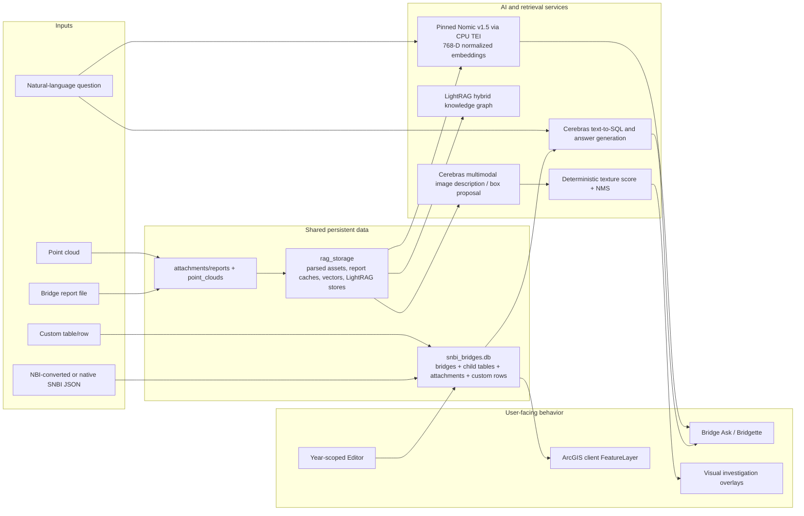
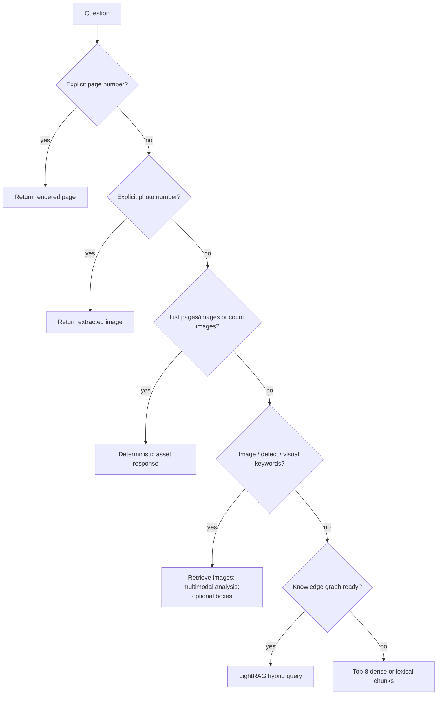
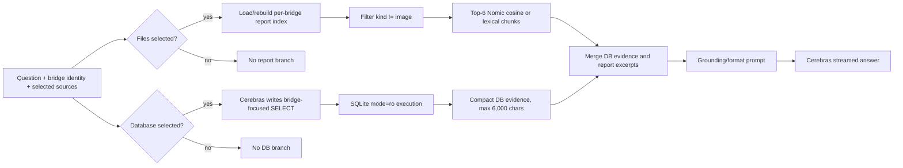
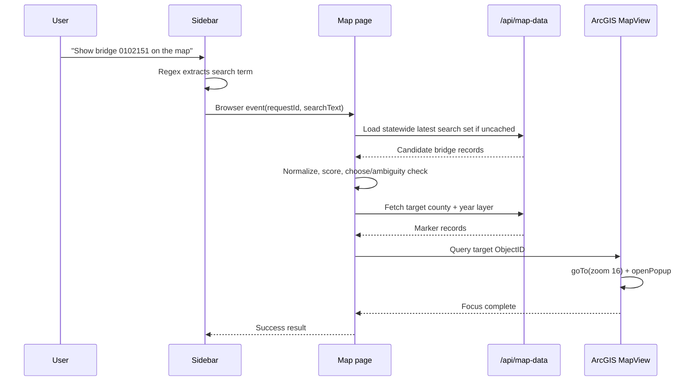
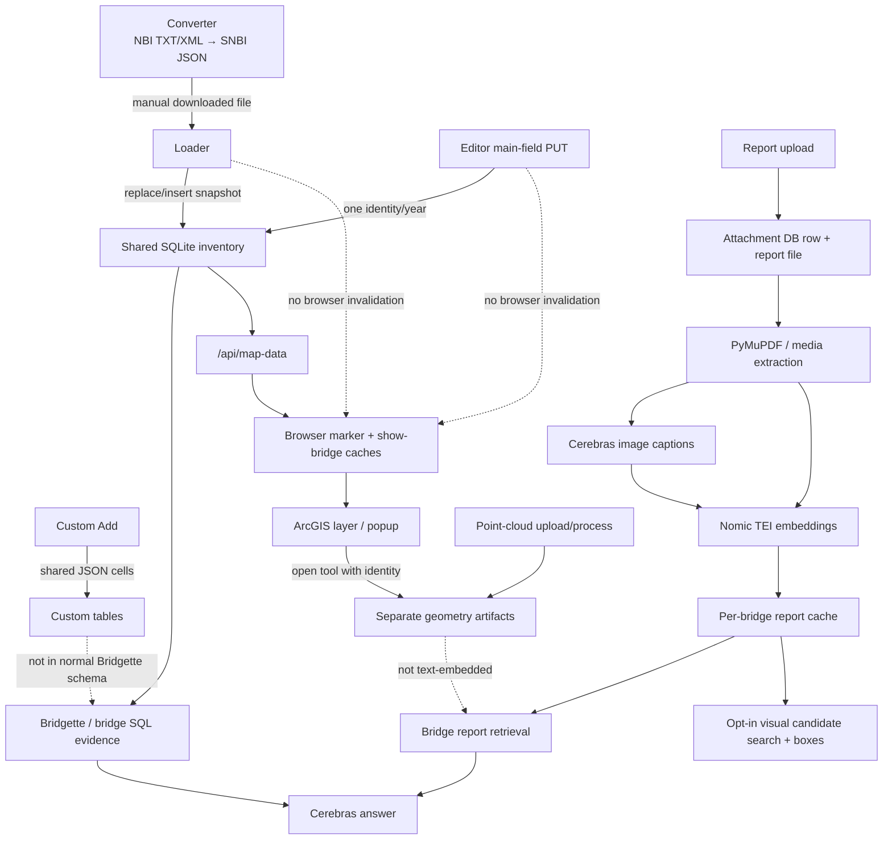

# BridgeGuard Ask, Edit, Add, and Map

## A code-traced study of document parsing, indexing, retrieval, visual investigation, database mutation, and map interaction

**Repository examined:** BridgeGuard remote application  
**Code revision examined:** `8f4d00244c76a43c112380c1e26a65e01112462f`  
**Audit date:** 2026-08-11  
**Document status:** implementation study and research-oriented technical report; not an FHWA approval, bridge-inspection determination, security certification, or model-validation report

---

## Abstract

This report reconstructs the implemented behavior of four closely related BridgeGuard feature families: **Ask**, **Edit**, **Add**, and **Map**. The main emphasis is Ask, because the user interface presents several experiences that look conversational but use materially different computational paths. Full-page Bridgette and sidebar Bridgette translate natural language into SQLite; bridge-scoped Ask retrieves both live database evidence and text from files attached to one bridge; the standalone Vision tool builds a document index and may use a LightRAG knowledge graph; and the explicit **Visual investigation** checkbox runs a separate image-selection and defect-boxing workflow. Treating all four as a single “RAG agent” would conceal important differences in provenance, state, access control, failure behavior, and validation needs.

The implemented generation provider is a server-selected Cerebras model. Text embeddings are not generated by Cerebras and are not served by Ollama: a CPU-capable Hugging Face Text Embeddings Inference (TEI) sidecar serves the exact pinned `nomic-ai/nomic-embed-text-v1.5` revision in a 768-dimensional vector space. Indexed passages receive Nomic’s `search_document:` prefix; questions receive `search_query:`. Cache compatibility is guarded by the complete embedding profile, so vectors produced by another model, revision, dimension, runtime, pooling rule, or prefix policy are rejected rather than silently mixed.

The study finds that the principal pipeline is functional and thoughtfully separates normal Ask from opt-in raw-image inspection. It also finds important limits. Uploaded office, text, and CSV extensions are accepted more broadly than their contents are actually parsed; the normal per-bridge report pipeline loses PDF page provenance for text; there is no OCR path for image-only text; visual “segmentation” is generated bounding boxes plus a lightweight texture heuristic, not a trained pixel-level segmentation model; generated bridge-scoped SQL is read-only but its bridge predicate is not programmatically verified; citations are labels rather than cryptographically or text-span-verified evidence; and cancellation, active-document state, caches, attachment storage, and databases are shared rather than user- or tenant-scoped. On the map, “show me bridge …” is deterministic client-side event routing—not an LLM tool call—and it searches a cached latest-record dataset before switching the map to the selected bridge’s county and year.

The report documents exact inputs, outputs, algorithms, equations, storage artifacts, role gates, state transitions, edge cases, empirical local-data observations, and a validation roadmap suitable for a research paper or engineering design review.

---

## 1. Research questions

This audit answers the following questions.

1. What does “Ask” mean in each BridgeGuard surface?
2. How are uploaded reports parsed, chunked, described, embedded, cached, and retrieved?
3. Which model performs generation, which model performs embedding, and how is vector compatibility enforced?
4. What exactly happens when **Visual investigation** is checked, and can it run when the checkbox is not checked?
5. How are answers grounded in the bridge database, and what does the text-to-SQL path guarantee or fail to guarantee?
6. What does **Add** mean across inventory loading, report upload, point-cloud attachment, and custom tables?
7. What does Edit modify, at what snapshot year, and when do Ask and Map observe the change?
8. How does “show me bridge” identify a bridge, change filters, zoom, and open the card?
9. How do access control, shared state, caching, and concurrency behave with several simultaneous users?
10. Which claims are supported by code, which are supported by external standards or research, and which require future empirical validation?

---

## 2. Scope, method, and evidentiary rules

### 2.1 Scope

The code-trace covers the React frontend, FastAPI routes, SQLite services, RAG and vision services, AI-provider adapter, deployment configuration, authentication middleware, and relevant tests. It includes four meanings of **Add** so the term is not left ambiguous:

- load a converted or native SNBI JSON snapshot into the inventory database;
- attach an inspection report to a bridge and index it for Ask;
- attach/process a point cloud, which is stored alongside but is not part of the text Ask index;
- create bridge/global custom-table definitions and rows.

The NBI-to-SNBI conversion rules themselves are treated in the companion report [`nbi-snbi-conversion-loader-bridgette.md`](./nbi-snbi-conversion-loader-bridgette.md). Forecasting, LCCA, and KPI logic are treated in [`forecasting-lcca-kpis-research-report.md`](./forecasting-lcca-kpis-research-report.md). This report describes where those records enter or interact with Ask and Map without duplicating every conversion or forecasting equation.

### 2.2 Method

The investigation used four evidence layers:

1. **Static code trace.** Every claimed implemented behavior was followed from UI event to HTTP route, service function, database or filesystem artifact, and response rendering.
2. **Configuration trace.** Provider identities, model revision, dimensions, prefixes, runtime image, persistence paths, limits, and authorization rules were traced through deployment and application configuration.
3. **Read-only local audit.** Aggregate counts and cache metadata were inspected without exposing report content or modifying the databases.
4. **Primary-source comparison.** The implementation was compared with official model cards and runtime documentation, ArcGIS and SQLite documentation, FHWA/eCFR material, OWASP guidance, NIST guidance, and original or peer-reviewed RAG/text-to-SQL research.

### 2.3 Claim labels

To prevent implementation facts from being confused with research conclusions:

- **Implemented** means directly established by the examined revision.
- **Observed locally** means measured in the repository’s data snapshot on 2026-08-11; it is not necessarily the production server state.
- **External requirement/guidance** means supported by the cited primary source.
- **Inference** means a reasoned interpretation and is identified as such.
- **Not validated** means the repository contains no adequate benchmark demonstrating the claim.

Line links are traceability anchors, not immutable identifiers; later commits may move the referenced lines.

---

## 3. The four systems hidden behind the word “Ask”

| Surface | Scope | Retrieval or execution | Uses report text | Uses raw images | Main output |
|---|---|---|---:|---:|---|
| Full-page Bridgette | Entire NJ inventory | LLM-generated read-only SQLite `SELECT`, then LLM summary | No | No | Answer, generated SQL, rows, columns, row count |
| Sidebar Bridgette | Entire NJ inventory, plus client map intent | Map command is intercepted in browser; other questions use the same text-to-SQL stream | No | No | Map action result or streamed SQL-grounded answer |
| Bridge-detail Ask | One bridge identity, selected DB/files | Generated bridge-focused SQL plus top report text/table chunks | Yes | No in normal mode | Streamed answer and source labels |
| Bridge-detail Visual investigation | One bridge and selected report files | Image-description similarity selects candidates; multimodal model proposes defect boxes; CV heuristic refines | Only indirectly in precomputed descriptions | Yes, only through its explicit endpoint | Detection summary and annotated images |
| Standalone Vision document | One content-hashed uploaded PDF/image | Regex router; LightRAG hybrid KG first for text; dense/lexical fallback; image/page routes for visual questions | Yes | Yes for visual routes | Context, page labels, optional images, then generated answer |
| Standalone database Vision | Selected database scope | Flattened database context plus lexical retrieval and generation | N/A | No | Grounded database response |

The critical design point is that **the bridge-detail checkbox does not merely add a flag to the normal answer**. When unchecked, the frontend calls the normal bridge Ask stream. When checked, it calls a different endpoint, `/api/bridge-visual-investigation`, and receives detection overlays rather than the combined DB/report-text answer. The normal bridge Ask function intentionally excludes image-description chunks from its retrieval set. This behavior is visible in [`BridgeDetailModal.tsx`](../frontend/src/components/BridgeDetailModal.tsx#L131-L364), [`vision.py`](../backend/app/routers/services/vision.py#L1380-L1594), and [`main.py`](../backend/app/main.py#L1607-L1694).

The standalone Vision tool is different: its router can infer an image-analysis path from terms such as “crack,” “corrosion,” “photo,” or “figure,” and its `force_defect_segmentation` checkbox can additionally force bounding-box analysis. Therefore the statement “vision runs only when checked” is true for the **bridge-detail Visual investigation control**, not for every document-Vision route in the application.

---

## 4. End-to-end architecture



The deployment intentionally contains **two model services with different jobs**:

- Cerebras performs text generation, SQL generation, answer summarization, technical image description, and proposed defect bounding boxes.
- A separately managed, CPU-compatible Hugging Face TEI service performs Nomic text embeddings.

There is no Ollama dependency in this path. The production Compose definition pins the CPU TEI container by immutable image digest and the model by Hub commit in [`deploy/oci/compose.yaml`](../deploy/oci/compose.yaml#L1-L51). The provider adapter is in [`llm_providers.py`](../backend/app/routers/services/llm_providers.py#L1-L634).

---

## 5. Data and storage model

### 5.1 Persistent roots

All principal artifacts default to `backend/data`, or to the directory selected by `BRIDGEGUARD_DATA_DIR`:

| Artifact | Default path | Purpose |
|---|---|---|
| Main inventory DB | `backend/data/snbi_bridges.db` | Yearly bridge snapshots, nested SNBI tables, attachments, custom data |
| Forecast DB | `backend/data/snbi_forecasts.db` | Forecast training/runs; not directly searched by Ask |
| Attachments | `backend/data/attachments` | Inspection reports and point clouds by bridge |
| RAG storage | `backend/data/rag_storage` | Parsed assets, report cache JSON, embeddings, document manifest, LightRAG storage |
| Exports | `backend/data/exports` | Converter/export output |
| Temporary files | `backend/data/temp` | Upload and conversion scratch space |

The path contract is centralized in [`datapaths.py`](../backend/app/routers/services/datapaths.py#L1-L49). Paths in attachment rows and newer caches are made relative to the data root where possible, improving portability across the laptop and remote server.

### 5.2 Identity and isolation

Inventory snapshots are keyed conceptually by `(state_code, bridge_number, data_year)`. Reports and point clouds are associated with `(state_code, bridge_number)` but not with a user, organization, tenant, or snapshot year. Report cache filenames are also bridge-scoped, not user-scoped. The same is true of the principal SQLite databases and RAG storage.

Consequently, authentication controls who may call a route, but it does not create per-user data partitions. An authorized editor’s load, edit, upload, or delete changes the shared corpus seen by other authorized users. Browser component state—selected sources, checkbox state, text typed into a modal—is local to that browser, while server data and caches are shared.

### 5.3 Attachment row

The `bridge_attachments` table stores:

```text
id, state_code, bridge_number, attachment_type,
filename, filepath, size_bytes, uploaded_at
```

It has no foreign key to a particular inventory snapshot, no uniqueness constraint preventing duplicate rows, no content hash, and no uploader/user column. See [`main.py`](../backend/app/main.py#L423-L439).

### 5.4 Report-index artifacts

For each bridge, the persisted report cache contains a file-set signature, parsed chunks, optional embedding matrix and exact embedding profile, image count, and page-render metadata. Generic document Vision uses a separate SHA-256 document manifest and profile-specific LightRAG storage. These are two related but distinct cache schemes.

---

## 6. AI provider and embedding-space contract

### 6.1 Generation

The default configured generation model in the examined revision is `gemma-4-31b`. The server ignores client model hints and obtains the model from `CEREBRAS_MODEL`. Text requests use a plain user message. Multimodal requests contain a text item plus one or more `image_url` data URLs. Temperature defaults to zero; generation retries transient rate-limit failures; streamed responses can close the underlying provider stream on cancellation. See [`llm_providers.py`](../backend/app/routers/services/llm_providers.py#L345-L484).

Cerebras currently lists Gemma 4 31B among dedicated-endpoint options for “Vision & document understanding,” but its shared/public catalog is separate and changes over time. Model availability must therefore be verified against the live account rather than inferred solely from the code default. The relevant official sources are the [Cerebras model-selection guide](https://inference-docs.cerebras.ai/models/choose-a-model), [supported-model overview](https://inference-docs.cerebras.ai/models/overview), and [model capability endpoint documentation](https://inference-docs.cerebras.ai/api-reference/models/public-models).

### 6.2 Exact embedding profile

The active profile is:

| Property | Implemented value |
|---|---|
| Provider | Hugging Face Text Embeddings Inference (`tei`) |
| Model | `nomic-ai/nomic-embed-text-v1.5` |
| Hub revision | `20d1e6057a2e1fa08b45123e41ce9381fc338f0e` |
| Runtime version | `1.9.3` |
| Dimension | `768` |
| Passage prefix | `search_document: ` |
| Query prefix | `search_query: ` |
| Pooling | mean |
| Output dtype | float32 |
| Normalization | enabled |
| Truncation | enabled, from the right |
| Deployment | pinned CPU TEI sidecar; no Ollama |

Nomic’s official model card states that a RAG corpus should use `search_document:` while user questions use `search_query:`, reports a native 768-dimensional representation and 8,192-token sequence length, and describes smaller Matryoshka dimensions as a supported trade-off. BridgeGuard uses the native 768 dimensions and persists the prefix policy as part of the vector identity. See the [Nomic v1.5 model card](https://huggingface.co/nomic-ai/nomic-embed-text-v1.5) and [TEI repository/API documentation](https://github.com/huggingface/text-embeddings-inference).

### 6.3 Why old and new vectors can coexist only after re-indexing

For a passage (d_i) and question (q), retrieval assumes both vectors occupy the same coordinate system:

\[
e_i = E_{M,R,P,D}(\texttt{search\_document: }d_i),
\qquad
e_q = E_{M,R,P,D}(\texttt{search\_query: }q)
\]

where (M) is model, (R) revision/runtime behavior, (P) pooling/prefix/normalization policy, and (D) dimension. Similarity is then:

\[
s(q,d_i)=\frac{e_q^T e_i}{\lVert e_q\rVert_2\lVert e_i\rVert_2}.
\]

Changing only the vector width is not enough to make another model compatible; two 768-dimensional models may still encode unrelated geometries. BridgeGuard therefore compares provider, model, revision, runtime, dimension, prefix policy, normalization, truncation, direction, dtype, and pooling. Missing legacy metadata is treated as incompatible. A compatible `(number_of_chunks, 768)` finite matrix is accepted; otherwise parsed chunks are retained and re-embedded with the active service, or lexical retrieval is used if TEI is unavailable. The enforcement is in [`llm_providers.py`](../backend/app/routers/services/llm_providers.py#L52-L107), [`rag_engine.py`](../backend/app/routers/services/rag_engine.py#L216-L268), and [`vision.py`](../backend/app/routers/services/vision.py#L941-L1017).

### 6.4 Readiness

The backend does more than ping TEI. `/info` must report the expected model ID, exact SHA, runtime version, float32 dtype, and mean pooling, after which a live probe must return the configured width. This prevents a healthy-but-wrong embedding container from serving a corrupt mixed index. See [`verify_embedding_backend`](../backend/app/routers/services/llm_providers.py#L562-L610).

---

## 7. Generic document ingestion: the standalone Vision pipeline

The standalone Vision document path is content-hash-scoped and should not be confused with bridge-attached report indexing. Its implementation is concentrated in [`rag_engine.py`](../backend/app/routers/services/rag_engine.py#L1-L1940), with HTTP routes in [`main.py`](../backend/app/main.py#L952-L1088) and UI state in [`Vision.tsx`](../frontend/src/pages/Vision.tsx).

### 7.1 Input contract

The visible standalone document selector accepts PDFs and common raster images. On upload, the API saves the file under the configured temporary directory and calculates a SHA-256 hash over the bytes. The hash is the generic index identity; re-uploading exactly the same content can reuse parsed material. The query-only route requires a `doc_hash`, which is safer than asking an unqualified global index, although internal helpers still contain a “last manifest item” fallback when no hash is supplied.

### 7.2 PDF extraction

For each PDF page, the pipeline performs three related operations:

1. `Page.get_text()` extracts the existing PDF text layer.
2. Embedded raster images are enumerated, filtered, deduplicated, extracted, and associated heuristically with nearby captions or photo numbers.
3. The complete page is rendered at 150 DPI so the UI can display it and the vision route has a flattened-page fallback.

The extraction code is in [`rag_engine.py`](../backend/app/routers/services/rag_engine.py#L333-L562). This design aligns with PyMuPDF’s documented capabilities: `Page.get_text()` reads page text, `Page.get_images()`/image information enumerate images, and `Page.get_pixmap()` rasterizes a page. PyMuPDF separately provides `get_textpage_ocr()` for image-based text, but BridgeGuard does **not** call it. See the official [PyMuPDF Page API](https://pymupdf.readthedocs.io/en/latest/page.html) and [basic extraction examples](https://pymupdf.readthedocs.io/en/latest/the-basics.html).

The consequence is precise:

- a digitally generated PDF with a usable text layer can be text-searched;
- an OCRed scan may be searchable if the OCR text is already embedded in the PDF;
- a pure image scan has no extracted text in this pipeline, although its rendered pages can still be sent to the multimodal model on a visual route.

The pypdf project similarly emphasizes that text extraction is not OCR and that PDF text order/semantics can be difficult; see [pypdf’s text-extraction discussion](https://pypdf.readthedocs.io/en/stable/user/extract-text.html). The standalone generic pipeline mainly uses PyMuPDF, not pypdf, for its full PDF ingest.

### 7.3 Image normalization

Before multimodal submission, an image is converted to RGB, resized so its longest side is at most 768 pixels, encoded as JPEG at quality 85, and placed in a data URL. This bounds payload size but may remove fine crack texture, small labels, and high-frequency detail. The original extracted asset remains on disk; it is the provider input copy that is resized. The implementation is in [`rag_engine.py`](../backend/app/routers/services/rag_engine.py#L279-L330).

### 7.4 Word-window chunking

Extracted page text is split by whitespace, not by sentence, section, layout block, token count, or semantic boundary. Defaults are 500 words with 100-word overlap:

\[
C_1 = w_1,\ldots,w_{500}, \qquad
C_2 = w_{401},\ldots,w_{900}, \ldots
\]

Page identity is retained in the generic pipeline. Empty pages and placeholder “no text content” records are skipped. Runtime RAG settings can change chunk size and overlap for future work, but changing the settings does not automatically rebuild existing indexes. The function is [`_split_page_chunks`](../backend/app/routers/services/rag_engine.py#L914-L934); settings routes are in [`main.py`](../backend/app/main.py#L1181-L1218).

### 7.5 Dense index

Chunks are embedded in batches of 16 as passages. The TEI adapter itself applies its configured batch limit and validates the final matrix. Query vectors are produced in query mode. The application normalizes again when computing cosine similarity and returns the top (k) chunks. For generic fallback retrieval, (k=8).

If a valid vector matrix is absent, malformed, non-finite, or dimension-incompatible, retrieval falls back to a basic lexical score:

\[
L(q,c)=\left|T(q)\cap T(c)\right|,
\]

where (T(x)) is the set of lowercased whitespace tokens for which `isalnum()` is true. This fallback ignores frequency, phrase structure, stemming, negation, field importance, and synonyms. Ties preserve the underlying order, so early chunks can dominate. See [`rag_engine.py`](../backend/app/routers/services/rag_engine.py#L938-L997).

### 7.6 LightRAG knowledge graph

The complete extracted text—with explicit page separators—is also inserted into a LightRAG store whose directory is namespaced by the active embedding profile. BridgeGuard supplies Cerebras for completion and the same pinned Nomic TEI service for embedding. Configured LightRAG chunking uses approximately 600 tokens with 100-token overlap, a maximum entity-extraction input of 6,000 tokens, and no additional gleaning pass. On query, `QueryParam(mode="hybrid")` combines graph and vector-oriented evidence. If the result resembles a “no context” response or KG construction failed, the application uses its direct dense/lexical fallback.

This is an actual LightRAG integration, but the router described as “LangGraph-style” elsewhere is only an application regex router; there is no LangGraph state-machine dependency in this flow. LightRAG was proposed as a graph-enhanced retrieval method combining local and global knowledge structures; see the peer-reviewed [LightRAG paper in Findings of EMNLP 2025](https://aclanthology.org/2025.findings-emnlp.568/) and the [authors’ implementation](https://github.com/HKUDS/LightRAG). BridgeGuard’s integration is in [`rag_engine.py`](../backend/app/routers/services/rag_engine.py#L569-L680).

### 7.7 Image descriptions and their index

Every successfully extracted embedded image is submitted once to the multimodal generation model with a technical-document description prompt. The resulting string is prefixed with image ID, page, detected photo number, and nearby caption when available. These descriptions are then embedded as text passages in a separate matrix. Thus image search is **text-to-generated-description retrieval**, not Nomic image embedding and not direct visual feature matching:

\[
\text{image pixels}\xrightarrow{\text{multimodal LLM}}\text{description text}
\xrightarrow{E_{\text{Nomic}}}\text{768-D image-description vector}.
\]

This architecture supports queries such as “show the bearing diagram” when the generated description contains matching concepts. It can miss an image if the initial description omitted the relevant feature, misread a label, or failed. The model card notes that a separately aligned Nomic vision model exists, but this repository does not use that image encoder. See [`rag_engine.py`](../backend/app/routers/services/rag_engine.py#L1561-L1621).

### 7.8 Manifest and cache commit

The generic manifest stores parsed page text, chunks, page-image paths, extracted-image paths/metadata, generated image descriptions, KG readiness, vector arrays, and the exact embedding profile. Vector arrays are serialized into JSON rather than a dedicated vector database. A profile-specific directory prevents a LightRAG store from being opened under a different dimension/model configuration.

The parsed content is reusable even when embeddings are incompatible. Re-indexing first computes complete text and image-description matrices, validates them, and only then writes the new profile. If TEI is unavailable, the old on-disk profile is retained for rollback while the current request uses lexical fallback. See [`rag_engine.py`](../backend/app/routers/services/rag_engine.py#L1404-L1654).

### 7.9 Query routing

Before generation, deterministic regular expressions classify the question:



Explicit asset-count questions use extraction statistics rather than asking the LLM to count. Broad summary questions bypass top-(k) and include all chunks, which may improve coverage but can create an oversized context. The implemented patterns are in [`rag_engine.py`](../backend/app/routers/services/rag_engine.py#L1000-L1127) and query execution is in [`rag_engine.py`](../backend/app/routers/services/rag_engine.py#L1657-L1851).

### 7.10 Generic Vision output

The retrieval function returns context text, coarse source labels such as `Page 12` or `Knowledge Graph`, chunks, returned image payloads, total pages, and flags indicating KG/vision use. A later prompt constructs the natural-language or JSON answer. The page labels do not prove which exact characters or image pixels support each sentence, and KG output has already passed through a generation step before the final answer. These are useful provenance hints, not verified scholarly citations.

---

## 8. Bridge report upload and indexing

Bridge-scoped reports use a separate aggregate index per bridge. This is the corpus searched by the Ask tab in a bridge card.

### 8.1 Upload transaction

An editor posts a multipart file to:

```text
POST /api/bridges/{state_code}/{bridge_number}/reports
```

The server:

1. sanitizes the state/bridge directory and basename;
2. rejects extensions outside the allowlist;
3. reads no more than the configured maximum, 50 MB by default;
4. checks only that PDF bytes begin with `%PDF-`;
5. saves the file under a second-resolution UTC timestamp plus sanitized name;
6. inserts an `inspection_report` attachment row;
7. starts a daemon thread to rebuild/warm that bridge’s aggregate index.

The route is in [`main.py`](../backend/app/main.py#L384-L496). It limits basic path traversal and size, but non-PDF file signatures/MIME types are not verified, there is no malware/content-disarm scan, and disk write plus DB insert are not one atomic transaction. OWASP recommends extension allowlisting together with type/signature validation, randomized storage naming, storage outside the web root, authorization, size limits, and malware/CDR controls as appropriate; see the [OWASP File Upload Cheat Sheet](https://cheatsheetseries.owasp.org/cheatsheets/File_Upload_Cheat_Sheet.html).

### 8.2 Accepted-versus-indexed format matrix

The route and the parser do not have the same effective capability:

| Extension / upload status | Text indexed | Images indexed | Page renders | Actual behavior in this revision |
|---|---:|---:|---:|---|
| `.pdf` | Yes, if a text layer exists | Yes, embedded regions | Yes | Best-supported report format |
| `.png`, `.jpg`, `.jpeg` | No OCR text | The uploaded image itself | No | Multimodal description becomes an image chunk |
| `.docx` | Effectively no document text | Embedded ZIP media only | No | Text helper tries PDF then no-op image OCR; media extraction works |
| `.xlsx` (accepted) | Effectively no cell text | Embedded ZIP media only | No | ZIP media works; sheet text is not parsed |
| `.xlsm`, `.pptx` (rejected by upload) | N/A through route | Internal ZIP-media extractor exists | No | Parser capability is unreachable through the report upload route |
| `.bmp`, `.tif`, `.tiff` (rejected by upload) | N/A through route | Internal standalone-image support exists | No | Accepted only by lower-level image helpers, not this upload route |
| `.doc`, `.xls` | No effective content extraction | No | No | Accepted but unsupported by the implemented parser |
| `.txt`, `.csv` | No effective text extraction | No | No | Accepted but passed through PDF/no-op-image fallback |

This is a material implementation/UX mismatch. The code comments call Office parsing “best effort,” but the generic helper only knows PDF and raster-image text slots; image OCR explicitly returns an empty string. Office ZIP media extraction supports `.docx`, `.xlsx`, `.xlsm`, and `.pptx`, although `.pptx` and `.xlsm` are not in the HTTP allowlist. See [`vision.py`](../backend/app/routers/services/vision.py#L18-L121) and [`vision.py`](../backend/app/routers/services/vision.py#L1020-L1106).

Recommended interpretation: until native parsers and tests are added, advertise PDF plus common images as the supported Ask corpus, or reject formats that yield an empty index.

### 8.3 Bridge cache signature

All existing report files for a bridge are sorted into a signature:

\[
S_b=\operatorname{sort}\{(\text{path}_j,\lfloor\operatorname{mtime}_j\rfloor)\}.
\]

The in-memory key includes state, bridge, signature, provider, model, and dimension. The disk cache additionally persists the complete embedding profile and validates it before reuse. The file signature does **not** include a content hash or size and truncates modification time to an integer second. It is therefore weaker than generic Vision’s SHA-256 identity. Ordinary uploaded names include a timestamp, so normal use will usually change the path; nevertheless, a research-grade invalidation contract should hash the file bytes.

Per-bridge locks prevent overlapping ingest within one Python process. They do not coordinate several Gunicorn workers or hosts. See [`vision.py`](../backend/app/routers/services/vision.py#L842-L1017).

### 8.4 Extraction and page-provenance loss

For each report, `_extract_file_assets` returns one concatenated text string, image records, and page-render records. The aggregate index then calls the page chunker with this synthetic record:

```python
{'page': 1, 'text': entire_file_text}
```

As a result, **all text chunks from a multi-page PDF are labeled page 1** in the bridge report index, even though generic document Vision retains each true page. Images and page renders can still carry their actual page. This weakens source traceability in normal bridge Ask and must be fixed before claiming page-accurate report citations. The behavior is visible in [`vision.py`](../backend/app/routers/services/vision.py#L1058-L1106) and [`vision.py`](../backend/app/routers/services/vision.py#L1191-L1258).

### 8.5 Text and image chunks

For each file:

- concatenated text is split into 500-word/100-overlap chunks and labeled `kind='text'`;
- each extracted image is resized and described by Cerebras;
- the description plus file/page/photo/caption metadata becomes `kind='image'`;
- all text and image-description chunks are embedded together in one Nomic matrix.

This single aligned matrix makes it possible to rank either subset by selecting row indices. Normal Ask ranks only text rows. Visual investigation ranks only image-description rows.

### 8.6 Background warm-up and readiness

Upload starts background indexing immediately. Listing a bridge’s reports also starts warm-up once per bridge per backend process. The status endpoint compares the current file set with memory/disk cache and reports `file_count`, `ready`, and `indexing`. If the disk cache lacks a compatible vector profile, it is considered not ready until re-embedded.

The process-level `_report_warm_started` set is never cleared after a report delete or later change. Upload itself starts a fresh thread, but a change reached only through list/status may not start another warm thread for an already-seen bridge. First Ask remains a safety net because it calls ingestion synchronously in a worker thread.

### 8.7 Delete semantics

Deleting a report removes the attachment file and DB row but does not explicitly delete:

- the persisted per-bridge cache JSON;
- extracted image/page-render artifacts;
- the old entry in the in-memory report cache;
- the warm-start marker.

The changed file signature prevents the old cache from being selected for a later Ask, so logical retrieval should self-correct. Physical derived artifacts remain, however, creating storage and privacy-retention debt. Deletion should cascade through every derivative and be verifiable by content hash.

---

## 9. Bridgette: natural language to live database evidence

Bridgette is a two-generation text-to-SQL pipeline, not an embedding search over SNBI files.

### 9.1 Schema prompt

On first use in a process, `_bridgette_schema`:

1. creates and populates a New Jersey county-code lookup table;
2. enumerates columns from `bridges`, `features`, `routes`, `span_sets`, `elements`, `works`, `posting_statuses`, and `counties`;
3. adds instructions about yearly snapshots, avoiding duplicate bridge counts, latest-year filtering, individual-bridge rankings, and county-name joins;
4. caches the resulting schema string globally.

See [`vision.py`](../backend/app/routers/services/vision.py#L288-L348).

Two consequences deserve emphasis. First, a nominal viewer “read” can cause `_ensure_counties_table` to write shared database state. Second, custom tables, attachments, point clouds, and inspection extraction history are not exposed in Bridgette’s normal schema. The schema cache is not invalidated if a migration changes the database during the process lifetime.

### 9.2 SQL generation

For each independent question, the code constructs a prompt containing:

- current local date and year;
- the compact database schema and usage notes;
- the user question;
- rules requiring exactly one read-only SQLite `SELECT` and SQL-only output.

The response is stripped of a Markdown fence and any content before the first `SELECT`. If the word `LIMIT` is absent anywhere in the text, `LIMIT 500` is appended. The model-supplied SQL is then executed.

The main flow is:

```mermaid
sequenceDiagram
  participant U as User
  participant UI as Bridgette UI
  participant C as Cerebras
  participant API as FastAPI service
  participant DB as SQLite mode=ro

  U->>UI: Natural-language question
  UI->>API: POST /api/bridgette/stream
  API->>C: Schema + rules + question
  C-->>API: Candidate SELECT
  API->>API: Strip fence; require SELECT; append LIMIT if absent
  API->>DB: Execute read-only SQL
  DB-->>API: Columns + rows
  API-->>UI: meta(SQL, columns, rows, count)
  API->>C: Question + SQL + compact row evidence
  C-->>API: Streaming answer tokens
  API-->>UI: token...token...done
```

Implementation anchors: [`bridgette_answer`](../backend/app/routers/services/vision.py#L386-L451), [`bridgette_answer_stream`](../backend/app/routers/services/vision.py#L454-L527), and [`_extract_sql`/`_ensure_limit`](../backend/app/routers/services/vision.py#L351-L368).

### 9.3 Engine-level read-only protection

`execute_readonly_sql` first accepts only statements whose trimmed prefix is `SELECT`, `PRAGMA`, or `EXPLAIN`, and then opens the database URI with `mode=ro`. Bridgette itself additionally requires the extracted statement to begin with `SELECT`. SQLite therefore rejects mutation at the engine level, not merely through a prompt. The [SQLite URI documentation](https://www.sqlite.org/uri.html) defines `mode=ro` as read-only. BridgeGuard’s executor is in [`database.py`](../backend/app/routers/services/database.py#L2969-L2983).

Read-only is not the same as fully safe or correctly scoped. The implementation has no SQL abstract-syntax-tree allowlist, authorizer callback, query cost estimate, progress handler, or execution deadline. A generated `SELECT` can still scan large tables, use an excessive existing limit, construct an expensive recursive query, or read a wider population than the user intended. SQLite provides an [authorizer callback](https://www.sqlite.org/c3ref/set_authorizer.html) and [progress handler](https://www.sqlite.org/c3ref/progress_handler.html) that could enforce table/operation policy and interrupt excessive work.

### 9.4 Result-to-answer generation

The raw result is preserved for the full-page UI. For the narrative answer, up to 40 rows are provided to Cerebras. When more exist, the preview contains the first 20, a marker giving the omitted count, and the last 20. This avoids hiding the newest tail of an ordered history but does not summarize the omitted middle. The prompt tells the model to use only the query result and SQL predicate.

Output shape:

```json
{
  "answer": "generated natural-language answer",
  "sql": "SELECT ...",
  "rows": [{"column": "value"}],
  "columns": ["column"],
  "count": 1
}
```

The full-page client exposes SQL and up to the first 100 rendered rows. The compact sidebar ignores the `meta` event and shows only answer tokens. No prior turn is sent to the backend, so phrases such as “what about that county?” have no actual conversation memory.

### 9.5 Text-to-SQL evaluation status

The repository has no annotated Bridgette question set and no measured execution accuracy, result accuracy, scope accuracy, or abstention rate. SQL that runs is not necessarily SQL that answers the intended question. The Spider benchmark established exact-match and execution-oriented evaluation as central to complex text-to-SQL research; see [Yu et al., 2018](https://aclanthology.org/D18-1425/). A BridgeGuard benchmark should use its own schema and agency questions rather than claiming accuracy from a general benchmark.

### 9.6 Nominal multi-model retry is not a distinct-model retry

Code comments describe a small SQL model with fallback to a more capable answer model. In the current provider adapter, however, caller model hints are ignored and `generation_model()` is authoritative. Unless requests are sent to independently configured provider endpoints, both attempts use the same server-selected model. With default empty `BRIDGE_SQL_MODEL`, the conditional retry may not occur at all.

---

## 10. Bridge-scoped Ask: database plus report text

### 10.1 Request inputs

The Ask tab sends:

- `question`;
- `state_code` and `bridge_number`;
- selected source names, where `Database` is a special source;
- output options supported by the API, although the bridge UI normally uses plain text;
- no previous messages and no selected `data_year`.

All sources are selected by default. If only Database is selected, file ingestion is skipped. If any filename is selected, the current bridge report index is loaded or built off the event loop.

### 10.2 Independent evidence branches

Report retrieval and database SQL generation are independent, so the implementation runs them concurrently:



The orchestration is in [`process_bridge_ask`](../backend/app/routers/services/vision.py#L1380-L1594).

### 10.3 Report retrieval

Normal Ask deliberately filters out `kind='image'`. It ranks only report text/table chunks, takes six, and truncates each displayed excerpt to 2,200 characters. When a compatible matrix exists, similarity is cosine over the Nomic query and passage vectors. Otherwise it uses lexical overlap. There is no minimum score, BM25 component, reciprocal-rank fusion, cross-encoder reranker, diversity/MMR control, or score shown to the user. Therefore six unrelated chunks can still fill the context.

Image descriptions are absent by design: a user who did not opt into visual investigation does not receive a raw-image/VLM answer inferred from query wording. This request-time gate is verified by [`test_visual_investigation_gate.py`](../backend/tests/test_visual_investigation_gate.py).

### 10.4 Important consent boundary: indexing still captions images

The checkbox gates **query-time raw-image defect inspection**, not all visual processing. During upload, background warm-up, or first cold Ask, every extracted report image is sent to Cerebras for its initial technical description, and that description is stored and embedded. This happens whether the later Ask checkbox is checked or not.

That distinction should be disclosed in the UI and data-governance policy:

- unchecked normal Ask: no new raw-image inspection for the question;
- initial indexing: raw extracted images may already have been sent to the configured hosted multimodal endpoint for captioning;
- checked visual investigation: selected raw images are sent again with a defect-specific question and box schema.

### 10.5 Database branch and scope weakness

`bridge_sql_context` asks the model to write a query for the single supplied bridge and limits the returned context to 6,000 characters. It does **not** parse the generated SQL to prove that both state and bridge predicates are present. The database connection prevents writes, but a model error or prompt injection could return unrelated or broad rows. The bridge number is also interpolated into the SQL-generation prompt.

If SQL returns nothing usable, the fallback database RAG enumerates tables, samples up to 30 rows, creates lexical chunks, takes six, and caps context at 12,000 characters. Filters are applied only to tables that actually expose the relevant state/bridge columns; other tables can contribute global samples. See [`bridge_sql_context`](../backend/app/routers/services/vision.py#L530-L580) and [`get_db_context`](../backend/app/routers/services/vision.py#L696-L768).

### 10.6 Year semantics

The bridge card carries identity but not the map’s selected snapshot year into Ask. SQL instructions for a current question use the global `MAX(data_year)` from `bridges`, not the maximum year for the selected bridge. A historical bridge absent from the global latest submission can therefore produce no current row even when it has an older latest snapshot. A user viewing 2015 on the map can open Ask and receive latest/global-year evidence without a visible context switch.

### 10.7 Grounding prompt and response

`build_prompt` labels the supplied context as the sole source of truth, requests explicit uncertainty, and can enforce a `NOT_FOUND` rule or JSON shape when those options are passed. The bridge UI does not normally set strict grounding, so the server default is false. The final answer response includes model, scope, selected reports, source labels, and index statistics.

The visible provenance has defects:

- `reports_used` includes every selected report encountered in the index, not only reports whose chunks entered top six;
- text pages from multi-page reports were collapsed to page 1;
- the bridge UI displays report filenames but can omit the separate Database source label;
- no exact supporting span, score, attachment ID, content hash, or quoted field value is attached to each answer claim.

These are source hints rather than citation verification.

### 10.8 Stateless “chat”

The browser renders a sequence of messages, but each request contains only the latest question and fixed bridge identity. Neither Bridgette nor bridge Ask supplies previous turns to Cerebras. A follow-up must restate the necessary entity, time, condition variable, and comparison unless the single new question independently contains them.

---

## 11. Visual investigation: exact algorithm

### 11.1 Gate and endpoint

In the bridge Ask tab, `useVisual` starts as `false`. Switching tabs unmounts the component and resets it. When false, the normal stream is called. When true, the UI posts to `/api/bridge-visual-investigation` and does not call the normal DB/report answer route. The backend requires a bridge identity and searches only image chunks from the selected report filenames.

### 11.2 Candidate selection

Let (g_j) be the Nomic passage embedding of the precomputed description for image (j), and (e_q) the query embedding. The route computes:

\[
s_j=\cos(e_q,g_j).
\]

Default selection behavior is:

- similarity floor: (s_j\ge 0.32);
- maximum strong candidates: 8;
- if no candidate meets the floor, embedding fails, or the matrix is unavailable: rank/fallback over all images;
- fallback cap: none by default because `VISUAL_INVESTIGATION_FALLBACK_MAX=0` means uncapped.

Thus a cold or unembedded bridge with many images can cause a long sequence of hosted multimodal calls. Full-page PDF renders are not candidates in this bridge route; only extracted raster images are. A flattened scanned PDF can have page renders yet report “No extracted report images.” See [`process_bridge_visual_investigation`](../backend/app/routers/services/vision.py#L1597-L1745).

### 11.3 VLM box proposal

For each candidate, the multimodal model receives the resized image and the user’s defect question, with instructions to return only:

```json
{"detections":[{"label":"string","confidence":0.0,"bbox":[0.0,0.0,0.0,0.0]}]}
```

Coordinates are interpreted as normalized `[x, y, width, height]`, clipped to the unit image, and boxes below one percent in either dimension are rejected. The label and “confidence” are model-generated; they are not calibrated probabilities. The proposal code is [`rag_engine.py`](../backend/app/routers/services/rag_engine.py#L714-L754).

### 11.4 Deterministic texture refinement

For a proposed crop normalized to grayscale values in ([0,1]), the code computes horizontal and vertical finite differences and local standard deviation:

\[
E=\frac{\operatorname{mean}(|\Delta_x I|)+\operatorname{mean}(|\Delta_y I|)}{2},
\qquad C=\operatorname{std}(I),
\]

\[
A=\operatorname{clip}_{[0,1]}(0.65E+0.35C).
\]

Accepted candidates receive a combined ordering score:

\[
S=0.70\,c_{\text{VLM}}+0.30A.
\]

Thresholds are:

| Mode | Minimum VLM confidence | Minimum anomaly (A) | NMS IoU threshold |
|---|---:|---:|---:|
| `fast` | 0.20 | 0.00 | 0.40 |
| `balanced` | 0.30 | 0.05 | 0.33 |
| `high_precision` | 0.45 | 0.09 | 0.25 |

The bridge UI sends no mode value, so the dedicated endpoint uses its default `fast`. Non-maximum suppression keeps boxes in decreasing combined score and drops a candidate if its intersection-over-union with an already kept box exceeds the mode threshold:

\[
\operatorname{IoU}(B_1,B_2)=\frac{|B_1\cap B_2|}{|B_1\cup B_2|}.
\]

If every box is rejected by the threshold filters, the function deliberately restores the highest-confidence raw model box. Therefore even `high_precision` does not guarantee that its anomaly threshold passed. Implementation: [`rag_engine.py`](../backend/app/routers/services/rag_engine.py#L757-L876).

### 11.5 Output

For each image with at least one surviving box, the server draws red rectangles and labels onto a PNG and returns base64 data plus structured detections. Images with no box are omitted. The summary reports `checked_images=len(ranked)` even if an asset was missing or a detector request failed. Detector exceptions become empty detections, making “provider failure” indistinguishable from “no visible match” in the final sentence.

### 11.6 What this algorithm is—and is not

It is:

- semantic candidate search over generated image captions;
- zero/few-shot multimodal bounding-box proposal;
- a deterministic local texture sanity score;
- confidence filtering and rectangular NMS;
- an annotated decision-support display.

It is not:

- pixel-level semantic or instance segmentation;
- a locally trained crack/spall/corrosion detector;
- photogrammetric dimensioning;
- a calibrated probability of structural defect;
- an SNBI condition rating;
- a substitute for an NBIS inspection team leader, qualified personnel, hands-on inspection, NDE, or engineering judgment.

The applicable federal rules require qualified personnel and documented inspection procedures. [23 CFR 650.309](https://www.ecfr.gov/current/title-23/chapter-I/subchapter-G/part-650/subpart-C/section-650.309) specifies personnel qualifications and training; [23 CFR 650.313](https://www.ecfr.gov/current/title-23/chapter-I/subchapter-G/part-650/subpart-C/section-650.313) requires inspection to determine condition, document results, provide a qualified team leader, and perform QC/QA. FHWA’s [bridge-inspection resources](https://www.fhwa.dot.gov/bridge/inspection/index.cfm) include the BIRM, and FHWA’s study of the [reliability of visual inspection](https://www.fhwa.dot.gov/publications/research/nde/01021.cfm) illustrates why observed visual evidence and human process require validation rather than automatic equivalence.

### 11.7 Cancellation and event-loop behavior

The visual function is declared async but invokes blocking model calls directly in its image loop. It does not arm the normal chat cancellation stream. A browser abort or `/api/ask-cancel` therefore does not reliably stop provider work already underway, and the loop can block other work in the same event loop. The uncapped fallback may approach or exceed the deployment’s long request timeout. Each detector call should run in a cancellable worker/job queue with request-scoped status and a hard image/cost budget.

---

## 12. Retrieval and answer quality: what is measured today

The application contains correctness tests for embedding-profile identity and the bridge visual gate. It does **not** contain a report-question benchmark or production metrics for:

- parsing coverage by file type;
- OCR character/word accuracy;
- retrieval Recall@(k), precision@(k), MRR, or nDCG;
- answer exact match or semantic correctness;
- groundedness/faithfulness;
- citation precision and recall;
- SQL execution/result/scope accuracy;
- correct abstention on missing evidence;
- visual box precision, recall, mAP, IoU, or confidence calibration;
- latency/cost percentiles by pipeline stage;
- cross-user isolation or cancellation correctness.

The foundational RAG work describes generation conditioned on retrieved non-parametric evidence; see [Lewis et al., NeurIPS 2020](https://papers.neurips.cc/paper/2020/hash/6b493230205f780e1bc26945df7481e5-Abstract.html). RAG evaluation must separately assess context relevance, answer faithfulness, and answer relevance; see the peer-reviewed [RAGAS paper](https://aclanthology.org/2024.eacl-demo.16/) and [ARES paper](https://aclanthology.org/2024.naacl-long.20/). These sources motivate an evaluation design; they do not validate BridgeGuard by association.

---

## 13. “Add” is five different ingestion paths

| Path | Input | Persistent result | Indexed for text Ask? |
|---|---|---|---:|
| NBI Converter | NBI TXT/CSV plus optional Element XML | No automatic DB write; downloadable SNBI JSON in browser | No |
| Inventory Loader | SNBI JSON plus explicit snapshot year | Normalized relational rows in shared SQLite | Queried live through SQL; no embeddings |
| Bridge report upload | Inspection PDF/document/image | Attachment row, source file, parsed assets/chunks, optional Nomic vectors | Yes |
| Legacy inspection extractor | PDF or Docling JSON | Optional report history and optional field application | No |
| Point-cloud upload | LAS/PLY/E57/XYZ/PCD/CSV/TXT/NPZ | Raw and optional cleaned/segmented geometry | No text embedding |
| Custom table “Add” | Definition and cell JSON | Shared custom-table definitions/rows | Not in normal Bridgette schema |

### 13.1 Converter-to-loader boundary

The Converter accepts NBI TXT/CSV and optional Element XML, invokes `/api/convert`, retains the resulting SNBI array in browser state, and offers a download. It does **not** load the database automatically. The next step is an explicit Loader action with an inventory year. This separation permits human review of conversion coverage and validation but also makes it possible to download and never load, or to load manually modified JSON.

The converter path and exact NBI/SNBI rules are covered in the companion conversion report. Frontend flow is in [`Converter.tsx`](../frontend/src/pages/Converter.tsx#L127-L256); the backend entry is [`main.py`](../backend/app/main.py#L595-L692).

### 13.2 Inventory Loader input validation

Loader sends a JSON file and selected `data_year` to `/api/load-json`. Browser validation requires a JSON suffix/MIME and a year from 1990 through 2100. The server independently checks the size, parses JSON, requires a non-empty list, inspects bridge identity/state fields, rejects non-New-Jersey records, and returns legacy/validation findings as advisories rather than blockers. The UI is [`Loader.tsx`](../frontend/src/pages/Loader.tsx); route logic is [`main.py`](../backend/app/main.py#L750-L871).

### 13.3 Inventory relational write

`load_json_to_db` executes the upload as one transaction. For each bridge/year it:

1. maps recognized SNBI keys to `bridges` columns;
2. chooses the API year as authoritative, otherwise derives one or falls back to the current year;
3. inserts or updates the unique main snapshot;
4. deletes and recreates same-year child records, source records, and metadata;
5. inserts Features, Routes, Span/Substructure Sets, Elements, Works, Inspections, and Posting Statuses;
6. retains original NBI material where present;
7. creates a `JSON_LOAD` history item only if one is not already present;
8. commits or rolls back the outer transaction on a fatal exception.

Implementation: [`database.py`](../backend/app/routers/services/database.py#L993-L1291).

This is relational loading, not document RAG. It creates no Nomic vectors, LightRAG graph, or report index. Bridgette and bridge Ask’s DB branch query the newly stored records live on their next request.

### 13.4 Critical duplicate-load behavior

The route checks for “all records already existed” **after** calling the database loader. The loader refreshes the existing main rows and deletes/recreates children; only afterward can the API return a conflict message suggesting the user delete first. An apparent rejected duplicate can therefore already have replaced production values. The old `JSON_LOAD` history row can remain, misrepresenting the refreshed state.

The correct contract should be one of:

- perform a read-only preflight and reject before mutation; or
- explicitly label the action “replace/refresh this year,” show a diff, and commit with an audit record.

### 13.5 Load-time consistency limits

- Loader validation is advisory and does not block persistence.
- Unknown top-level keys are filtered, but child insertion uses a helper that can catch/log SQLite errors without failing the whole operation, permitting some incomplete children.
- The JSON loader is not the same normalization pipeline as TXT/XML conversion.
- No forecast training rebuild, KPI refresh event, Map invalidation, or report re-index is triggered.
- Same bridge/year concurrent loads are last-committed whole-snapshot replacements.
- One long SQLite write transaction serializes other writers; no explicit application busy timeout is set.

### 13.6 Inventory delete behavior

Year and single-bridge-year delete functions enumerate tables dynamically and delete matching rows. In the current schema, the parent `bridges` table can be encountered before children whose composite foreign keys use `NO ACTION`; deleting a populated year can therefore fail with a foreign-key error. Deletion also deliberately or incidentally leaves differently keyed bridge-wide artifacts such as report attachments, RAG derivatives, point clouds, custom rows, extraction history, and forecasts.

The UI’s statement that custom tables/files are kept is true for the single-snapshot action, but cleanup semantics should be explicit for every artifact. Routes are in [`main.py`](../backend/app/main.py#L1482-L1511) and service logic in [`database.py`](../backend/app/routers/services/database.py#L2007-L2050).

### 13.7 Legacy inspection extractor is not report RAG

The inspection-extraction routes accept a PDF or Docling JSON, parse recognized fields, optionally save an extraction-history entry, validate identity/current values, and optionally apply accepted fields. They do not automatically attach the source file to the bridge report corpus.

Two defects are important:

- the extraction route defaults to viewer authorization even when `save_to_history=true` writes shared DB state;
- applying a report update filters by state and bridge but not `data_year`, so one inspection can overwrite the same fields across every historical snapshot.

See [`main.py`](../backend/app/main.py#L874-L948) and the apply implementation in [`database.py`](../backend/app/routers/services/database.py#L931-L989).

### 13.8 Point clouds are parallel, not embedded knowledge files

Point clouds are stored and processed in a separate geometry pipeline. Accepted formats include LAS, PLY, E57, XYZ, PCD, CSV, TXT, and NPZ; the default upload cap is 500 MB. Upload uses a temporary `.uploading` path and atomically replaces the final raw file. Cleaning, segmentation, clearance, and analysis can persist processed NPZ/PLY/results, but none of those points is converted into the Nomic text index used by Ask.

Map identity can open the point-cloud tool, but neither Bridgette nor bridge report Ask queries the point coordinates. Point-cloud APIs are in [`point_cloud_api.py`](../backend/app/routers/point_cloud_api.py), with geometric algorithms in [`point_cloud.py`](../backend/app/routers/services/point_cloud.py).

### 13.9 Custom Add tables

The bridge Custom tab lets an editor create a definition, add rows, save cells, and delete rows/tables. Definitions can be bridge- or state-scoped, but they contain no owner or tenant. Any authorized editor with an ID can affect shared rows, and cell writes replace the full JSON object with last-writer-wins semantics. Deleting a shared definition deletes its rows across all bridges.

Custom data is absent from `_bridgette_schema` and therefore is not normally available to Bridgette or bridge SQL Ask. The fallback table enumerator may encounter it only in exceptional fallback behavior, with no stable semantic schema for the cell JSON. UI: [`BridgeDetailModal.tsx`](../frontend/src/components/BridgeDetailModal.tsx#L375-L535). Persistence: [`database.py`](../backend/app/routers/services/database.py#L2053-L2178).

---

## 14. Edit: exact write scope and downstream visibility

### 14.1 Main snapshot edit

The Editor loads a bridge and its child tables, renders main fields as text inputs, and sends the entire main `bridgeData` object to:

```text
PUT /api/bridge/{state_code}/{bridge_number}?data_year={selected_year}
```

The server treats the query year as authoritative, rejects a mismatched payload year, protects identity/year fields, maps either database names or SNBI tags, filters to real `bridges` columns, and updates exactly:

```sql
WHERE state_code = ? AND bridge_number = ? AND data_year = ?
```

This is the intended fix for historical-year scoping: main Editor changes do not fan out across all years. See [`Editor.tsx`](../frontend/src/pages/Editor.tsx#L684-L833) and [`update_bridge_main`](../backend/app/routers/services/database.py#L2986-L3073).

### 14.2 Validation and concurrency

The main save performs no strong type, code-list, range, cross-field, or SNBI validation. Inputs are plain text. There is no `updated_at`, version number, ETag, audit user, diff, or optimistic-lock predicate. Two editors can load the same snapshot; the second save sends a stale full object and overwrites the first editor’s changes, including fields the second user did not intentionally modify.

Recommended write contract:

```text
PATCH one or more validated SNBI fields
WHERE identity/year AND row_version = expected_version
RETURN new_version + audit event
```

### 14.3 Child-row edits are currently browser drafts

The Editor loads Features, Routes, Span Sets, Elements, Works, Inspections, and Posting rows and lets the user edit/add them in React state. The main Save button does not send child POST/PUT/DELETE operations. Those drafts are included only in downloaded JSON/CSV; changing selection or reloading discards them.

Therefore “Edit” has two different meanings in one screen:

- main bridge fields: persist to SQLite;
- nested child rows: modify the prospective export only.

The UI should either label this explicitly or implement transactional child CRUD.

### 14.4 Editor-role integration defect

Authorization classifies every `/api/table/...` read as admin, while the final bridge `PUT` requires only editor. The Editor page begins by reading `/api/table/bridges` and child table endpoints. Configured editor-role users therefore receive 403 before the page can populate, even though they are authorized to save. Only administrators can practically operate the current Editor UI. The policy is in [`auth.py`](../backend/app/auth.py#L219-L261).

### 14.5 When other features see an edit

| Consumer | Data source | After a successful main edit |
|---|---|---|
| Bridgette | Live SQLite query per question | Next question can see it if SQL selects that year/field |
| Bridge Ask DB branch | Live generated SQL | Next question can see it; selected map year is not carried |
| Report retrieval | Separate file cache | Unaffected; no re-embedding needed for DB-only field edit |
| Visible Map layer | Browser-cached `/api/map-data` response | Stale until relevant refetch/reload |
| Sidebar show-bridge search | One-time statewide cache | Stale for names, location, coordinates, condition, deletion/addition |
| KPI UI | Server computes live, UI remains mounted | Stale until year changes/refresh/page reload |
| Forecast/LCCA | Separate caches/models | May remain stale depending on model cache and rebuild state |

No invalidation event or shared data revision connects mutations to open clients.

---

## 15. Map and “show me bridge”

### 15.1 Data source

The map is not displaying an ArcGIS-hosted bridge layer. FastAPI queries the local SQLite inventory, derives one map record per eligible bridge snapshot, and sends JSON. The browser creates an ArcGIS client-side `FeatureLayer` in WGS 84 (`WKID 4326`) and supplies point graphics, fields, renderer, and popup template. ArcGIS provides basemap/rendering/navigation; BridgeGuard supplies the inventory features.

The server query is [`get_bridges_for_map`](../backend/app/routers/services/database.py#L1685-L1781); routes are in [`main.py`](../backend/app/main.py#L1451-L1466); client layer creation is in [`ArcgisMap.tsx`](../frontend/src/components/ArcgisMap.tsx#L504-L597). Esri documents client-side `FeatureLayer.source`, query behavior, renderers, and popups in the official [FeatureLayer reference](https://developers.arcgis.com/javascript/latest/references/core/layers/FeatureLayer/).

### 15.2 Normal filtering and rendering

At initialization, the page loads states and available years, chooses New Jersey and the newest year, obtains counties, automatically chooses the first county, and fetches that county’s bridge markers. County/year changes make new server requests. Changing the displayed condition item only rebuilds the client layer and renderer. Basemap switching replaces only the basemap.

The renderer has Poor 0–4, Fair 5–6, and Good 7–9 classes. The visible legend additionally lists Critical even though the renderer has no separate Critical break. Marker mode is always active; dormant heatmap logic is not selectable.

### 15.3 Name derivation

Current latest map rows generally lack a stored top-level bridge name. The database derives a display string using the first carried (`C`) feature and first below (`B`) feature ordered by feature type, e.g., “US 9 over Nacote Ck & Lindbergh Av.” Alternate crossed features are not all indexed as aliases, so a valid public name can fail search.

### 15.4 Sidebar-only command interception

The compact sidebar checks a deterministic intent pattern before it calls Bridgette. A command must resemble navigation and mention a bridge/map or contain a likely alphanumeric bridge identifier. A 4–20-character alphanumeric/hyphen token containing a digit is preferred, except a bare four-digit year. The browser dispatches a request-ID-tagged event to the always-mounted Map component.

The full-page Bridgette does not perform this interception and always uses `/api/bridgette/stream`. On small layouts where the sidebar is hidden, this natural-language map command is unavailable. See [`SidebarBridgette.tsx`](../frontend/src/components/SidebarBridgette.tsx#L20-L80), [`mapBridgeEvents.ts`](../frontend/src/lib/mapBridgeEvents.ts#L25-L77), and [`Bridgette.tsx`](../frontend/src/pages/Bridgette.tsx#L33-L85).

### 15.5 Search scores

On the first map command, Map fetches `/api/map-data?state_code=34` without a year, producing a statewide latest-per-identity search corpus, then caches it for the component lifetime. Candidate fields are normalized for punctuation/case. Scores are:

| Match | Score |
|---|---:|
| Exact structure number | 100 |
| Structure number contains query, query length ≥3 | 88 |
| Exact derived name | 80 |
| Name contains query, query length ≥4 | 70 |
| Location contains query, query length ≥4 | 60 |
| All query tokens found across number/name/location | 50 + matched-token count |

Ambiguity is reported only when top results tie below 88. Tied partial-number matches at 88 silently choose the first result; this is a correctness defect. There is no edit distance, phonetic aliasing, geocoder, language-model resolver, or prior-turn coreference. The ranking is in [`Map.tsx`](../frontend/src/pages/Map.tsx#L140-L234).

### 15.6 Filter switch, zoom, and popup

After selecting a target, Map changes state, county, and year to the target’s stored values, waits for that county/year layer, and passes a focus request to `ArcgisMap`. The component finds the exact state/bridge in the loaded graphics, queries its generated numeric ObjectID, calls `MapView.goTo` at zoom 16 over 850 ms, and opens the popup. Only then does Map emit success to the sidebar.



ArcGIS documents the canonical selection-query-zoom-popup interaction through the [FeatureLayer query sample](https://developers.arcgis.com/javascript/latest/sample-code/featurelayer-query/) and [`MapView`](https://developers.arcgis.com/javascript/latest/references/core/views/MapView/) API.

### 15.7 Popup behavior

The popup displays derived name/number, location, year built, overall classification, component conditions, length, and width. Buttons currently created are Open Details, History, Point Cloud, and LCCA. Types/handlers exist for Reports, Edit, and Explorer, but the popup builder does not create those buttons. Edit and Ask remain accessible inside the details modal.

### 15.8 Latest-per-identity semantics

A no-year map query chooses the latest available row for each bridge identity, not the bridges present in the single newest statewide submission. This preserves historical identities whose last row is older but can make “Latest Year” appear to contain bridges absent from 2025. The show-bridge command also switches to the target’s latest available year, not the year the user may have been viewing before the command.

### 15.9 Map defects and edge cases

1. **Stored XSS risk.** Database-derived bridge number, location, year, length, width, and related values are interpolated into popup `innerHTML` without contextual escaping. Loaded or edited content can become executable markup. OWASP advises avoiding `innerHTML` for untrusted API data; see the [AJAX Security Cheat Sheet](https://cheatsheetseries.owasp.org/cheatsheets/AJAX_Security_Cheat_Sheet.html). Use DOM nodes/`textContent` or a vetted sanitizer.
2. **Stale search and markers.** The statewide search corpus is initialized once, and the visible layer refetches only on filter changes. Add/Edit/Delete does not invalidate either cache.
3. **Year context loss.** Popup tool payloads omit `data_year`; opening Ask, Edit, History, or LCCA from a historical marker can silently use latest data.
4. **Async races.** County and marker requests lack abort/version guards, so a slower older request can overwrite a newer selection.
5. **Missing-focus timeout.** If the target does not exist in the newly loaded layer, the focus effect returns without error and the sidebar waits until its 45-second timeout.
6. **Stop mismatch.** Sidebar Stop aborts network chat but does not cancel the browser map-action promise.
7. **Sticky error state.** Fetch error state is not consistently cleared before retry.
8. **Count mismatch.** County counts do not apply exactly the same coordinate-validity filter as rendered markers.
9. **Coordinate datum.** Points are declared WGS 84 while SNBI coordinates are intended to be NAD83-consistent; the approximation or transformation should be explicit.
10. **No behavioral tests.** There are no frontend tests for parsing, ambiguity, focus, popup, races, invalidation, or snapshot propagation.

### 15.10 Security-positive choices

The implementation also makes several sound choices:

- map navigation is deterministic application logic rather than unconstrained LLM agency;
- server map queries use parameters rather than concatenated user SQL;
- the focus query interpolates only a computed numeric object index;
- county-at-a-time rendering limits the interactive layer size;
- the client layer explicitly defines object ID, geometry type, spatial reference, attributes, renderer, and popup;
- premium ArcGIS assets are optional, with keyless public basemap fallback.

---

## 16. Cross-feature interaction model



### 16.1 Consequence table

| Mutation | Ask database evidence | Report index | Map currently open | Forecast/KPI/LCCA |
|---|---|---|---|---|
| Load/replace SNBI year | Live on next SQL query | Unchanged | Stale until refetch/reload | No automatic training/cache/UI refresh |
| Edit main bridge snapshot | Live on next properly scoped SQL query | Unchanged | Stale until refetch/reload | Can remain stale depending on consumer |
| Upload report | DB attachment list immediate; report text after index | Rebuilt/warmed | No map change | No direct change |
| Delete report | Source row/file removed | New signature excludes it; derivatives remain | No map change | No direct change |
| Add custom row | Not normally visible to Bridgette | Unchanged | No map change | No direct change |
| Upload/process point cloud | Not visible to text Ask | Unchanged | Popup can open point-cloud tool | No direct change unless manually applied elsewhere |

### 16.2 There is no common data-revision contract

Each subsystem decides freshness independently:

- SQL paths read the main DB at request time;
- report RAG uses path/mtime cache signatures;
- generic Vision uses SHA-256 document identity;
- Map keeps React/browser caches;
- forecasts use a separate database and model caches;
- custom tables are separate JSON-cell tables;
- point clouds use deterministic filesystem paths.

A research-grade integrated system should attach a monotonic `data_revision` and source hashes to mutations, caches, model runs, map responses, and answers. The answer record should disclose exactly which revision and attachments produced it.

---

## 17. Authentication, authorization, privacy, and multi-user behavior

### 17.1 Route roles

The middleware defines a simple hierarchy:

- **viewer:** API reads, Bridgette, Ask, visual investigation, map, downloads;
- **editor:** general PUT/PATCH/DELETE, SNBI load, report upload, custom-table POSTs, forecast build/train, inspection apply, generic RAG reset;
- **admin:** raw tables/rows/schema, arbitrary SQL administration, system info, RAG settings, clear data.

The policy is implemented in [`auth.py`](../backend/app/auth.py#L219-L297). Cloudflare Access can authenticate the allowed people at the edge, but the application’s persistent data model remains one shared workspace after authentication.

### 17.2 Role defects

Several route classifications do not match side effects:

1. Editor UI reads `/api/table/...`, classified admin, so editor-role users cannot populate the page they are otherwise authorized to save.
2. Inspection extraction defaults to viewer even when `save_to_history=true` writes history.
3. Point-cloud analysis endpoints not explicitly classified can default to viewer despite writing processed artifacts.
4. Viewer-facing controls can remain visible even when the eventual mutation returns 403, creating a UI/authorization mismatch.

Authorization must be based on the actual operation, not only HTTP verb or partial path patterns.

### 17.3 Shared rather than user-owned data

The following lack a `user_id`, organization/tenant key, or per-session namespace:

- bridge inventory and child tables;
- report/point-cloud attachments;
- custom-table definitions and rows;
- report cache and extracted assets;
- generic document manifest and active-document state;
- model usage counters;
- forecast database and runs;
- cancellation and progress state.

Browser filters and a checkbox are per browser. Persistent data, derived artifacts, AI quotas, and most server state are shared. This is suitable only if the intended security model is a single trusted collaboration workspace. It is not a private per-user or multi-tenant architecture.

### 17.4 Process-global document identity

Standalone Vision’s `_active_session_hash` is a single module variable in each backend worker. Internal query helpers can fall back to the latest manifest document when a supplied hash is absent or not found. Another authenticated user’s upload can therefore change which document an unqualified request targets. The frontend stores one document hash and chat transcript in origin-wide `localStorage`, not under the authenticated email, and logout does not necessarily clear it.

These behaviors are in [`rag_engine.py`](../backend/app/routers/services/rag_engine.py#L152-L160), [`rag_engine.py`](../backend/app/routers/services/rag_engine.py#L1893-L1927), and [`Vision.tsx`](../frontend/src/pages/Vision.tsx#L61-L105).

### 17.5 Global cancellation and progress

`_chat_cancel_event`, `_chat_active`, RAG `_cancel_event`, and `_progress_info` are global within a worker. One user’s Stop can affect another request; overlapping `begin_chat`/`end_chat` calls can clear state for another generation; report-index progress displays the last writer rather than a bridge/user job. Multiple workers make the opposite problem: a cancel request landing on a different worker cannot reach the target operation.

Replace these globals with a durable job table keyed by `(job_id, authenticated_subject)`, and require the same subject or administrator to read/cancel it.

### 17.6 Generic uploads and reset

The generic Vision temp helper reads the entire upload and writes by basename into one shared directory without the report route’s 50 MB cap. Two users can overwrite a same-named temp file. Any viewer can use the generic Vision upload/query route, consuming shared storage and hosted-model quota. The editor-only reset clears every generic document, asset, and KG—not one user’s document.

### 17.7 Prompt injection and RAG poisoning

Report text, generated descriptions, KG material, user questions, and database result text are inserted into prompts. A malicious document may contain instructions to ignore the system’s grounding rules, leak other context, or mischaracterize evidence. Images can contain visible or hidden instructions as well. This is indirect/multimodal prompt injection and RAG poisoning, not traditional SQL injection.

OWASP’s [LLM Prompt Injection Prevention Cheat Sheet](https://cheatsheetseries.owasp.org/cheatsheets/LLM_Prompt_Injection_Prevention_Cheat_Sheet.html) recommends clear separation of instructions from untrusted content, input/output validation, least privilege, monitoring, and human review; it specifically discusses remote document content, multimodal injection, and RAG poisoning. BridgeGuard currently relies mainly on prompt wording and read-only DB access. It has no document trust label, prompt-injection scan, claim-level verifier, or retrieval permission filter.

### 17.8 Generated SQL: mutation protected, confidentiality not proven

SQLite `mode=ro` is a strong defense against writes. It does not guarantee least-privilege reads. Bridge-scoped SQL is not checked for bridge predicates; full Bridgette can query every table exposed in the prompt; result rows are sent to the hosted model. In a future tenant design, DB views and parameterized server-owned query templates must enforce tenant/bridge scope before any model sees data. Prompt instructions are not a data-access boundary.

### 17.9 File and cache confidentiality

Report caches serialize complete chunks, generated descriptions, and possibly vectors as ordinary JSON; rendered pages and extracted photos remain in filesystem directories. No application-level encryption or per-user permission key is applied. Deleting a source does not erase derivatives. A data-retention policy must enumerate source files, cache JSON, vectors, page renders, extracted images, backups, logs, and hosted-provider retention.

### 17.10 Trustworthy-AI boundary

NIST’s [Generative AI Profile](https://www.nist.gov/publications/artificial-intelligence-risk-management-framework-generative-artificial-intelligence) extends the AI RMF with lifecycle risk management, testing, value-chain controls, incident handling, and reassessment after RAG adaptation. Applying its Govern–Map–Measure–Manage structure would require named system owners, approved use cases, evidence/corpus governance, measured failure thresholds, incident escalation, and documented human oversight. The present code has useful engineering controls but no complete TEVV or governance record in the repository.

---

## 18. Read-only empirical snapshot of the checked-out workspace

These measurements describe the local data tree on 2026-08-11 at the audited revision. They are **not** guaranteed to match production and are not official NJDOT/FHWA statistics.

| Measurement | Observed locally |
|---|---:|
| NJ bridge-year rows | 221,804 |
| Distinct NJ bridge numbers | 7,275 |
| Valid latest-per-identity map markers | 7,243 |
| Latest marker identities whose latest row predates 2025 | 426 |
| 2025 bridge rows | 6,825 |
| Valid 2025 map markers | 6,817 |
| Inspection-report attachment rows / bridges | 10 / 10 |
| Recorded inspection-report bytes | 645,038,444 |
| Point-cloud attachment rows / bridges | 15 / 15 |
| Recorded point-cloud bytes | 5,226,301,971 |
| Per-bridge report cache JSON files | 10 |
| Cached report chunks | 1,232: 582 text, 650 image-description |
| Cached PDF page-render metadata | 1,066 |
| RAG-storage files / bytes | 1,605 / 857,366,620 |

All 10 inspected per-bridge cache files contained parsed chunks but `embeddings=null` and no embedding profile. Every cached multi-page PDF text chunk was labeled page 1. On a correctly configured server, the startup re-indexer or first Ask should retain parsed material and compute the pinned Nomic vectors; until then, retrieval is lexical. “Index ready” may nevertheless be optimistic because a newly ingested cache with failed embeddings can be kept in memory.

A data-integrity audit also found one byte-identical PDF associated with two different bridge identities. This does not prove which association is correct, but it demonstrates why upload-time identity confirmation, attachment hashes, duplicate detection, and reviewer-visible provenance are necessary before calling an answer bridge-specific.

---

## 19. Consolidated failure modes and edge cases

| Priority | Area | Trigger | Current result | Required control |
|---|---|---|---|---|
| P0 | Map security | Loaded/edited text contains HTML/JS payload | Value reaches popup `innerHTML` | Build DOM with `textContent`; sanitize any intentional HTML; add XSS regression test |
| P0 | Bridge SQL scope | Model omits bridge predicate | Read-only query can return other/all bridges | Server-owned parameterized view/query plan or parse and prove identity predicates |
| P0 | Loader semantics | Re-upload existing bridge/year | Data is refreshed, then route can report conflict | Preflight before write or explicit atomic replace workflow with diff/audit |
| P0 | Historical integrity | Apply extracted inspection fields | Update can affect every year for bridge | Require explicit year and include it in `WHERE` |
| P0 | User isolation | Two users use standalone Vision | Active document/progress/cancel/localStorage can cross users | User/tenant-scoped corpus, jobs, browser keys, authorization |
| P1 | Role integration | Editor opens Editor UI | Admin-only raw-table read returns 403 | Provide editor-safe read endpoint; test role’s complete user journey |
| P1 | Upload contract | User uploads TXT/CSV/DOC/XLS/Office | File accepted but useful text may be absent | Narrow allowlist or add native parsers with extraction QA |
| P1 | Scanned reports | PDF has no text layer | Text search misses page content | OCR fallback with language, confidence, page provenance, human QA |
| P1 | Visual validity | Checkbox requests defect analysis | Unvalidated VLM boxes can be displayed as findings | Rename as suggestions, benchmark, calibrate, expose failures, require expert confirmation |
| P1 | Visual consent | Checkbox is never checked | Images can still be sent to Cerebras during indexing | Disclose indexing behavior; add policy/consent or defer image captioning |
| P1 | Cache deletion | Editor deletes report | Source excluded logically; derived data remains | Content-hash derivative registry and transactional cascade deletion |
| P1 | Global job state | Concurrent users stop/index | One job can overwrite/cancel another | Persistent request-scoped jobs and ownership checks |
| P1 | Viewer mutation | Viewer extracts with history or analyzes point cloud | Shared state/artifacts can be written | Explicit role declarations based on side effects |
| P1 | Year context | Open tool from historical marker | Ask/Edit/LCCA can use latest snapshot | Carry `data_year` through popup payload, modal, API, prompts, and output |
| P1 | Main Edit concurrency | Two editors save same row | Last full-object PUT overwrites prior changes | PATCH + row version/ETag + conflict diff + audit user |
| P1 | Child Edit semantics | User changes nested row and clicks Save | Draft is not persisted | Implement child CRUD or label export-only state unmistakably |
| P1 | Inventory deletion | Delete a year with child rows | Parent-first FK failure possible | Explicit child-first transaction and tested cascade plan |
| P1 | Prompt injection | Uploaded text/image contains instructions | Untrusted content can influence generation/KG | Trust labels, strong data delimiters, content scanning, output verifier, least privilege |
| P2 | Report provenance | Multi-page PDF answer | All text chunks cite page 1 | Preserve original page records through aggregate chunking |
| P2 | Retrieval relevance | No relevant report passage | Top six still returned | Score threshold, hybrid search/reranking, calibrated abstention |
| P2 | Attachment ambiguity | Duplicate filenames or repeated content | Source selection is filename-based | Use attachment ID + content hash + visible identity/version |
| P2 | Cache signature | File replaced with same path/second mtime | Stale index can be accepted | SHA-256 plus size; atomic cache writes |
| P2 | Map ambiguity | Partial number matches several bridges | Tied score 88 silently picks first | Treat every top-score tie as ambiguous; show candidates |
| P2 | Map freshness | Add/Edit/Delete while page open | Search/marker cache remains stale | Data revision, invalidation event, request cancellation/refetch |
| P2 | Map focus | Target not in loaded county/year | Sidebar waits 45 seconds | Immediate structured not-found from focus component |
| P2 | Broad document question | “Summarize entire report” | All chunks can enter context | Hierarchical/map-reduce summary with token budget |
| P2 | Visual service failure | Provider times out/errors | UI can say “no visible match” | Separate `error`, `not_analyzed`, and `negative` states |
| P2 | Readiness | TEI is healthy but Cerebras/VLM is not | `/ready` still passes | Probe text generation and configured vision capability separately |

---

## 20. Research evaluation protocol

### 20.1 Study design

Build a frozen, de-identified evaluation corpus with expert-approved ground truth and no overlap with model prompts used to generate labels. Stratify by:

- digitally generated PDF, OCRed PDF, pure scan, standalone image, DOCX, XLSX, TXT/CSV;
- short versus long reports;
- presence/absence of tables, captions, duplicate photos, vector drawings, and flattened pages;
- good/fair/poor component conditions and multiple defect types;
- bridge present in current year, historical-only bridge, duplicate/ambiguous number, missing coordinates;
- questions answerable from DB only, report only, both, neither, and intentionally adversarial content.

Split bridge identities—not only questions—between development and held-out test sets. Record the exact repository commit, DB checksum, attachment hashes, embedding profile, provider model ID/version, prompts, temperature, runtime, and date for every run.

### 20.2 Parsing and indexing measures

For each file and page measure:

- successful/failed parse rate by format;
- character error rate and word error rate for OCR;
- page attribution accuracy;
- table cell precision/recall and row/column structure accuracy;
- embedded-image extraction recall and false-positive rate;
- caption/photo-number association accuracy;
- percentage of chunks with a valid finite 768-D vector and exact profile;
- cache-hit correctness after rename, edit, delete, restart, and provider outage.

### 20.3 Retrieval measures

For a question with relevant chunk set (G_q) and ordered retrieved list (R_q^k):

\[
\operatorname{Recall@k}(q)=\frac{|G_q\cap R_q^k|}{|G_q|},
\]

\[
\operatorname{MRR}=\frac{1}{|Q|}\sum_{q\in Q}\frac{1}{\operatorname{rank}_q},
\]

with reciprocal rank zero when no relevant chunk is found. Also report precision@(k), nDCG@(k), source-file recall, and page-retrieval accuracy. Compare:

1. lexical fallback;
2. Nomic dense top-(k);
3. dense plus BM25 fusion;
4. dense plus reranker;
5. LightRAG hybrid;
6. different chunk sizes/overlaps and thresholds.

Do not evaluate only final answers: retrieval failure and generation failure require different remedies.

### 20.4 Answer measures

Use expert-reviewed reference answers and evidence spans to measure:

- factual correctness and completeness;
- claim-level support/faithfulness;
- citation precision, recall, and page accuracy;
- correct unit, year, component, and bridge identity;
- answer relevance and readability;
- abstention precision/recall when evidence is absent or conflicting;
- contradiction rate between DB and report evidence;
- consistency over repeated deterministic runs.

Automated RAG judges may accelerate iteration, but a safety-relevant bridge domain requires blinded human adjudication and inter-rater agreement. RAGAS/ARES metrics should be reported as auxiliary rather than sole truth.

### 20.5 Text-to-SQL measures

Create questions with approved SQL and expected result tables. Report:

- valid-SQL rate;
- exact-set and execution-result accuracy;
- bridge/state/year scope compliance;
- aggregation and distinct-identity accuracy;
- unit/date correctness;
- unauthorized-table/read leakage rate;
- latency, rows scanned, timeout rate, and retry rate;
- narrative-answer correctness conditional on correct SQL.

Adversarial cases should include prompt injection in question, bridge number, database text, and report content; nested/recursive SQL; excessive limits; ambiguous year phrases; and historical-only bridges.

### 20.6 Visual measures

Build an expert-annotated image set with defect class, bounding boxes and—if the product continues using the word segmentation—pixel masks. Evaluate candidate retrieval separately from detection:

- image candidate Recall@8;
- per-class box precision/recall, F1, mAP, and IoU;
- false positive rate on no-defect and non-bridge images;
- confidence calibration and expected calibration error;
- performance by image resolution, lighting, scale, occlusion, annotation, and material;
- agreement with qualified inspectors and effect on review time;
- error detection: provider failure must never be counted as a true negative.

Compare the raw VLM boxes with each refinement mode and with the forced-top-one fallback disabled. The primary safety endpoint should optimize a predeclared cost function for false negatives and false positives, not a visually appealing overlay count.

### 20.7 Map measures

Build a name/number alias test set and measure exact navigation success@1, ambiguity detection recall, wrong-bridge rate, zoom/popup success, and time-to-focus. Test every condition/year/county combination, historical context propagation, invalid coordinates, duplicated IDs, network reordering, mutation invalidation, keyboard/small-screen access, and malicious popup values.

### 20.8 Multi-user and security measures

Run concurrent browser/API sessions under different roles and verify:

- one user cannot see/query/reset another private document in a tenant design;
- Stop cancels only its job;
- progress/status is job-specific;
- editor writes conflict predictably rather than silently overwrite;
- report deletion removes every derivative and backup subject to policy;
- prompt-injection corpora cannot expand data scope or trigger unauthorized actions;
- arbitrary uploaded content cannot execute in browser/server parsers;
- map popup output is inert text.

### 20.9 Performance and cost

Record p50/p95/p99 latency and failure rate for extraction, captioning, embedding, KG build, SQL generation/execution, retrieval, answer generation, and visual analysis. Record input/output tokens, images submitted, cache hit ratio, bytes per indexed page, SQLite lock time, and hosted cost per bridge/report/question. Report cold-start and warm-cache results separately.

---

## 21. Recommended remediation roadmap

### Phase 0 — correct unsafe or misleading behavior

1. Replace map popup `innerHTML` assembly with safe DOM/text rendering and add malicious-value tests.
2. Rename visual output to **experimental defect-region suggestions**; remove any implication of pixel segmentation or official inspection; display provider failures separately; require human confirmation.
3. Enforce bridge/state/year scope outside the LLM. Prefer server-owned parameterized query templates or a validated SQL AST plus SQLite authorizer/progress limits.
4. Fix duplicate Loader semantics so “conflict” performs zero writes, or relabel and audit an intentional replace.
5. Scope inspection-report application to one explicit `data_year`.
6. Repair authorization for the complete editor journey and protect every side-effecting extraction/point-cloud route as editor or admin.
7. Narrow accepted report types to real capability immediately; do not accept a file that will produce an empty index without a warning/failure.

### Phase 1 — provenance and freshness

8. Preserve page numbers and text spans through bridge report extraction; identify every source by attachment ID, SHA-256, version, page, chunk ID, and retrieval score.
9. Hash report bytes for cache identity; write cache files atomically; make attachment deletion cascade to chunks, vectors, renders, extracted images, logs, and backups under policy.
10. Introduce a shared monotonic data revision. Return it from load/edit/delete and include it in Map/KPI/model responses; invalidate and refetch mounted clients.
11. Carry `data_year` from Map marker through Details, Ask, Edit, History, LCCA, and exports.
12. Add optimistic concurrency (`row_version`/ETag), field-level PATCH, user attribution, change reason, and immutable audit log.
13. Either implement nested child CRUD transactionally or remove the appearance that child edits are saved.

### Phase 2 — retrieval quality and document support

14. Add native UTF-8 TXT/CSV parsing and supported DOCX/XLSX/PPTX text/table parsers; reject legacy binary Office unless a sandboxed parser is available.
15. Add OCR only when direct text is missing/low-quality, retaining page boxes, confidence, language, and original image. PyMuPDF’s official OCR path invokes Tesseract and should be cached because it is much slower than direct extraction; see [PyMuPDF OCR guidance](https://pymupdf.readthedocs.io/en/latest/recipes-ocr.html).
16. Add hybrid dense+BM25 retrieval, score thresholds, a reranker, token-aware context budgeting, and explicit no-evidence behavior. Evaluate each addition by ablation.
17. Use a hierarchical summary pipeline rather than inserting every chunk for broad questions.
18. Reconcile LightRAG’s generated KG answer with the final grounding/format/citation contract instead of treating `Knowledge Graph` as sufficient provenance.

### Phase 3 — multi-user and operational architecture

19. Replace global active hash, cancellation, progress, and reset with durable user-owned jobs and corpus IDs.
20. Namespace browser storage by authenticated subject and clear sensitive state on sign-out.
21. If private data is required, add organization/tenant/owner keys to attachment, corpus, cache, custom, history, and forecast records and enforce them in DB views—not prompts.
22. Move long parse/caption/visual/point-cloud work to a bounded job queue with concurrency, cost, retry, timeout, and cancellation policy.
23. Add file malware/CDR controls, MIME/signature validation, archive-bomb defense, content quarantine, and provider-retention review.
24. Add readiness probes for the configured Cerebras text and vision capabilities in addition to exact TEI readiness.

### Phase 4 — research validation and release gates

25. Create versioned gold datasets for SQL, report retrieval, answers, citations, visual candidates/boxes, and map navigation.
26. Establish minimum release thresholds and confidence intervals; publish negative results and subgroup performance.
27. Require qualified bridge-domain review for corpus labels, visual conclusions, and any workflow that could influence inspection, posting, repair, or public safety.
28. Monitor post-deployment drift, provider/model changes, retrieval failures, wrong-scope queries, abstentions, and human overrides.

---

## 22. Reproducible implementation checks

These checks are designed to prove behavior without relying on a narrative description.

### 22.1 Verify the pinned embedding profile

1. Start the TEI sidecar from [`deploy/oci/compose.yaml`](../deploy/oci/compose.yaml).
2. Call backend readiness.
3. Confirm model ID, exact SHA, runtime `1.9.3`, mean pooling, float32, and 768 dimensions.
4. Build a two-chunk cache and inspect its `embedding_profile`.
5. Change only dimension or revision in a fixture; confirm cache rejection and re-embedding/lexical fallback.
6. Confirm passage strings begin `search_document:` and query strings begin `search_query:`.

Automated coverage exists in [`test_embedding_profiles.py`](../backend/tests/test_embedding_profiles.py).

### 22.2 Verify the bridge visual gate

1. Attach an image report whose generated description contains a unique sentinel.
2. Ask about the sentinel with Visual investigation unchecked.
3. Confirm normal Ask excludes the image-description chunk and no detector is called.
4. Check Visual investigation and ask the same question.
5. Confirm the dedicated endpoint selects an image and calls detection.
6. Inspect logs/network to observe that the initial indexing caption occurred independently of the checkbox.

The first two behavioral assertions are covered in [`test_visual_investigation_gate.py`](../backend/tests/test_visual_investigation_gate.py).

### 22.3 Reproduce report format mismatch

1. Upload a plain UTF-8 `.txt` containing a unique sentence.
2. Wait for “Ready.”
3. Inspect the cache: no corresponding text chunk is produced.
4. Ask for the sentence: it is not retrievable.
5. Repeat with DOCX paragraph text and one embedded image; the image description may appear while paragraph text does not.

### 22.4 Reproduce page-provenance collapse

1. Create a two-page text PDF with unique strings on pages 1 and 2.
2. Attach it to a bridge and index it.
3. Inspect the per-bridge cache; both text chunks report page 1.
4. Upload the same PDF to standalone Vision; its generic chunks retain pages 1 and 2.

### 22.5 Reproduce duplicate-load mutation

1. Load a bridge/year JSON with a distinctive main value and child row.
2. Change both values and load the same identity/year again without deletion.
3. Observe a conflict-style response.
4. Query the DB and confirm the second values may already have replaced the first.
5. Inspect `JSON_LOAD` history and confirm it may still describe the first load.

### 22.6 Verify selected-year main Edit

1. Prepare the same bridge in two years with different BW01/condition values.
2. Open the older year in Editor and save one main field.
3. Confirm only that identity/year changed and `data_year` itself remained immutable.
4. Existing tests cover this in [`test_bridge_snapshot_scoping.py`](../backend/tests/test_bridge_snapshot_scoping.py).

### 22.7 Reproduce child Edit non-persistence

1. Change or add an Element/Feature/Route row in Editor.
2. Click the main Save action.
3. Download JSON before leaving; the browser export contains the draft.
4. Reload the bridge; SQLite data does not contain the child change.

### 22.8 Reproduce editor-role failure

1. Authenticate as a configured editor.
2. Open Editor.
3. Observe `GET /api/table/bridges` returning 403.
4. Confirm the final `/api/bridge/...` PUT is classified editor, demonstrating the journey-level policy mismatch.

### 22.9 Verify “show me bridge”

1. Use the wide sidebar and enter an exact bridge number.
2. Confirm no `/api/bridgette/stream` request is sent.
3. Confirm a map event loads/scores the statewide corpus, changes county/year, zooms to 16, and opens the card.
4. Enter the same phrase in full-page Bridgette; confirm it produces SQL/chat rather than map navigation.
5. Construct two numbers sharing a partial token; confirm a tied score-88 query can select the first silently.

### 22.10 Verify stale-map behavior

1. Load the map and perform one sidebar search so the statewide cache exists.
2. In another session, add/edit/delete a bridge or its location/name/condition.
3. Repeat the search and inspect the visible marker without changing filters.
4. Confirm stale data persists until refetch/reload.

### 22.11 Verify user-state collision

1. Open two authenticated browser profiles against one backend worker.
2. Upload different standalone Vision documents and issue query-only requests without a valid explicit hash.
3. Observe which global active hash resolves.
4. Start two Ask streams; send Stop from one and inspect the other.
5. Start two index jobs and poll progress; observe last-writer global status.

### 22.12 Verify deletion completeness

1. Record source file, attachment row, cache JSON, extracted image/page-render paths, and hash.
2. Delete the report through the API.
3. Confirm source and DB row are removed.
4. Confirm derived cache/assets remain today.
5. After remediation, require all governed derivatives to be absent or retained only under an explicit legal/audit policy.

---

## 23. Conclusion

BridgeGuard already has a coherent technical spine: a relational bridge inventory, deterministic ArcGIS navigation, server-controlled Cerebras generation, a pinned non-Ollama Nomic embedding space, strict vector-profile validation, per-bridge report indexes, and an explicit query-time gate for bridge visual investigation. Those choices explain why previously processed chunks can be retained while incompatible vectors are safely recomputed, why database edits do not require document re-embedding, and why “show me bridge” can zoom immediately without giving the LLM open-ended browser control.

The current system should nevertheless be described as a **shared, experimental decision-support workspace**, not a validated autonomous inspection or multi-tenant platform. Its most important scientific gap is not model sophistication but measurement: no corpus-level parsing, retrieval, SQL, grounding, citation, visual, or concurrent-user performance has been established. Its most important engineering gaps are prompt-only data scoping, global user state, incomplete parser contracts, weak provenance/deletion, stale cross-feature caches, unvalidated visual boxes, and several mutation/role/year defects.

The strongest path forward is to make identity, year, source hash, data revision, authenticated subject, and evidence span first-class fields across every pipeline. Once those controls exist, controlled experiments can determine whether LightRAG, reranking, OCR, or visual analysis actually improve domain outcomes. Until then, model-generated answers and boxes should remain review aids whose supporting database rows, report pages, and source files are always visible to a qualified human.

---

## 24. External sources used

All external claims in this report were based on the following primary technical documentation, government material, or original/peer-reviewed research. Access dates are 2026-08-11 unless the source itself states otherwise.

### 24.1 Retrieval, embeddings, and evaluation research

1. Patrick Lewis et al., **“Retrieval-Augmented Generation for Knowledge-Intensive NLP Tasks,”** NeurIPS 2020. Establishes the parametric-plus-retrieved-non-parametric memory formulation and its provenance motivation.  
   [NeurIPS paper](https://papers.neurips.cc/paper/2020/hash/6b493230205f780e1bc26945df7481e5-Abstract.html) · [arXiv](https://arxiv.org/abs/2005.11401)

2. Zhipeng Guo et al., **“LightRAG: Simple and Fast Retrieval-Augmented Generation,”** Findings of EMNLP 2025. Describes graph-enhanced local/global retrieval used as the conceptual basis for the repository dependency.  
   [ACL Anthology](https://aclanthology.org/2025.findings-emnlp.568/) · [official repository](https://github.com/HKUDS/LightRAG)

3. Zach Nussbaum et al., **“Nomic Embed: Training a Reproducible Long Context Text Embedder,”** 2024. Documents Nomic’s long-context embedding design and evaluation.  
   [arXiv](https://arxiv.org/abs/2402.01613)

4. Nomic AI, **`nomic-ai/nomic-embed-text-v1.5` model card.** Authoritative usage instructions for `search_document:` and `search_query:`, native 768 dimensions, 8,192 sequence length, mean pooling examples, normalization, and Matryoshka dimensions.  
   [Hugging Face model card](https://huggingface.co/nomic-ai/nomic-embed-text-v1.5)

5. Shahul Es et al., **“RAGAs: Automated Evaluation of Retrieval Augmented Generation,”** EACL 2024 System Demonstrations. Motivates separate evaluation of retrieval context, answer faithfulness, and relevance.  
   [ACL Anthology](https://aclanthology.org/2024.eacl-demo.16/)

6. Jon Saad-Falcon et al., **“ARES: An Automated Evaluation Framework for Retrieval-Augmented Generation Systems,”** NAACL 2024. Provides an evaluation framework for context relevance, faithfulness, and answer relevance with limited human labels.  
   [ACL Anthology](https://aclanthology.org/2024.naacl-long.20/)

7. Tao Yu et al., **“Spider: A Large-Scale Human-Labeled Dataset for Complex and Cross-Domain Semantic Parsing and Text-to-SQL Task,”** EMNLP 2018. Provides the standard motivation for exact/complex text-to-SQL evaluation rather than assuming runnable SQL is correct.  
   [ACL Anthology](https://aclanthology.org/D18-1425/)

### 24.2 Model-serving and document-processing documentation

8. Hugging Face, **Text Embeddings Inference.** Runtime/API, container, batching, model-serving, and authentication documentation for the TEI sidecar.  
   [Official repository](https://github.com/huggingface/text-embeddings-inference) · [documentation](https://huggingface.co/docs/text-embeddings-inference/main/en/index)

9. PyMuPDF, **Page API and extraction/OCR recipes.** Defines `Page.get_text`, image enumeration, `Page.get_pixmap`, and optional `get_textpage_ocr`/Tesseract behavior.  
   [Page API](https://pymupdf.readthedocs.io/en/latest/page.html) · [basics](https://pymupdf.readthedocs.io/en/latest/the-basics.html) · [image recipes](https://pymupdf.readthedocs.io/en/latest/recipes-images.html) · [OCR recipes](https://pymupdf.readthedocs.io/en/latest/recipes-ocr.html)

10. pypdf, **Extract Text from a PDF.** Explains digitally born, scanned, and OCRed PDFs and explicitly states that pypdf is not OCR software.  
    [Official documentation](https://pypdf.readthedocs.io/en/stable/user/extract-text.html)

11. Cerebras Inference, **model and capability documentation.** Used to distinguish the code’s configured dedicated Gemma 4 31B option from the changing public/shared model catalog and to verify claimed vision/document-understanding positioning.  
    [Choose a model](https://inference-docs.cerebras.ai/models/choose-a-model) · [supported models](https://inference-docs.cerebras.ai/models/overview) · [public model capabilities](https://inference-docs.cerebras.ai/api-reference/models/public-models)

### 24.3 SQLite and ArcGIS technical sources

12. SQLite, **URI filenames.** Defines `mode=ro` read-only connections.  
    [SQLite URI documentation](https://www.sqlite.org/uri.html)

13. SQLite, **authorizer and progress-handler APIs.** Supports the recommendation for compile-time operation restrictions and interrupting expensive queries.  
    [Authorizer](https://www.sqlite.org/c3ref/set_authorizer.html) · [progress handler](https://www.sqlite.org/c3ref/progress_handler.html)

14. SQLite, **WAL and isolation.** Documents reader/writer coexistence, serialized writers, checkpoints, and transaction visibility.  
    [Write-Ahead Logging](https://www.sqlite.org/wal.html) · [Isolation](https://www.sqlite.org/isolation.html)

15. Esri, **ArcGIS Maps SDK for JavaScript FeatureLayer.** Defines client-side sources, object-ID requirements, fields, renderers, popups, and query operations used by the map.  
    [FeatureLayer reference](https://developers.arcgis.com/javascript/latest/references/core/layers/FeatureLayer/)

16. Esri, **MapView and FeatureLayer query sample.** Documents `goTo`, popup operations, and the selection-query-zoom interaction.  
    [MapView reference](https://developers.arcgis.com/javascript/latest/references/core/views/MapView/) · [query sample](https://developers.arcgis.com/javascript/latest/sample-code/featurelayer-query/) · [PopupTemplate reference](https://developers.arcgis.com/javascript/latest/references/core/PopupTemplate/)

### 24.4 Security and AI governance

17. OWASP, **File Upload Cheat Sheet.** Supports layered extension/MIME/signature validation, safe naming/storage, authorization, size limits, malware scanning, and CDR recommendations.  
    [OWASP File Upload Cheat Sheet](https://cheatsheetseries.owasp.org/cheatsheets/File_Upload_Cheat_Sheet.html)

18. OWASP, **LLM Prompt Injection Prevention Cheat Sheet.** Covers direct/indirect prompt injection, document and multimodal injection, RAG poisoning, least privilege, structured prompt separation, monitoring, and human review.  
    [OWASP LLM Prompt Injection Prevention](https://cheatsheetseries.owasp.org/cheatsheets/LLM_Prompt_Injection_Prevention_Cheat_Sheet.html)

19. OWASP, **AJAX Security Cheat Sheet.** Identifies `innerHTML` with untrusted API data as an XSS risk and recommends contextual output handling.  
    [OWASP AJAX Security](https://cheatsheetseries.owasp.org/cheatsheets/AJAX_Security_Cheat_Sheet.html)

20. OWASP GenAI, **Vector and Embedding Weaknesses.** Supports permission-aware retrieval, tenant partitioning, corpus validation, and retrieval audit recommendations.  
    [OWASP LLM08:2025](https://genai.owasp.org/llmrisk/llm082025-vector-and-embedding-weaknesses/)

21. NIST, **Artificial Intelligence Risk Management Framework: Generative Artificial Intelligence Profile**, NIST AI 600-1, 2024. Supports lifecycle governance, testing/evaluation, incident response, value-chain controls, and reassessment after RAG adaptation.  
    [NIST publication page](https://www.nist.gov/publications/artificial-intelligence-risk-management-framework-generative-artificial-intelligence) · [PDF](https://nvlpubs.nist.gov/nistpubs/ai/NIST.AI.600-1.pdf)

### 24.5 Bridge inventory and inspection sources

22. Electronic Code of Federal Regulations, **23 CFR 650.309—Qualifications of personnel.** Establishes qualifications and training for program managers, team leaders, and related inspection personnel.  
    [eCFR § 650.309](https://www.ecfr.gov/current/title-23/chapter-I/subchapter-G/part-650/subpart-C/section-650.309)

23. Electronic Code of Federal Regulations, **23 CFR 650.313—Inspection procedures.** Establishes inspection, documentation, qualified team-leader, load-rating, critical-finding, and QC/QA requirements.  
    [eCFR § 650.313](https://www.ecfr.gov/current/title-23/chapter-I/subchapter-G/part-650/subpart-C/section-650.313)

24. FHWA, **Bridge Inspection resources and Bridge Inspector’s Reference Manual index.** Authoritative federal collection for bridge inspection procedures/training resources.  
    [FHWA Bridge Inspection](https://www.fhwa.dot.gov/bridge/inspection/index.cfm)

25. FHWA, **Reliability of Visual Inspection for Highway Bridges**, FHWA-RD-01-021, 2001. Provides federal research context for variability and reliability limits in visual bridge inspection.  
    [FHWA report page](https://www.fhwa.dot.gov/publications/research/nde/01021.cfm)

26. FHWA, **Specifications for the National Bridge Inventory and validation/crosswalk material.** Supports inventory item meaning and the NAD83-consistent coordinate discussion.  
    [SNBI publication with Errata #1](https://www.fhwa.dot.gov/bridge/snbi/errata1_to_snbi_march_2022_publication.pdf) · [data validation logic](https://www.fhwa.dot.gov/bridge/snbi/data_validation_logic.cfm) · [NBI-to-SNBI crosswalk](https://www.fhwa.dot.gov/bridge/snbi/datacrosswalk.cfm)

---

## 25. Repository sources used

### 25.1 Backend and deployment

| Source | Material traced |
|---|---|
| [`backend/app/main.py`](../backend/app/main.py) | Upload, conversion, loader, Vision, Bridgette, bridge Ask, visual, Map, Edit, custom, delete, readiness HTTP routes |
| [`backend/app/auth.py`](../backend/app/auth.py) | Cloudflare/password identity handling and viewer/editor/admin route policy |
| [`backend/app/routers/services/llm_providers.py`](../backend/app/routers/services/llm_providers.py) | Cerebras message/generation/streaming; pinned Nomic TEI embedding profile, validation, prefixes, readiness |
| [`backend/app/routers/services/rag_engine.py`](../backend/app/routers/services/rag_engine.py) | Generic PDF parsing, image extraction/rendering, chunking, embeddings, LightRAG, routing, visual boxes/refinement, manifest/global state |
| [`backend/app/routers/services/vision.py`](../backend/app/routers/services/vision.py) | Bridgette SQL, database context, report parsers/cache/index, per-bridge Ask, visual endpoint, cancellation |
| [`backend/app/routers/services/database.py`](../backend/app/routers/services/database.py) | Relational loader/schema, map queries, custom tables, deletes, readonly SQL, year-scoped Editor update |
| [`backend/app/routers/services/constants.py`](../backend/app/routers/services/constants.py) | SNBI tag-to-database mapping used by loading/editing |
| [`backend/app/routers/services/datapaths.py`](../backend/app/routers/services/datapaths.py) | Persistent database, attachment, RAG, export, and temporary paths |
| [`backend/app/routers/services/parser.py`](../backend/app/routers/services/parser.py) | Converter NBI/Element XML parsing and legacy inspection extraction |
| [`backend/app/routers/point_cloud_api.py`](../backend/app/routers/point_cloud_api.py) | Point-cloud format/upload/storage/process endpoints and bridge linkage |
| [`backend/app/routers/services/point_cloud.py`](../backend/app/routers/services/point_cloud.py) | Cleaning, segmentation, roadway/soffit and clearance algorithms |
| [`deploy/oci/compose.yaml`](../deploy/oci/compose.yaml) | Immutable CPU TEI image and pinned Nomic model/revision wiring |
| [`deploy/oci/README.md`](../deploy/oci/README.md) | Remote deployment contract, environment, CPU-only embedding sidecar |
| [`deploy/oci/OPERATIONS.md`](../deploy/oci/OPERATIONS.md) | Persistent paths and operations context |

### 25.2 Frontend

| Source | Material traced |
|---|---|
| [`frontend/src/components/BridgeDetailModal.tsx`](../frontend/src/components/BridgeDetailModal.tsx) | Bridge tabs, Ask source selection, visual checkbox, custom Add, snapshot delete |
| [`frontend/src/components/BridgeReportsModal.tsx`](../frontend/src/components/BridgeReportsModal.tsx) | Report upload/list/download/delete and global indexing progress |
| [`frontend/src/components/SidebarBridgette.tsx`](../frontend/src/components/SidebarBridgette.tsx) | Map-command interception and compact Bridgette streaming |
| [`frontend/src/lib/mapBridgeEvents.ts`](../frontend/src/lib/mapBridgeEvents.ts) | Show-bridge regex parser, browser event protocol, 45-second timeout |
| [`frontend/src/pages/Bridgette.tsx`](../frontend/src/pages/Bridgette.tsx) | Full-page text-to-SQL streaming and evidence display |
| [`frontend/src/pages/Vision.tsx`](../frontend/src/pages/Vision.tsx) | Standalone document state, strict mode, visual routing controls, localStorage/reset |
| [`frontend/src/pages/Map.tsx`](../frontend/src/pages/Map.tsx) | State/county/year fetches, condition choices, search scores, focus orchestration, caches |
| [`frontend/src/components/ArcgisMap.tsx`](../frontend/src/components/ArcgisMap.tsx) | Client FeatureLayer, renderer, popup HTML/actions, `goTo`/popup focus |
| [`frontend/src/pages/Converter.tsx`](../frontend/src/pages/Converter.tsx) | NBI/XML conversion inputs and download-only boundary |
| [`frontend/src/pages/Loader.tsx`](../frontend/src/pages/Loader.tsx) | JSON/year load, validation display, loaded-year delete |
| [`frontend/src/pages/Editor.tsx`](../frontend/src/pages/Editor.tsx) | Main and child data loads, full main save, export-only nested drafts |
| [`frontend/src/pages/PointCloud.tsx`](../frontend/src/pages/PointCloud.tsx) | Point-cloud UI upload/process/segment/clearance behavior |
| [`frontend/src/App.tsx`](../frontend/src/App.tsx) | Mounted tool state, popup-to-tool identity payload, role/UI behavior |
| [`frontend/src/lib/tools.ts`](../frontend/src/lib/tools.ts) | Tool payload fields and missing snapshot-year propagation |

### 25.3 Tests

| Source | Covered assertions |
|---|---|
| [`backend/tests/test_embedding_profiles.py`](../backend/tests/test_embedding_profiles.py) | 12 tests for pinned profile, prefixes, dimensions, runtime/revision, cache compatibility, fallback, LightRAG roles |
| [`backend/tests/test_visual_investigation_gate.py`](../backend/tests/test_visual_investigation_gate.py) | 2 tests for normal-Ask image exclusion and dedicated visual detection |
| [`backend/tests/test_bridge_snapshot_scoping.py`](../backend/tests/test_bridge_snapshot_scoping.py) | Historical read/save scope and immutable year, plus selected export conversion cases |
| [`backend/tests/test_auth.py`](../backend/tests/test_auth.py) | Identity, session/JWT, route-role and authentication behavior; not the complete Editor journey |

---

## Appendix A. API input/output map

| Endpoint | Minimum role | Principal input | Principal output/side effect |
|---|---|---|---|
| `POST /api/bridgette/stream` | viewer | question/model form fields | NDJSON meta(SQL/rows), tokens, done/stopped/error |
| `POST /api/db-rag/stream` | viewer | question, bridge identity, selected sources | NDJSON source metadata and generated answer tokens |
| `POST /api/bridge-visual-investigation` | viewer | query, bridge identity, selected filenames, optional mode | Detection summary, structured boxes, annotated images |
| `POST /api/vision-rag` | viewer | generic PDF/image plus question/options | Upload, parse/index, retrieve, answer |
| `POST /api/vision-query` | viewer | question and `doc_hash` | Query existing generic document index |
| `POST /api/vision-reset` | editor | none | Clears all generic document/KG state, not one document |
| `GET /api/map-data` | viewer | state, optional county/year | Bridge marker records |
| `GET /api/map-counties` | viewer | state, optional year | County counts |
| `POST /api/bridges/{state}/{bridge}/reports` | editor | one multipart report | Source file + attachment row + background index |
| `GET /api/bridges/{state}/{bridge}/reports[-status]` | viewer | bridge identity | Attachment list/readiness; can start warm-up |
| `DELETE /api/bridges/{state}/{bridge}/reports/{id}` | editor | bridge/attachment identity | Deletes source row/file; derivatives persist |
| `POST /api/load-json` | editor | SNBI JSON + optional year | Shared relational snapshot load/refresh |
| `PUT /api/bridge/{state}/{bridge}?data_year=...` | editor | main field object | Updates exactly one main bridge snapshot |
| `POST /api/custom-tables...` | editor | shared definition/row JSON | Creates shared custom data |
| `DELETE /api/bridges/by-year` | editor | state/year | Attempts inventory year deletion |

---

## Appendix B. Default algorithm and limit ledger

| Parameter | Default | Effect |
|---|---:|---|
| Generic/report text chunk | 500 words | Direct dense/lexical retrieval unit |
| Chunk overlap | 100 words | Repeated boundary context |
| LightRAG chunk | 600 tokens | KG insertion unit |
| LightRAG overlap | 100 tokens | KG chunk boundary context |
| LightRAG max entity input | 6,000 tokens | Entity extraction bound |
| Direct generic text top-(k) | 8 | Dense/lexical fallback context |
| Bridge report text top-(k) | 6 | Normal Ask file evidence |
| Bridge excerpt cap | 2,200 characters/chunk | Final prompt file evidence |
| Bridgette appended row limit | 500 | Added only when no `LIMIT` word exists |
| Bridge SQL appended row limit | 200 | Added only when no `LIMIT` word exists |
| Bridgette answer preview | 40 rows | First 20 + omitted marker + last 20 |
| Bridge SQL context cap | 6,000 characters | DB branch evidence |
| Fallback DB context cap | 12,000 characters | Lexical flattened context |
| Image provider resize | 768 px longest side | Hosted multimodal payload |
| JPEG quality | 85 | Hosted multimodal payload compression |
| Visual similarity floor | 0.32 | Strong image-description match |
| Visual strong candidates | 8 | Maximum candidate boxes on strong retrieval |
| Visual fallback maximum | 0 = uncapped | Weak/unavailable embeddings can scan all images |
| Bridge visual mode | `fast` | 0.20 VLM confidence, no anomaly threshold, IoU 0.40 |
| Generic default visual mode | `balanced` | 0.30 confidence, anomaly 0.05, IoU 0.33 |
| Report upload | 50 MB | Configurable source-file cap |
| Point-cloud upload | 500 MB | Separate geometry-file cap |
| Sidebar map action timeout | 45 seconds | Browser result promise |
| Map focus | zoom 16, 850 ms | Popup navigation animation |

---

## Appendix C. Existing automated coverage and missing experiments

### C.1 Covered

- Default Nomic provider/model/revision/runtime/dimension/profile fields.
- Query/passages receive different Nomic prefixes.
- Provider matrices with the wrong width are rejected.
- TEI readiness rejects incorrect revision/runtime and validates output width.
- Legacy/missing vector profiles are never assumed compatible.
- Direct retrieval falls back when query/cache widths disagree.
- Manifest and bridge caches require compatible profiles.
- LightRAG uses passage role for insert and query role for lookup.
- Normal bridge Ask excludes image-description chunks.
- Dedicated bridge visual route invokes detection.
- Main bridge Editor reads and saves the selected snapshot year only.
- Authentication/session/JWT and a subset of route roles.

### C.2 Not covered

- End-to-end extraction of real PDFs, captions, images, scans, tables, or Office/text formats.
- Real TEI, Cerebras multimodal, or LightRAG integration in CI.
- Retrieval relevance, answer correctness, grounding, citation accuracy, or abstention.
- Bridgette SQL correctness, query cost, and enforced bridge/year scope.
- Prompt injection, RAG poisoning, malicious file handling, and popup XSS.
- Loader duplicate conflict, child-first deletion, partial child insert, or load concurrency.
- Complete editor-role UI journey and persisted child-row behavior.
- Visual candidate recall, box precision/recall, calibration, provider-failure handling, or cancellation.
- Map command parsing, name/number scoring, ambiguity, zoom/popup behavior, request races, stale cache, and year propagation.
- Cross-user document, localStorage, progress, cancellation, reset, and cache isolation.
- Derivative deletion and backup retention.

---

## Appendix D. Terminology

| Term | Meaning in this report |
|---|---|
| **Attachment** | Source report or point-cloud metadata row plus filesystem path associated with a bridge identity |
| **Bridge Ask** | Ask tab inside one bridge’s details modal; normal path combines live DB evidence and retrieved report text |
| **Bridgette** | Inventory-wide natural-language-to-SQL assistant, except the sidebar’s separately intercepted map command |
| **Cache profile** | Full embedding-space identity: provider, model, revision, runtime, dimension, prefixes, normalize/truncate rules, dtype, pooling |
| **Chunk** | Word-window text excerpt or generated image-description text stored as a retrieval item |
| **Citation** | In current code, a filename/page/source label; not necessarily a verified supporting span |
| **Corpus** | Set of report/document chunks and derived artifacts available to one retrieval pipeline |
| **Dense retrieval** | Ranking passages by cosine similarity in Nomic’s vector space |
| **Image-description retrieval** | Ranking a question against Nomic embeddings of Cerebras-generated captions, not raw image embeddings |
| **KG** | LightRAG knowledge-graph store built only for standalone generic document Vision |
| **Lexical fallback** | Simple size of the token-set intersection between question and chunk |
| **Map command** | Deterministic sidebar regex/event workflow that searches, changes filters, zooms, and opens a popup |
| **NMS** | Non-maximum suppression: discard an overlapping lower-ranked bounding box above an IoU threshold |
| **OCR** | Optical character recognition; not implemented in the hosted report/generic RAG path today |
| **RAG** | Retrieve external evidence and condition generation on that evidence; BridgeGuard contains more than one RAG implementation |
| **Segmentation** | A term used in some code/UI; implemented output is rectangular box annotation, not pixel masks |
| **Snapshot** | One bridge identity at one `data_year` in the inventory |
| **TEI** | Hugging Face Text Embeddings Inference service running pinned Nomic v1.5 |
| **Tenant isolation** | Storage and query enforcement by organization/user boundary; not present in the current shared workspace |
| **Visual investigation** | Explicit bridge checkbox route that selects report images and requests defect bounding boxes |

---

## Appendix E. Minimal truthful product description

The following concise language is consistent with the audited implementation:

> BridgeGuard provides a shared New Jersey bridge-data workspace. Bridgette answers inventory questions by generating and executing read-only SQLite queries. A bridge’s Ask tab can combine live database evidence with text retrieved from uploaded inspection reports. Reports are parsed and indexed with a pinned 768-dimensional Nomic embedding service; report images are described by the configured Cerebras multimodal endpoint during indexing. When a user explicitly selects Visual investigation, BridgeGuard searches those image descriptions, asks the multimodal model for possible defect bounding boxes, applies a lightweight texture/NMS refinement, and returns experimental overlays for human review. “Show me bridge” in the desktop sidebar uses deterministic browser logic to locate the latest available bridge record, switch the map to its county/year, zoom, and open its card. These AI results are decision support and are not official bridge-inspection findings.

---

**End of report.**
