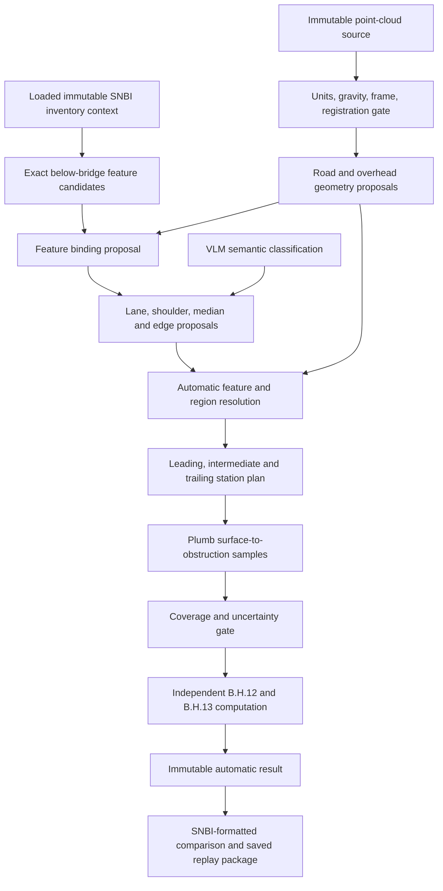

# SNBI B.H.12/B.H.13 Clearance Measurement Implementation Plan

**Status:** implementation started; the first automatic vertical slice is in progress
**Prepared:** 2026-09-02
**Target:** highway features below a bridge, measured from a registered point cloud
**Product position:** SNBI-compliant calculation workflow with BrM-compatible data capture and visualization

## 1. Decision and terminology

The implementation will use many vertical cross-sections to calculate clearance, retain only cross-sections that contribute evidence to a result, and show one selected cross-section at a time as a clean BrM-style lane/shoulder diagram. The 3D view and the diagram will be synchronized.

The implementation must not claim to reproduce an undocumented AASHTOWare Bridge Management (BrM) point-cloud algorithm. The public BrM 7.2 description confirms support for lane types, lane clearances, plural measurement points, leading/trailing bridge edges, overall minimum/maximum values, and a clearance graph. It does not publish an automatic point-cloud measurement method. AASHTOWare states that the detailed Technical Manual is available to licensed agencies.

Accordingly:

- FHWA SNBI definitions are the normative calculation rules.
- BrM public behavior is the compatibility target for data organization and presentation.
- Exact BrM schema/workflow equivalence is a separate conformance task requiring a licensed Technical Manual and a representative BrM export.
- Results are calculated and refreshed automatically for the operator. They remain point-cloud measurement results rather than survey values, official SNBI submissions, permit-routing values, or engineering determinations, and they never overwrite loaded SNBI data automatically.

### Automatic-operator workflow directive

Manual measurement review and manual acceptance are not part of this implementation. Deterministic geometry and bounded VLM semantics resolve feature, region, station, and obstruction inputs automatically. Ambiguity is handled by preserving conservative candidates, calculating separate feature results where possible, or returning no numeric value internally. The default output contains values, units, compact status icons, and visual geometry only—no warning paragraphs, descriptive prose, research banners, receipt text, or instructional copy.

Official references:

- [FHWA Specifications for the National Bridge Inventory, March 2022](https://www.fhwa.dot.gov/bridge/snbi/snbi_march_2022_publication.pdf), B.H.12 on printed pages 159–160 and B.H.13 on pages 161–162.
- [AASHTOWare Bridge Management 7.2 release update](https://www.aashtoware.org/story/aashtoware-bridge-management-7-2-release-update/), public description of the Clearance Module.
- [AASHTOWare Bridge resources](https://www.aashtoware.org/products/bridge/bridge-resources/), including the licensed Technical Manual statement.
- [FHWA SNBI data validation logic](https://www.fhwa.dot.gov/bridge/snbi/data_validation_logic.cfm), to be frozen with the calculation profile used by the implementation.

## 2. User-visible outcome

For each highway feature below the selected bridge, the user will be able to:

1. load the original cloud, a processed cloud, or both together;
2. run one automatic proposal that identifies the correct roadway, lane/shoulder regions, bridge leading/trailing edges, likely restrictions, and candidate measurement sections;
3. receive automatically resolved feature, region boundaries, station locations, and restriction inclusion without a manual review step;
4. see only the cross-sections that materially support B.H.12, B.H.13, an edge minimum, or a coverage boundary;
5. select a retained section and see its full plane in 3D and its lane/shoulder clearance diagram at the same time;
6. see B.H.12 and B.H.13 calculated independently, with the controlling envelope/point highlighted;
7. compare the point-cloud candidates with the exact B.H.12 and B.H.13 values in the loaded SNBI feature row;
8. view every dimension in metres and feet only;
9. save and reload the raw cloud reference, processed cloud, semantic/geometry receipts, resolved regions, retained sections, samples, and results; and
10. receive an automatically recomputed result only after the server has verified that the source and inventory context have not changed.

The default view will remain simple: cloud, compact feature/result panel, one selected section plane, and one section diagram. Diagnostic evidence remains available through the API/logs but is not displayed in the result panel.

## 3. Normative measurement rules

### 3.1 B.H.12 — Highway Maximum Usable Vertical Clearance

The engine will:

- bind the result to one exact highway feature identified by B.F.01/B.F.02/B.F.03 and its canonical source pointer;
- consider only the traveled part of that feature; shoulders are excluded;
- search every feasible 3.048 m (10 ft) continuous lateral envelope within contiguous eligible traveled lanes, including an auxiliary/turn lane only when the resolved region type makes it part of the traveled way;
- calculate each envelope's controlling value as the minimum plumb clearance observed over its lateral width and across all required longitudinal sections;
- select the feasible envelope with the greatest controlling minimum;
- measure from the local highway surface to the lowest bridge member, attached sign/utility/appurtenance, or other overhead restriction;
- retain the winning envelope location internally even though SNBI reports only its value;
- keep full-precision metres internally; and
- for the SNBI-formatted display value, convert to feet and round down to the nearest 0.1 ft, or display 99.9 when the clearance is at least 100 ft or no overhead restriction exists.

B.H.12 is not the absolute minimum and must never be populated by copying B.H.13.

### 3.2 B.H.13 — Highway Minimum Vertical Clearance

The engine will:

- use the same exact feature binding as B.H.12;
- search the whole resolved highway-feature surface, including a shoulder only when it is contiguous with the traveled way and supported by deterministic evidence as paved/stabilized under the configured agency policy;
- exclude grass, dirt, or an unverified shoulder from B.H.13 eligibility;
- measure plumb from the local highway/eligible-shoulder surface to the lowest bridge member, attached sign/utility/appurtenance, or other overhead restriction;
- choose the absolute minimum from all valid, sufficiently covered samples for that feature;
- preserve the controlling sample, station, region, obstruction, and evidence IDs; and
- apply the same reporting-only conversion, downward rounding, and 99.9 rule used for B.H.12.

B.H.13 must be less than or equal to B.H.12 when both are finite candidates for the same feature. A violation is a computation error, not a warning.

### 3.3 Shared rules

- “Plumb” means parallel to the verified gravity vector, not perpendicular to a fitted deck or road plane.
- Each highway below the bridge is measured separately. A nearby road, ramp, railroad, waterway, road carried on a different deck level, or another crossing bridge must not be fused into the feature.
- Attached restrictions are measurement obstructions, not removable clutter.
- Surface, obstruction, and coverage evidence must exist at a sample; the engine must not invent a clearance across an occluded or unscanned area.
- Geometry is calculated in metres in a verified local engineering frame. Feet are a display/reporting conversion.
- Raw precision is retained. SNBI's downward tenth-foot rounding occurs only in the explicit SNBI-formatted display/export projection.

## 4. Current repository state

### 4.1 Components to retain

The repository already contains the core domain rules and should extend them rather than replace them:

- `backend/app/services/point_cloud/clearance.py`
  - typed ordered clearance regions;
  - leading/intermediate/trailing station samples;
  - complete feasible B.H.12 10-ft-window evaluation;
  - independent B.H.13 selection;
  - sample-spacing failure behavior;
  - BrM-style graph payload;
  - separate railroad/navigation gates.
- `backend/app/services/point_cloud/features.py`
  - canonical feature parsing;
  - same-bridge, below-bridge feature filtering;
  - deterministic binding and explicit ambiguity states.
- `backend/app/services/point_cloud/snbi_projection.py`
  - downward tenth-foot formatting and sentinel handling;
  - downward tenth-foot rounding;
  - 99.9 sentinel handling.
- `backend/app/routers/services/point_cloud.py`
  - local surface-envelope geometry;
  - gravity/axis checks;
  - multiple candidate measurement planes;
  - deterministic component proposals and VLM-assisted conservative fusion.
- `backend/app/services/point_cloud/run_store.py`
  - immutable runs and source identity;
  - append-only measurement candidates and processing receipts;
  - hashes, idempotency, and replay evidence.
- `frontend/src/pages/PointCloud.tsx`
  - raw/processed/together display;
  - retained-plane selection;
  - compact grouped component display;
  - saved-session loading;
  - metres/feet display and recorded B.H.13 comparison.

### 4.2 Gaps to close

The baseline pipeline stopped with `lane_shoulder_and_station_review_required`. The first implementation slice now creates automatically resolved `ClearanceRegion` and `ClearanceSample` objects and calls `measure_highway_clearance` for the unambiguous single-highway case. The remaining gaps below cover richer geometry and validation.

Specific gaps are:

1. The current central 85% roadway proxy is not a defensible lane/shoulder definition.
2. Retained section rectangles are based on evenly distributed display offsets, not resolved region widths.
3. Leading and trailing bridge edges are not explicitly derived from the deck footprint/road centerline intersection.
4. Candidate sections are selected by a clearance envelope heuristic, but their coverage role and retention reason are not typed.
5. The obstruction set must prove that attached restrictions remain included while unrelated clutter can be excluded.
6. VLM semantics are used for components but do not produce a bounded region/station proposal contract.
7. The automatic result is not materialized as a separately identified immutable measurement result.
8. Saved results do not explicitly identify the selected automatic measurement candidate ID and hash.
9. The UI does not yet show automatic feature binding, true-width regions, retained stations, or B.H.12 envelope placement.
10. Existing screening quality thresholds are not calibrated against registered field-survey truth.

This plan completes the operational integration of the already implemented clearance domain model; it does not reopen the general cleaning/segmentation architecture.

## 5. Target workflow



### Step 1 — Freeze source and context

The run must bind to:

- source file SHA-256 and byte size;
- source receipt, scan IDs, units, coordinate/reference-frame declaration, gravity source, and registration receipt;
- bridge state code and bridge number;
- loaded inventory data year, immutable revision ID, canonical document SHA-256, and knowledge-pack SHA-256;
- analysis profile version and its SHA-256;
- VLM provider/model/schema/prompt/image hashes when the VLM is used.

The backend may currently resolve the immutable inventory identity through the existing snapshot adapter, but the API/UI will call it **loaded inventory revision**, not “published snapshot.” If the repository completes its removal of the legacy publication concept, only the identity resolver changes; measurement receipts continue to bind to the immutable revision ID and canonical hash.

### Step 2 — Establish the measurement frame

The engine will require verified units and gravity. It will preserve world coordinates as float64 for calculations and create a reversible local frame:

- `w`: verified plumb/gravity axis;
- `u`: roadway longitudinal axis;
- `v`: roadway transverse axis;
- origin: bounded local origin stored with the transform.

Roadway PCA may propose `u`, but direction will be stabilized using the roadway centerline and the bridge footprint. For curved or branching roadways, use a local centerline coordinate rather than one global PCA line. Each retained section is normal to the local roadway tangent and vertical in `w`.

Failures return `not_measurable` internally; they do not fall back to source-axis Z. The result UI shows an empty value and a compact status icon rather than warning prose.

### Step 3 — Detect and bind each under-bridge highway feature

1. Cluster plausible paved surfaces into roadway candidates using surface continuity, elevation, slope, width, connectivity, and passage below the bridge footprint.
2. Generate stable geometry receipt IDs for every candidate.
3. Match candidates only to canonical features with highway type, B.F.02 = `B`, and no incompatible B.H.18 crossing-bridge identity.
4. Auto-bind directly when exactly one canonical candidate and one geometry candidate are compatible.
5. When multiple highways, divided carriageways, ramps, or inventory rows remain, score only evidence-backed matches. Calculate separate results when each geometry candidate has a unique match; otherwise keep the binding unresolved and emit no numeric value for that candidate.
6. Store the resolved binding as feature ID, source pointer, geometry receipt ID, resolution method, confidence, timestamp, and parent hashes.

No B.H.12/B.H.13 calculation proceeds without one exact binding.

### Step 4 — Propose lane, shoulder, median, and edge regions

The proposal builder will combine deterministic geometry and bounded VLM semantics.

Deterministic evidence can include:

- curb, barrier, median, gutter, pavement-edge, and elevation discontinuities;
- intensity/color line-marking evidence when available;
- repeated longitudinal line evidence;
- road-surface slope/crown changes;
- connected paved-surface boundaries;
- feature width and lane-count priors from the exact SNBI row; and
- uncertainty/coverage masks.

The VLM receives orthographic plan, oblique context, and representative section renders plus the trusted, bridge-specific SNBI context. It may propose semantic boundary roles such as lane line, edge of traveled way, paved shoulder, median, curb, or unknown. It must return a strict schema with proposal IDs, evidence IDs, confidence, and abstention. It cannot return distances and cannot delete point-cloud evidence.

The proposal becomes an ordered set of non-overlapping regions:

- left edge/cope;
- shoulder;
- traveled lane;
- auxiliary/turn lane;
- median; and
- right edge/cope.

Every boundary includes `offset_m`, proposal source, evidence IDs, confidence, and resolution status. The automatic resolver chooses the most conservative evidence-supported boundary set. Shoulder eligibility defaults to false and becomes true only when deterministic surface/connectivity evidence satisfies a versioned agency policy; appearance from the VLM alone cannot make a shoulder eligible.

The UI displays real region widths; it must not draw equal-width rectangles unless widths are actually equal.

### Step 5 — Determine bridge edges and candidate stations

Leading and trailing stations are obtained from intersections between the resolved roadway centerline/corridor and the conservative overhead bridge footprint. Intermediate stations are added by the following deterministic process:

1. Start with leading and trailing stations.
2. Add stations at span/beam/diaphragm/sign/utility restriction candidates and at changes in road grade, superelevation, or overhead envelope.
3. Add uniform coverage stations no farther apart than the calibrated longitudinal spacing limit.
4. Densify between stations when the clearance surface changes faster than the vertical tolerance or when a lower obstruction appears between neighbors.
5. Repeat until the error/coverage criterion is met or the maximum station budget is reached.
6. If convergence or coverage fails, return `not_measurable` internally and omit the numeric result.

Each station records:

- stable station ID and edge type (`leading`, `intermediate`, `trailing`);
- chainage/longitudinal position in metres;
- plane origin, unit normal, local axes, and clipped roadway interval;
- why it was generated;
- source point/mesh evidence hashes;
- transverse sampling resolution and coverage; and
- retained/discarded status and reason.

### Step 6 — Build the obstruction layer safely

The measurement obstruction layer is distinct from the cleaned presentation cloud.

It includes:

- bridge deck underside, beams/girders, diaphragms, braces, truss members, and other structural members;
- attached signs, utilities, conduits, luminaires, and other appurtenances;
- other overhead structures/restrictions intersecting the feature corridor; and
- unresolved overhead candidates whenever they intersect or could intersect the measurement corridor.

It excludes only evidence proven unrelated to the vertical corridor, such as isolated sensor noise or non-overhead clutter, under the existing conservative fusion rules. A high-confidence “clutter” classification alone is not sufficient to remove an attached or corridor-intersecting restriction.

Every excluded component retains its points in the raw cloud and receives a disposition receipt. Unknown overhead candidates are included conservatively whenever they could control a reported clearance.

### Step 7 — Materialize plumb clearance samples

At each required station and transverse offset:

1. Estimate the lower highway surface from a robust local neighborhood on the resolved road/shoulder region.
2. Cast/query a narrow column parallel to the verified gravity vector.
3. Find the lowest supported intersection with the obstruction layer above the lower surface.
4. Calculate raw clearance as the obstruction elevation minus lower-surface elevation along gravity.
5. Attach lower-surface and obstruction evidence IDs, local point counts, fit residuals, support radius, occlusion flags, and component ID.
6. If the lower or upper intersection lacks support, emit a missing sample rather than interpolate a value.
7. Adaptively add lateral samples at region boundaries, extrema, sharp envelope changes, and between samples until coverage criteria are met.

The active distance must come from source-supported local geometry. Fitted planes/meshes can stabilize neighborhood estimation and visualization, but they cannot bridge a data hole without an explicit validated interpolation policy.

### Step 8 — Apply quality and completeness gates

The quality gate is evaluated per feature, station, region, and candidate result. It will include:

- verified metric scale and gravity;
- verified registration and maximum residual;
- roadway/overhead overlap;
- minimum local point support and density;
- lower/upper surface residuals;
- maximum lateral and longitudinal unsampled gap;
- occlusion ratio;
- required leading/trailing station presence;
- coverage of every station used by a B.H.12 candidate;
- B.H.13 coverage of every eligible region;
- unresolved overhead restriction count;
- out-of-distribution indicators; and
- sensitivity of the controlling value to sampling density and neighborhood size.

Thresholds will live in a versioned measurement-quality profile. Repository defaults remain conservative screening thresholds until calibrated. Numeric output is omitted if any mandatory gate fails.

### Step 9 — Compute B.H.12 and B.H.13 independently

Resolved regions and valid samples are converted to the existing `ClearanceRegion` and `ClearanceSample` types and passed to `measure_highway_clearance`.

The implementation will strengthen the existing calculation with:

- an explicit proof/receipt that every required station covers the full selected B.H.12 envelope within the maximum spacing;
- candidate generation at all region/sample breakpoints, with property tests showing no better feasible 10-ft interval was skipped;
- a hard invariant `bh13_raw_m <= bh12_raw_m` for the same feature;
- stable tie-breaking and permutation invariance;
- an explicit no-restriction representation rather than fabricating a tall obstruction; and
- typed reasons for no feasible envelope, incomplete B.H.13 coverage, or unresolved obstruction.

### Step 10 — Retain only calculation-relevant planes

The engine may evaluate many stations, but the interactive result keeps only planes required to reproduce the output:

- leading and trailing bridge-edge stations;
- the station containing the B.H.12 controlling sample;
- the station containing the B.H.13 controlling sample;
- any station containing the overall minimum or maximum shown in the BrM-style summary;
- any station that controls a distinct portion of the selected 10-ft envelope;
- any station required to reproduce a coverage/quality boundary.

Duplicate roles collapse onto one retained plane. Non-retained candidates keep compact hash/count/range receipts for reproducibility but are not rendered or shipped as full geometry by default.

This gives the user a clean single-plane presentation while preserving a multi-plane calculation.

### Step 11 — Recompute and persist automatically

Any source, processing-profile, feature, region, station, or obstruction change invalidates the previous measurement hash. The server automatically validates the resolved inputs, recomputes all samples/results, and appends a new immutable result. Identical inputs deduplicate to the same result identity.

The saved current result points to one materialized result ID/hash; generic JSON options are never treated as computed measurements. Loading a saved result re-verifies its source/context/profile hashes before displaying values.

## 6. Data contracts

All schemas will reject unknown fields and nonfinite values and include a `schema_version`.

### 6.1 `ClearanceFeatureBindingReceipt`

```json
{
  "schema_version": "bridgeguard-clearance-binding-v2",
  "detected_feature_id": "detected-highway-1",
  "geometry_receipt_id": "geometry:highway:1",
  "canonical_feature_id": "feature:H02:2",
  "canonical_source_pointer": "/Features/0",
  "status": "bound",
  "decision_source": "automatic_geometry_and_context",
  "confidence": 0.97,
  "parent_candidate_sha256": "..."
}
```

### 6.2 `ClearanceRegionResolution`

```json
{
  "schema_version": "bridgeguard-clearance-regions-v2",
  "feature_id": "feature:H02:2",
  "transverse_origin_m": 0.0,
  "regions": [
    {
      "region_id": "lane-1",
      "region_type": "traveled_lane",
      "start_offset_m": -3.6,
      "end_offset_m": 0.0,
      "direction": "forward",
      "lane_type": "through",
      "include_in_bh13": true,
      "boundary_evidence_ids": ["boundary:12", "boundary:13"],
      "resolution_status": "resolved"
    }
  ],
  "shoulder_policy_receipt": null,
  "resolver_version": "bridgeguard-clearance-regions-v2"
}
```

The server derives B.H.12 eligibility from `region_type`; the client cannot submit a separate B.H.12 boolean. B.H.13 shoulder inclusion requires a typed eligibility receipt.

### 6.3 `ClearanceStationPlan`

```json
{
  "schema_version": "bridgeguard-clearance-stations-v2",
  "feature_id": "feature:H02:2",
  "stations": [
    {
      "station_id": "station-leading",
      "edge": "leading",
      "chainage_m": 0.0,
      "origin_m": [0.0, 0.0, 0.0],
      "normal": [1.0, 0.0, 0.0],
      "reason": "bridge_footprint_intersection",
      "resolution_status": "resolved"
    }
  ],
  "maximum_longitudinal_gap_m": 1.0,
  "resolver_version": "bridgeguard-clearance-stations-v2"
}
```

### 6.4 `ClearanceObstructionResolution`

For each component: component ID, class, attached status, corridor-intersection status, disposition, evidence IDs, confidence, proposal source, and resolution status. A protected field prevents automatic exclusion of attached, corridor-intersecting, or unresolved overhead components.

### 6.5 `ClearanceSampleReceipt`

For each sample: feature/region/station IDs; longitudinal/lateral coordinates; lower and obstruction points in local/world coordinates; raw clearance metres; obstruction component; point/mesh evidence IDs; support statistics; quality flags; and algorithm/profile version.

### 6.6 `HighwayClearanceCandidateV2`

The result contains:

- exact source/context/profile hashes;
- binding, region, station, obstruction, and quality receipt hashes;
- all valid sample receipts or a content-addressed sample artifact;
- B.H.12 feasible-envelope summary and selected envelope;
- B.H.13 controlling sample;
- overall/leading/trailing minimum and overall maximum;
- recorded SNBI comparisons;
- retained-plane geometry and role list;
- raw full-precision metres;
- status: `measured` or `not_measurable`; and
- typed internal quality/failure codes that are not rendered as warning or description text in the result UI.

### 6.7 SNBI-formatted comparison projection

The comparison projection adds result ID/hash, calculation time, source/context hashes, reporting-profile version, and downward-rounded SNBI feet values. It does not overwrite recorded inventory values automatically and is not labeled as an official SNBI submission.

## 7. API plan

The implementation will extend the durable run API and reuse its ownership, ETag, idempotency, source-integrity, and quota controls.

### Read endpoints

- `GET /api/point-cloud/runs/{run_id}/measurements`
  - list automatically feature-bound results and compact quality state.
- `GET /api/point-cloud/runs/{run_id}/measurements/{measurement_id}`
  - return regions, stations, obstructions, result, and retained-plane metadata.
- `GET /api/point-cloud/runs/{run_id}/measurements/{measurement_id}/samples`
  - paged/binary sample evidence for advanced inspection; not loaded in the default panel.
- Existing run result/evidence/preview/download endpoints remain the source for full replay artifacts.

### Recompute endpoint

- `POST /api/point-cloud/runs/{run_id}/measurements/recompute`
  - starts a durable automatic recompute when source/profile inputs change;
  - appends a new immutable result on success;
  - is idempotent for source + context + analysis-profile hashes.

### API behavior

- Recompute starts automatically after a valid processing/source change, and the server deduplicates identical inputs.
- Long recomputes expose the existing durable job status/cancel pattern.
- Conflicting ETags return 409 and the client reloads the current result automatically.
- Public payloads never expose local filesystem paths, private prompt text, raw VLM output, or secrets.

## 8. Persistence and replay plan

### 8.1 Reuse

Keep:

- `point_cloud_runs`;
- `point_cloud_run_sources`;
- `point_cloud_vlm_calls`;
- `point_cloud_components`;
- `point_cloud_measurement_candidates`;
- processing/result evidence tables;
- immutable candidate NPZ/PLY/result artifacts; and
- raw/processed/together session behavior already present in the bridge viewer.

### 8.2 Schema additions

Add an append-only `point_cloud_measurement_resolutions` table with:

- workspace ID, run ID, measurement ID, ordinal, and UUID;
- parent geometry candidate ID and SHA-256;
- binding/regions/stations/obstructions JSON plus canonical SHA-256;
- resolver/profile versions and creation time;
- source, canonical-context, knowledge-pack, and analysis-profile SHA-256 values; and
- a unique idempotency hash.

Extend measurement evidence so each automatic result references the resolution ID/hash and stores a typed `candidate_kind` (`automatic_result`). No existing result row is mutated.

The saved-session/current-result pointer names the selected result ID/hash. Readers resolve that exact result rather than assume the first or latest row.

### 8.3 Artifact package

Each durable result directory will contain hash-verified:

- immutable source receipt/reference;
- processed point cloud (`npz` and optional `ply`);
- component labels and conservative fusion receipt;
- local/world coordinate transform;
- feature-binding and automatic-resolution receipts;
- region, station, obstruction, and quality receipts;
- sample evidence artifact;
- retained-plane geometry artifact;
- result JSON and SNBI-formatted comparison projection; and
- a manifest with byte sizes and SHA-256 hashes.

“Load original,” “Load processed,” and “Together” use the manifest to load the correct paired artifacts. A saved processed result whose raw-source hash no longer matches is treated as stale and its numeric result is not displayed.

## 9. VLM role and prompt change

The VLM is a bounded semantic classifier, not the distance calculator.

The trusted system/context block will include only bounded facts relevant to the selected bridge and feature:

- bridge and loaded-inventory identity;
- below-bridge feature rows and decoded B.F/B.H fields;
- recorded B.H.12/B.H.13 as comparison values, never geometric ground truth;
- roadway/lane-count metadata when present;
- component/material/type priors relevant to identifying bridge members and attached appurtenances; and
- allow-listed evidence IDs.

The user/evidence block contains deterministic renders with printed candidate/boundary IDs. Any retrieved document text stays separately marked as untrusted evidence.

The response schema permits:

- roadway-candidate matching;
- region-boundary semantic roles;
- attached-restriction versus unrelated-clutter classification;
- uncertain/abstained decisions; and
- evidence references.

It forbids:

- coordinates or clearance values not already supplied as deterministic evidence;
- silently deleting a candidate;
- marking a shoulder structurally adequate solely from appearance;
- changing feature identity without selecting a canonical candidate; and
- declaring an official SNBI value.

If the VLM is unavailable or abstains, deterministic resolution continues conservatively: protected/unknown overhead candidates stay included, uncertain shoulders stay excluded from B.H.13, and unresolved feature identity produces no number. No VLM failure may remove bridge points or manufacture a numeric result.

## 10. Frontend plan

### 10.1 Default compact layout

The right panel will have four compact blocks:

1. **Cloud** — Original / Processed / Together segmented control, point count, point-size control.
2. **Feature** — canonical feature name/direction, binding status, recorded B.H.12 and B.H.13.
3. **Clearance** — candidate B.H.12/B.H.13 in metres and feet, deltas from recorded values, quality status.
4. **Sections** — retained section chips; selecting one updates both 3D plane and section diagram.

Repeated component labels are grouped by class and count. Long receipts, warnings, hashes, proposal diagnostics, research banners, and explanatory descriptions are not rendered in the result panel.

### 10.2 Section visualization

The diagram will:

- use a single shared horizontal offset axis and a vertical clearance axis;
- draw adjacent rectangles/polygons using true region widths and sampled overhead profiles;
- label region type/direction once below each region;
- show section clearance at meaningful extrema without stacked floating boxes;
- overlay the selected B.H.12 10-ft envelope as a translucent bracket/band;
- mark the B.H.13 controlling point separately;
- use one consistent color per semantic role, not per individual component;
- show metres first and feet in the same tooltip/readout; and
- show missing/occluded areas as gaps or hatching, never as continuous measured geometry.

The 3D viewer will show one selected retained plane by default. Its translucent section polygon, region boundary ticks, B.H.12 band, B.H.13 ray, and controlling obstruction are visible without large callout boxes. A small toggle may show all retained planes for audit, but discarded planes remain hidden.

### 10.3 Automatic result behavior

- Source or processing changes trigger a deduplicated recomputation automatically.
- While recomputing, the previous value is not shown as current.
- An unresolved/non-measurable result uses an em dash and compact status icon only.
- Region boundaries, stations, obstruction membership, and quality receipts remain inspectable through developer/evidence APIs but do not create an operator review step.
- The result panel contains no descriptive or warning paragraphs.

### 10.4 Accessibility and responsiveness

- Do not use color as the only status/role indicator.
- Section selection and cloud controls must be keyboard accessible.
- Tooltips must be focusable.
- The section plot collapses below the 3D viewer on narrow screens.
- Numeric formatting is consistent: raw metres show 3 decimals, converted feet show 2 decimals, and SNBI-formatted feet show exactly 1 decimal after downward rounding.

## 11. Backend implementation phases

### Phase 0 — Contract freeze and fixtures

**Goal:** make the intended automatic calculation state executable before changing the active pipeline.

Tasks:

- Add versioned Pydantic/dataclass contracts for bindings, boundaries/regions, station plans, obstruction resolution, sample quality, and results.
- Add canonical serialization and content hashes.
- Define typed status/reason codes.
- Add golden synthetic fixtures for flat/skewed/crowned roads, shoulders, multiple lanes, multiple roadways, beams, signs, utilities, and occlusions.
- Write a traceability test mapping every normative B.H.12/B.H.13 rule to at least one executable test.
- Obtain, if available, a redacted BrM export and licensed field/schema mapping for the conformance checkpoint.

**Exit:** contracts and rule tests pass; no UI dependency.

### Phase 1 — Feature/region/station proposal builders

**Goal:** replace the central-85% display proxy with automatic, source-supported resolution.

Tasks:

- Split raw geometry extraction from semantic proposal generation.
- Add local roadway centerline/corridor modeling for curved and branching roads.
- Generate deterministic boundary evidence and region proposals.
- Generate verified-gravity vertical station planes at bridge edges, restriction events, adaptive extrema, and coverage intervals.
- Extend the bounded VLM schema/prompt for boundary and obstruction semantics.
- Preserve all unknown/protected restrictions.

**Exit:** every proposal is reproducible, evidence-linked, and can abstain without a numeric B.H.12/B.H.13.

### Phase 2 — Typed resolution persistence and APIs

**Goal:** make automatic geometry/semantic resolution replayable.

Tasks:

- Add the measurement-resolution schema and immutable triggers/indexes.
- Add typed read/recompute endpoints.
- Reuse owner checks, quotas, `If-Match`, idempotency keys, and job leases.
- Recheck source/context/profile hashes before every recompute.
- Expose the selected automatic result ID/hash in the saved-session pointer.
- Update backup/restore, retention, evidence limits, and integrity checks.

**Exit:** a saved resolution deterministically creates/replays the same measurement result.

### Phase 3 — Dense plumb sampling and SNBI computation integration

**Goal:** convert automatically resolved geometry into valid domain samples and compute both items.

Tasks:

- Implement lower/upper local-intersection evidence and adaptive sampling.
- Add missing-data/occlusion behavior and versioned quality gates.
- Convert resolved contracts to `ClearanceRegion`/`ClearanceSample`.
- Call `measure_highway_clearance` from the durable recompute worker.
- Strengthen invariants, no-restriction handling, and coverage proofs.
- Generate retained-plane roles and compact discarded-plane receipts.
- Project SNBI-formatted comparison values only through `snbi_projection.py`.

**Exit:** measured results contain independent B.H.12/B.H.13 values and complete replay evidence; invalid scans produce no plausible number.

### Phase 4 — Compact automatic visualization UI

**Goal:** provide the simple automatic operator view requested.

Tasks:

- Add compact feature/result/section blocks.
- Implement true-width BrM-style region diagram and shared labels.
- Synchronize selected diagram section with one full 3D plane.
- Render B.H.12 envelope and B.H.13 control without large callouts.
- Remove manual review/acceptance controls and descriptive/warning text from result output.
- Recompute automatically with stale-result protection.
- Preserve original/processed/together loading and save/reload behavior.

**Exit:** the operator receives the full compact result without a review step or explanatory clutter.

### Phase 5 — Comparison and export

**Goal:** make automatic results traceable and non-destructive.

Tasks:

- Recheck current source/context and scientific-release gates.
- Store/report raw metres, converted feet, rounded SNBI feet, and recorded-value deltas distinctly.
- Keep results separate from the loaded bridge inventory; do not overwrite it automatically.
- Add a BrM mapping/export adapter only after licensed schema confirmation.

**Exit:** automatic results are traceable and cannot masquerade as loaded inventory values.

### Phase 6 — Field validation and controlled rollout

**Goal:** establish measurement accuracy and safe release conditions.

Tasks:

- Build independent development/calibration/untouched test sets using registered total-station or equivalent field-survey truth.
- Predefine tolerances with the bridge/inspection program owner; do not tune on the untouched set.
- Evaluate total error, false-high error, false-low error, B.H.12 envelope-selection accuracy, B.H.13 controller accuracy, abstention, and attached-restriction retention.
- Stratify by scanner, density, range, skew, road crown, material, feature count, weather/light, traffic occlusion, and restriction type.
- Require zero numeric output for mandatory-abstention fixtures and 100% retention of protected restrictions in the safety corpus.
- Freeze the approved quality profile and release receipt.

**Exit:** program-owner approval and a hash-bound evaluation receipt permit the existing release gate to expose governed measurement export.

## 12. File-by-file change map

| File/area | Planned change |
|---|---|
| `backend/app/services/point_cloud/clearance.py` | Add typed receipt versions, missing-sample/no-restriction semantics, coverage proof, invariants, and retained-plane role selection. Keep B.H.12/B.H.13 core separation. |
| `backend/app/services/point_cloud/features.py` | Extend binding receipts for automatic geometry-to-canonical resolution and multiple highway candidates. |
| `backend/app/services/point_cloud/snbi_projection.py` | Bind the SNBI-formatted comparison to a result ID/hash and reporting profile; retain report-only downward rounding. |
| `backend/app/routers/services/point_cloud.py` | Refactor current clearance extraction into frame, roadway, boundary, station, obstruction, and sample builders; remove central-85% as a measurement assumption. |
| `backend/app/services/point_cloud/fusion.py` | Add explicit measurement-obstruction disposition and protect attached/corridor-intersecting restrictions. |
| `backend/app/services/point_cloud/vlm_protocol.py` | Add strict lane-boundary/obstruction semantic-resolution schema with abstention and evidence allow-list. |
| `backend/app/services/point_cloud/knowledge_pack.py` | Add bounded selected-feature context needed for semantic resolution; keep recorded clearances diagnostic only. |
| `backend/app/services/point_cloud/run_store.py` | Persist typed resolution/result identities and verify their hashes on replay. |
| `backend/app/routers/services/db_schema.py` | Add resolution table/indexes/immutable triggers and selected-result identity. |
| `backend/app/routers/services/db_migrations.py` | Add forward migration, drift checks, backup/restore reconciliation, and downgrade/compatibility behavior. |
| `backend/app/routers/point_cloud_api.py` | Add measurement read/recompute surfaces and return binary/paged evidence safely. |
| `frontend/src/pages/PointCloud.tsx` | Split the monolithic panel into compact result blocks; add a true-width diagram, synchronized retained planes, automatic recompute, and calculated/recorded comparison. |
| `backend/tests/test_point_cloud_feature_clearance.py` | Expand normative, invariant, and property tests. |
| `backend/tests/test_point_cloud_clearance_quality.py` | Add adaptive coverage, missing-data, error-bound, and no-fallback cases. |
| `backend/tests/test_point_cloud_segmentation_fusion.py` | Prove attached restrictions cannot be deleted and unknown corridor candidates remain included. |
| `backend/tests/test_point_cloud_run_store.py` | Add resolution/result hash, concurrency, replay, backup, and retention tests. |
| `backend/tests/test_point_cloud_durable_jobs.py` | Add recompute leases, retries, cancellation, source/context staleness, and idempotency tests. |
| `backend/tests/test_point_cloud_frontend_contract.py` | Add compact UI, unit, retained-plane, autosave, and stale-result contracts. |

## 13. Verification matrix

### Unit and property tests

- B.H.12 never includes a shoulder.
- B.H.12 considers every feasible 3.048 m window implied by breakpoints.
- B.H.12 selects the maximum of candidate minima.
- B.H.13 includes only explicitly eligible contiguous stabilized shoulders.
- B.H.13 selects the absolute valid minimum.
- `B.H.13 <= B.H.12` for the same measurable feature.
- Leading/trailing minima use only their typed stations.
- Downward rounding works immediately below/above tenth-foot boundaries and is never used internally.
- Permuting points, samples, regions, and evidence order does not change results/hashes after canonicalization.
- Translation/rotation in a valid verified frame does not change clearance.
- Density reduction within the validated range stays within the approved tolerance; outside it forces abstention.

### Synthetic geometry cases

- flat road/flat soffit;
- crowned road, superelevation, and grade change;
- skewed bridge and curved road;
- one, two, and multiple traveled lanes;
- auxiliary/turn lane and separated carriageways;
- paved, stabilized, uncertain, grass, and dirt shoulders;
- median, barrier, curb, gutter, and edge/cope;
- multiple highway features and a nearby non-target road;
- leading edge lower than center, trailing edge lower than center, and intermediate local control;
- beam/girder, diaphragm, sign, utility, luminaire, and other attached restriction;
- vehicle/vegetation/noise clutter crossing and not crossing the measurement corridor;
- full and partial occlusion, missing soffit, missing road, and sparse overlap;
- double-deck/crossing-bridge identity conflict; and
- no overhead restriction / 100-ft sentinel behavior.

### API/persistence tests

- ownership and workspace isolation;
- strict body schemas and bounded payloads;
- `If-Match`, idempotency, and concurrent recompute behavior;
- recompute retry/restart determinism;
- source, inventory revision, knowledge pack, and profile staleness;
- resolution/result/artifact tamper detection;
- selection of only an exact hash-verified result;
- backup/restore and retention of raw, processed, and measurement artifacts; and
- old saved sessions remain readable or fail with an explicit version message.

### UI/end-to-end tests

- one selected full plane by default;
- only retained planes are selectable;
- true region widths and non-redundant labels;
- diagram/3D selection synchronization;
- metres and feet only;
- B.H.12 band and B.H.13 controller are visually distinct;
- recorded versus calculated values cannot be confused;
- source/profile changes recompute and mark previous results stale;
- raw/processed/together survives save and reload; and
- no warnings, descriptions, instructions, hashes, or research banners appear in the result panel.

## 14. Acceptance criteria

Implementation is complete only when all of the following are true:

1. The active durable pipeline creates an exact automatically feature-bound result rather than the central-85% roadway proxy.
2. True-width regions, leading/trailing/intermediate stations, and obstruction inclusion are resolved automatically.
3. The server, not the browser or VLM, materializes plumb samples and recomputes the immutable candidate.
4. B.H.12 and B.H.13 satisfy the rules and invariants in Section 3.
5. Attached restrictions cannot be removed by a VLM-only decision.
6. Missing coverage prevents a numeric result where it could hide the controlling clearance.
7. The viewer shows one selected full plane, a synchronized true-width section diagram, and only calculation-relevant planes.
8. All values are displayed in metres and feet only, with raw and SNBI-formatted precision clearly separated.
9. Original, processed, together, resolution inputs, results, and receipts can be saved and reloaded with integrity verification.
10. The current saved result names the exact automatic result ID/hash and survives deterministic replay.
11. Current targeted backend tests and the production frontend build pass without regressing raw/processed/together viewing.
12. The product does not claim exact BrM algorithm equivalence without licensed conformance evidence.
13. Governed SNBI export remains blocked until field-validation thresholds and program-owner approval are recorded.
14. No manual review/acceptance controls or descriptive/warning text appear in the operator result workflow.

## 15. Risks and controls

| Risk | Control |
|---|---|
| A visually plausible lane boundary is wrong | Require agreement with deterministic geometry/context, preserve evidence, choose conservative bounds, and omit the number if unresolved. |
| Lowest obstruction is removed as clutter | Separate obstruction from presentation cleaning; protect attached/corridor-intersecting/unknown candidates. |
| Sparse scans overstate clearance | Missing samples and coverage gaps block the result; do not interpolate by default. |
| A single section misses the controller | Calculate over adaptive multiple stations; retain only the planes needed to explain the result. |
| Excessive planes clutter the UI | Role-based retention, deduplication, one selected plane by default, audit toggle for all retained planes. |
| Recorded B.H.13 biases the point-cloud result | Use it only after calculation as a diagnostic comparison. |
| Generic settings change without recomputation | Every source/profile/resolution hash change creates or selects a materialized immutable result. |
| “Exact BrM” claim is unverifiable | Use public behavior only; add licensed manual/export conformance checkpoint. |
| Point-cloud precision is mistaken for accuracy | Use compact status icons, omit values that fail quality gates, and calibrate with independent field-survey truth before governed export. |
| Current dirty/legacy persistence behavior complicates migration | Add forward-only schema migration, compatibility tests, backup verification, and no destructive rewrite. |

## 16. Open decisions before Phase 1

These decisions require project or program-owner input but do not prevent contract/test work:

1. Obtain licensed BrM Technical Manual access and a redacted clearance export if exact schema/workflow compatibility is required.
2. Confirm NJDOT policy/evidence required to classify a shoulder as structurally adequate for B.H.13.
3. Confirm whether auxiliary/turn lanes are always part of the traveled way for B.H.12 under the agency's coding policy or require an explicit per-region decision.
4. Choose the independent field-survey reference method and validation authority.
5. Set calibrated sampling, registration, residual, density, and error thresholds from the survey corpus.
6. Decide whether validated point-cloud results may enter a separate governed inventory-import workflow. Direct automatic overwrite is not planned.

## 17. Recommended first implementation slice

The first code slice should be deliberately vertical and testable:

1. Add `ClearanceRegionResolution`, `ClearanceStationPlan`, and `ClearanceObstructionResolution` contracts.
2. Build a deterministic two-lane + shoulders proposal from one existing geometry fixture.
3. Persist one typed automatic resolution.
4. Materialize source-supported samples for leading, controlling intermediate, and trailing stations.
5. Call the existing `measure_highway_clearance` engine.
6. Append one automatic measurement result with hashes.
7. Render one selected full plane plus a true-width section diagram, including B.H.12 envelope and B.H.13 point.
8. Reload the run and reproduce the same values and visualization from saved evidence.

This slice proves the end-to-end contract before adding more sophisticated lane detection, adaptive station placement, or VLM boundary proposals.
