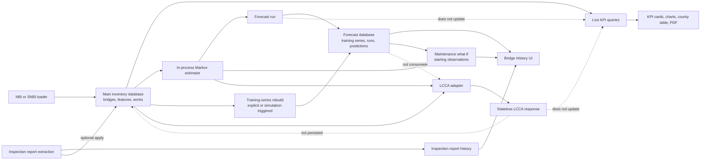
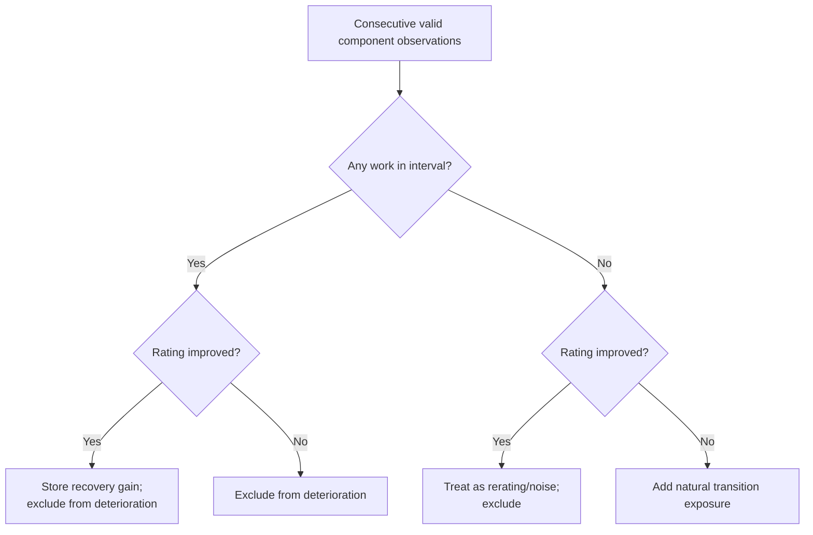
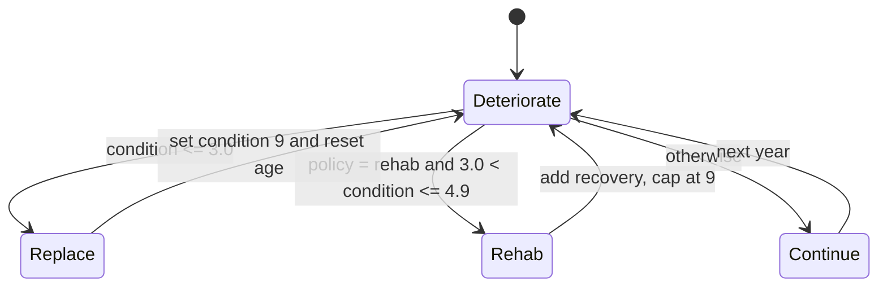
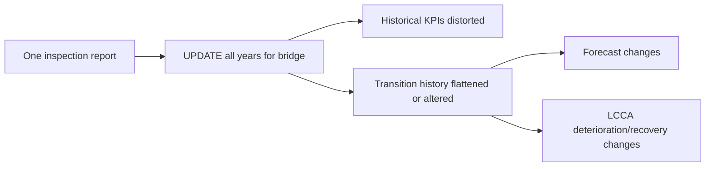

# BridgeGuard Forecasting, Life-Cycle Cost Analysis, and KPI System

## An implementation, model-validation, integration, and standards study

**System studied:** BridgeGuard remote repository  
**Repository revision:** `8f4d00244c76a43c112380c1e26a65e01112462f` (`main`)  
**Code, data, and source review date:** August 11, 2026  
**Primary application scope:** New Jersey, state FIPS code 34  
**Document status:** Research-oriented technical report and reproducible implementation audit; not an FHWA certification, investment recommendation, or project-level engineering analysis

---

## Contents

- [Abstract](#abstract)
- [1. Research questions](#1-research-questions)
- [2. Scope, method, and evidentiary limits](#2-scope-method-and-evidentiary-limits)
- [3. Terminology and claim categories](#3-terminology-and-claim-categories)
- [4. End-to-end architecture](#4-end-to-end-architecture)
- [5. Data foundation and exact feature inventory](#5-data-foundation-and-exact-feature-inventory)
- [6. Forecast model choice and scientific basis](#6-forecast-model-choice-and-scientific-basis)
- [7. Forecast training-sample construction](#7-forecast-training-sample-construction)
- [8. Markov transition estimator](#8-markov-transition-estimator)
- [9. Forecast propagation and uncertainty](#9-forecast-propagation-and-uncertainty)
- [10. Work recovery and maintenance simulation](#10-work-recovery-and-maintenance-simulation)
- [11. Forecast persistence, APIs, and user interface](#11-forecast-persistence-apis-and-user-interface)
- [12. Forecast validation and measured performance](#12-forecast-validation-and-measured-performance)
- [13. Bridge history and forecast provenance](#13-bridge-history-and-forecast-provenance)
- [14. LCCA purpose, inputs, and initial conditions](#14-lcca-purpose-inputs-and-initial-conditions)
- [15. LCCA deterioration and policy logic](#15-lcca-deterioration-and-policy-logic)
- [16. LCCA cost model](#16-lcca-cost-model)
- [17. Discounting, residual value, and recommendation](#17-discounting-residual-value-and-recommendation)
- [18. LCCA worked example](#18-lcca-worked-example)
- [19. LCCA methodological assessment](#19-lcca-methodological-assessment)
- [20. KPI formulas and data semantics](#20-kpi-formulas-and-data-semantics)
- [21. KPI frontend, year, and county behavior](#21-kpi-frontend-year-and-county-behavior)
- [22. Operational KPIs versus FHWA performance measures](#22-operational-kpis-versus-fhwa-performance-measures)
- [23. Current-data KPI audit](#23-current-data-kpi-audit)
- [24. How forecasting, LCCA, and KPIs interact](#24-how-forecasting-lcca-and-kpis-interact)
- [25. Multi-user, cache, and concurrency behavior](#25-multi-user-cache-and-concurrency-behavior)
- [26. Threats to validity and edge cases](#26-threats-to-validity-and-edge-cases)
- [27. Research-grade evolution and prioritized roadmap](#27-research-grade-evolution-and-prioritized-roadmap)
- [28. Reproducibility protocol](#28-reproducibility-protocol)
- [29. Conclusion](#29-conclusion)
- [References](#references)
- [Appendix A: implementation index](#appendix-a-implementation-index)
- [Appendix B: exact constants and API contract](#appendix-b-exact-constants-and-api-contract)
- [Appendix C: source-to-assumption traceability](#appendix-c-source-to-assumption-traceability)
- [Appendix D: recommended verification tests](#appendix-d-recommended-verification-tests)
- [Appendix E: function-level input and output map](#appendix-e-function-level-input-and-output-map)

---

## Abstract

BridgeGuard combines three related but technically distinct forms of bridge-management analysis. Its forecasting feature fits a fleet-derived, discrete-state Markov deterioration model to annual National Bridge Inventory and Specifications for the National Bridge Inventory snapshots. Its life-cycle cost analysis (LCCA) uses the same live Markov evidence to compare a condition-triggered rehabilitation policy with a run-to-condition-triggered-replacement policy. Its KPI dashboard summarizes observed inventory condition, age, traffic, and county counts for a selected snapshot year. The three features read a shared bridge database, but they do not form a closed decision-feedback loop: persisted forecasts do not drive LCCA, LCCA recommendations do not change the inventory, and neither predictions nor costs are rolled into the KPI dashboard.

This report reconstructs the exact features, equations, data paths, API behavior, user-interface behavior, and multi-user implications from the current source code. It compares the implementation with current Federal Highway Administration (FHWA) bridge-condition computation guidance, bridge-management and LCCA guidance, and peer-reviewed work on Markov deterioration and time-series evaluation. It also records a reproducible audit of the current local New Jersey database.

The active production forecasting engine is a custom Markov model, not Prophet. It models deck, superstructure, substructure, and culvert ratings on the 0-9 condition scale. Historical no-work intervals are used to estimate annual probabilities of staying in the same state or dropping by one or more rating levels, with fallbacks across county, age, intended traffic band, and fleet-level cohorts. This choice is scientifically plausible because bridge condition ratings are ordered, discrete, persistent states and Markov transition models are established in bridge-management research. However, the repository contains no comparative model-selection experiment. More importantly, current canonical traffic is stored in a child `features` table while the Markov code reads empty traffic columns from the parent `bridges` table. The fitted production model is therefore not presently traffic-stratified.

The built-in one-year fixed-cutoff backtest reports 18,841 component predictions, mean absolute error (MAE) 0.090, mean bias -0.051, and 98.5% within one rating point. A same-sample persistence benchmark, predicting no rating change, achieves MAE 0.048 and 99.4% within one point. The small absolute Markov error is therefore not evidence that the model improves upon the most important baseline. The displayed lower and upper paths are expected rating plus or minus one standard deviation of the discrete future-state distribution; they are not confidence intervals and exclude uncertainty in the estimated transition probabilities.

The LCCA is a deterministic screening calculation, not a stochastic optimization, Markov decision process, or formal benefit-cost analysis. It compares exactly two hard-coded policies, uses constant-dollar unit costs, discounts annual and capital costs, and subtracts a straight-line terminal residual credit. The intervention timing is not searched or optimized: rehabilitation occurs whenever the deterministic condition path first falls at or below 4.9 but remains above 3.0, and replacement occurs at or below 3.0. The current defaults include 2024 FHWA New Jersey replacement rates, but FHWA's now-current 2025 table reports lower values. Several other values, including the $300/ft2 rehabilitation cost, $1.50/ft2 annual maintenance cost, poor-condition penalty, and 30% user-cost multiplier, are application assumptions rather than directly sourced agency cost estimates.

The KPI dashboard correctly reflects the familiar Good/Fair/Poor condition thresholds and approximately the primary-component/culvert control rule, but it is an all-bridge, count-based operational inventory dashboard. It is not the federal Transportation Performance Management (TPM) measure, which applies to an era-specific set of NHS bridges and weights condition by deck area. For the current 2025 data, the app reports 6,825 bridges: 25.4% Good, 68.9% Fair, and 5.7% Poor by bridge count. A diagnostic carried-feature BH03 candidate area calculation produces materially different results, illustrating why the app's cards must not be interpreted as official FHWA measures.

The report concludes that the current system is a valuable, explainable planning prototype whose strongest attribute is traceable use of observed bridge histories. Research-grade deployment requires data-versioned model fitting, correct feature joins, rolling-origin and baseline-relative validation, probabilistic calibration, LCCA sensitivity and action optimization, a separate standards-conformant FHWA TPM panel, and tests that protect historical snapshots from cross-year mutation.

---

## 1. Research questions

This study addresses the following questions.

1. What exact bridge features enter the forecast, LCCA, and KPI calculations?
2. What forecasting model is active in production, how is it estimated, and why is that model family reasonable for bridge-condition data?
3. How are maintenance, rating improvement, missing years, cohort sparsity, and uncertainty handled?
4. What performance metrics are computed, over which years and bridges, and how do they compare with a naive baseline?
5. What does the LCCA calculate year by year, which costs and policies are included, and which claims would overstate the implementation?
6. How does the KPI dashboard classify bridges, group counties and years, and differ from federal bridge-condition performance measures?
7. How do the three features exchange data, and which seemingly connected outputs are in fact independent?
8. What state is shared between users, what remains browser-local, and how can edits, caching, or concurrent runs affect results?
9. Which choices are supported by authoritative sources, which are reasonable engineering heuristics, and which need calibration or correction?
10. What validation and design changes are required for a research-paper-quality or operational decision-support claim?

---

## 2. Scope, method, and evidentiary limits

### 2.1 Scope

The code review covers:

- inventory loading into annual `bridges`, `features`, and `works` records;
- the custom Markov model and retained optional Prophet path;
- forecast training-series and prediction persistence;
- bridge history, forecast overlays, and maintenance what-if simulation;
- bridge-level LCCA endpoints and modal interface;
- statewide and county KPI endpoints and dashboard;
- authorization, browser state, global server state, model caching, and cross-feature invalidation; and
- relevant data-quality pathways, particularly inspection-report application and year selection.

The related conversion and Bridgette pipelines are documented separately in [BridgeGuard NBI-SNBI Conversion, Inventory Loading, and Bridgette Database Agent](nbi-snbi-conversion-loader-bridgette.md). This report begins at the normalized inventory and concentrates on analytics.

### 2.2 Method

The work combined four methods.

1. **Static implementation tracing.** Three parallel code-audit tracks independently inspected forecasting/history, LCCA, and KPI/integration logic. Findings were reconciled at the shared database and UI boundaries.
2. **Primary-source research.** FHWA specifications, regulations, computation procedures, preservation and LCCA guidance, FHWA unit-cost tables, and peer-reviewed forecasting literature were used to evaluate the choices.
3. **Read-only runtime audit.** SQLite row counts, field availability, cohort coverage, forecast persistence, and current KPI values were measured without modifying source data. Existing backend routines were used to reproduce temporal backtests; an equivalent same-split persistence baseline was calculated for comparison.
4. **Claim audit.** User-facing language and code comments were compared with execution paths so that this document describes implemented behavior, not intended behavior.

### 2.3 Data snapshot and reproducibility boundary

Runtime results in this report describe the local databases as inspected on August 11, 2026:

| Artifact | Size | SHA-256 |
|---|---:|---|
| `backend/data/snbi_bridges.db` | 1,226,502,144 bytes | `B259D07DB94BCC49E12F257D7006F61A7E337F0332FEF083973B731B6D5D70EA` |
| `backend/data/snbi_forecasts.db` | 104,693,760 bytes | `A1CECADB46FF6CE3CD6C36C15D17A5CD9C321B4A176FC810B68794555272DD29` |

These are mutable application databases, not version-controlled research releases. Counts and metrics must be recomputed if either hash changes. The repository revision identifies code, but it does not freeze data or server configuration.

### 2.4 Limits

This is not an FHWA submission audit, a bridge safety determination, a project cost estimate, or a recommendation to rehabilitate or replace a real structure. General condition ratings cannot by themselves establish treatment scope. The current application lacks site-specific quantities, maintenance-of-traffic plans, detours, design constraints, utilities, permitting, risk models, and engineer-approved alternatives required for project-level LCCA.

The empirical audit uses one state's loaded inventory and should not be treated as geographic external validation. The report identifies implementation defects and research limitations but does not change application code. No GPU, visual-language model, large language model, or generative AI is used by the forecast, LCCA, or KPI calculations described here.

---

## 3. Terminology and claim categories

| Term | Meaning in this report |
|---|---|
| **Snapshot year** | `data_year`, the inventory archive/submission year stored for a bridge; it is not necessarily the year in which every component was inspected. |
| **Component rating** | Numeric 0-9 deck, superstructure, substructure, or culvert condition value. `N`, blank, malformed, or out-of-range values are not numeric observations for the Markov model. |
| **Natural interval** | A consecutive valid rating interval not associated with recorded work and not showing an unexplained improvement. |
| **Exposure-year** | One annual slot contributed by a natural interval to a transition cell. A multi-year observation gap contributes multiple slots. |
| **Cohort** | A group used to pool transition evidence, defined from component, starting state, county, age band, and intended traffic band, with fallbacks when evidence is sparse. |
| **Markov forecast** | Repeated propagation of a probability distribution through empirically estimated condition-state transitions. |
| **State dispersion band** | Expected future rating plus or minus one standard deviation of the discrete state distribution. This is not a confidence interval. |
| **Persistence baseline** | Forecast that the next observed condition rating equals the latest observed rating. |
| **LCCA** | In this implementation, a discounted present-cost comparison between two fixed policies, including a terminal residual credit. |
| **Operational inventory KPI** | Count-based descriptive statistic for all loaded bridges in a snapshot. |
| **FHWA TPM measure** | Regulated NHS bridge-condition measure computed using applicable bridge deck area and federal preparation rules. |

This report labels the basis of a choice using four categories.

- **Implemented fact:** directly observable in source code or database behavior.
- **Source-supported choice:** materially aligned with an authoritative source or established research method.
- **Application heuristic:** a deliberate but locally selected threshold, default, multiplier, or fallback without demonstrated calibration.
- **Audit inference:** a reasoned interpretation, explicitly identified when the repository does not state the rationale.

This distinction matters for the question "why was it chosen?" A plausible scientific rationale does not prove that the development team compared alternatives or calibrated a threshold. Where no model-selection record exists, this report says so.

---

## 4. End-to-end architecture

### 4.1 Actual dataflow



The solid arrows are active data dependencies. The dotted arrows call out expected-looking relationships that do not exist.

### 4.2 Three different analytical questions

The features answer different questions.

| Feature | Primary question | Time orientation | Unit of output |
|---|---|---|---|
| Forecast | Given observed fleet transitions, how may each component's rating distribution evolve? | Future, bridge/component | Expected rating, state dispersion, confidence label |
| LCCA | Under two fixed condition-triggered policies, what present cost does the expected controlling-condition path imply? | Future, bridge/scenario | Net present life-cycle cost, event years, savings |
| KPI | What does the loaded inventory look like for one archive year? | Observed snapshot, state/county | Counts, count percentages, age, traffic, area |

The common database permits consistent identity and current-condition lookup. It does not make the outputs interchangeable. A prediction is not an observation, an LCCA recommendation is not an approved work event, and a count-based KPI is not a federal performance measure.

### 4.3 Principal implementation locations

- Forecast estimator: [`markov.py`](../backend/app/routers/services/markov.py#L1)
- Forecast database, runs, backtest, and APIs: [`forecasting.py`](../backend/app/routers/services/forecasting.py#L1)
- LCCA calculation: [`lcca.py`](../backend/app/routers/services/lcca.py#L1)
- KPI and history database functions: [`database.py`](../backend/app/routers/services/database.py#L1363)
- HTTP routes: [`main.py`](../backend/app/main.py#L1469)
- KPI page: [`Kpis.tsx`](../frontend/src/pages/Kpis.tsx#L1)
- Forecast page: [`Forecasts.tsx`](../frontend/src/pages/Forecasts.tsx#L1)
- History modal: [`BridgeHistoryModal.tsx`](../frontend/src/components/BridgeHistoryModal.tsx#L1)
- LCCA modal: [`BridgeLCCAModal.tsx`](../frontend/src/components/BridgeLCCAModal.tsx#L1)

---

## 5. Data foundation and exact feature inventory

### 5.1 Annual bridge identity

The main table stores one row per `(state_code, bridge_number, data_year)`. Schema and indexes are created in [`database.py`](../backend/app/routers/services/database.py#L338). The loader treats an explicitly supplied snapshot year as authoritative and refreshes child records for the affected snapshot in [`database.py`](../backend/app/routers/services/database.py#L993). Repeated feature and work data are stored in child tables scoped to the bridge snapshot.

The current database contains:

| Measure | Audited value |
|---|---:|
| State codes | 34 only |
| Bridge-year rows | 221,804 |
| Distinct bridge identities | 7,275 |
| Snapshot range | 1992-2025 |
| Distinct snapshot years | 34 |
| Bridges in 2025 | 6,825 |
| Bridges with one observed year | 73 |
| Bridges with 2-4 observed years | 81 |
| Bridges with 5-24 observed years | 954 |
| Bridges with at least 25 observed years | 6,167 |

The population is therefore longitudinal for most bridge identities, but not balanced: bridges enter, leave, change identifier, and have component-specific missingness.

### 5.2 Canonical SNBI-to-database fields

The source mapping is defined in [`constants.py`](../backend/app/routers/services/constants.py#L32). The fields central to this report are:

| Purpose | SNBI item | Stored field | Forecast | LCCA | KPI |
|---|---|---|---:|---:|---:|
| State | BL01 | `state_code` | identity | request/current lookup | grouping |
| Bridge identifier | BID01 | `bridge_number` | identity | request/current lookup | identity/count |
| County/FIPS | BL02 | `county_code` | cohort | response/cohort | grouping |
| Year built | BW01 | `year_built` | age band | starting age | average age/old count |
| Deck rating | BC01 | `deck_condition_rating` | modeled | possible controller | classification |
| Superstructure rating | BC02 | `superstructure_condition_rating` | modeled | possible controller | classification |
| Substructure rating | BC03 | `substructure_condition_rating` | modeled | possible controller | classification |
| Culvert rating | BC04 | `culvert_condition_rating` | modeled | possible controller | fallback classification |
| Lowest rating | BC13 | `lowest_condition_rating_code` | unused | unused | ignored by KPI; state-history may use |
| Total length | BG02 | `total_bridge_length` | unused | area fallback | area fallback |
| Out-to-out width | BG05 | `bridge_width_out_to_out` | unused | area fallback | area fallback |
| Approach width | BG09 | `approach_roadway_width` | unused | currently unused | currently unused |
| Irregular deck area | BG15 | `irregular_deck_area` | unused | currently unused | currently unused |
| Calculated deck area | BG16 | `calculated_deck_area` | unused | preferred area | preferred area |
| Work year | B.W. fields/works | `year_work_performed` | excludes transitions; recovery | indirect through model | unused |
| NHS designation | BH03 in Features | `features.nhs_designation` | unused | manually supplied instead | currently unused |
| AADT | BH09 in Features | `features.annual_average_daily_traffic` | intended, but wrong table queried | unused | high-traffic count |
| ADTT | BH10 in Features | `features.annual_average_daily_truck_traffic` | intended, but wrong table queried | unused | not displayed |

Converted legacy records intentionally omit FHWA-calculated BC12, BC13, and BG16, so downstream derivation is necessary; see [`mapper.py`](../backend/app/routers/services/mapper.py#L274). That design makes the fallback equations important.

### 5.3 Used, intended, and absent forecast features

| Feature | Intended implementation | Current effective status | Consequence |
|---|---|---|---|
| Component type | Separate transition evidence for deck, superstructure, substructure, culvert | Active | Different deterioration matrices by component |
| Starting condition state | Rounded 0-9 state | Active | State-specific stay/drop probabilities |
| Age | Five 20-year bands plus missing | Active for usable year built | Forecast may change cohort as bridge ages |
| County | Latest county, with county-first fallback | Active | Local pooling within NJ |
| Traffic | ADTT bands, then AADT fallback bands | Inactive in current fitted model | `bridges` traffic fields are empty; values are in `features` |
| State | Used in bridge identity grouping | Not in cohort aggregation key | A multi-state deployment would pool states and collide numeric county codes |
| Material, design, environment, route class | Not queried | Absent | No structural/exposure covariates beyond age/county/intended traffic |
| Inspection uncertainty | Not modeled | Absent | Ratings treated as observed states after filtering |
| Action type/component treated | Work year only | Absent | Every work year affects every component equally |

The traffic gap is not minor. The audited main `bridges` traffic columns contain no populated values for the current population, while nested feature records do contain traffic values. The KPI join sees those values; the Markov query in [`markov.py`](../backend/app/routers/services/markov.py#L186) does not. Until the carried-highway feature is joined, user-facing claims of traffic-aware deterioration are false for the current model.

---

## 6. Forecast model choice and scientific basis

### 6.1 Active engine

The active default is `markov`, set in [`forecasting.py`](../backend/app/routers/services/forecasting.py#L31) and dispatched in [`forecasting.py`](../backend/app/routers/services/forecasting.py#L749). Prophet code remains as an optional compatibility path, but Prophet is absent from production [`requirements.txt`](../backend/requirements.txt#L4), the API exposes no engine selector, and saved current predictions are labeled Markov.

The frontend contains stale language describing "Prophet deterioration forecasts" and requiring at least three years. Those statements do not describe the active Markov path, which can produce a cohort-based forecast from a single current observation. The distinction should be corrected in UI and publications.

### 6.2 Why a discrete-state Markov family is reasonable

Bridge condition ratings are ordered, bounded, discrete observations, most commonly 0 through 9. A transition model naturally represents the probability of remaining at a rating or moving to a worse rating during a time interval. Markov and semi-Markov approaches have a long bridge-management literature, including work by Cesare et al., Madanat et al., and Thomas and Sobanjo. FHWA's InfoBridge forecasting documentation uses proportional-hazards survival functions to estimate state durations and derive Markov transition probabilities. FHWA's NBIAS investment methodology uses transition probabilities in a broader decision/optimization system.

The family has practical advantages for BridgeGuard:

- outputs remain on the interpretable rating scale;
- a probability distribution can be propagated without GPU resources;
- fleet histories support pooled estimation even for a bridge with few observations;
- state 0 can be made absorbing and predictions bounded 0-9;
- county/age/traffic cohorts can be expressed as transparent fallbacks; and
- work-associated improvements can be separated from natural deterioration.

These are source-supported reasons to consider the model family. They are not evidence that the current estimator was selected through an experiment. The repository contains no documented comparison against ordinal regression, survival models, proportional-hazards models, hidden Markov models, semi-Markov models, hierarchical Bayesian transition models, gradient boosting, or even persistence during model selection.

### 6.3 Why Prophet is a poor default for the present task

Prophet is designed for continuous time series with trend, seasonality, holidays, and change points. Annual bridge condition sequences are short, bounded, discrete, highly persistent, and irregularly missing, with abrupt maintenance-related increases. There is no meaningful within-year seasonality in the stored annual ratings. Prophet can still be used as a pragmatic curve-fitting comparator, but its assumptions are less naturally matched than a state-transition model. The active production choice to omit it also reduces installation weight and CPU/memory overhead.

If Prophet is retained for research, its own documentation recommends simulated historical forecasts/cross-validation and makes clear that its uncertainty interval depends heavily on assumptions about future trend changes. It should be evaluated as a comparator, not named in the UI when it is not running.

### 6.4 What the active model is not

The forecast is not:

- a neural network or deep-learning model;
- an LLM/VLM inference;
- a GPU calculation;
- an individual bridge physics model;
- a survival model with censored-duration likelihood;
- a semi-Markov duration model;
- a Markov decision process;
- an optimization of maintenance actions; or
- a claim that condition in each year depends only on the immediately previous state in a causal sense.

It is an empirical, cohort-pooled, first-order annual transition estimator followed by deterministic probability propagation.

---

## 7. Forecast training-sample construction

### 7.1 Two databases with different roles

The main Markov estimator reads directly from the live inventory database's `bridges` and `works` tables. It does **not** fit from `snbi_forecasts.db.training_series`. The separate forecast database defines `forecast_runs`, `training_series`, and `forecast_predictions` in [`forecasting.py`](../backend/app/routers/services/forecasting.py#L43).

`training_series` serves three purposes:

1. observed-series retrieval for forecast displays;
2. the bridge selector for the standalone Forecast page; and
3. starting observations for the Markov maintenance what-if route; and
4. the retained Prophet path.

The rebuild function deletes and recreates training rows from the main database in [`forecasting.py`](../backend/app/routers/services/forecasting.py#L171). A Markov fit can therefore use newly loaded main-database conditions while a stale `training_series` continues to display older observed points. `ensure_training_data` rebuilds only when a bridge has no rows, not when its rows changed.

### 7.2 Rating validation

The helper accepts numeric ratings in the closed interval `[0,9]`. Null, blank, `N`, malformed text, negative values, and values greater than 9 are excluded; see [`markov.py`](../backend/app/routers/services/markov.py#L62). No rating imputation is performed. Missing component years are removed before consecutive valid observations are paired, so the interval may span more than one calendar year.

Current numeric observation coverage is:

| Component | Numeric observations | Bridge identities with component | Natural intervals | Exposure-years |
|---|---:|---:|---:|---:|
| Deck | 193,417 | 6,419 | 179,853 | 180,613 |
| Superstructure | 205,647 | 6,774 | 192,721 | 193,257 |
| Substructure | 205,665 | 6,776 | 192,141 | 192,647 |
| Culvert | 16,146 | 699 | 15,260 | 15,432 |
| **Total natural intervals** | - | - | **579,975** | - |

### 7.3 Identity continuity

Histories are grouped by `(state_code, bridge_number)` in [`markov.py`](../backend/app/routers/services/markov.py#L208). A previous bridge identifier is not used to join renamed assets. A number change can therefore split one physical bridge into two series, while an erroneous identifier reuse could join unrelated observations.

### 7.4 Historical metadata assignment

County and year built are taken only from the bridge's final row; the code does not scan backward when either is blank there. ADTT and AADT do scan backward for the latest nonblank value. The selected metadata are then applied to the entire historical series. Age for an interval is computed at its starting year, but historical county and traffic changes are not modeled. This creates potential temporal leakage or misclassification when route/county/traffic changed, and it unnecessarily loses an earlier valid county/year-built value when the final row is blank.

### 7.5 Age bands

Age is `data_year - year_built`. The hard-coded bands in [`markov.py`](../backend/app/routers/services/markov.py#L74) are:

| Label | Age |
|---|---:|
| `0-19` | 0 through 19 |
| `20-39` | 20 through 39 |
| `40-59` | 40 through 59 |
| `60-79` | 60 through 79 |
| `80+` | 80 or more |
| missing | invalid/missing year built or negative age |

The 20-year boundaries are application heuristics. They are understandable pooling strata but are not learned cut points and have not been compared with continuous-age, smaller-bin, or monotone-effect alternatives.

### 7.6 Intended traffic bands

The intended selection is truck traffic first, AADT second:

| Input | Low | Medium | High |
|---|---:|---:|---:|
| ADTT | `<250` | `250-999` | `>=1000` |
| AADT fallback | `<5000` | `5000-19999` | `>=20000` |

The thresholds are defined in [`markov.py`](../backend/app/routers/services/markov.py#L90). They are engineering bins, not fitted thresholds. Because the query reads parent-table traffic columns that are empty under the canonical loader, all current bridges fall through with no traffic band.

### 7.7 Work labels

Recorded work years are the union of child `works.year_work_performed` and any parent bridge work year; see [`markov.py`](../backend/app/routers/services/markov.py#L123). A work record applies bridge-wide. The model does not know whether a project treated the deck, superstructure, substructure, culvert, or a non-condition component, nor does it distinguish preservation, rehabilitation, reconstruction, or replacement.

For consecutive observations `(y1, r1)` and `(y2, r2)`, work is considered present when any recorded year satisfies:

```text
y1 < work_year <= y2
```

This convention associates an observation at `y2` with work completed after the previous observation and through the current observation year.

---

## 8. Markov transition estimator

### 8.1 Interval decisions

For bridge `b`, component `m`, and consecutive valid observations

```math
(y_1,r_1),\;(y_2,r_2), \qquad \Delta t=y_2-y_1>0,
```

the code applies these rules in [`markov.py`](../backend/app/routers/services/markov.py#L254):

1. If `r2 > r1` and no work is recorded, treat the improvement as rerating/noise and exclude the interval.
2. If work exists, exclude the interval from natural deterioration.
3. If work and an improvement coexist, store the gain `g = r2 - r1` as recovery evidence.
4. Otherwise, include the interval as natural deterioration, including a no-change interval.



This is an explainable attempt to isolate deterioration. Its limitations are equally important: incomplete work records turn real interventions into apparent rerating; blanket work records remove natural exposure for all components; and a rating increase without recorded work is discarded rather than modeled as inspection error.

### 8.2 Converting a multi-year observed drop into annual slots

For an included interval, total integer drop is:

```math
D=\operatorname{round}(r_1-r_2).
```

It is divided over `Delta t` annual slots:

```math
q=\left\lfloor\frac{D}{\Delta t}\right\rfloor,
\qquad u=D\bmod\Delta t.
```

The first `u` slots receive drop magnitude `q+1`; the remaining slots receive `q`. The helper is in [`markov.py`](../backend/app/routers/services/markov.py#L109).

Example: a drop from 7 to 4 across two years gives `D=3`, `q=1`, `u=1`, so the synthetic annual magnitudes are 2 and 1. A four-year no-change interval contributes four stay exposures.

All annual slots are attributed to the original rounded starting state. The algorithm does not reconstruct the intermediate state after each synthetic drop. This approximation can bias state-specific probabilities for long gaps.

### 8.3 Exposure and empirical probabilities

Let `c` be a cohort cell, `s = round(r1)` the original state, `E(c,s)` exposure-years, and `N(c,s,d)` the count of positive annual drop magnitude `d`. The algorithm updates:

```math
E_{c,s}\leftarrow E_{c,s}+\Delta t
```

and then estimates:

```math
P_{c,s}(D=d)=\frac{N_{c,s,d}}{E_{c,s}}, \quad d>0,
```

```math
P_{c,s}(D=0)=1-\sum_{d>0}P_{c,s}(D=d).
```

The accumulation is implemented in [`markov.py`](../backend/app/routers/services/markov.py#L226), and matrix construction in [`markov.py`](../backend/app/routers/services/markov.py#L295).

The estimator uses raw frequencies. There is no Laplace/Dirichlet smoothing, shrinkage toward a fleet prior, censoring likelihood, measurement-error model, or uncertainty interval for each transition probability.

### 8.4 Cohorts accumulated for every interval

Each included interval updates three fleet-level cells:

1. component + age + traffic;
2. component + age; and
3. component only.

When county is available it also updates:

4. component + county + age + traffic;
5. component + county + age; and
6. component + county only.

The current model holds 498 county-specific aggregate keys and 522 aggregate keys in total.

The comments call the non-county cells "statewide," but `state_code` is absent from the cell key. This is accurate only because the current data contain New Jersey alone. In a multi-state database, states would be pooled and identical numeric county codes would collide.

### 8.5 Forecast-time fallback

At each forecast step, the transition lookup tries:

1. county + age + traffic;
2. county + age;
3. county only;
4. fleet + age + traffic;
5. fleet + age;
6. fleet only.

A cell is trusted when it has at least 25 exposure-years **for the requested component, cohort, and starting state**, controlled by `MIN_COHORT_EXPOSURE` in [`markov.py`](../backend/app/routers/services/markov.py#L41). It is not enough for the cohort as a whole to have 25 observations across all states. If none meets 25 for the requested state, any fleet-level component/state cell with positive exposure may be used. If even that is unavailable, the default is:

```math
P(\text{stay})=0.90, \qquad P(\text{drop by one})=0.10.
```

The lookup is implemented in [`markov.py`](../backend/app/routers/services/markov.py#L304).

The hierarchy is a practical sparse-data strategy and preserves explainability. The exposure threshold and terminal 90/10 prior are application heuristics. They have not been tuned through cross-validation, and the response does not reveal which fallback level was used for each forecast year.

There is also a current missing-traffic collision in the accumulator. When `traffic_band` is null, the intended `(component, age, traffic)` key is identical to the `(component, age, no-traffic)` fallback key, but the key list is not deduplicated. The same interval is therefore added twice to fleet-age and county-age cells. Their probability ratios remain unchanged because both numerator and exposure double, but the `>=25` exposure gate is reached at roughly half the intended real exposure. Component-only cells are not duplicated. Correcting the traffic join and deduplicating aggregate keys are both required for reproducible cohort selection.

### 8.6 Current transition composition

The audit found that 552,554 of 579,975 included natural intervals show no rating change. Component detail is:

| Component | Candidate intervals | Excluded | Unexplained increase | Work interval | Natural no-change | Natural decline |
|---|---:|---:|---:|---:|---:|---:|
| Deck | 186,998 | 7,145 | 4,839 | 2,306 | 170,326 | 9,527 |
| Superstructure | 198,873 | 6,152 | 3,745 | 2,407 | 183,949 | 8,772 |
| Substructure | 198,889 | 6,748 | 4,341 | 2,407 | 183,591 | 8,550 |
| Culvert | 15,447 | 187 | 150 | 37 | 14,688 | 572 |

This persistence is a property of annual condition data and a reason to benchmark every deterioration method against the no-change forecast.

---

## 9. Forecast propagation and uncertainty

### 9.1 State transition

The state space is `S = {0,...,9}`, with state 0 absorbing. The current rating is rounded and converted to a one-hot starting distribution `p0`. At future year `t`, the age band is updated and a transition operator is selected:

```math
p_t=p_{t-1}T_{m,c,a_t,\tau}.
```

For current state `i > 0`:

```math
T_{i,i}=P(D=0),
```

```math
T_{i,j}=\sum_{d:\max(0,i-d)=j}P(D=d), \qquad j<i.
```

The summation matters at state 0 because several drop magnitudes can collapse onto the same bounded destination.

For state 0, `T(0,0)=1`. Matrix application and summary statistics are implemented in [`markov.py`](../backend/app/routers/services/markov.py#L341).

### 9.2 Point forecast

The reported forecast is the expectation of the state distribution:

```math
\hat y_t=\mu_t=\sum_{i=0}^{9}i\,p_t(i).
```

This expected value can be fractional even though the underlying condition states are integers. It is best interpreted as the mean rating under the cohort transition distribution, not a promised inspection rating.

### 9.3 Displayed bounds

The state-distribution standard deviation is:

```math
\sigma_t=\sqrt{\sum_{i=0}^{9}(i-\mu_t)^2p_t(i)}.
```

Stored bounds are:

```math
L_t=\max(0,\mu_t-\sigma_t),
\qquad U_t=\min(9,\mu_t+\sigma_t).
```

These should be called a **plus/minus one-standard-deviation state dispersion band**. They are not a 68%, 80%, 90%, or 95% confidence/prediction interval. For a skewed, discrete distribution, `mu +/- sigma` has no fixed coverage. The band also conditions on transition estimates as if they were known exactly.

Omitted uncertainty includes:

- sampling uncertainty in the empirical transition cells;
- model and fallback selection uncertainty;
- inspection/rating measurement error;
- unknown future maintenance;
- future climate, traffic, policy, and network changes;
- work-record incompleteness; and
- structural breaks across the 1992-2025 record.

As a diagnostic only, the audited one-year sample had 96.6% empirical coverage within the stored band and average total width 0.406 rating points. This does not validate a nominal probability; it demonstrates why the band must not be labeled from a normal-distribution rule.

### 9.4 Dynamic and static covariates

Age advances during propagation, so the transition cell can change at a band boundary. County and traffic band remain fixed at the bridge's selected metadata. The model does not forecast AADT/ADTT or allow future county/route status to change.

### 9.5 FHWA comparison

FHWA InfoBridge's documented bridge-condition forecast methodology is a useful comparator, not the code being run here. The FHWA material discusses survival/proportional-hazards and Markov models, censored durations, explanatory covariates, condition-state transition matrices, and expected ratings. The BridgeGuard implementation shares the discrete-state/expected-rating idea but uses simpler empirical annual frequencies, preserves observed multi-level annual drops, and does not estimate a censored duration model. A research paper must describe this as a custom implementation rather than an implementation of the FHWA InfoBridge model.

---

## 10. Work recovery and maintenance simulation

### 10.1 Learned recovery

Work-associated rating increases become recovery samples. For a requested component, [`markov.py`](../backend/app/routers/services/markov.py#L391) applies this hierarchy:

1. county mean if at least three samples and mean gain is at least 0.25;
2. fleet mean if at least one sample and mean gain is at least 0.25;
3. otherwise default to +2.0; and
4. cap learned recovery at +4.0.

Current evidence is:

| Component | Work-improvement samples | Mean gain | Effective bump |
|---|---:|---:|---:|
| Deck | 131 | 2.870 | 2.87 |
| Superstructure | 112 | 3.116 | 3.12 |
| Substructure | 109 | 2.743 | 2.74 |
| Culvert | 0 | unavailable | default 2.0 |

The low sample counts relative to the full history are important. Recovery is descriptive evidence from recorded coincident work and improvements; it is not a causal treatment-effect estimate because project selection, action type, inspection timing, and regression to the mean are uncontrolled.

### 10.2 Forecast what-if simulation

The forecast simulation endpoint:

1. calculates the baseline Markov forecast through the user-selected maintenance year;
2. keeps only the scalar expected rating at that year, discarding the pre-maintenance probability distribution;
3. adds the recovery bump to that expectation, caps it at 9, rounds it to a one-hot restart state, and resumes Markov propagation; and
4. returns baseline and intervention paths without persisting the scenario.

The simulation code is in [`markov.py`](../backend/app/routers/services/markov.py#L407), called from [`forecasting.py`](../backend/app/routers/services/forecasting.py#L975).

This is a transparent scenario tool. It does not optimize the maintenance year, classify the intervention, estimate work cost, preserve pre-maintenance state uncertainty, or propagate uncertainty in the recovery gain. The scenario path itself is not persisted. However, the viewer-accessible GET route first calls `ensure_training_data`; when the target has no training rows, that helper rebuilds and replaces the entire shared `training_series`. Thus a nominal read/simulation can have a persistent shared side effect.

---

## 11. Forecast persistence, APIs, and user interface

### 11.1 Forecast run

A Markov forecast run in [`forecasting.py`](../backend/app/routers/services/forecasting.py#L620):

1. builds or reuses the process-local model;
2. runs/reuses the temporal backtest to obtain component confidence labels;
3. creates a `forecast_runs` row;
4. forecasts one requested bridge or every historical identity having a usable latest rating;
5. stores one row per future year and component; and
6. marks the run successful.

The API horizon is limited to 1-50 years at [`main.py`](../backend/app/main.py#L1731). Predictions are appended, not version-replaced. `get_bridge_forecast` normally selects the highest run ID containing a bridge, so a new one-bridge run becomes the visible forecast for that bridge while other bridges retain older runs. If a bridge has no predictions at all, however, the function falls back to the global latest successful run ID and can return that unrelated ID with empty forecast arrays. That is a response-provenance bug, not evidence that the run modeled the bridge.

A full run does not restrict targets to bridges present in the maximum inventory year. The current model has 7,275 historical identities but only 6,825 present in 2025, so as many as 450 retired, replaced, renumbered, or otherwise absent identities can receive forecasts unless latest-inventory eligibility is added.

There is also one bridge-level `latest_year`, defined as the maximum current year across its components. That same year is used as the forecast origin for every component. If deck was last observed in 2022 but superstructure in 2025, the deck rating can be treated as if observed in 2025 rather than aged/advanced from its true observation year.

### 11.2 Current forecast database

| Measure | Audited value |
|---|---:|
| Training-series rows | 620,875 |
| Bridges in training-series | 7,275 |
| Training year range | 1992-2025 |
| Successful Markov runs | 42 |
| Persisted prediction rows | 3,495 |
| Bridges represented in persisted predictions | 17 |
| Forecast year range in persisted predictions | 2026-2075 |
| Latest run | ID 42; July 25, 2026; one bridge; ten years |

The summary count of prediction rows is cumulative across historical runs. It is not the number of current/latest predictions. Old outputs remain even if a bridge is deleted from the main inventory, and rebuilding `training_series` does not purge old predictions.

### 11.3 Authorization

Forecast reads are viewer-accessible. Explicit training/rebuild mutations require editor privileges through the role policy in [`auth.py`](../backend/app/auth.py#L219). Two caveats matter. First, the History modal attempts an editor-only training POST when it finds no suitable forecast; a viewer's 403 is caught and can leave the forecast empty without a clear message. Second, the viewer-accessible simulation GET calls `ensure_training_data`, which can rebuild the shared training table when the bridge is absent. The latter violates the expected read-only role boundary.

### 11.4 Standalone Forecast page

The page is registered in the tool registry and renderable in [`App.tsx`](../frontend/src/App.tsx#L112), but it is absent from `SIDEBAR_TOOLS` in [`tools.ts`](../frontend/src/lib/tools.ts#L41), and no normal `openTool('forecasts')` caller was found. It is therefore effectively unreachable through the current navigation. Forecasting is mainly visible as an overlay in Bridge History.

When opened, the page has additional limitations:

- its title/subtitle still says Prophet;
- its empty-state says three years are required, which is false for Markov;
- it requests at most 1,000 of 7,275 bridge identities, so search is incomplete;
- it displays at most 100 of those results; and
- its training controls are visible to users who may lack editor permission.

### 11.5 Cache behavior

The Markov cache is process-global and limited to four entries. Its key is approximately:

```text
database path + max-year restriction + row count + maximum data year
```

See [`markov.py`](../backend/app/routers/services/markov.py#L148). The backtest cache uses the same coarse version signal in [`forecasting.py`](../backend/app/routers/services/forecasting.py#L1092).

An in-place rating edit, county correction, work-record change, or traffic update can leave row count and maximum year unchanged and therefore return a stale model. Same-year refreshes are especially vulnerable. No loader/editor mutation explicitly invalidates the caches. With multiple server workers, each process would maintain its own independently stale or fresh copy.

---

## 12. Forecast validation and measured performance

### 12.1 What the built-in backtest does

The function called a rolling-origin backtest is implemented at [`forecasting.py`](../backend/app/routers/services/forecasting.py#L1095). It is actually a single fixed-origin temporal holdout:

1. clamp `holdout_years` to 1-5;
2. find the global maximum data year;
3. set `cutoff = max_year - holdout_years`;
4. fit one model using observations through the cutoff;
5. start each bridge/component at its last pre-cutoff observation;
6. forecast forward to all available post-cutoff observations; and
7. micro-average the errors over component-year predictions.

It does not refit at a sequence of origins, so it should be labeled fixed-origin temporal validation. Tashman's review and modern forecasting practice distinguish this from rolling-origin evaluation.

The scorer also includes every available post-cutoff observation without excluding or stratifying bridges that receive rehabilitation or replacement during the holdout period. The forecast assumes no future work, so those errors mix natural-deterioration prediction error with unmodeled intervention effects. Research reporting should publish an untreated/no-recorded-work test subset and a separately labeled action-affected subset.

### 12.2 Metrics

For error `e_i = predicted_i - actual_i`:

```math
MAE=\frac{1}{N}\sum_{i=1}^{N}|e_i|,
```

```math
Bias=\frac{1}{N}\sum_{i=1}^{N}e_i,
```

```math
Within1=100\cdot\frac{1}{N}\sum_{i=1}^{N}I(|e_i|\le1).
```

MAE is interpretable in condition-rating points. Negative bias means expected ratings are lower than observed ratings on average. `Within1` is easy to communicate but can be high for any persistent integer series.

### 12.3 Current one-year result

Training ends in 2024 and the evaluated observations are in 2025.

| Component | N component predictions | Markov MAE | Markov bias | Markov within +/-1 |
|---|---:|---:|---:|---:|
| Deck | 5,831 | 0.100 | -0.058 | 98.4% |
| Superstructure | 6,194 | 0.087 | -0.051 | 98.7% |
| Substructure | 6,194 | 0.086 | -0.048 | 98.5% |
| Culvert | 622 | 0.066 | -0.018 | 99.2% |
| **Overall** | **18,841** | **0.090** | **-0.051** | **98.5%** |

`N=18,841` is not a bridge sample size. A bridge can contribute several component predictions. The metric is a component-level micro-average, and heavily represented components influence the result more than culverts.

### 12.4 Same-split persistence benchmark

The essential baseline predicts each held-out rating as its most recent pre-cutoff rating.

| Component | Persistence MAE | Persistence bias | Persistence within +/-1 |
|---|---:|---:|---:|
| Deck | 0.054 | -0.008 | 99.2% |
| Superstructure | 0.045 | -0.005 | 99.4% |
| Substructure | 0.045 | -0.004 | 99.5% |
| Culvert | 0.042 | +0.010 | 99.2% |
| **Overall** | **0.048** | **-0.005** | **99.4%** |

Overall root mean square error was 0.313 for Markov and 0.311 for persistence. The Markov model therefore does not beat persistence on any of the main one-year summary metrics in the current audit.

This result does not imply that forecasts should always remain flat over long horizons. It means the present estimator has not demonstrated incremental short-horizon predictive skill. A research claim should report both the absolute error and the skill relative to persistence.

### 12.5 Longer fixed-origin summaries

| Holdout setting | Single training cutoff | Scored component-years | MAE | Bias | Within +/-1 |
|---:|---:|---:|---:|---:|---:|
| 1 year | 2024 | 18,841 | 0.090 | -0.051 | 98.5% |
| 2 years | 2023 | 37,631 | 0.147 | -0.065 | 97.5% |
| 3 years | 2022 | 56,290 | 0.178 | -0.079 | 97.2% |
| 4 years | 2021 | 74,982 | 0.226 | -0.100 | 96.3% |
| 5 years | 2020 | 93,710 | 0.255 | -0.128 | 95.8% |

These are not pure two-, three-, four-, and five-step errors. For example, the five-year configuration pools observations at several lead times after a single 2020 cutoff. A research-grade evaluation should report error separately by lead time and across multiple historical origins.

### 12.6 Confidence labels

The application converts component-wide backtest MAE into:

- High: MAE `<= 0.5`;
- Medium: MAE `<= 1.0`; and
- Low: MAE `> 1.0`.

A one-observation bridge/component is capped at Medium. The label does not change with horizon, county, age, starting state, sample size of the chosen cohort, or fallback level. It is a coarse UI category, not a bridge-specific probability statement.

### 12.7 Missing validation

The current implementation does not report:

- skill or MASE relative to persistence;
- median absolute error;
- horizon-specific error;
- repeated/rolling origins;
- error by starting state, age, county, traffic, or fallback level;
- bootstrap uncertainty for MAE/bias;
- transition-probability uncertainty;
- ranked probability score, Brier score, log score, or CRPS;
- empirical calibration of the full state distribution;
- external-state validation; or
- an ablation showing whether county, age, or traffic improves accuracy.

The full state distribution is discarded when only expected values and bounds are persisted, preventing later use of proper probabilistic scores. Gneiting and Raftery's work on proper scoring rules provides the relevant evaluation foundation, while Hyndman and Koehler explain the need for scale-aware and baseline-aware accuracy measures.

---

## 13. Bridge history and forecast provenance

### 13.1 Historical series assembly

Bridge History is not simply a plot of training observations. The function in [`database.py`](../backend/app/routers/services/database.py#L1363) assembles candidate years and fills each metric using precedence:

1. loaded bridge snapshot;
2. latest inspection-report extraction for that year; then
3. synthetic backcast from the latest rating.

The synthetic backcast is:

```math
r_y=\min\left(9,\;r_{current}+0.08(currentCalendarYear-y)\right).
```

It is a visualization convenience, not forecast training data. It assumes older condition was better by 0.08 rating points per calendar year and can fill event years that contain no measured component rating.

### 13.2 UI overlay

The History modal separately fetches the historical series and the latest persisted forecast in [`BridgeHistoryModal.tsx`](../frontend/src/components/BridgeHistoryModal.tsx#L132). It may automatically request retraining if a forecast is missing or not net-degrading, but it does not verify:

- main database version;
- model/cache version;
- forecast horizon requested by the viewer;
- identity metadata changes; or
- whether a newer source snapshot exists.

The chart connects nulls, which can visually imply continuity across missing observations. Culvert history is assembled by the backend but is not plotted. Only deck uncertainty is visibly banded even though forecasts can contain other component bounds.

History provenance is row-level rather than component-level. If any value in a year comes from a snapshot, the row can be labeled `snapshot` even when another component was filled from an inspection report or synthetic backcast. In addition, History's local rating parser accepts arbitrary finite floats, whereas the forecast model enforces 0-9. A visibly assembled History curve can therefore contain a value the model would reject. Per-component value/source/observation-date fields are required for exact traceability.

### 13.3 Selected map year

The map passes state and bridge identity to History and LCCA, but not the selected historical map year. Therefore, a user viewing a 2015 snapshot can open an analysis that begins with the latest available condition. This should be made explicit in the UI or corrected with an `as_of_year` parameter.

---

## 14. LCCA purpose, inputs, and initial conditions

### 14.1 Correct technical characterization

BridgeGuard's LCCA is a bridge-level, planning-screening comparison of two deterministic, condition-triggered management policies. It uses fleet-derived Markov deterioration evidence, area-scaled cost assumptions, annual discounting, and terminal residual value. The calculation is performed on demand by [`lcca.py`](../backend/app/routers/services/lcca.py#L289) and exposed through [`main.py`](../backend/app/main.py#L1770).

It should not be called:

- optimized timing;
- stochastic LCCA;
- a Markov decision policy;
- a portfolio optimization;
- a project cost estimate;
- a benefit-cost analysis; or
- an engineering recommendation.

No timing search, action selection optimization, budget constraint, probabilistic sampling, benefits stream, or benefit-cost ratio exists.

### 14.2 API inputs

The route identifies a bridge by `state_code` and `bridge_number` and accepts query parameters:

| Input | Backend default/behavior | Frontend behavior | Meaning |
|---|---|---|---|
| `horizon_years` | 40; silently clamped 5-100 | choices 20, 30, 40, 50, 75, 100 | analysis period |
| `nhs` | null | Blended, NHS, Non-NHS | replacement-rate selector |
| `replace_per_sqft` | default unless value `>0` | editable | replacement unit cost |
| `rehab_per_sqft` | default unless value `>0` | editable | major rehabilitation unit cost |
| `annual_maint_per_sqft` | accepts `>=0` | editable | annual base maintenance unit cost |
| `poor_penalty_per_sqft` | accepts `>=0` | editable | annual poor-condition consequence proxy |
| `discount_rate` | default unless value `>0` | editable as percent | annual real discount assumption |

The backend does not impose practical upper bounds for unit costs or discount rate. Negative maintenance/penalty inputs revert or are rejected by effective-value logic, while zero is intentionally permitted for those two annual costs. Replacement, rehabilitation, and discount inputs of zero do not select zero; they fall back to defaults.

The modal holds draft and applied assumptions in React state in [`BridgeLCCAModal.tsx`](../frontend/src/components/BridgeLCCAModal.tsx#L74). Cost edits require Apply; NHS classification and horizon changes trigger requests immediately. The values are not stored in the database, a user profile, local storage, or cookies. Closing/unmounting the modal resets them.

### 14.3 Latest bridge facts

LCCA combines two different latest-value paths.

- [`_bridge_facts`](../backend/app/routers/services/lcca.py#L79) reads the bridge's single latest database row and obtains year built plus geometry: BG16 calculated deck area, BG02 total length, and BG05 out-to-out width.
- [`_calibrate`](../backend/app/routers/services/lcca.py#L110) uses the Markov model's independently latest valid observation for each component. County and Markov metadata come from the model-building path, not `_bridge_facts`.

The LCCA starting year is the maximum year among the independently current component values. Malformed or absent component values are ignored, and the controlling rating is the minimum numeric value across deck, superstructure, substructure, and culvert.

This creates a temporal edge case: one component may have last been observed several years earlier than another, yet all are placed at the common maximum start year. The response does not expose each component's actual source year or rating age.

### 14.4 Deck-area calculation

Area is:

```math
A=
\begin{cases}
BG16, & BG16\text{ is truthy},\\
BG02\times BG05, & \text{both are truthy},\\
0, & \text{otherwise}.
\end{cases}
```

The result is rounded to one square foot decimal. When area is zero, the model uses fixed absolute cost fallbacks.

This fallback is incomplete under current FHWA computation guidance and is not dataset-regime aware. For the 2026 and 2027 NBI transition-period datasets, FHWA-HIF-25-010 calculates area as BG02 x BG05 when BG05 is positive and otherwise BG02 x BG09; it excludes the record when both widths are missing or zero. Beginning with the 2028 SNBI-based dataset, the procedure uses positive BG15 irregular deck area when available and otherwise BG02 x BG05, excluding records when BG15 and BG05 are both missing/zero. BridgeGuard uses neither BG09 nor BG15 in LCCA or KPI fallback logic.

FHWA specifies half-up rounding to one tenth of a square foot: for example, 123.45 becomes 123.5. BridgeGuard uses Python `round(value, 1)`, whose ties-to-even/binary-float behavior can differ at half cases. That deviation is usually small financially but matters for exact federal-style reproducibility.

### 14.5 NHS classification

The frontend asks the user to choose Blended, NHS, or Non-NHS. A backend comment says loaded data does not populate NHS designation, but canonical conversion places BH03 on the carried-highway feature, and the loader stores `features.nhs_designation`. In the current 2025 data, all 6,825 bridges have a carried H01 feature classified `Y` or `N`: 3,035 NHS and 3,790 non-NHS.

LCCA does not query this child table. It should normally infer the current carried-highway NHS value and retain a visible override for ambiguous cases. Manual Blended should not be the silent default when an authoritative loaded field is available.

---

## 15. LCCA deterioration and policy logic

### 15.1 Relationship to the forecast model

LCCA imports the live inventory path and Markov module in [`lcca.py`](../backend/app/routers/services/lcca.py#L20). It does not read the forecast database, saved forecast runs, persisted expected ratings, forecast confidence labels, or forecast bounds.

The relationship is:

```text
same inventory + same Markov estimator -> two independent consumers
```

not:

```text
saved forecast -> LCCA
```

This permits LCCA to operate even when no forecast run exists, but also permits LCCA and the displayed saved forecast to disagree when cache/data/run versions differ.

### 15.2 Controlling component

The initial controller is the component with the lowest numeric current rating. That single component remains the controller for the entire LCCA path. The model does not forecast all components and recompute the minimum each year. A deck that begins at 7 cannot become controlling later if superstructure begins at 6, even if their transition distributions would cross.

The user-facing `annual_decline_rate` is a reporting statistic, not the slope of the component later simulated. Calibration forecasts every available component for 12 years, takes the minimum expected rating across components in each future year, and averages the non-increasing drops along that minimum envelope, with a floor of 0.02 rating points/year. The actual LCCA path then locks to the initially controlling component and repeatedly queries its expected annual drop conditional on current deterministic rating, age, county, and intended traffic cohort, again with a floor of 0.02. Users therefore cannot reproduce the chart by subtracting the displayed rate every year.

### 15.3 Deterministic expected-drop path

Let `C_t` be the deterministic controlling-component rating after action in year `t`, and let `d(C,age,cohort)` be the expected one-year drop derived from the selected Markov transition probabilities. Before intervention:

```math
C'_t=\max\left(0,C_{t-1}-\max(0.02,d(C_{t-1},age_t,cohort))\right).
```

The probability distribution is collapsed into its expected drop. Therefore, LCCA does not compute expected costs over possible Markov states. Threshold crossing is based on one mean path; nonlinear event costs and poor penalties are not integrated across state probabilities.

### 15.4 Two policies



The policies are:

1. **Run to condition-triggered replacement without rehabilitation.** The UI calls this "Do nothing," but it still pays routine maintenance, poor-condition penalty, and replacement whenever condition is at or below 3.0.
2. **Fixed condition-triggered rehabilitation.** Apply rehabilitation whenever `3.0 < condition <= 4.9`; replace whenever condition is at or below 3.0.

There is no candidate-year sweep. Rehabilitation timing is entirely determined by the fixed threshold. Calling the result "optimal rehab" overstates the algorithm.

### 15.5 Action effects

- Replacement sets condition to 9 and resets modeled age to zero.
- Rehabilitation adds a learned/fallback recovery bump, capped at 9.
- Rehabilitation does not reset modeled age, even though some descriptive wording suggests a reset.
- The recovery lookup always requests the **deck** recovery bump rather than the controlling component's recovery. This is a material implementation defect for superstructure-, substructure-, and culvert-controlled bridges.
- The 25-year rehabilitation service life is used only for residual value. It does not prevent another rehabilitation in the following year.

Consequently, rehabilitation can repeat in consecutive years if one bump does not lift condition above the trigger. Neither minimum action spacing nor action-specific deterioration is modeled.

### 15.6 Threshold interpretation

The 4.9 rehabilitation trigger and 3.0 replacement trigger are application policy assumptions. FHWA condition categories support the interpretation that ratings 4 and below are Poor for TPM classification, but they do not prescribe replacement at 3 or a universal rehabilitation project at 4.9. FHWA's Bridge Preservation Guide cautions that general condition ratings are too broad to determine a specific action without more detailed assessment.

---

## 16. LCCA cost model

### 16.1 Defaults

The constants are declared in [`lcca.py`](../backend/app/routers/services/lcca.py#L27):

| Parameter | Current default | Basis category |
|---|---:|---|
| Replacement design life | 75 years | NCHRP/AASHTO new-bridge convention used as a planning assumption |
| Rehabilitation service life | 25 years | application planning assumption |
| Discount rate | 3% | reasonable real-rate planning default; user adjustable |
| Replacement threshold | 3.0 | application policy heuristic |
| Rehabilitation/poor threshold | 4.9 | application policy heuristic |
| NJ NHS replacement | $840/ft2 | FHWA 2024 cost-used value |
| NJ non-NHS replacement | $775/ft2 | FHWA 2024 cost-used value |
| Blended replacement | $800/ft2 | application blend, not exact current weighted rate |
| Major rehabilitation | $300/ft2 | application assumption |
| Annual maintenance base | $1.50/ft2/year | application assumption |
| Poor-condition penalty | $1.00/ft2/year | application consequence proxy |
| Poor-streak escalation | +25% of base per consecutive poor year | application heuristic |
| "User costs" | 30% multiplier | display-only heuristic |
| No-area replacement fallback | $4,000,000 | application fallback |
| No-area rehabilitation fallback | $1,500,000 | application fallback |
| No-area annual maintenance | $12,000/year | application fallback |
| No-area poor penalty | $20,000/year | application fallback |

### 16.2 Current and previous FHWA replacement rates

The code values match the FHWA 2024 table's New Jersey cost-used values: $840/ft2 for NHS and $775/ft2 for non-NHS. The source uses a three-year average of available submitted replacement unit costs to reduce year-to-year variation.

FHWA's now-current [2025 Bridge Replacement Unit Costs](https://www.fhwa.dot.gov/bridge/nbi/sd2025.cfm) report New Jersey cost-used values of $760/ft2 for NHS and $691/ft2 for non-NHS. The page was updated June 26, 2026. The hard-coded BridgeGuard defaults are therefore one published cycle behind. On the FHWA table's poor-bridge areas, an area-weighted 2025 NJ replacement rate is approximately $740.85/ft2; this is an audit-derived blend, not an FHWA-labeled "blended" value.

The app should version cost libraries by state, NHS class, source publication, submitted-cost years, and real-dollar base year. It should not silently apply NJ defaults to other states accepted by the generic API.

### 16.3 Rehabilitation rate

The $300/ft2 value is 37.5% of the app's $800 blended replacement rate. The cited Wisconsin cost sheet lists individual bridge work components, but it does not establish a $300/ft2 New Jersey major rehabilitation value. FHWA's aggregate poor-bridge tables use rehabilitation equal to 68% of replacement when producing their national/state estimates. That FHWA assumption is not necessarily the correct project value either, but it demonstrates that BridgeGuard's $300 is not an FHWA rate.

The current value should be labeled a user-editable screening assumption. Research-grade analysis should define a treatment scope and construct cost distributions from NJDOT bid history or agency-approved planning estimates.

### 16.4 Base costs from area

When area `A > 0`:

```math
R=\operatorname{round}(A u_R),
```

```math
H_c=\operatorname{round}(A u_H),
```

```math
M=\operatorname{round}(A u_M),
```

```math
P=\operatorname{round}(A u_P),
```

where `R` is replacement, `H_c` rehabilitation, `M` annual maintenance base, and `P` poor-condition penalty base. Effective costs are constructed in [`lcca.py`](../backend/app/routers/services/lcca.py#L325).

### 16.5 Routine maintenance

For the post-action condition `C_t`, annual routine cost is:

```math
M_t=M\frac{10-C_t}{5}.
```

| Post-action rating | Cost multiplier |
|---:|---:|
| 9 | 0.2 |
| 7 | 0.6 |
| 5 | 1.0 |
| 3 | 1.4 |
| 0 | 2.0 |

The variable `annual_base` is thus the amount at rating 5, not a flat annual cost. The linear condition multiplier is an application heuristic.

### 16.6 Poor-condition penalty

When post-action rating is below 4.9, let `s_t` be the count of consecutive poor years. Then:

```math
Q_t=P(4.9-C_t)\left[1+0.25(s_t-1)\right].
```

Otherwise `Q_t=0` and the streak resets. The escalation sequence is 1.00, 1.25, 1.50, 1.75, and so on. It is linear, not compounded. It represents an increasing consequence proxy, not inflation.

The code comment explains that the penalty prevents deferred action from appearing economically free. That is a model-design rationale, not an empirical valuation of risk or road-user cost.

### 16.7 Capital cost

For each year:

```math
K_t=R I(t\in\mathcal R)+H_c I(t\in\mathcal H),
```

where `R` and `H` are the replacement and rehabilitation event-year sets.

### 16.8 What increases year by year in dollars

BridgeGuard does **not** inflate replacement, rehabilitation, or maintenance unit prices. Unit costs are numerically constant, but the code does not declare whether they are nominal or constant-dollar values. Annual totals change because:

- condition changes the routine-maintenance multiplier;
- poor-condition depth and streak change the penalty;
- rehabilitation/replacement create discrete event costs; and
- present-value discounting reduces the weight of later dollars.

The calculation can be interpreted as constant-dollar analysis only if the unit costs share an explicit real-dollar base year and the discount rate is real. The UI/API do not state a base year. Historical Federal Lands/ERFO training guidance explains that constant-dollar costs should be paired with a real discount rate and discusses historical real rates in roughly the 3-5% range; it is not a current universal federal discount policy. The app's 3% is therefore a plausible agency-planning sensitivity/default, not a generally mandated rate.

For comparison, current USDOT FY2026 guidance for **discretionary-grant benefit-cost analyses** tells applicants to use 2024 real dollars and a 7% real discount rate. That requirement does not automatically govern an internal bridge-management LCCA, but it should be included as a clearly labeled sensitivity when results will support such a grant application. BridgeGuard's present output is not a formal grant BCA because it has no defensible benefits or road-user-cost stream.

---

## 17. Discounting, residual value, and recommendation

### 17.1 Present cost

For horizon `H` and annual discount rate `r`, pre-residual present cost is:

```math
PV_{cost}=\sum_{t=1}^{H}\frac{M_t+Q_t+K_t}{(1+r)^t}.
```

No cost occurs at time zero. Each annual and capital cost is separately discounted in [`lcca.py`](../backend/app/routers/services/lcca.py#L212).

### 17.2 Residual value

For the last replacement in year `tau_R`, with 75-year service life:

```math
SV_R=R\frac{\max(0,75-(H-\tau_R))}{75}.
```

For the last rehabilitation after the last replacement, or the last rehabilitation when no replacement occurs, with 25-year life:

```math
SV_H=H_c\frac{\max(0,25-(H-\tau_H))}{25}.
```

Terminal credit is:

```math
PV(SV)=\frac{SV_R+SV_H}{(1+r)^H},
```

and reported life-cycle cost is:

```math
LCC=PV_{cost}-PV(SV).
```

Straight-line remaining-life credit and consistent discounting are aligned in spirit with common LCCA practice. Important limitations are:

- no residual value for the existing asset when no capital action occurs;
- only the latest qualifying rehabilitation is credited;
- replacement and a later rehabilitation can both receive credits;
- no demolition, terminal land, recycling, or decommissioning value;
- a final-year action has remaining-life fraction exactly 1.0 and its residual credit uses the same discount exponent as its capital cost, so that capital cost is exactly canceled before response rounding; only same-year operating/condition effects remain; and
- the API returns residual credit, but the frontend does not show it and cumulative charts exclude it.

### 17.3 Recommendation rule

The fixed rehabilitation policy is recommended only when:

```math
|\mathcal H|\ge1
\quad\text{and}\quad
LCC_{rehab}<LCC_{run-to-replacement}-1.
```

Savings are:

```math
Savings=LCC_{run-to-replacement}-LCC_{rehab}.
```

This is a present-cost difference, not a benefits-minus-costs net present value. The system has no benefits stream and no benefit-cost ratio.

The recommendation comparison uses unrounded floating-point NPVs. Headline NPVs and savings are rounded to whole dollars in the API. A marginal case can therefore be decided by raw values that are not fully visible in the displayed totals; research/audit output should retain cents or the unrounded decision margin.

### 17.4 "User cost" field

The response calculates:

```math
LCC_{with\ user\ costs}=1.30\times LCC.
```

This multiplier is display-only and does not affect the recommendation. It scales agency costs, poor penalty, capital costs, and net residual together. It does not calculate traffic delay, detour distance, vehicle operating cost, work-zone time, crash exposure, closure, load posting, emissions, or resilience consequences.

NCHRP Report 483 treats road-user, agency, and vulnerability costs as distinct analytical streams. BridgeGuard's 30% multiplier should be renamed an illustrative uplift or removed until a defensible user-cost module exists. It may double-count concepts already represented by the poor penalty.

---

## 18. LCCA worked example

### 18.1 Reproducible current-snapshot example

For state 34 bridge `01M0019`, the audited latest record is:

| Input | Value |
|---|---:|
| Snapshot year | 2025 |
| Year built | 1925 |
| Deck rating | 7 |
| Superstructure rating | 6 |
| Substructure rating | 6 |
| Culvert rating | `N` |
| Controlling component selected | Superstructure |
| BG02 length | 30.8 ft |
| BG05 width | 32.8 ft |
| Area fallback | 1,010.2 ft2 |
| Analysis horizon | 40 years |

Using the default Blended assumptions produced:

| Output | Value |
|---|---:|
| Replacement cost | $808,160 |
| Rehabilitation cost | $303,060 |
| Annual maintenance base | $1,515 |
| Displayed annual decline | 0.039 rating points/year |
| Recovery bump | 2.67 |
| Start year | 2025 |
| Reported years to poor | 40 |
| Run-to-replacement LCC | $32,101 |
| Fixed-rehabilitation first event | 2065 |
| Fixed-rehabilitation pre-residual cumulative cost | $124,755 |
| Rehabilitation residual credit | $92,905 |
| Fixed-rehabilitation LCC | $31,850 |
| Reported savings | $251 |

### 18.2 Interpretation

The example exposes a horizon-edge effect. Rehabilitation occurs in the last modeled year, so its remaining-life fraction is exactly 1.0; the rehabilitation capital charge and its residual credit have the same discount exponent and exactly cancel before response rounding. The apparent $251 advantage comes from the intervention year's improved condition-dependent maintenance/penalty treatment, not from paying a small residual portion of rehabilitation. Yet the action can be labeled recommended because it clears the $1 rule. A small change in horizon, discount rate, action timing, or cost arithmetic could reverse the decision.

It also exposes the recovery-component defect: superstructure controls the LCCA, but the implementation requests deck recovery evidence. The result is useful as a software reproduction case, not as a real recommendation for bridge `01M0019`.

---

## 19. LCCA methodological assessment

### 19.1 What is well founded

The following choices are defensible for a screening prototype:

- comparing explicit alternatives over a defined horizon;
- using a deterioration model rather than a fixed replacement date;
- including routine, rehabilitation, and replacement agency costs;
- discounting every future cost;
- including residual service value at the horizon;
- making key cost and discount inputs user adjustable; and
- presenting a condition path alongside cumulative cost.

NCHRP Report 483 and FHWA LCCA materials support this general workflow: define the bridge and alternatives, select deterioration behavior, estimate agency/user/vulnerability costs, calculate present values, review sensitivity, and select based on the analysis context.

### 19.2 What remains heuristic or incomplete

| Issue | Current behavior | Research/operational consequence |
|---|---|---|
| Strategy optimization | fixed trigger only | cannot claim optimal timing |
| Condition uncertainty | expected deterministic path | threshold/event cost bias; no decision probability |
| Component interaction | initial minimum remains controller | misses future controller changes |
| Recovery | always deck-derived | incorrect for non-deck controller |
| Action detail | generic rehabilitation | no scope-specific cost/effect |
| Action spacing | unrestricted repeated rehab | unrealistic sequences possible |
| Cost vintage | hard-coded 2024 NJ | now stale; wrong for other states |
| Rehabilitation cost | $300/ft2 heuristic | not supported by cited table |
| User costs | 30% multiplier | not a user-cost model |
| Poor penalty | synthetic proxy | potential double counting |
| Inflation/base year | not stated | real/nominal ambiguity |
| Sensitivity | manual one-at-a-time edits | no systematic uncertainty analysis |
| Forecast validation | not consumed | recommendations ignore weak/low-skill forecast |
| Scenario storage | none | no audit trail or reproducibility per user |
| Project constraints | absent | screening only |

### 19.3 API and visible output behavior

The successful API response contains bridge identity, engine, start year, horizon, discount rate, caller-selected NHS state, current controlling rating, displayed annual decline, controlling component, recovery value/source, deck area, age/year built, years to Poor, county, fleet transition count, effective unit and absolute costs, policy NPVs, residual credits, action years/counts, savings, annual condition chart rows, and cumulative discounted cost chart rows. The exact response construction is in [`lcca.py`](../backend/app/routers/services/lcca.py#L384).

The modal displays the main policy costs, first action years, replacement count, savings, current condition, decline, years to Poor, recovery bump, deck area, cost assumptions, one user-cost-adjusted value, and selectable condition/cost charts. It does not expose the controlling component, county cohort, recovery source, transition sample count, residual credits, recommended-policy user-cost value, source data/model version, or uncertainty. Those omissions make independent interpretation harder.

Condition curves use smoothed `monotone` rendering even though calculations are annual and action-triggered; cumulative costs use a step-after curve. Narrative and plot threshold labels are also inconsistent: calculation/narrative use Poor below 4.9, while a chart label presents Poor at 4 or below. The underlying equation in this report is authoritative for current code.

### 19.4 Difference from a Markov decision model

FHWA's NBIAS methodology combines deterioration, preservation actions, agency and user costs, objectives, and network constraints within Markov-decision and linear-programming optimization. BridgeGuard uses Markov evidence only for deterioration. It does not define action-specific transition kernels, value iteration, policy optimization, portfolio constraints, or budget allocation. Calling the current LCCA "Markov-based" is accurate; calling it a "Markov decision model" is not.

### 19.5 Appropriate user-facing disclaimer

> Planning-level screening based on fleet-average historical rating transitions and user-editable cost assumptions. Results are not a bridge safety determination, project scope, official benefit-cost analysis, or substitute for engineering inspection and agency-approved costs.

---

## 20. KPI formulas and data semantics

### 20.1 Endpoint behavior

State and county KPI routes are defined in [`main.py`](../backend/app/main.py#L1469). The calculations are in [`database.py`](../backend/app/routers/services/database.py#L1834) and [`database.py`](../backend/app/routers/services/database.py#L1942). Each request reads the current main database; the server does not persist KPI results or maintain a KPI result cache.

The dashboard should be described as an **Operational Inventory KPI dashboard**. It summarizes the loaded inventory and is useful for workload, portfolio composition, and descriptive condition counts. It does not currently implement the regulated federal performance measures.

### 20.2 Condition rating selection

For bridge `i`, the code numerically coerces BC01 deck, BC02 superstructure, BC03 substructure, and BC04 culvert. `N` and invalid text become missing. It then calculates:

```math
r_i=
\begin{cases}
\min(BC01_i,BC02_i,BC03_i), & \text{if any primary rating is numeric},\\
BC04_i, & \text{if all three primary ratings are missing and culvert is numeric},\\
\text{unknown}, & \text{otherwise}.
\end{cases}
```

Classification is:

```math
class_i=
\begin{cases}
Good, & r_i\ge7,\\
Fair, & 5\le r_i<7,\\
Poor, & r_i<5,\\
Unknown, & r_i\text{ missing}.
\end{cases}
```

The familiar Good/Fair/Poor cut points align with [23 CFR 490.409](https://www.ecfr.gov/current/title-23/chapter-I/subchapter-E/part-490/subpart-D/section-490.409). For a normal bridge, the code's primary-component minimum is the expected rule. For a culvert, the culvert rating controls only when all three primary fields are missing. The KPI ignores stored BC12 classification and BC13 lowest-condition values, which is reasonable for converted rows where FHWA-calculated fields are intentionally absent, but it can diverge from native or malformed mixed records.

The function does not explicitly enforce integer values or range 0-9 after numeric coercion. A numeric `-1` becomes Poor and a numeric `10` becomes Good unless upstream validation prevented it. Loader validation is advisory rather than an invariant at this query boundary.

### 20.3 Statewide counts and percentages

For state/year set `S`:

```math
N=|S|,
```

```math
N_k=\sum_{i\in S}I(class_i=k),\qquad k\in\{Good,Fair,Poor\},
```

```math
pct_k=\operatorname{round}\left(100\frac{N_k}{N},1\right).
```

Unknown bridges remain in denominator `N`. Therefore, Good + Fair + Poor may sum to less than 100%. The frontend computes `Unrated = N - N_G - N_F - N_P` for the donut but has no Unrated headline card.

The grouping uses bridge number within the effective state/year query so that one bridge snapshot contributes once. The total is a count of bridge identities, not an area or span count.

### 20.4 Age

Statewide average age is implemented as:

```math
AverageAge=currentWallClockYear-mean(BW01).
```

The "Built before 1980" value is:

```math
N_{old}=\sum_iI(BW01_i<1980),
\qquad pct_{old}=100N_{old}/N.
```

The 1980 cutoff is an application segmentation choice with no regulatory or research citation in code.

The age equation has a historical-semantic defect. Selecting snapshot 2010 in calendar year 2026 reports the current age of bridges that appeared in the 2010 snapshot, not their age in 2010. The value will increase every calendar year even when the database is unchanged. A historical dashboard should use `data_year - year_built` or relabel the metric precisely.

### 20.5 Deck area

For each bridge:

```math
A_i=
\begin{cases}
BG16_i, & BG16_i\text{ is not null, including zero or negative values},\\
BG02_i\times BG05_i, & BG16_i\text{ is null and both factors are numeric},\\
0, & \text{otherwise}.
\end{cases}
```

The API returns `total_deck_area = sum(A_i)`, but the frontend does not display it and it does not weight the condition percentages. A stored BG16 value of zero suppresses the geometry fallback, and zero/negative area validity is not checked. The KPI code performs no per-bridge deck-area rounding at all. Only final percentages use pandas `.round(1)`, whose tie behavior is not FHWA's explicit half-up method.

The fallback is also not dataset-regime aware: it omits the transition-period BG09 alternative, ignores BG15 irregular deck area for 2028+ SNBI-based computation, and does not apply the corresponding exclusion rules.

### 20.6 Traffic

The state KPI query joins child features for the selected `data_year` **or features whose `data_year` is null**, then takes the maximum numeric BH09 AADT per bridge. A yearless feature can therefore influence every historical snapshot. High traffic is:

```math
N_{highTraffic}=\sum_i I(\max_j AADT_{ij}>10{,}000).
```

The threshold is application-specific and uncited. The maximum is taken across all feature rows, not explicitly the H01 carried-highway feature. A route below the bridge can therefore determine the high-traffic flag. This differs from an asset-management metric explicitly defined on carried traffic.

The KPI successfully reads nested feature traffic, which explains why the High Traffic card is populated while Markov traffic bands are empty.

### 20.7 County calculation

County rows repeat count-based Good/Fair/Poor percentages and average age, but omit area, NHS, traffic, and old-bridge metrics. Pandas grouping drops null county codes before a later `fillna`, so bridges with missing BL02 do not appear under an Unknown county. County totals can therefore be lower than the statewide total. County names are resolved through a New Jersey-only FIPS map even though the backend accepts another `state_code`; other states fall back to generic `County ###` labels.

---

## 21. KPI frontend, year, and county behavior

### 21.1 Year selection

`/api/loaded-years` returns distinct snapshot years in descending order. The KPI page in [`Kpis.tsx`](../frontend/src/pages/Kpis.tsx#L63) fetches the list once, selects the newest year, and requests state and county results in parallel.

Backend defaults differ slightly:

- state KPI without an explicit year uses the global maximum year;
- county KPI without an explicit year uses the selected state's maximum year.

They coincide in the current NJ-only database. In a multi-state database, default state and county data can refer to different years. The frontend supplies an explicit selected year, avoiding the problem during normal use.

The frontend looks for New Jersey and falls back to the first returned state if NJ is absent. In a mixed database, it could display another state beneath NJ-specific page language.

### 21.2 Cards and visual outputs

The page renders eight headline cards:

1. total bridges;
2. Good count and percentage;
3. Fair count and percentage;
4. Poor count and percentage;
5. average age;
6. bridges built before 1980;
7. high-traffic bridges with AADT greater than 10,000; and
8. counties reporting.

It also renders:

- a Good/Fair/Poor/Unrated count donut;
- a vertically stacked county count chart;
- a county table; and
- an A4 PDF created from an HTML screenshot.

The county chart sorts by total bridge count. The table sorts by Poor count and then total count. `total_deck_area` exists in the API/TypeScript type but has no card or plot.

### 21.3 Frontend staleness and race behavior

After first opening, the application keeps the KPI tool mounted in [`App.tsx`](../frontend/src/App.tsx#L166) to preserve local selection. Loaded years are fetched only once, and KPI data refetch only when the page's local selected year changes. Loader/editor mutations do not emit an invalidation event, and there is no Refresh button. Closing and reopening the tool does not force a remount.

As a result:

- a newly loaded year may not appear until page reload;
- same-year edits may remain invisible until year toggle/reload; and
- a delete can leave previously rendered counts visible.

Requests are not aborted or versioned. Rapid year switching can allow a slower earlier response to overwrite a later selection.

### 21.4 State condition-history endpoint

A separate state-history function in [`database.py`](../backend/app/routers/services/database.py#L2201) currently has no frontend consumer. It prefers stored BC13 and otherwise takes a minimum across numeric condition fields. Its method differs from the KPI recomputation. Valid records will often agree, but malformed/native mixed bridge-culvert rows or manually edited BC13 can diverge.

---

## 22. Operational KPIs versus FHWA performance measures

### 22.1 Federal measure definition

[23 CFR 490.407](https://www.ecfr.gov/current/title-23/chapter-I/subchapter-E/part-490/subpart-D/section-490.407) defines the national bridge-condition measures, and [23 CFR 490.409](https://www.ecfr.gov/current/title-23/chapter-I/subchapter-E/part-490/subpart-D/section-490.409) defines condition classification and calculation. The current [FHWA Computation Procedure for the TPM Bridge Condition Measures](https://www.fhwa.dot.gov/tpm/guidance/hif25010.pdf) addresses the SNBI transition period and full SNBI computation.

At a high level, the federal measures are:

- percentage of NHS bridge deck area classified Good; and
- percentage of NHS bridge deck area classified Poor.

Fair is an official bridge condition classification and contributes deck area to the denominator, but it is not a separate NHPP performance measure in 23 CFR 490.407; the two measures are Good and Poor. They are not percentages of all bridge records by count. Preparation rules identify applicable NHS bridges, calculate/validate deck area, apply condition classification, exclude unusable records as specified, and report to one tenth of a percent.

For the prepared applicable set, with deck area `A_i`:

```math
\%Good=100\frac{\sum_{i\in Good}A_i}{\sum_{i\in\{Good,Fair,Poor\}}A_i},
```

```math
\%Poor=100\frac{\sum_{i\in Poor}A_i}{\sum_{i\in\{Good,Fair,Poor\}}A_i}.
```

The procedure then applies its specified half-up rounding to one tenth of a percent. Fair deck area is explicitly present in the denominator even though there is no separate Fair NHPP performance measure.

The official computation is explicitly data-era specific:

| NBI dataset year | Governing preparation basis | Deck-area rule, simplified |
|---|---|---|
| 2025 and earlier Coding Guide data | [FHWA-HIF-18-023](https://www.fhwa.dot.gov/tpm/guidance/hif18023.pdf) | NBI Item 49 x Item 52; if Item 52 is missing/zero, use Item 32; exclude when both width values are missing/zero |
| 2026-2027 transition-period data | FHWA-HIF-25-010 Section 2.1 | BG02 x BG05 when BG05 >0, otherwise BG02 x BG09; exclude when BG05 and BG09 are missing/zero |
| 2028 and later SNBI-based data | FHWA-HIF-25-010 Section 2.2 | positive BG15 irregular deck area, otherwise BG02 x BG05; exclude when BG15 and BG05 are missing/zero |

Eligibility also changes with the source regime. For 2028+ SNBI data, the current procedure requires the selected state, the BG01 NBIS bridge-length threshold, and at least one highway feature satisfying BF01 `H##`, BF02 carried location `C`, and BH03 NHS `Y`, with specified border handling. Selecting only an H01/BH03 row is not the complete federal population query.

### 22.2 Comparison

| Dimension | BridgeGuard current KPI | FHWA TPM/NHPP measure |
|---|---|---|
| Population | all loaded bridges in state/year | applicable bridges carrying NHS, including qualifying ramps |
| Denominator | bridge count | applicable NHS bridge deck area |
| Condition thresholds | Good >=7; Fair 5-6; Poor <=4 | same category thresholds |
| Bridge controller | min deck/super/sub; culvert fallback | min primary ratings for bridges; culvert rating for culverts; SNBI procedure uses prepared fields/rules |
| Area fallback | BG16 else BG02 x BG05 | transition-period BG05/BG09 rule; 2028+ BG15 then BG02 x BG05; specified exclusions and half-up rounding |
| Applicable-population, exclusion, and QA rules | not applied | era-specific preparation/exclusion logic applied |
| Main outputs | Good/Fair/Poor counts and percentages | NHS deck-area percentage Good and Poor |
| Rounding | standard application round to 0.1 | specified tenth-percent calculation/rounding |
| Regulatory status | operational descriptive dashboard | federal performance measure |

The threshold similarity is real, but it does not make the metrics equivalent. The labels should say "share of loaded bridges by count" and the app should introduce a separate, explicitly named FHWA TPM panel if regulatory-style measures are desired.

### 22.3 Why both views are useful

A count dashboard answers operational questions such as how many bridge records are Poor, how work is distributed among counties, and how many assets are older than a selected vintage. An area-weighted NHS measure answers a statutory network-performance question. Neither should replace the other.

Recommended presentation:

- **Operational Inventory:** count-based all-bridge Good/Fair/Poor, Unrated, age, traffic, county.
- **FHWA TPM Diagnostic:** NHS-only area-weighted Good/Poor, data-exclusion count, missing/zero-area count, source year, and explicit "diagnostic/not submitted" label until certified.

---

## 23. Current-data KPI audit

### 23.1 Application result for 2025

| KPI | Audited value |
|---|---:|
| Total bridge records | 6,825 |
| Good | 1,732 (25.4%) |
| Fair | 4,701 (68.9%) |
| Poor | 392 (5.7%) |
| Unknown | 0 |
| Average age under current formula | 59.52 years from API; 60 years on rounded UI card |
| Built before 1980 | 4,549 (66.7%) |
| High traffic | 3,555 |
| Counties | 21 |
| App fallback total deck area | 81,147,826.9 ft2 |

The API average-age value uses calendar year 2026 because that was the runtime audit year. It is not `2025 - mean(year built)`. The frontend applies `Math.round`, so the visible card shows 60 years rather than 59.52.

### 23.2 Area-quality diagnostic

All 2025 converted rows have null `calculated_deck_area`, as expected for an FHWA-calculated field omitted by legacy conversion. The app therefore relies on fallback geometry. It assigns zero area to 297 bridges whose BG05 is absent. Using BG09 for those qualifying fallback cases increases the diagnostic total to 81,834,568.4 ft2.

For a 2025 Coding Guide dataset, FHWA-HIF-18-023 is the relevant official procedure. The alternative total above is only a width-fallback diagnostic on the app's converted fields; it does not reproduce the full applicable-population, exclusion, and rounding procedure. The 686,741.5 ft2 difference still shows why area completeness must be reported alongside any area-based result.

### 23.3 NHS diagnostic comparison

The carried H01 feature marks 3,035 current rows with BH03=`Y`. This is a **BH03 diagnostic candidate set**, not the complete applicable federal population. Among those rows, 238 have BG01 null, and the diagnostic does not implement the full length, feature, border, omission, and era-specific preparation rules. Its condition distribution is:

The read-only audit projection was: state 34 and `data_year=2025`; one bridge row per identity; join the same-year carried H01 feature with BH03=`Y`; classify condition with the app's primary-component/culvert fallback; calculate diagnostic area as BG16 when usable, otherwise BG02 times BG05, with BG09 as the missing-BG05 diagnostic fallback; then sum area by class. The database hash in Section 2.3 fixes the input snapshot.

| Diagnostic | Good | Fair | Poor |
|---|---:|---:|---:|
| BH03 candidate bridge count | 688 (22.7%) | 2,207 (72.7%) | 140 (4.6%) |
| Diagnostic deck-area numerator | 12,917,474.1 ft2 | 46,619,618.3 ft2 | 3,505,175.8 ft2 |
| Approximate BH03 candidate area weighting | 20.5% | 73.9% | 5.6% |

The diagnostic area denominator is 63,042,268.2 ft2, the sum of the three displayed numerators. These values came from the read-only local H01/BH03 candidate query described above; they are audit diagnostics, not official FHWA results. They do not claim complete federal population preparation, exclusions, border treatment, or official rounding. Their purpose is to demonstrate material denominator effects: the current all-bridge count cards (25.4/68.9/5.7) cannot substitute for an NHS area-weighted measure.

As an independent caution, FHWA's 2025 New Jersey unit-cost table reports 140 Poor NHS bridges and 3,505,252 ft2, versus this local candidate diagnostic's 3,505,175.8 ft2. The 76.2 ft2 difference is small but confirms that the local projection is not the official prepared dataset.

### 23.4 Data-location diagnostic

All top-level `bridges.nhs_designation` and parent traffic fields are null in the audited data, while corresponding nested feature values are populated. This explains three apparent inconsistencies:

- KPI high traffic works because it joins features;
- Markov traffic stratification does not work because it reads the parent; and
- LCCA asks users for NHS status because it never joins the carried feature.

One schema-aware feature projection should serve all three analyses.

---

## 24. How forecasting, LCCA, and KPIs interact

### 24.1 Dependency matrix

| Producer / consumer | Forecast | LCCA | KPI |
|---|---:|---:|---:|
| Main bridge snapshots | direct model input/current state | latest state and geometry | selected-year observation input |
| Features table | currently not joined by Markov | currently not joined for NHS | joined for AADT |
| Works table | transition exclusion/recovery | indirect through live Markov | unused |
| Forecast `training_series` | observed overlay/selector/Prophet path and Markov simulation starting observations | unused | unused |
| Persisted forecast predictions | displayed in History | unused | unused |
| Forecast backtest metrics | confidence labels | unused | unused |
| LCCA response | unused | output | unused |
| KPI result | unused | unused | output only |

### 24.2 Loading, editing, and deletion

A load or editor mutation changes the main source for all three features, but propagation is uneven:

- a new KPI request reads changed values immediately, while an already mounted KPI page may not refetch;
- a Markov model may remain stale if its cache fingerprint does not change;
- observed forecast overlays may remain stale until `training_series` is rebuilt;
- Markov what-if simulation may start from stale `training_series` observations even while its transition model comes from the live/cached main DB;
- saved forecasts remain stale until a new run is created;
- old forecast records remain after main inventory deletion; and
- LCCA can use a live/cached model different from the saved forecast shown in History.

There is no shared data-version identifier in responses to tell a user whether KPI, forecast, and LCCA were computed from the same source snapshot.

### 24.3 Why predictions do not change KPIs

KPIs represent observed inventory snapshots. Forecasting creates separate future scenario rows and does not write future ratings into `bridges`. This separation is correct: predicted condition should not contaminate observed or statutory measures.

If future portfolio indicators are added, they should be a separate "Scenario KPI" family, for example:

- expected NHS deck area Poor by future year;
- probability that each bridge reaches Poor;
- expected number or area of bridges needing intervention;
- intervention budget and residual-value distribution; and
- portfolio savings under alternative policy/budget scenarios.

Scenario KPIs should carry a forecast run ID, model/data version, horizon, and uncertainty. They must never be presented as observed FHWA TPM results.

### 24.4 Why LCCA does not change history

An LCCA event is hypothetical. It should not become a work record or improved condition until an authorized user approves a real plan and later inventory/inspection evidence is loaded. The current stateless separation is safe in this respect. A future saved-scenario feature should store scenarios in a separate table rather than mutate inventory history.

### 24.5 Critical inspection-report interaction

The optional inspection-report apply path in [`database.py`](../backend/app/routers/services/database.py#L931) updates `bridges` by state and bridge number without restricting `data_year`. A single report can therefore write the same extracted condition into every historical snapshot for that bridge.

This is a high-severity cross-feature risk:



The update must target one explicit immutable snapshot year, preserve prior values/provenance, and invalidate dependent models. Until corrected, applied inspection reports can compromise every analysis in this report.

---

## 25. Multi-user, cache, and concurrency behavior

### 25.1 Browser-local state

Each browser/component maintains its own:

- selected KPI year;
- selected forecast bridge and horizon;
- open/closed tool state;
- LCCA horizon, NHS choice, cost assumptions, and chart view; and
- unsaved LCCA scenario result.

One user's LCCA cost edit does not become another user's default. Closing the LCCA modal normally resets the scenario. KPI and Forecast tools are kept mounted after first use, preserving their local selections until reload.

### 25.2 Shared global state

All authenticated users share:

- `snbi_bridges.db` inventory/history;
- `snbi_forecasts.db` training rows, runs, and predictions;
- process-local Markov/backtest caches;
- the latest forecast run chosen for each bridge; and
- editor mutations, loads, deletions, and training actions.

There is no `user_id`, tenant ID, organization ID, scenario owner, or workspace filter in the analytics tables or routes. This is a shared collaborative application, not tenant-isolated analytics.

### 25.3 Role effects

Viewers can read KPIs, forecasts, history, and LCCA. Editors can load/delete/edit inventory and explicitly build/train forecasts, changing analytical results for everyone. The simulation GET is an exception: a viewer can indirectly trigger a replacement of shared `training_series` if the selected bridge has no rows. The shared-state design may be appropriate for one NJDOT/Rowan collaboration if changes are governed, but it needs audit logging, data versions, explicit coordination, and removal of hidden GET mutations.

### 25.4 Concurrent forecast runs

Concurrent editor runs append global run IDs. For a bridge with predictions, the highest run containing that bridge becomes everyone's visible forecast. A later one-bridge experiment can replace the visible result for that bridge without creating a named scenario or notifying other users. If the bridge has no predictions, the read path can instead attach the unrelated global latest successful run ID to empty arrays. The global summary's "latest run" can likewise be a single-bridge job.

Recommended design:

- immutable model/data version;
- named run purpose (`production`, `validation`, `experiment`);
- owner and timestamp;
- explicit promoted production run per bridge/fleet;
- atomic promotion rather than implicit maximum run ID; and
- retention/cleanup policy.

### 25.5 Request races

KPI year requests and LCCA assumption requests lack cancellation or sequence guards. If a user changes controls quickly, an older slower response can arrive last and temporarily overwrite the newest choice. Use `AbortController` or a monotonically increasing request token and verify the response parameters before committing state.

### 25.6 Multi-worker deployment

SQLite WAL mode improves reader/writer coexistence, but SQLite still serializes writers. Simultaneous loads, edits, deletes, or training-table rebuilds can wait or fail with locking contention unless transactions, timeouts, and retry behavior are designed and tested. Separately, each application worker has an independent in-memory model cache. Without a shared version signal, workers can fit at different times and return different forecasts/LCCA for identical requests. A database revision row or content fingerprint, explicit invalidation event, and version embedded in every response are required before horizontally scaling workers.

---

## 26. Threats to validity and edge cases

### 26.1 Internal validity

1. **Work confounding.** Work is not action- or component-specific; excluded intervals and recovery gains may be misclassified.
2. **Unrecorded work.** A true intervention with no work record is discarded as rerating if condition rises, and its deterioration interval is not characterized correctly.
3. **Historical metadata leakage.** Latest county and traffic metadata are applied retrospectively.
4. **Observation timing.** `data_year` is not necessarily inspection year; multi-year gaps are mechanically split.
5. **Starting-state attribution.** Every synthetic annual slot from a long gap is assigned to the original state.
6. **Sparse cells.** Raw-frequency cohorts have no shrinkage or parameter uncertainty.
7. **Traffic disconnect.** Intended traffic covariate is absent from the current fit.
8. **Null-traffic duplicate keys.** Age-specific cohort exposure is double-counted when the intended traffic key collapses onto the no-traffic fallback key, changing when the minimum-exposure gate is met.
9. **Component recency.** One bridge-wide maximum year is used as the origin for components last observed in different years.
10. **Target eligibility.** Full runs include historical identities absent from the latest inventory.
11. **Holdout interventions.** Backtest scores mix no-work deterioration targets with post-cutoff action-affected observations.
12. **Cross-year mutation.** Inspection apply can rewrite history.
13. **Viewer-triggered mutation.** A maintenance-simulation GET can replace shared training rows through `ensure_training_data`.

### 26.2 Construct validity

1. Condition rating is a broad ordinal assessment, not remaining service life or failure probability.
2. The Markov expected rating is not a physical deterioration curve.
3. `mu +/- sigma` is not a confidence interval.
4. LCCA poor penalty is not measured risk or road-user cost.
5. Fixed rehabilitation threshold is not optimized timing.
6. KPI bridge count is not FHWA deck-area performance.
7. Calendar-year average age is mislabeled for historical snapshots.

### 26.3 External validity

The current fit uses New Jersey data only. County effects can encode local inspection practice as well as environment. Applying the model to another state without state-specific cohorts, validation, material/climate covariates, and aligned rating practice is unsupported. The code's missing state cohort key would pool states rather than create a valid transfer model.

### 26.4 Statistical conclusion validity

The backtest is one origin, and its micro-average is dominated by no-change component-years. High `Within1` is expected even for persistence. There is no uncertainty on metric estimates and no external test set. The current evidence supports reporting a reproducible prototype error, not claiming superior predictive accuracy.

### 26.5 LCCA edge cases

- already Poor but above 3: fixed policy rehabilitates in the first future year;
- at or below 3: both policies replace in the first future year;
- final-year rehab/replacement: large residual offset can decide recommendation;
- zero area: generic absolute costs override bridge size;
- zero annual maintenance/penalty: accepted, permitting stripped-down scenarios;
- extreme discount/cost input: no practical upper bound;
- rehabilitation insufficient to clear threshold: consecutive annual rehabs possible;
- no capital event: existing asset receives no residual value;
- non-NJ state: NJ defaults still applied;
- rapid parameter changes: stale response can overwrite current UI selection.

### 26.6 KPI edge cases

- unknown ratings stay in total denominator;
- numeric out-of-range ratings are classified;
- missing county rows disappear from county groups;
- maximum AADT may come from a below-bridge feature;
- missing BG05 produces zero area even if BG09 exists;
- historical age drifts with wall clock;
- mixed database can show first non-NJ state under NJ page title;
- loaded year list and same-year data remain stale in mounted UI.

---

## 27. Research-grade evolution and prioritized roadmap

### 27.1 Priority 0: protect data validity

These changes should precede model enhancements because a sophisticated model cannot repair corrupted history.

1. Restrict inspection-report application to one explicit `data_year`; require optimistic version checking and preserve field-level provenance.
2. Introduce an immutable inventory revision/fingerprint updated by every load, edit, delete, and report application.
3. Put the revision in KPI, forecast, backtest, and LCCA responses and forecast-run metadata.
4. Explicitly invalidate Markov/backtest caches and refresh the training projection on mutation.
5. Prevent stale cross-database artifacts by marking forecast runs obsolete when their source revision differs.
6. Add database backup/restore and an audit log for editor mutations.
7. Remove `ensure_training_data` mutation from the viewer GET simulation path; require an explicit authorized rebuild or a read-through projection that does not write.

### 27.2 Priority 1: repair feature semantics and UI claims

1. Join the carried H01 feature into the analytical projection for BH03 NHS, BH09 AADT, and BH10 ADTT.
2. Use `(state_code, county_code)` and `state_code` in cohort keys before accepting multi-state data.
3. Correct Forecast UI wording from Prophet to Markov and expose the actual method/version.
4. Place Forecast in the sidebar or remove the unreachable page; hide editor-only controls by role.
5. Pass selected map `as_of_year` into History/LCCA or clearly label analysis as latest-snapshot.
6. Label forecast bounds "state distribution +/-1 SD," never "confidence interval."
7. Label LCCA "fixed trigger policy comparison," not optimization.
8. Rename KPI output "Operational Inventory" and state "percent of loaded bridges by count."
9. Add Refresh/invalidation events and request cancellation to KPI/LCCA controls.

### 27.3 Priority 2: establish forecast skill

1. Implement genuine rolling-origin evaluation over several historical cutoffs.
2. Report performance separately at 1-, 2-, 3-, 5-, 10-, and longer-year lead times.
3. Always report persistence and, where meaningful, age/component fleet-average baselines.
4. Add MAE, RMSE, median absolute error, bias, MASE/skill, and sample counts.
5. Retain full forecast state distributions and compute ranked probability score or another proper ordinal probabilistic score.
6. Report calibration/coverage and sharpness for any prediction interval or quantile set.
7. Stratify evaluation by starting rating, age, county, traffic, component, and fallback level.
8. Compare raw-frequency Markov with smoothed/hierarchical Markov, semi-Markov/survival, ordinal regression, and selected tree-based methods.
9. Tune cohort bins and minimum exposure only inside training folds.
10. Perform ablation tests showing the incremental value of age, county, traffic, work filtering, and multi-level drops.
11. Add bridge-grouped uncertainty/bootstrap intervals so repeated component-years from one bridge do not imply independent evidence.
12. Preserve each component's actual last-observation year and advance stale components to a common as-of date explicitly.
13. Limit production targets to an explicit latest-inventory population while retaining historical identities only for research when requested.
14. Separate no-recorded-work and action-affected holdout results.
15. Reserve at least one future archive or external geography for final confirmation.

Research acceptance criteria should be declared before selection. One example is positive skill versus persistence at relevant horizons, no severe cohort calibration failure, stable results across origins, and transparent uncertainty. The exact thresholds require stakeholder agreement; they should not be chosen after observing results.

### 27.4 Priority 3: evolve LCCA from screening to decision support

1. Forecast every structural component and recompute the controlling rating annually.
2. Use action- and component-specific recovery distributions rather than a deck bump for all actions.
3. Define preservation, rehabilitation, and replacement actions with minimum spacing, service life, cost, and transition effect.
4. Compare candidate intervention years or implement a transparent dynamic/Markov decision model before using "optimal."
5. Integrate uncertainty by propagating transition and recovery distributions through Monte Carlo or exact state/action expectation.
6. Return expected cost, percentile range, probability each alternative is least-cost, and decision sensitivity.
7. Version costs by state, system, scope, source, and constant-dollar base year; add systematic inflation/real-dollar conversion where needed.
8. Auto-detect NHS from carried feature with user-visible override.
9. Replace the 30% uplift with explicit agency, work-zone delay, detour, vehicle operating, safety, emissions, and vulnerability streams where supported.
10. Separate costs from benefits and calculate BCR only when a defensible benefits stream exists.
11. Add systematic one-way and probabilistic sensitivity, including discount rate, costs, treatment effect, thresholds, and horizon.
12. Persist named, immutable scenarios with owner, timestamp, source revision, model version, and assumptions.
13. Require engineer review and project-specific quantities before operational recommendation.

### 27.5 Priority 4: add standards-conformant KPI views

1. Retain current count KPIs under an accurate Operational Inventory heading.
2. Add a separate FHWA TPM Diagnostic query with full era-specific applicable-population logic: Coding Guide rules for 2025 and earlier; transition rules for 2026-2027; and for 2028+ the BG01 threshold plus a qualifying carried highway feature (`BF01=H##`, `BF02=C`, `BH03=Y`), including ramps and border handling. H01/BH03 alone remains only a local candidate diagnostic.
3. Use prepared/validated condition classification and year-regime-specific deck-area rules: transition-period BG09 fallback, 2028+ BG15 precedence, exclusions, and FHWA half-up rounding.
4. Apply and report exclusion/data-quality logic, not silent zero area.
5. Return Good/Poor deck area, total applicable area, excluded records, missing geometry, and one-decimal percentages.
6. Use selected snapshot year for historical age and separate current-age metrics if desired.
7. Define high-traffic and old-bridge thresholds in configuration with rationale.
8. Group missing county as Unknown rather than dropping it.
9. Restrict traffic to the intended carried feature or label an all-feature maximum accurately.
10. Add future **Scenario KPIs** as a different panel linked to a forecast/scenario version.

### 27.6 Publication and governance artifacts

A research or agency deployment should publish/version:

- data dictionary and feature lineage;
- database snapshot hashes and archive dates;
- training/evaluation split manifest;
- model card with intended use and limitations;
- LCCA assumption register and cost-source dates;
- KPI measure specification;
- test results and known issue register;
- change log and model approval record; and
- reproducible scripts that regenerate tables/figures without using application UI state.

---

## 28. Reproducibility protocol

### 28.1 Freeze the environment

Record:

1. Git commit and dirty-worktree status;
2. Python and dependency lock/versions;
3. operating system and architecture;
4. database absolute paths, sizes, modification times, and SHA-256 hashes;
5. application environment variables that select databases;
6. state and year filters;
7. time zone and wall-clock date, because current age depends on it; and
8. server worker count, because caches are process-local.

The current report records the Git commit in the document header and database hashes in Section 2.3.

### 28.2 Dataset profile to regenerate

For every run, export:

- bridge-year and distinct-bridge counts by state/year;
- component observation/missingness counts;
- year-built, county, NHS, AADT, and ADTT completeness;
- work rows and distinct bridge-work years;
- interval counts by duration, direction, and work status;
- cohort exposures and selected fallback frequencies;
- feature-versus-parent traffic/NHS completeness; and
- geometry completeness under BG16, BG15, BG05 fallback, and BG09 fallback, separated by dataset era.

### 28.3 Forecast evaluation design

Use a manifest of temporal origins. For each origin:

1. fit only from observations available at or before the origin;
2. freeze metadata to values available at that origin rather than latest future metadata;
3. score identical bridge/component targets for all candidate models;
4. compute metrics by exact lead time;
5. calculate persistence on the identical rows;
6. retain full probability vectors for probabilistic scoring;
7. bootstrap by bridge identity for uncertainty; and
8. publish exclusions and missing-target counts.

Minimum tables should include:

- model versus persistence MAE/RMSE/bias/MASE by horizon and component;
- sample counts and distinct bridge counts;
- ranked probability score and calibration by state;
- performance by starting condition, age, county, traffic, and fallback level; and
- ablation/model comparison results.

### 28.4 LCCA reproduction record

Every reproduced LCCA result should store:

- bridge identity and source snapshot year;
- exact source database revision/hash;
- all component ratings with dates/provenance;
- geometry and NHS-source feature;
- model version and cohort/fallback used each year;
- every user/default parameter and its source/base year;
- annual pre-action condition, action, post-action condition, routine cost, penalty, capital cost, discount factor, and discounted cost;
- residual-value components;
- recommendation rule result; and
- sensitivity/uncertainty results.

This row-level ledger would make totals independently verifiable and expose terminal-year artifacts.

### 28.5 KPI reproduction record

For each dashboard query record:

- exact state and snapshot year;
- included bridge identities;
- condition values and selected controller;
- unknown/invalid/excluded counts;
- the current endpoint's count of null-county bridges excluded by pandas grouping, plus an optional intended-design result with an explicit Unknown bucket;
- geometry and area formula used per bridge;
- NHS carried-feature status;
- traffic feature selected; and
- final numerator, denominator, and rounding rule.

An official-style diagnostic must retain the federal preparation/exclusion reasons separately from the operational count view.

### 28.6 Expected current audit checkpoints

A reproduction against the exact database hashes and code revision should recover integer row/sample/checkpoint counts exactly. Floating-point metrics should use declared numerical tolerances. Expected checkpoints are:

- 221,804 bridge-year rows and 7,275 identities, 1992-2025;
- 579,975 included natural transition intervals;
- one-year Markov `N=18,841`, MAE 0.090, bias -0.051, within-one 98.5%;
- same-split persistence MAE 0.048 and within-one 99.4%;
- 2025 KPI total 6,825, Good 1,732, Fair 4,701, Poor 392; and
- the bridge `01M0019` example within ordinary floating-point/rounding differences.

Failure to recover them should trigger investigation of database version, current-year age semantics, cache reuse, dependency changes, or source-code differences.

---

## 29. Conclusion

BridgeGuard's forecasting, LCCA, and KPI features form a coherent planning prototype around a shared annual bridge inventory, but they are three independent analytical products rather than one end-to-end decision engine.

The forecast has an interpretable core: filter annual condition histories, separate work-associated changes, estimate empirical state transitions, fall back across cohorts, and propagate a bounded probability distribution. A Markov family is well motivated for ordinal bridge-condition states and can operate efficiently on CPU. The implementation nevertheless has a critical feature-join defect, coarse cache versioning, no state-specific cohort key, and insufficient validation. Its current one-year Markov MAE of 0.090 is worse than the 0.048 persistence baseline. Research claims should therefore emphasize transparency and current limitations, not predictive superiority.

The LCCA reuses live deterioration evidence but collapses it to a deterministic condition path. It compares two fixed policies using editable cost assumptions, discounting, and residual value. This is useful for rapid scenario screening. It is not optimized, stochastic, or a formal benefit-cost analysis. Source-backed replacement costs coexist with multiple unsourced heuristics, current cost values are one FHWA cycle old, and the recovery component is incorrectly fixed to deck. The result must remain planning-level until action effects, costs, uncertainty, and engineering scope are validated.

The KPI dashboard correctly communicates operational bridge counts and familiar condition categories. Its all-bridge count percentages are not the NHS deck-area-weighted FHWA TPM measures. A separate standards-aligned diagnostic panel would resolve this without sacrificing the useful count dashboard.

The highest-value next step is not a more complex model. It is a trustworthy analytical foundation: immutable snapshot updates, one shared schema-aware feature projection, explicit data/model versions, cache invalidation, baseline-relative rolling validation, and tests. Once those are in place, probabilistic forecast calibration, scenario LCCA, and official-style KPI computations can be developed without ambiguity over what data and method produced each result.

---

## References

### Federal specifications, regulations, data, and guidance

1. Federal Highway Administration. [Specifications for the National Bridge Inventory, March 2022](https://www.fhwa.dot.gov/bridge/snbi/snbi_march_2022_publication.pdf). Defines SNBI items, data structure, condition fields, calculated fields, and reporting context.
2. Federal Highway Administration. [SNBI resource hub](https://www.fhwa.dot.gov/bridge/snbi.cfm). Current index for specification, errata, schema, validation, transition, and implementation resources.
3. Electronic Code of Federal Regulations. [23 CFR 490.407 - National performance management measures for assessing bridge condition](https://www.ecfr.gov/current/title-23/chapter-I/subchapter-E/part-490/subpart-D/section-490.407).
4. Electronic Code of Federal Regulations. [23 CFR 490.409 - Calculation of National performance management measures for assessing bridge condition](https://www.ecfr.gov/current/title-23/chapter-I/subchapter-E/part-490/subpart-D/section-490.409). Defines NHS scope, component classification, thresholds, and measure calculation.
5. Federal Highway Administration. [Computation Procedure for the Transportation Performance Management Bridge Condition Measures, FHWA-HIF-25-010](https://www.fhwa.dot.gov/tpm/guidance/hif25010.pdf). Current procedure for the NBI/SNBI transition period, applicable NHS records, condition determination, deck area, exclusions, and measure calculation.
6. Federal Highway Administration. [Transportation Performance Management Frequently Asked Questions](https://www.fhwa.dot.gov/tpm/faq.cfm). Official explanatory material for bridge condition performance measures.
7. Federal Highway Administration. [NBI-to-SNBI Data Crosswalk](https://www.fhwa.dot.gov/bridge/snbi/datacrosswalk.cfm). Authoritative transition relationships relevant to loaded field meaning and deck-area fallbacks.
8. Federal Highway Administration. [Bridge Condition Rating Forecast - Survival-Based Models](https://infobridge.fhwa.dot.gov/Content/Documents/Models/Bridge_Component_Condition_Forecast_Survival_Based_Models.pdf). FHWA InfoBridge methodological comparator covering survival/proportional-hazards and Markov condition forecasting.
9. Federal Highway Administration. [Bridge Investment Analysis Methodology, Appendix B](https://www.fhwa.dot.gov/policy/23cpr/appendixb.cfm). Describes NBIAS deterioration, Markov decision, optimization, agency, and user-cost concepts.
10. Federal Highway Administration. [Bridge Preservation Guide](https://www.fhwa.dot.gov/bridge/preservation/guide/guide.pdf). Preservation terminology, program concepts, condition-based actions, and limits of general ratings for project scope.
11. Federal Highway Administration. [Life-Cycle Cost Analysis: The LCCA Process](https://www.fhwa.dot.gov/pavement/lcca/lccafact/). Pavement-oriented general federal overview of alternatives, costs, discounting, and analysis process; used for general LCCA concepts, not bridge-specific cost evidence.
12. Federal Lands Highway. [Selecting a Discount Rate for an LCCA](https://flh.fhwa.dot.gov/programs/erfo/training/life_cycle_cost_analysis/select_discount_rate.php). Historical Federal Lands/ERFO training context for real versus nominal treatment and real-rate examples; not a current universal federal discount policy.
13. Federal Highway Administration. [Bridge Replacement Unit Costs 2024](https://www.fhwa.dot.gov/bridge/nbi/sd2024.cfm). Source of the app's $840/ft2 NJ NHS and $775/ft2 NJ non-NHS defaults.
14. Federal Highway Administration. [Bridge Replacement Unit Costs 2025](https://www.fhwa.dot.gov/bridge/nbi/sd2025.cfm). Current table at review date; reports NJ cost-used values of $760/ft2 NHS and $691/ft2 non-NHS and uses 68% of replacement for aggregate rehabilitation estimates.
15. Wisconsin Department of Transportation. [Bureau of Structures Cost Estimate Calculations](https://wisconsindot.gov/Documents/doing-bus/local-gov/astnce-pgms/highway/tools/bos-cost.pdf). Component-level bridge cost reference cited by the implementation; it does not establish the app's $300/ft2 NJ major-rehabilitation value.
16. U.S. Department of Transportation. [Benefit-Cost Analysis Guidance for Discretionary Grant Programs, FY 2026](https://www.transportation.gov/sites/dot.gov/files/2025-12/Benefit%20Cost%20Analysis%20Guidance%202026%20Update%20%28Final%29.pdf). Current grant-BCA comparator requiring 2024 real dollars and a 7% real discount rate; not automatically the governing method for internal agency LCCA.
17. Federal Highway Administration. [Computation Procedure for the Bridge Condition Measures, FHWA-HIF-18-023](https://www.fhwa.dot.gov/tpm/guidance/hif18023.pdf). Coding Guide-based procedure applicable to the 2025 and earlier NBI datasets in the current transition schedule.

### Bridge-management and LCCA research

18. Transportation Research Board, National Cooperative Highway Research Program. [NCHRP Report 483: Bridge Life-Cycle Cost Analysis](https://onlinepubs.trb.org/onlinepubs/nchrp/nchrp_rpt_483.pdf). Framework for alternatives, deterioration, agency costs, user costs, vulnerability, uncertainty, discounting, residual value, and the AASHTO 75-year new-bridge design-life convention.
19. Cesare, M. A., Santamarina, C., Turkstra, C., and Vanmarcke, E. H. (1992). [Modeling Bridge Deterioration with Markov Chains](https://doi.org/10.1061/(ASCE)0733-947X(1992)118:6(820)). *Journal of Transportation Engineering*, 118(6), 820-833.
20. Madanat, S., Mishalani, R., and Ibrahim, W. H. W. (1995). [Estimation of Infrastructure Transition Probabilities from Condition Rating Data](https://doi.org/10.1061/(ASCE)1076-0342(1995)1:2(120)). *Journal of Infrastructure Systems*, 1(2), 120-125.
21. Thomas, O., and Sobanjo, J. (2016). [Semi-Markov Models for the Deterioration of Bridge Elements](https://doi.org/10.1061/(ASCE)IS.1943-555X.0000298). *Journal of Infrastructure Systems*, 22(3), 04016010. Relevant to the memoryless-duration limitation and bridge-element semi-Markov alternatives.

### Forecast evaluation and optional Prophet comparator

22. Tashman, L. J. (2000). [Out-of-sample tests of forecasting accuracy: an analysis and review](https://doi.org/10.1016/S0169-2070(00)00065-0). *International Journal of Forecasting*, 16(4), 437-450. Foundation for rolling-origin evaluation.
23. Hyndman, R. J., and Koehler, A. B. (2006). [Another look at measures of forecast accuracy](https://doi.org/10.1016/j.ijforecast.2006.03.001). *International Journal of Forecasting*, 22(4), 679-688. Basis for scale-aware/baseline-aware error assessment.
24. Gneiting, T., and Raftery, A. E. (2007). [Strictly Proper Scoring Rules, Prediction, and Estimation](https://doi.org/10.1198/016214506000001437). *Journal of the American Statistical Association*, 102(477), 359-378. Basis for evaluating probability distributions rather than only expected ratings.
25. Taylor, S. J., and Letham, B. (2018). [Forecasting at Scale](https://doi.org/10.1080/00031305.2017.1380080). *The American Statistician*, 72(1), 37-45. Prophet model description.
26. Prophet documentation. [Diagnostics](https://facebook.github.io/prophet/docs/diagnostics.html). Simulated historical forecasts and cross-validation for the retained optional comparator.
27. Prophet documentation. [Uncertainty intervals](https://facebook.github.io/prophet/docs/uncertainty_intervals.html). Interpretation and assumptions for Prophet trend/observation uncertainty.

### Software implementation sources

28. BridgeGuard. [`backend/app/routers/services/markov.py`](../backend/app/routers/services/markov.py). Active transition estimator, cohort lookup, propagation, recovery, and simulation.
29. BridgeGuard. [`backend/app/routers/services/forecasting.py`](../backend/app/routers/services/forecasting.py). Forecast database, training projection, engine dispatch, run persistence, read APIs, backtest, and confidence labels.
30. BridgeGuard. [`backend/app/routers/services/lcca.py`](../backend/app/routers/services/lcca.py). LCCA assumptions, deterministic paths, annual costs, discounting, residual value, and recommendation.
31. BridgeGuard. [`backend/app/routers/services/database.py`](../backend/app/routers/services/database.py). Inventory schema/loading, inspection report application, history assembly, and KPI calculations.
32. BridgeGuard. [`backend/app/main.py`](../backend/app/main.py). HTTP request contracts and authorization dependencies.
33. BridgeGuard. [`frontend/src/pages/Kpis.tsx`](../frontend/src/pages/Kpis.tsx). KPI state, requests, cards, charts, tables, and PDF export.
34. BridgeGuard. [`frontend/src/pages/Forecasts.tsx`](../frontend/src/pages/Forecasts.tsx). Forecast administrative page and stale Prophet copy.
35. BridgeGuard. [`frontend/src/components/BridgeHistoryModal.tsx`](../frontend/src/components/BridgeHistoryModal.tsx). Observed/synthetic history and persisted forecast overlay.
36. BridgeGuard. [`frontend/src/components/BridgeLCCAModal.tsx`](../frontend/src/components/BridgeLCCAModal.tsx). LCCA inputs, requests, result cards, and charts.

---

## Appendix A: implementation index

| Concern | Source location |
|---|---|
| SNBI-to-SQLite field mapping | [`constants.py`](../backend/app/routers/services/constants.py#L32) |
| Annual bridge schema and identity | [`database.py`](../backend/app/routers/services/database.py#L338) |
| Feature schema | [`database.py`](../backend/app/routers/services/database.py#L507) |
| Snapshot-year loading and refresh | [`database.py`](../backend/app/routers/services/database.py#L993) |
| Child feature/work loading | [`database.py`](../backend/app/routers/services/database.py#L1136) |
| Inspection report update risk | [`database.py`](../backend/app/routers/services/database.py#L931) |
| Bridge history precedence/backcast | [`database.py`](../backend/app/routers/services/database.py#L1363) |
| State KPI | [`database.py`](../backend/app/routers/services/database.py#L1834) |
| County KPI | [`database.py`](../backend/app/routers/services/database.py#L1942) |
| State condition history | [`database.py`](../backend/app/routers/services/database.py#L2201) |
| Markov rating/age/traffic helpers | [`markov.py`](../backend/app/routers/services/markov.py#L48) |
| Markov source query | [`markov.py`](../backend/app/routers/services/markov.py#L167) |
| Transition estimation | [`markov.py`](../backend/app/routers/services/markov.py#L216) |
| Cohort fallback/matrix lookup | [`markov.py`](../backend/app/routers/services/markov.py#L292) |
| Forecast propagation | [`markov.py`](../backend/app/routers/services/markov.py#L341) |
| Recovery | [`markov.py`](../backend/app/routers/services/markov.py#L391) |
| Maintenance simulation | [`markov.py`](../backend/app/routers/services/markov.py#L407) |
| Forecast DB schema | [`forecasting.py`](../backend/app/routers/services/forecasting.py#L43) |
| Training projection rebuild | [`forecasting.py`](../backend/app/routers/services/forecasting.py#L171) |
| Markov run/persistence | [`forecasting.py`](../backend/app/routers/services/forecasting.py#L620) |
| Engine dispatch | [`forecasting.py`](../backend/app/routers/services/forecasting.py#L749) |
| Latest bridge forecast selection | [`forecasting.py`](../backend/app/routers/services/forecasting.py#L815) |
| Simulation response | [`forecasting.py`](../backend/app/routers/services/forecasting.py#L975) |
| Fixed-origin backtest | [`forecasting.py`](../backend/app/routers/services/forecasting.py#L1095) |
| LCCA latest bridge facts | [`lcca.py`](../backend/app/routers/services/lcca.py#L79) |
| LCCA Markov adapter | [`lcca.py`](../backend/app/routers/services/lcca.py#L110) |
| LCCA policy/cost simulation | [`lcca.py`](../backend/app/routers/services/lcca.py#L212) |
| LCCA response | [`lcca.py`](../backend/app/routers/services/lcca.py#L384) |
| KPI routes | [`main.py`](../backend/app/main.py#L1469) |
| Forecast/LCCA routes | [`main.py`](../backend/app/main.py#L1722) |
| Role matrix | [`auth.py`](../backend/app/auth.py#L219) |
| Shared DB paths | [`datapaths.py`](../backend/app/routers/services/datapaths.py#L33) |
| Tool mounting/preserved state | [`App.tsx`](../frontend/src/App.tsx#L166) |
| Map to History/LCCA identity only | [`Map.tsx`](../frontend/src/pages/Map.tsx#L383) |

---

## Appendix B: exact constants and API contract

### B.1 Forecast constants

| Constant/behavior | Value |
|---|---:|
| Active engine | `markov` |
| Condition states | integers 0-9 |
| Absorbing state | 0 |
| Minimum preferred cohort exposure | 25 exposure-years |
| No-data transition fallback | 90% stay, 10% drop one |
| Age bands | 0-19, 20-39, 40-59, 60-79, 80+ |
| ADTT bands | `<250`, `250-999`, `>=1000` |
| AADT bands | `<5000`, `5000-19999`, `>=20000` |
| Recovery fallback | +2.0 |
| Recovery cap | +4.0 |
| Forecast API horizon | 1-50 years |
| Backtest holdout setting | 1-5 years |
| High-confidence threshold | MAE `<=0.5` |
| Medium-confidence threshold | MAE `<=1.0` |

### B.2 LCCA constants

| Constant/behavior | Value |
|---|---:|
| Default horizon | 40 years |
| Silently clamped effective horizon | 5-100 years |
| Display calibration path | 12 years |
| Minimum deterministic annual drop | 0.02 rating/year |
| Default discount rate | 3% |
| Rehabilitation trigger | `3.0 < C <= 4.9` |
| Replacement trigger | `C <= 3.0` |
| Replacement reset | rating 9; age 0 |
| Rehabilitation recovery | deck recovery bump; cap 9 |
| Replacement life for residual | 75 years |
| Rehabilitation life for residual | 25 years |
| NJ NHS replacement | $840/ft2 |
| NJ non-NHS replacement | $775/ft2 |
| Blended replacement | $800/ft2 |
| Rehabilitation | $300/ft2 |
| Maintenance base | $1.50/ft2/year |
| Poor penalty base | $1.00/ft2/year |
| Poor streak | +25% of base per consecutive year |
| User-cost display uplift | 30% |

### B.3 KPI outputs

| Output | Current definition |
|---|---|
| Total | bridge identities in selected state/year, including unrated |
| Good | selected controlling rating >=7 |
| Fair | selected controlling rating 5-6 |
| Poor | selected controlling rating <5 |
| Average age | current calendar year minus mean year built |
| Built before 1980 | count and percentage with BW01 <1980 |
| High traffic | max feature BH09 >10,000 |
| Total deck area | sum of BG16 else BG02 x BG05 else zero; API only |
| County row | count classification and average age by non-null BL02 |

### B.4 High-level API authorization

| Operation | Typical route family | Minimum role | State mutation |
|---|---|---|---|
| Read KPI | `/api/kpis/...` | Viewer | none |
| Read bridge forecast | `/api/forecasts/bridge/...` | Viewer | none |
| Simulate maintenance | forecast simulation route | Viewer | scenario response is ephemeral, but missing bridge training rows can trigger replacement of shared `training_series` |
| Read LCCA | `/api/lcca/...` | Viewer | response only |
| Build/rebuild training | forecast build route | Editor | replaces shared training-series |
| Train/run forecast | forecast train route | Editor | appends shared runs/predictions |
| Load/edit/delete inventory | loader/editor routes | Editor or higher per route | changes shared inventory |

---

## Appendix C: source-to-assumption traceability

| Implemented choice or claim | Current source/basis | Status | Required action |
|---|---|---|---|
| Discrete Markov condition states | bridge-management literature; FHWA comparator; code | source-supported family | compare and validate specific estimator |
| State 0 absorbing | application code | reasonable heuristic | document/validate effect |
| 20-year age bands | code only | heuristic | tune/ablate within temporal CV |
| ADTT/AADT bands | code only | heuristic and currently disconnected | correct join, then tune/ablate |
| Minimum 25 exposures | code only | heuristic | sensitivity and shrinkage comparison |
| 90/10 terminal prior | code only | heuristic | calibrate or use hierarchical prior |
| Exclude work intervals | deterioration-isolation rationale | conceptually supported | require action/component-specific work evidence |
| Treat no-work improvement as noise | code rationale | heuristic | model inspection error/unknown work explicitly |
| Expected Markov rating | standard probability expectation | source-supported | retain full distribution |
| `mu +/- 1 SD` bounds | code only | descriptive, not calibrated interval | relabel and add quantile/calibration analysis |
| Prophet retained but inactive | implementation | fact | remove stale UI or expose as tested comparator |
| MAE/bias/within-one | standard metrics | useful but incomplete | add baseline skill, horizon, probabilistic scores |
| Fixed one-origin backtest | implementation | insufficient for rolling-origin claim | implement genuine rolling origins |
| LCCA two-policy comparison | implementation | valid screening structure | rename accurately |
| Rehab threshold 4.9 | code; loosely near Poor boundary | policy heuristic | agency calibration/sensitivity |
| Replace threshold 3.0 | code only | policy heuristic | engineering/agency policy basis |
| 75-year replacement life | NCHRP Report 483 records the AASHTO new-bridge design-life convention; code | sourced convention used as a planning assumption | validate project-specific residual life |
| 25-year rehab life | code only | planning assumption | treatment-specific validation |
| 3% discount rate | FHWA real-rate context/NCHRP; code | plausible planning default | declare base year and sensitivities |
| 2024 NJ $840/$775 replacement | FHWA 2024 table | sourced but stale | update/version to current cycle |
| $800 blended replacement | code | heuristic | compute transparent weighted/class-specific value |
| $300 rehabilitation | code and non-equivalent WisDOT reference | unsupported as NJ major rehab rate | replace with scoped agency estimate/distribution |
| $1.50 annual maintenance | code; preservation guide supports concept only | heuristic | calibrate from maintenance program cost |
| $1.00 poor penalty, 25% streak | code | heuristic proxy | replace/validate with risk and user-cost streams |
| 30% user-cost multiplier | code | unsupported as user-cost model | remove or calculate explicit impacts |
| Straight-line residual value | common LCCA concept/NCHRP | partially aligned | address existing asset and horizon sensitivity |
| Good/Fair/Poor thresholds | 23 CFR 490.409 | source-supported | retain with valid inputs |
| Era-specific TPM population and deck area | FHWA-HIF-18-023 and FHWA-HIF-25-010 | not implemented | branch by dataset era; apply eligibility, border, exclusion, BG09/BG15, and half-up rules |
| All-bridge count percentages | code | operational KPI only | label accurately |
| NHS area-weighted official measure | 23 CFR/FHWA procedure | not implemented | add separate diagnostic implementation |
| Pre-1980 cutoff | code | heuristic | explain/configure |
| AADT >10,000 | code | heuristic | explain/configure and specify carried feature |
| Viewer simulation GET rebuilding training data | route and `ensure_training_data` code | hidden shared mutation/authorization defect | make GET read-only and require explicit editor rebuild |

---

## Appendix D: recommended verification tests

### D.1 Forecast unit tests

- reject missing, `N`, nonnumeric, negative, and greater-than-nine ratings;
- preserve zero and nine;
- classify exact age and traffic band boundaries;
- split multi-year drop magnitudes deterministically;
- exclude work intervals and no-work improvements;
- learn county recovery only at required sample count;
- use component recovery rather than deck for every LCCA controller;
- enforce fallback order and expose selected level;
- make state 0 absorbing and probability rows sum to one;
- bound expected value and dispersion to 0-9;
- include state in cohort keys;
- join H01 BH09/BH10 rather than empty parent fields; and
- invalidate cache on any relevant mutation.

### D.2 Forecast evaluation tests

- verify no target/post-origin metadata enters training;
- compare candidate and persistence on identical target rows;
- report exact lead-time metrics rather than pooled holdout years;
- verify bridge-grouped sample counts and bootstrap units;
- retain state probabilities for proper scoring;
- test interval coverage and sharpness;
- test that confidence varies with horizon/cohort evidence; and
- reproduce known metrics against a pinned fixture database.

### D.3 LCCA unit tests

- correct transition-period BG09 fallback, 2028+ BG15 precedence, BG05 fallback, and no-area/exclusion paths;
- FHWA half-up deck-area rounding at exact half cases;
- auto-detect NHS from latest carried H01 feature;
- enforce/declare all input bounds and zero semantics;
- verify deterministic condition update and component control;
- prevent inappropriate consecutive rehabilitation or explicitly allow/test it;
- verify replacement age reset and selected rehabilitation age treatment;
- verify routine multiplier at conditions 9, 7, 5, 3, and 0;
- verify poor threshold, streak reset, and linear escalation;
- verify annual discounting at first and terminal years;
- verify residual value after replacement/rehabilitation and no-action case;
- test final-year action artifact;
- verify recommendation only after meaningful economic tolerance;
- verify that recommendation uses raw/unrounded NPVs while displayed headline costs and savings are whole-dollar rounded;
- ensure displayed cumulative cost reconciles with residual-adjusted LCC; and
- reproduce the `01M0019` audit fixture.

### D.4 KPI unit tests

- normal bridge minimum of deck/super/sub;
- culvert-only rating;
- mixed bridge/culvert record;
- unknown and out-of-range values;
- denominator with unrated bridges;
- selected-year age rather than wall-clock age;
- null county retained as Unknown;
- carried-feature traffic selection;
- transition-period BG09 fallback, 2028+ BG15 precedence, and half-up area rounding;
- NHS-only filtering;
- area-weighted versus count result;
- federal omit/exclusion reporting;
- one-decimal rounding cases; and
- frontend refresh and response-race protection.

### D.5 Cross-feature integration tests

- a one-year editor change alters only that snapshot;
- inspection-report apply cannot update every historical year;
- loader/editor mutation increments data revision and invalidates caches;
- training projection/source revision mismatch is visible;
- deleted bridge forecasts are hidden/retired;
- selected historical map year is honored or explicitly rejected;
- all analytics return matching source revision;
- viewer cannot mutate through automatic train; and
- viewer simulation GET cannot rebuild or replace shared training data; and
- concurrent editors cannot implicitly promote an experimental run.

---

## Appendix E: function-level input and output map

### E.1 Forecast core

| Function | Principal inputs | Principal outputs | Side effects |
|---|---|---|---|
| [`build_markov_model`](../backend/app/routers/services/markov.py#L167) | source DB path; cache flag; optional maximum training year | dictionary containing aggregate transition cells, recovery summaries, latest component state per bridge, observation counts, bridge metadata, interval count, and county-cohort count | reads main SQLite DB; may populate process cache |
| [`expected_annual_drop`](../backend/app/routers/services/markov.py#L324) | model, component, rating, age, traffic band, county | expected one-year drop magnitude | none |
| [`forecast_metric`](../backend/app/routers/services/markov.py#L341) | model, component, starting rating, base age, traffic band, horizon, starting year, county | one row/future year: `year`, `yhat`, `yhat_lower`, `yhat_upper` | none |
| [`recovery_bump`](../backend/app/routers/services/markov.py#L391) | model, component, optional county | `(bump, source)` where source is learned/default | none |
| [`simulate_metric`](../backend/app/routers/services/markov.py#L407) | forecast inputs plus maintenance year and bump | one simulated `year`, `yhat` row per future year | none |

`build_markov_model(max_year=cutoff)` is the temporal-training boundary used by backtesting. `use_cache=False` is necessary when reproducing a changed database that has not altered the coarse cache key.

### E.2 Forecast service and persistence

| Function | Principal inputs | Principal outputs | Side effects |
|---|---|---|---|
| [`rebuild_training_db`](../backend/app/routers/services/forecasting.py#L171) | main and forecast DB paths | status, inserted count, bridge/metric/year summary | deletes/reloads shared `training_series` |
| [`train_markov_forecasts`](../backend/app/routers/services/forecasting.py#L620) | horizon, DB paths, optional one-bridge scope | status, run ID, trained/skipped counts, prediction count, horizon, engine, fleet transitions, backtest | appends run and prediction rows |
| [`train_condition_forecasts`](../backend/app/routers/services/forecasting.py#L749) | same plus engine string | Markov output by default; optional Prophet output | dispatches a persisted run |
| [`get_forecast_summary`](../backend/app/routers/services/forecasting.py#L763) | forecast DB | training rows/bridges/years, cumulative prediction rows, latest run, metric names | initializes schema if needed |
| [`get_forecast_bridges`](../backend/app/routers/services/forecasting.py#L794) | limit and forecast DB | bridge identity/name and observed-year count | none beyond schema init |
| [`get_bridge_forecast`](../backend/app/routers/services/forecasting.py#L815) | state, bridge, forecast DB | identity, selected run ID/engine, and per-component `observed` plus `forecast` arrays | none beyond schema init |
| [`ensure_training_data`](../backend/app/routers/services/forecasting.py#L871) | bridge identity and DB paths | Boolean indicating whether training rows exist | may rebuild the entire shared training table |
| [`simulate_bridge_forecast`](../backend/app/routers/services/forecasting.py#L975) | bridge, maintenance year, horizon, DB paths, engine | per-component observed, baseline, simulated paths, bump/source | function does not persist scenario; HTTP wrapper may first rebuild shared training data |
| [`backtest_markov`](../backend/app/routers/services/forecasting.py#L1095) | main DB and holdout setting | status, cutoff, overall and per-component `n`, MAE, bias, within-one, and related metadata | may read/write process cache only |

### E.3 LCCA

| Function | Principal inputs | Principal outputs | Side effects |
|---|---|---|---|
| [`_bridge_facts`](../backend/app/routers/services/lcca.py#L79) | bridge identity and source DB | latest year built and deck area | reads main DB |
| [`_calibrate`](../backend/app/routers/services/lcca.py#L110) | bridge identity and source DB | current controller, base age, display decline, expected-drop callable, controller name, recovery, start year, county, transition count | builds/reuses Markov cache |
| [`_simulate_strategy`](../backend/app/routers/services/lcca.py#L169) | current rating, drop function, recovery, horizon, optional rehab trigger, base age | post-action annual rating series, rehab offsets, replacement offsets | none |
| [`_salvage_credit`](../backend/app/routers/services/lcca.py#L212) | event offsets, horizon, costs, discount | discounted terminal residual credit | none |
| [`_npv`](../backend/app/routers/services/lcca.py#L234) | rating series, event offsets, costs, discount | present cost before residual | none |
| [`_cumulative_cost_series`](../backend/app/routers/services/lcca.py#L258) | same | annual cumulative discounted pre-residual values | none |
| [`compute_bridge_lcca`](../backend/app/routers/services/lcca.py#L289) | bridge, horizon, NHS choice, unit-cost and discount overrides | full policy, parameter, unit-cost, chart, and recommendation response | reads main DB/cache; no scenario persistence |

### E.4 KPI and history

| Function | Principal inputs | Principal outputs | Side effects |
|---|---|---|---|
| [`get_bridge_history`](../backend/app/routers/services/database.py#L1363) | DB path, bridge identity | bridge metadata, assembled annual history, events, source/confidence information | reads main/history tables |
| [`get_state_kpis`](../backend/app/routers/services/database.py#L1834) | DB path, optional year | list of state KPI dictionaries with count classes, percentages, age, area, high traffic, old count | reads main/features tables |
| [`get_county_kpis`](../backend/app/routers/services/database.py#L1942) | DB path, state, optional year | list of county KPI dictionaries with count classes, percentages, age | reads main table |
| [`get_state_condition_history`](../backend/app/routers/services/database.py#L2201) | DB path and state | annual state Good/Fair/Poor history | reads main table; currently no frontend consumer |

The service functions return plain dictionaries/lists that FastAPI serializes. Except for forecast rebuild/training and inventory mutations, analytical reads and scenarios do not write results to the main inventory database.
