# BridgeGuard NBI-SNBI Conversion, Loader, and Bridgette Hardening Plan

## Implementation roadmap, migration design, and acceptance criteria

**Repository baseline:** `8f4d00244c76a43c112380c1e26a65e01112462f` (`main`)  
**Plan date:** August 13, 2026  
**Source audit:** [nbi-snbi-conversion-loader-bridgette.md](nbi-snbi-conversion-loader-bridgette.md)  
**Scope:** legacy NBI parsing, NBI-to-SNBI transition, element import, local and official validation, reverse projection, loader, annual snapshots, provenance, export, Bridgette, bridge-scoped Ask, and deterministic map routing  
**Status:** implementation plan only; this document does not certify BridgeGuard output for FHWA submission

---

## 1. Outcome

The work should produce two clearly separated products:

1. **A traceable transition and research-import system.** Every output value is tied to immutable source bytes, a source record, a versioned rule, a conversion profile, and an explicit confidence/review status.
2. **A safe bridge-data assistant.** Bridgette queries a versioned semantic layer through a server-validated plan, never receives unrestricted database authority, and returns answers whose numeric claims can be traced to exact result cells.

The present code has useful foundations: deterministic Python mappings, annual snapshot keys, SQLite `mode=ro` for generated queries, a visible SQL/evidence panel, a pinned embedding identity, and a deterministic “show bridge” route. The hardening work preserves those strengths while removing silent coercion, silent data loss, ambiguous replacement behavior, unbounded generated SQL, process-global cancellation, and misleading “parity” or “reverse conversion” claims.

This is not a single refactor. It should be delivered as small, reversible pull requests with compatibility adapters and feature flags.

---

## 2. Non-negotiable design decisions

### 2.1 Separate federal transition from research import

The current converter mixes an FHWA-style transition with product convenience defaults and a broad NJ historical import. Those are different operations and must become different profiles.

| Profile | Purpose | Eligibility | Defaults | Validation | Export label |
|---|---|---|---|---|---|
| `regulatory_ibr_2022` | Reproduce the March 2022 SNBI baseline incorporated by reference | Apply only the eligibility rules in that pinned bundle | Only values explicitly supported by that bundle | March 2022 schema/rules as a historical legal baseline | “Regulatory-baseline comparison; not a current submission” |
| `submission_2026_v04_v1_1` | Produce a 2026 transition-period draft for agency review | Enforce Item 42A and Item 112 transition rules | Only values explicitly allowed by the pinned crosswalk and reviewed operational overlays | Pinned v04 schema, validation logic v1.1, and approved temporary-width/code rules | “2026 submission-support draft — external verification required” |
| `submission_2027_v04_v1_1` | Produce a 2027 transition-period draft for agency review | Same explicit legacy eligibility gate | Same rule-bundle discipline | Pinned artifacts actually in force for the 2027 submission | “2027 submission-support draft — external verification required” |
| `errata2_2026_preview` | Evaluate the June 2026 redline and future migration impact | Never changes production eligibility by itself | No production values derived from preview-only text | Informational/differential validation only | “Informational preview — not an official SNBI change” |
| `research_historical_import` | Preserve/query historical records, including records outside the federal transition population | Retain all parseable records; record eligibility separately | Application-derived values allowed only in a separate extension/projection layer | Structural integrity plus clearly labeled research QA | “BridgeGuard research import — not a submission file” |
| `native_snbi` | Load agency-created SNBI JSON | No legacy eligibility calculation | No converter defaults | Exact pinned JSON schema plus applicable validation profile | “Native SNBI, validation status shown” |
| `submission_2028` | Future permanent-code workflow | Rules published for the 2028 submission cycle | No temporary transition values | Disabled until FHWA publishes and BridgeGuard pins/tests the governing artifacts | “2028 submission-support draft” only after activation |

The selected profile is mandatory request metadata and is stored with the batch, snapshot revision, validation run, and export.

### 2.2 Keep three standards baselines distinct

Do not collapse these into one “latest SNBI” label:

- **Regulatory baseline:** FHWA-HIF-22-017, March 2022, incorporated by reference at 23 CFR 650.317.
- **Operational submission baseline:** the schema and validation artifacts FHWA currently uses for NBTIS submissions.
- **Informational errata baseline:** FHWA Errata #1 and the newly posted Errata #2 redline. The Errata #2 notice says it is informational and awaits future rulemaking.

Each rule profile must record all three identifiers and SHA-256 hashes. Runtime code must never download or silently update federal artifacts. The executable object should be an immutable `RuleBundle` containing `id`, `profile_kind`, `legal_status`, `effective_years`, artifact URLs and hashes, a reviewed patch manifest, the application commit, and reviewer approval.

**Corrections to the source audit:** the implementation must not copy two earlier recommendations literally. The published `BG01` crosswalk remains Item 49 greater than 9.1 m; Item 112 is an eligibility input, not the `BG01` value rule. The H01 `BH12` rule explicitly uses nearest tenth with round-down, so the current H01 behavior is not a defect. H02 must be resolved independently against the pinned XLSX/reference tool before changing it.

### 2.3 Make the canonical document authoritative

The authoritative stored object should be the normalized SNBI JSON document for one bridge/snapshot/revision. Relational tables are a deterministic query projection of that document.

This fixes four related problems:

- the normalized `features` table currently cannot retain all mapped railroad/navigation tags;
- unknown native SNBI fields can be discarded silently;
- an edit and an export can reconstruct different shapes;
- source lineage is currently overwritten on same-year refresh.

### 2.4 Make published snapshots immutable

Loading, reloading, and editing must create revisions. A published revision is never updated in place. One revision may be promoted as the active snapshot for `(workspace, state, bridge, data_year)` after validation and review.

### 2.5 Replace unrestricted text-to-SQL with a constrained query plan

The preferred target is:

1. the model emits a typed `BridgeQueryPlan` JSON object;
2. the server validates scope, dimensions, metrics, filters, year semantics, sort, and row limit;
3. a deterministic compiler generates parameterized SQL against approved views;
4. SQLite independently enforces read-only access, an authorizer, resource limits, and a deadline;
5. deterministic renderers answer simple counts/tables; the LLM may narrate complex results but cannot alter facts.

An AST validator around existing generated SQL is an interim control, not the final semantic boundary.

### 2.6 Keep SQLite for the first hardening releases, but isolate it

SQLite remains reasonable for the current single-host, read-heavy six-user deployment if BridgeGuard uses one controlled writer, bounded read transactions, healthy checkpoints, and a fixed SQLite build. The storage service must hide SQLite-specific operations behind repositories so a later PostgreSQL migration does not require rewriting converter or assistant logic.

For unrelated paying customers, use a dedicated instance/database/object store per customer until full tenant isolation is implemented and tested.

---

## 3. Target data flow

```mermaid
flowchart LR
    U["Uploaded NBI, XML, or SNBI JSON"] --> A["Immutable source artifact + SHA-256"]
    A --> P["Strict parser + record diagnostics"]
    P --> E["Profile-specific eligibility decision"]
    E --> T["Versioned transition rules + field lineage"]
    T --> N["Canonical normalized SNBI document"]
    N --> V["Schema + BridgeGuard QA + official-rule profile"]
    V --> S["Staged snapshot revision"]
    S -->|review and publish| C["Published canonical revision"]
    C --> R["Relational query projection"]
    C --> X["Deterministic export + manifest"]
    R --> Q["Approved semantic views"]
    Q --> B["Validated Bridgette query plan"]
    B --> O["Bounded read-only SQL"]
    O --> G["Verified answer + cell evidence"]
    C --> D["Data revision event"]
    D --> I["Invalidate map, schema, RAG, forecast, and KPI caches"]
```



---

## 4. Priority and release gates

| Priority | Gate | Why it blocks later work |
|---|---|---|
| P0 | Reproducible tests, federal artifact registry, parser collision protection, no swallowed writes, complete feature storage, bounded Bridgette execution | Without these, later results cannot be trusted or measured |
| P1 | Field lineage, profile-specific eligibility/mapping, canonical documents, staged loader, deterministic replacement semantics | Establishes the durable data contract |
| P2 | Official-rule coverage, revision publishing, safe export/reverse projection, query-plan Bridgette, answer verification | Makes the workflow operationally defensible |
| P3 | Per-user sessions/cancellation, audit, cache invalidation, map/RAG integration hardening, optimistic edits | Makes concurrent collaboration reliable |
| P4 | Tenant isolation/PostgreSQL option, job queue, quotas, portfolio-scale performance | Required before shared multi-customer SaaS |

No UI badge may say “FHWA compliant,” “official,” “validated,” or “parity” until the corresponding acceptance gate in Section 23 is met.

---

## 5. Workstream 0 - establish a reproducible baseline

### 5.1 Repair the test harness first

Current evidence:

- 35 tests are collected from the six tracked test modules.
- Ordinary recursive collection also enters stale inaccessible `backend/tests/tmp*` directories and fails.
- Running tracked files directly produced 30 passes and five environment/temp-directory permission failures.
- There are no direct golden tests for the parser, eligibility population, complete transition map, reverse projection, loader transaction semantics, Bridgette SQL safety, answer faithfulness, or map routing.

Implementation:

1. Add `pytest.ini` with `testpaths = backend/tests`, `python_files = test_*.py`, and `norecursedirs = tmp* .git .venv`.
2. Replace `TemporaryDirectory(dir=Path(__file__).parent)` with pytest `tmp_path` or an OS temp root outside the source tree.
3. Ensure each test uses an injected database/artifact root; importing `main.py` must not touch production data.
4. Add deterministic timezone/date fixtures.
5. Add a `backend/requirements-dev.txt` or locked development group containing the test tools.
6. Add CI jobs for Python unit/integration tests, frontend type/build, schema migration, golden conversion, and security/evaluation gates.
7. Record test artifacts, rule-profile hash, SQLite version, Python version, and commit SHA in CI output.

Acceptance:

- `pytest backend/tests` collects only tracked tests and passes from a clean checkout on Windows and Linux.
- Tests never create directories under `backend/tests`.
- A test process cannot open the configured production database or attachment root.

### 5.2 Add a federal artifact registry

Create a versioned directory such as:

```text
backend/app/data/fhwa/
  registry.json
  2026-transition/
    datacrosswalk.xlsx
    codemapping.xlsx
    submittal-schema.json
    validation-logic-v1.1.xlsx
    artifact-hashes.json
    reviewed-rule-coverage.json
```

Add `backend/scripts/update_fhwa_artifacts.py` as a maintainer-only command. It downloads candidate artifacts, computes hashes, shows the diff, and requires a human-reviewed registry change. Application startup reads only local pinned artifacts.

Registry fields:

- artifact title, URL, published/updated date, retrieved date, SHA-256, media type;
- regulatory/operational/informational status;
- applicable submission years;
- parser/compiler version;
- reviewer and review date;
- supersedes/superseded-by links.

Because FHWA added Errata #2 on August 10, 2026, the first task in this workstream is an explicit gap review from the current rules to that redline. The redline must not silently override the incorporated March 2022 baseline or the current published submission schema.

### 5.3 Add a runtime/platform gate

The current local Python environment reports SQLite 3.50.4. SQLite documents a WAL-reset corruption race fixed in 3.51.3 and in selected backports, including 3.50.7. BridgeGuard uses WAL and can open concurrent connections, so deployment must not rely on an unverified affected build.

Implementation:

1. Add a startup/preflight check for SQLite version and vendor backport identity.
2. Build the runtime against a known-fixed SQLite release or documented distribution backport.
3. Fail production readiness when WAL is enabled on an unapproved build.
4. Report journal mode, foreign-key state, synchronous mode, busy timeout, WAL checkpoint state, and database integrity in an admin health diagnostic without exposing paths or records.
5. Add scheduled `PRAGMA quick_check` and controlled checkpoint monitoring; use the SQLite backup API rather than copying a live database file alone.

---

## 6. Workstream 1 - harden NBI and element ingestion

Primary code today: [parser.py](../backend/app/routers/services/parser.py#L240) and [main.py](../backend/app/main.py#L595).

### 6.1 Stream and fingerprint uploads

Replace “read all bytes, save by user filename, then parse” with a source-artifact service:

1. Generate an artifact UUID; never use the submitted filename as the storage identity.
2. Stream to a private temporary file while enforcing compressed/uncompressed byte limits and computing SHA-256.
3. Record original filename only as sanitized metadata.
4. Detect UTF-8 BOM, strict UTF-8/ASCII, and explicitly supported fallback encodings. Never use `errors='ignore'` because it destroys evidence.
5. Place cleanup in `finally`; preserve immutable accepted source artifacts according to retention policy and delete failed temporary files.
6. Return typed errors (`upload_too_large`, `unsupported_encoding`, `ambiguous_layout`, `malformed_record`, `xml_schema_error`) rather than a generic 500.
7. Preserve an intentionally raised HTTP 4xx instead of catching and rewrapping it as 500.

### 6.2 Parse fixed-width records as bytes

FHWA positions are byte positions. The strict parser should:

- require the declared official layout and validate exactly 445 record bytes excluding CR/LF; retain the full three-character Item 1 rather than truncating it;
- slice raw bytes at the pinned 445-byte offsets, then decode fields;
- retain `line_number`, byte offset, raw line hash, record type, and parse warnings;
- treat a short/long record as a structured issue, not silent padding/truncation;
- support a configurable `reject`, `quarantine`, or `accept_with_issue` policy;
- use multiple sample records for layout detection and fail when confidence is ambiguous. Autodetection may recommend `fhwa_fixed_445`, `named_csv`, or `legacy_positional_csv`, but the request must confirm an ambiguous format instead of silently falling into positional CSV.

### 6.3 Make CSV behavior explicit

Support named-header and positional files through a declared/detected dialect object containing delimiter, quote character, header presence, expected column count, encoding, and profile. Do not assume Python CSV defaults match every FHWA archive.

For every row:

- retain extra columns instead of silently dropping them;
- distinguish a missing field, an empty field, and a malformed value;
- reject a duplicate header name;
- report row length differences;
- prohibit spreadsheet formula execution when CSV is later downloaded by escaping cells beginning with `=`, `+`, `-`, or `@` in human-oriented exports.

### 6.4 Eliminate bridge-key collisions and overwrites

The current parser groups only by `STRUCTURE_NUMBER_008`; an all-state file can merge/overwrite bridges that reuse a number.

Introduce:

```text
LegacyBridgeKey = (source_agency_context, normalized_state_fips, raw_structure_number)
```

Rules:

- preserve the raw bridge number, including leading zeros, for grouping;
- normalize state separately without applying the later BID01 policy;
- require caller-supplied agency context when the file does not encode it;
- reject/quarantine a second Type 1 record for the same key rather than “last row wins”;
- accept only known Type 1, 2, and A semantics; unknown types are issues, not automatic under-records;
- retain every under-record in source order with a stable source-record ID;
- prefer Type 2 as primary when both 2 and A exist, as the crosswalk directs; if multiple possible primaries remain, select deterministically and emit a review issue.

### 6.5 Harden element XML

Replace the simple `.//FHWAED` parse with a bounded streaming parser:

- reject DTD/entity expansion and external references;
- handle namespaces by validated local name or a pinned namespace;
- validate against the pinned legacy element XSD when the input claims that format;
- retain XML source line/path where available;
- keep missing tags as missing; never convert absence to numeric zero;
- parse numeric values with field-specific rules and preserve the raw text;
- validate condition-state quantities, totals, parent relationships, and duplicate element keys;
- join by composite bridge identity when state is available; otherwise require unique match within the batch and quarantine ambiguity;
- report `element_file_supplied`, `element_file_parsed`, `element_records`, `matched`, `unmatched`, and `ambiguous` separately.

Acceptance fixtures must include namespaces, empty tags, malformed XML, entity declarations, duplicate elements, padding differences, ambiguous bridge numbers, and a valid state element file.

---

## 7. Workstream 2 - implement profile-specific eligibility

Eligibility belongs before mapping, not as a later `fhwa_omit` convenience flag.

### 7.1 Typed decision

Create an `EligibilityDecision` containing:

- `eligible: bool`;
- `profile_id` and rule ID;
- normalized Item 42A and Item 112 values;
- reason codes such as `eligible_highway_nbis`, `service_on_excluded`, `not_nbis_length`, `missing_required_source`, `research_only`;
- source record ID and exact source values;
- warnings and required review actions.

For the FHWA transition profile, enforce the published general rule: an over record must carry a highway with Item 42A in `{1,4,5,6,7,8}` and have Item 112=`Y`; under records transition only with a transitioned over record.

For research import, retain the bridge but preserve the federal decision. Do not overload one Boolean named `fhwa_omit` to mean eligibility, export exclusion, and data quality.

### 7.2 User-selected BID01 policy

The crosswalk requires an agency choice for leading zeros and says no default should be selected. Add an explicit batch option:

- preserve;
- trim all leading zeros;
- trim all but one leading zero.

Store the selection, show a preview of affected IDs and collisions, apply it consistently to historical data only after confirmation, and reject any policy that creates duplicate target IDs. The original identifier remains immutable in provenance.

### 7.3 State policy belongs outside core conversion

Move the hard-coded New Jersey filter into deployment/workspace policy. Core parser and transition code should support multiple states safely; the current production workspace may still enforce `allowed_state_codes=[34]` at the API boundary.

Acceptance:

- a golden population test achieves exact expected include/exclude decisions for all Item 42A values, Item 112 values, missing values, and under-only records;
- no record is dropped without an issue and source-record ID;
- no excluded record appears in a submission-profile export unless an authorized override with reason is recorded.

---

## 8. Workstream 3 - rebuild the transition engine around field lineage

Primary code today: [mapper.py](../backend/app/routers/services/mapper.py#L63), [snbi_crosswalk.py](../backend/app/routers/services/snbi_crosswalk.py), [snbi_rules.py](../backend/app/routers/services/snbi_rules.py), and numeric helpers in [utils.py](../backend/app/routers/services/utils.py#L123).

### 8.1 Replace untyped assignments with `TransitionValue`

Every field-producing rule should return:

```text
TransitionValue
  value
  target_tag
  rule_id
  category: direct | code_map | unit | derived | structural | temporary | no_transition | app_projection
  source_record_ids[]
  source_fields[] = {tag, raw, parsed}
  transform_version
  rounding_policy
  status: populated | null_source | invalid_source | temporary | assumed | generated | review_required
  messages[]
```

The canonical SNBI document receives only the `value`; the complete lineage is stored beside the revision. This eliminates static, after-the-fact explanations that cannot prove which source value actually produced a field.

### 8.2 Remove generic numeric defaults

`safe_int(..., 0)` and `safe_float(..., 0.0)` currently conflate blank, invalid, and true zero. Replace them with parsers returning `{value, status, raw}`. A rule may emit zero only when the crosswalk explicitly maps the source to zero or the user confirms an application value.

Audit at least BL01/02/03, BG11, BH08-11, BIE05, BIR01/BIR03, span counts, and work years for default-zero or default-`N` behavior.

### 8.3 Use rule-specific decimal arithmetic

Create tested helpers using `Decimal` and explicit policies:

- exact direct transfer;
- nearest whole/tenth/thousandth with `ROUND_HALF_UP` where specified;
- truncate/round down only where explicitly specified;
- source/target unit and conversion constant;
- cap behavior and why it applies.

Retain the H01 `BH12` round-down behavior: the published crosswalk explicitly says “nearest tenth, round down” for Item 10. Treat H02 as a separate rule because the under-record HTML table does not state the same rounding instruction. Pin an XLSX/FHWA Transition Tool reference fixture and differential-test H02 before changing the current code. Audit every `round_down=True` call against its exact crosswalk row rather than applying one global rounding interpretation.

### 8.4 Resolve known forward-map issues

At minimum:

1. Keep the published base-crosswalk `BG01` rule—populate from Item 49 only when the source length is greater than 9.1 m—and keep Item 112 solely as the separate eligibility gate. Register FHWA’s 2024 exact-6.1 m/20.1 ft transition guidance as a separately unresolved operational rule; do not change `BG01` output until a pinned FHWA Transition Tool/XLSX fixture demonstrates its exact interaction and preconditions. Never infer a `BG01` value from Item 112.
2. Stop asserting `BID03='0'` without structure-number-change evidence or an agency affirmation.
3. Apply the user-selected leading-zero policy to BID01 and associated identifiers.
4. Do not turn a blank Item 99 into `BL07='N'` without checking border evidence; emit a conflict when Items 98/99 disagree.
5. Preserve NJ-specific LRS leading zeros while applying exact 10+2 Item 13A/13B semantics.
6. Replace fallback span/substructure assertions with profile-approved temporary values only when authorized; otherwise leave null/missing and create review tasks.
7. Do not default fracture-critical/underwater requirements to `N` when source data are blank or invalid.
8. Keep calculated-by-FHWA fields out of submitted payloads and identify them as derived display fields when the application calculates them.
9. Verify every transition map against the pinned crosswalk/code-map row and store that row’s rule ID.
10. Make all “no transition” items explicit review tasks rather than invisible omissions.
11. Remove unsupported official-output defaults: synthetic `BID03`, blank-Item-99 `BL07='N'`, fallback `SpanSets`, fabricated `SubstructureSets`, default `BIR01/BIR03='N'`, `BAP05='0'`, `BIE03/BIE04/BIE07`, construction work `BR1`, and blank `BN01='N'`.
12. Populate `BC11` only from the actual Item 113 mapping; absence of a waterway feature is not evidence for `N`.
13. Build span configurations from Items 43B/44B using the detailed mapping and report count conflicts; never invent `BSP02=1` simply to keep a nonempty array.
14. If no under record exists, never clone carried-route Item 5/26/29 data into an H02 route. Populate only under-feature fields explicitly supported by an over-record crosswalk row.
15. Preserve a real zero route/detour value while leaving blank or malformed input null. Resolve `BH10` rounding through the pinned reference fixture rather than integer floor division.
16. Map `BIR03` directly from Item 92B; do not suppress it merely because Item 42B lacks a waterway code.
17. Apply `BN01` exactly as `N -> null`, `0 -> N`, `1 -> Y` under the selected rule bundle.
18. Validate DMS minute/second ranges and geographic bounds, and make unit helpers preserve a valid numeric zero.
19. Keep BC12, BC13, and BG16 as provenance/internal derived values when useful, but omit them from an operational submission payload when the pinned validation profile marks them “do not report.”

### 8.5 Preserve repeated-feature assumptions

The crosswalk assumes one feature/route/main span/approach span where the legacy format lacks multiplicity. Mark every synthesized repeated row with `assumption_id`, source record, and review status. Stable IDs must not depend on array position alone.

### 8.6 Make coverage meaningful

Replace union-of-tags coverage with per-field metrics:

- eligible source count;
- populated permanent count;
- populated temporary count;
- null because source blank;
- null because invalid;
- no-transition count;
- assumed/generated count;
- mapping exception count;
- reviewed/verified count.

Expose batch and bridge-level coverage. Never call normalization warnings “parity.”

### 8.7 Reconstruct inspection events across annual sources

The current mapper cannot decide initial versus routine inspection correctly from one row. Add a separate reducer over source records grouped by immutable bridge identity and inventory year:

```text
build_inspection_events(records_by_bridge_and_year, rule_bundle)
  -> InspectionEventResult[]
```

It must:

- emit `BIE01=1` for the first annual occurrence and `BIE01=2` thereafter under the pinned transition rule;
- create the documented proxy date and mark its day component as generated/proxy;
- deduplicate the same MMYY repeated in consecutive annual files using the most recent source row while retaining both lineages;
- derive NSTM/underwater/special events only from the applicable Items 92/93 rules;
- avoid inventing BIE03/BIE04/BIE07 values that have no legacy transition;
- make any pre-2000 date interpretation an explicit compatibility rule verified against an FHWA reference fixture, not an implicit two-digit-year pivot.

Tests cover first/subsequent occurrence, duplicate MMYY, missing/invalid dates, all applicable Item 92/93 combinations, and order independence.

---

## 9. Workstream 4 - canonical schema and validation

Primary code today: [snbi_schema.py](../backend/app/routers/services/snbi_schema.py#L93) and [snbi_validation.py](../backend/app/routers/services/snbi_validation.py#L253).

### 9.1 Validate before discarding anything

The current normalizer keeps recognized tags and may silently drop the rest. Replace it with a result object containing:

- normalized document;
- unknown tags with JSON Pointer paths;
- wrong container types;
- coercions performed;
- values rejected;
- duplicate logical child keys;
- schema errors and profile.

Unknown official-looking tags (`B...`) are errors/quarantine candidates; extension fields are allowed only under a namespaced `extensions` object. Preserve the original document regardless.

### 9.2 Layer validation

Run validation in this order:

1. **JSON parse and resource limits.**
2. **Pinned FHWA JSON Schema.** Exact shape, types, field lengths, and nesting for the selected operational profile.
3. **BridgeGuard projection integrity.** Every canonical field can round-trip through storage; child IDs and foreign keys are coherent.
4. **Executable FHWA-rule profile.** Critical, safety, error, and flag rules mapped to versioned source rows.
5. **Transition QA.** Eligibility, temporary values, assumptions, missing no-transition fields, provenance completeness, and source conflicts.
6. **Workspace policy.** Allowed state/agency, year, publication status, and required approvals.

### 9.3 Do not hand-wave official coverage

The existing validator correctly says it is incomplete. Keep that label until a generated coverage report accounts for every row in the pinned FHWA validation workbook as one of:

- implemented and tested;
- evaluated by JSON Schema;
- evaluated by FHWA/NBTIS only;
- not applicable to the selected profile, with reason;
- pending implementation.

Do not auto-translate English workbook text into executable logic without human review. Use stable rule IDs, hand-reviewed expressions, and fixtures.

### 9.4 Make policy configurable but safe

Profiles may set `advisory`, `reject_critical`, or `publish_gate`. Default behavior:

- research import: save a staged revision with issues, but do not publish automatically;
- native SNBI: reject malformed schema, stage records with business-rule issues;
- submission-profile export: block safety/critical errors and any unapproved temporary/default/assumption condition required by the profile.

The 2026/2027 temporary-code allowance and the 2028 prohibition must be driven by the selected submission profile, not merely by whether the caller happened to pass `submission_year` and not bypassed because `_SourceData.nbi` exists.

### 9.5 Eliminate the converted-record validation bypass

Today conversion marks rows as legacy and the validator returns before several structural, conditional, code-list, date, posting-safety, and temporary-code-expiry checks. Replace that overloaded flag with independent fields:

```text
source_kind = legacy_nbi | native_snbi | user_json
validation_profile = application_draft | submission_2026 | submission_2027 | errata2_preview
```

Persist the complete issue set with original rule IDs and pagination; do not truncate stored evidence for a UI limit. Draft conversion may finish as `submission_blocked`, but an official-profile export cannot proceed while blocking issues remain.

---

## 10. Workstream 5 - redefine reverse conversion

Primary code today: [reverse_mapper.py](../backend/app/routers/services/reverse_mapper.py#L402) and [main.py](../backend/app/main.py#L696).

### 10.1 Replace one ambiguous operation with three exports

1. **Restore original legacy source.** If the revision came from an NBI artifact, download the exact immutable original file/record set and hashes. This is the only exact reverse.
2. **Legacy projection for review.** Generate a clearly labeled best-effort representation plus a loss report.
3. **Human-readable report.** Flat/narrative output for review, never presented as an NBI file.

Do not call a headered CSV a 445-character NBI TXT file. Use correct extensions and MIME types.

### 10.2 Fix known projection defects

Correct and regression-test at least:

- BL12 must not be written to legacy Item 12;
- BIE11 must not be written to Item 75A;
- BH06 must restore the correct Item 13A/13B 10+2 split;
- BL08 needs explicit state/country and region-digit reconstruction policy rather than direct copying;
- posting status/evaluation fields must use correct source items and inverse maps;
- inverse code maps with multiple possible legacy values must not silently choose the first.
- shared border responsibility must not be invented as 50 percent;
- load-rating method families must not be collapsed into one approximate factor;
- missing features must not create Item 42A/42B zeroes;
- inspection, posting, substructure, and element datasets must not disappear from flat/review exports;
- a missing element quantity must remain missing rather than becoming zero.

### 10.3 Reconstruct repeated records only when evidence permits

The current exporter always emits one Type 1 row and cannot recover Type 2/A hierarchy. For a converted revision, use stored source records to restore the original rows exactly. For native SNBI, a synthetic legacy projection may create Type 2/A records only under documented deterministic rules and must list every non-invertible choice.

### 10.4 Add a loss manifest

For every target field classify:

- exact;
- within numeric tolerance;
- representative inverse chosen;
- structurally collapsed;
- omitted because no legacy representation;
- generated application value;
- unavailable due missing provenance.

Property tests must verify `legacy -> SNBI -> restore original` byte/hash identity when source artifacts exist and separately evaluate `SNBI -> legacy projection -> SNBI` by field category.

---

## 11. Workstream 6 - stage and validate loader requests

Primary code today: [main.py](../backend/app/main.py#L750) and [database.py](../backend/app/routers/services/database.py#L993).

### 11.1 Define a v2 import envelope

Support a compatibility adapter for the current array, but make the target request:

```json
{
  "manifest": {
    "profile_id": "native_snbi",
    "inventory_year": 2026,
    "state_code": 34,
    "agency_id": "NJDOT",
    "source_artifact_id": "...",
    "idempotency_key": "..."
  },
  "bridges": []
}
```

Validate every member before database writes. A non-object, wrong nested type, duplicate bridge key, unknown field, invalid year, or state mismatch must have an indexed JSON Pointer and typed error.

Expose the operation as a two-phase job rather than one long request:

```text
POST /api/imports                    -> 202 + import_id
GET  /api/imports/{id}               -> parse/validation/preflight digest
POST /api/imports/{id}/commit        -> requires digest + expected data_generation
POST /api/imports/{id}/rollback      -> admin-only rollback when supported
```

The commit request explicitly selects `create_only|replace_snapshot`, validation policy, whole-batch versus research-only per-bridge atomicity, and idempotency key. Keep `/api/load-json` only as a time-limited adapter that cannot bypass the same validation and transaction service.

### 11.2 Remove debug data leakage

Delete logging of the full first bridge/source payload. Emit structured logs with batch ID, actor, counts, hashes, issue codes, duration, and outcome. Raw bridge/report content belongs only in protected artifacts, never ordinary logs.

### 11.3 Make year semantics explicit

Inventory/submission year is mandatory manifest metadata for bulk imports. Inspection dates never infer the snapshot year when the user supplied it. If embedded metadata conflicts, stage the batch and require an explicit override reason.

### 11.4 Preflight before write

Preflight returns:

- file/profile/artifact identity;
- total/eligible/excluded/duplicate/invalid counts;
- per-bridge schema and rule summary;
- projected insert/new-revision/no-op/conflict counts;
- field-loss check against relational projection;
- proposed replacement/publish actions;
- estimated database and artifact growth.

The user confirms the exact action; the server rechecks artifact hash and current snapshot versions before commit.

The parser must also reject duplicate JSON property names, NaN/Infinity, oversized/nested values, duplicate child identities, and any unknown field that would be dropped by the projection. Do not materialize an unbounded upload as one joined string or log `_SourceData`.

---

## 12. Workstream 7 - migrate storage to revisions and complete projection

### 12.1 Immediate schema repair

Before the larger revision migration:

1. Add the missing railroad/navigation columns represented by BRR01-BRR03 and BN01-BN06, plus any other schema-tag audit gaps.
2. Backfill them from canonical/source JSON where available; report irrecoverable loss rather than inventing values.
3. Add logical uniqueness constraints for child rows.
4. Add `ON DELETE CASCADE` or replace composite child keys with a snapshot foreign key.
5. Add migration versioning and a `schema_migrations` table; stop using opportunistic startup `ALTER TABLE` as the only migration history.
6. Run `foreign_key_check`, projection round-trip checks, row-count reconciliation, and backup verification before/after migration.

The August 13 audit found the current 221,804 NJ snapshot rows free of duplicate snapshot keys, null years, orphan children, and FK violations, but `PRAGMA user_version=0` and no persisted BRR/BN values. Treat that as evidence that logical field loss can coexist with a healthy SQLite integrity check. Native-SNBI railroad/navigation values already discarded by the current projection may be unrecoverable; reconstruct only when immutable source records prove them.

### 12.2 Target tables

Recommended core entities:

| Table | Purpose |
|---|---|
| `workspaces` | Shared workspace now; tenant boundary later |
| `source_artifacts` | Immutable bytes/hash/metadata/retention |
| `source_records` | Every over/under/XML/native JSON record with stable identity |
| `conversion_batches` | Profile, options, rules, actor, counts, status |
| `eligibility_decisions` | Include/exclude decision and reason per source bridge |
| `snapshot_revisions` | Logical bridge/year revision, canonical JSON, content hash, state |
| `published_snapshots` | One active revision per logical bridge/year |
| `field_lineage` | Target JSON Pointer to source fields/rule/status |
| `validation_runs` / `validation_issues` | Immutable validation evidence by profile |
| projection tables | Query-optimized bridge/feature/route/span/etc. rows keyed by revision |
| `mutation_audit` | Actor/action/before-after hashes/reason/request ID |
| `workspace_state` | Monotonic `data_generation` and `schema_generation` used for ETags, stale-write checks, and cache invalidation |

Use `snapshot_revision_id` as the child foreign key. Keep `(workspace_id, state_code, bridge_number, data_year, revision_number)` unique.

Give every ordered child row an immutable ID, `ordinal`, and uniqueness constraint under its parent. Routes must reference a concrete `feature_id`; `(snapshot, feature_type)` is not sufficient when repeated features exist. Abort migration on an ambiguous route-parent match instead of selecting one by order.

### 12.3 Canonicalize hashes

Use a documented canonical JSON serialization (for example RFC 8785-compatible JCS) for content hashes. Keep file-byte hashes separately. A canonical-document hash must be stable across whitespace/key-order changes but must change when a value/type/array order changes.

### 12.4 Migration method

1. Back up through SQLite’s backup API and verify manifest checksums.
2. Create a shadow database with the target schema.
3. Convert each current snapshot into canonical JSON using the existing exporter, then compare to any preserved input JSON/source records.
4. Flag known lossy sections, especially rail/navigation, rather than treating the exporter as ground truth.
5. Project canonical documents into the shadow schema and compare every table/count/hash.
6. Run all golden/evaluation tests and `foreign_key_check`/`integrity_check`.
7. Swap only during a short maintenance window; retain rollback artifacts.

Replace opportunistic startup `ALTER TABLE` logic with checksummed `schema_migrations(version, checksum, applied_at, app_revision)` plus `PRAGMA user_version`. Rehearse the full production-sized migration and restore before the maintenance window; a release gate should compare canonical hashes, per-table counts, FK checks, and export hashes, not only whether SQL completed.

---

## 13. Workstream 8 - make load, edit, history, delete, and export deterministic

### 13.1 Remove `safe_insert`

The current helper uses `INSERT OR IGNORE` and catches/prints SQLite errors. Replace it with typed repository writes that either succeed or raise. Never use `cursor.rowcount` after a helper that swallowed the error to infer success.

### 13.2 Define exact load outcomes

| Existing state | Incoming content | Outcome |
|---|---|---|
| No logical snapshot | valid | Create staged revision 1 |
| Same active hash | identical | Idempotent no-op success |
| Same bridge/year, different hash | valid | Create staged next revision and return diff; do not overwrite |
| Duplicate key inside batch | any | Reject batch before writes |
| Any record invalid in `atomic=batch` | invalid | Roll back entire batch |
| Record invalid in explicit `atomic=bridge` research mode | invalid | Save no data for that bridge; return issue; other bridges may commit with separate savepoints |

The misleading “conflict, delete year first” response disappears. Reloading does not require destructive deletion.

Commit through one persistent writer queue per SQLite database. Use `BEGIN IMMEDIATE`, recheck the preflight digest, idempotency key, expected `data_generation`, and affected snapshot revisions, then write source/revision/projection/lineage/audit rows and increment the generation once in the same transaction. Default to whole-batch rollback. The explicit research partial mode uses one savepoint per bridge and may never leave part of one snapshot committed.

Every connection enables `foreign_keys=ON`, a bounded busy timeout, and `trusted_schema=OFF`; authoritative commits use `synchronous=FULL`. Checkpoint work is coordinated with the writer rather than racing it.

### 13.3 Separate replace and patch

- Bulk load creates complete canonical revisions.
- Editor patch is a separate endpoint using an ETag/revision precondition.
- Child arrays are replaced only when the canonical document explicitly contains the array; omission semantics are defined by the endpoint, not inferred.
- Every edit revalidates the complete document and regenerates the projection atomically.
- Conflicting stale edits return HTTP 409 with the current revision and a field diff.

Define query semantics once across Loader, Map, Editor, export, KPIs, and Bridgette: `year=YYYY` is exact; `as_of=YYYY` selects the latest published snapshot at or before that year per bridge; `latest=true` selects the latest published snapshot per bridge and never means the database’s one global maximum year. Mutation and submission-export endpoints always require an exact year/revision.

### 13.4 Derive history from snapshots

Do not insert synthetic `JSON_LOAD` rows into inspection-report history. Observed annual condition history is a query/view over published snapshots. Inspection report history holds actual report extractions and apply events. When an inspection extraction updates inventory, it must target one explicit snapshot revision/year, never every historical row.

### 13.5 Archive instead of ad hoc deletion

- Editor may archive/unpublish a revision with reason.
- Admin purge is a separately confirmed operation after retention checks.
- Cascades remove only revision-owned projections/lineage/issues.
- Reports, point clouds, forecasts, and RAG artifacts are handled by explicit retention policy, not accidentally left or deleted.
- Delete operations are deterministic table lists, not schema introspection that can delete parents before children.

Remove the current clear/delete pattern that enumerates tables opportunistically or toggles foreign keys inside a transaction. All import, edit, report-apply, publish, archive/delete, custom-table mutation, and administrative repair paths must use the same repository/audit service and update `data_generation` transactionally.

### 13.6 Export from one published revision set

Submission/research exports select a workspace, state/agency, inventory year, active revisions, and profile. They produce:

- deterministic canonical JSON;
- validation report;
- eligibility/exclusion report;
- provenance/lineage manifest;
- artifact/rule/application hashes;
- actor/time/export ID;
- explicit statement of whether the output passed BridgeGuard gates and whether external FHWA/NBTIS validation remains required.

Default submission export excludes ineligible records. Research export may include them only with a visible field and manifest reason.

### 13.7 Publish one cross-client invalidation signal

Increment `workspace_state.data_generation` in the same transaction as every visible data mutation and `schema_generation` in every migration. Return the generation in ETags and an `X-BridgeGuard-Data-Version` header. Key Map search, loaded years, KPIs, semantic catalog, report scope, and other data-derived caches by workspace/generation, then invalidate through bounded polling or SSE. A once-per-mount browser cache is not an authoritative inventory.

---

## 14. Workstream 9 - create a bridge semantic layer for Bridgette

Primary code today: [vision.py](../backend/app/routers/services/vision.py#L308) and [database.py](../backend/app/routers/services/database.py#L2969).

### 14.1 Stop teaching business semantics only in a prompt

Create reviewed views/metric definitions such as:

- `v_published_bridge_snapshots`;
- `v_current_bridge_snapshots` (latest published year per requested scope, with semantics documented);
- `v_bridge_features` and `v_carried_highway_features`;
- `v_bridge_condition` with bridge-versus-culvert controlling-rating logic;
- `v_county_bridge_inventory`;
- a metric registry for counts, Good/Fair/Poor inventory classes, age-at-snapshot/current-age, traffic, length, and deck area.

Each metric defines fields, joins, null behavior, denominator, time semantics, allowed dimensions, and whether it is an operational inventory KPI or an FHWA performance measure. Bridgette queries only approved views/metrics by default.

Generate/cache this semantic catalog by database identity, schema-migration version, and monotonic `data_revision`. Remove the current process-global schema cache that can survive a schema/data change. Refactor the KPI and history paths to call the same controlling-condition function so Bridgette, charts, and history cannot attach different meanings to Good/Fair/Poor.

### 14.2 Define `BridgeQueryPlan`

Example fields:

```text
intent: count | list | aggregate | trend | lookup | compare
metric_ids[]
dimensions[]
filters[]: {field_id, operator, typed_value}
time_scope: latest | explicit_year | range | all_years
state_scope / workspace_scope
bridge_scope (for bridge Ask)
order[]
limit
```

Pydantic validation rejects unknown metrics/fields/operators, invalid types, contradictory scopes, excessive dimensions, unsafe wildcard searches, and missing ambiguity resolution.

The SQL compiler uses parameter placeholders for every value and injects workspace/state/bridge/revision predicates server-side. The model cannot remove them.

### 14.3 Preserve an expert SQL fallback carefully

During migration, generated SQL may continue behind a feature flag. It must pass an AST parser that enforces:

- exactly one SELECT or WITH...SELECT statement;
- approved tables/views, columns, functions, joins, and CTE count;
- no PRAGMA, EXPLAIN, ATTACH, virtual-table creation, extension loading, writes, or multiple statements;
- server-injected scope predicates;
- clamped outer row cap regardless of an inner LIMIT;
- maximum joins, subqueries, recursion, expression depth, SQL bytes, parameters, and result columns.

Queries failing validation are never executed and produce a typed abstention/retry reason.

---

## 15. Workstream 10 - enforce database safety and resource bounds

### 15.1 Layer controls

For every generated/compiled query connection:

1. Open `mode=ro` with a short busy timeout.
2. Set `PRAGMA query_only=ON` defensively.
3. Install `Connection.set_authorizer()` and allow only SELECT/READ and an explicit safe function/table/column set.
4. Use `Connection.setlimit()` for SQL length, expression depth, columns, attached databases (zero), compound selects, and variable count.
5. Use `Connection.set_progress_handler()` for a wall-clock deadline and VM-step budget.
6. Retain the connection handle by request ID so cancellation can call `interrupt()` on that request only.
7. Fetch incrementally and stop at `max_rows + 1`; never construct an unbounded pandas DataFrame first.
8. Enforce maximum serialized result bytes and per-cell text size.
9. Close the read transaction immediately after result materialization.

SQLite explicitly recommends an authorizer and resource limits for untrusted SQL, and its progress handler can interrupt long-running operations.

Start with measured conservative ceilings and tune from telemetry: 200 rows for full-page Bridgette, 50 for the sidebar, 40 result columns, 1 MB serialized evidence, two seconds of SQL execution, four joins, four subqueries, and a progress callback every 1,000 VM instructions. These are server caps, not values the model or client may raise. The AST fallback must reject recursive CTEs and schema-table access and must clamp an existing `LIMIT`, not merely append one when absent.

### 15.2 Audit without leaking data

Store request ID, actor/workspace/session, question hash (and encrypted/redacted text only per retention policy), plan, compiled SQL, parameters with sensitive-value redaction, profile/schema/data revision, model/prompt version, duration, VM/time termination, row/byte counts, outcome, and answer-verification result.

Do not store full result rows in the ordinary audit log. A user-visible conversation record may retain selected evidence under a separate retention policy.

---

## 16. Workstream 11 - verify answers and expose evidence

### 16.1 Deterministic answers first

Counts, scalar aggregates, short lists, and grouped tables should be rendered from typed results without a second model call. Formatting rules control units, rounding, unknown values, and snapshot year.

### 16.2 Structured narrative claims

For narratives, require model output shaped like:

```json
{
  "answer_markdown": "...",
  "claims": [
    {"claim": "...", "evidence_cells": ["r0.total_bridges"], "operation": "direct"}
  ],
  "caveats": []
}
```

The server verifies referenced cells, numeric values, units, and allowed calculations. Unverified numeric claims are removed or the answer is regenerated. When result evidence is truncated for narration, calculation happens before truncation and the UI says exactly what was summarized.

Provider calls must use separate system, user, and evidence messages. Evidence records are explicitly marked untrusted and cannot redefine the selected workspace/bridge/year, query policy, tool permissions, or response schema. Every cited ID must resolve to the bounded stored evidence for that request; after one failed repair attempt, return a deterministic summary or abstention rather than an unsupported narrative.

### 16.3 Evidence parity between UIs

Full-page and sidebar Bridgette must both expose:

- interpreted scope and year;
- metric definition;
- SQL/plan (expandable);
- columns/row count and downloadable bounded result;
- data revision and source snapshot status;
- warnings/abstention reasons.

The sidebar currently discards meta evidence; it must not provide a lower-trust answer path.

### 16.4 Ambiguity and abstention

Ask before execution when “current,” county, bridge name/number, NHS, or condition metric has multiple reasonable meanings. If the requested fact is not represented in approved data, say so; do not infer it from a nearby field.

---

## 17. Workstream 12 - per-user sessions, cancellation, and multi-user correctness

### 17.1 Replace global events

Current cancellation uses process-global `threading.Event` objects. Introduce a request registry keyed by unguessable request ID with owner/workspace, operation type, status, deadline, connection/task handle, and expiration. A cancel endpoint can cancel only a request owned by the caller (or an admin).

Use one typed context across SQL, retrieval, generation, visual iteration, and streaming:

```text
AiRequestContext(request_id, owner_id, workspace_id, conversation_id,
                 mode, state_code, bridge_number, data_year,
                 deadline, cancellation_token)
```

Replace the global cancel route with `POST /api/ai/requests/{request_id}/cancel` and owner-check `GET /api/ai/requests/{request_id}/evidence`. Version stream events (`accepted`, `evidence`, `token`, and exactly one terminal `done|stopped|error`) so the UI can associate late events with the correct request and ignore stale responses.

For one worker, an in-memory registry is acceptable initially. Before multiple workers, move coordination to a shared job/cancellation store or queue. Do not claim cancellation across workers until tested.

### 17.2 Explicit conversation sessions

Create `chat_sessions` and `chat_turns` scoped by workspace and user. The client sends a session ID; the server authorizes it. Define:

- retention and deletion;
- whether earlier turns enter prompts;
- maximum turns/tokens;
- redaction and export;
- cited data revision per turn;
- no cross-user access unless a session is deliberately shared.

The current browser-local turn list may remain as a private ephemeral mode.

Browser persistence must be namespaced by the authenticated user/workspace and cleared on logout. Shared keys such as the current Vision `localStorage` entries must not reveal a previous user’s files, bridge selection, or chat on a shared workstation.

### 17.3 Mutation concurrency

Every loader/editor/report-apply/publish/delete request records `request.state.user.email`, role, workspace, request ID, and expected revision. Add per-workspace serialization for writes, bounded retries for `SQLITE_BUSY`, and optimistic concurrency for edits.

### 17.4 Tenant-ready keys

Even while deployment remains one shared workspace, new tables, artifact paths, caches, indexes, job IDs, and audits should accept `workspace_id`. A real tenant release additionally requires enforced tenant scope in every repository/query/compiler path, separate encryption/retention policies, isolation tests, and preferably PostgreSQL row-level security or dedicated databases.

---

## 18. Workstream 13 - bridge Ask, report RAG, visual investigation, and map actions

These are distinct paths and must stay visibly distinct while sharing identity/revision controls.

### 18.1 Bridge-scoped SQL in Ask

Do not rely on prompt text to keep a query on one bridge. Use the same query-plan compiler with immutable `workspace_id`, `state_code`, `bridge_number`, and selected/published `data_year` predicates injected by the server. Return the exact scoped snapshot revision.

### 18.2 Report RAG provenance and safety

- Hash uploads while streaming. Key parsed chunks, image descriptions, embeddings, and indexes by workspace, bridge, the ordered set of report IDs and file SHA-256 hashes, parser/extraction/chunk profile, image-caption model and prompt, exact embedding profile, and processing version. File path or integer modification time is not identity.
- Keep the current exact embedding-profile compatibility gate.
- Preserve PDF page numbers, Office sheet/slide IDs, tables, text offsets, image IDs, and bounding boxes. Fix the current PDF flattening path that can assign extracted content to page 1.
- Build FTS5/BM25 alongside the Nomic vectors, combine lexical and dense ranks through a reviewed fusion rule, and require a calibrated relevance threshold. If no evidence clears it, abstain instead of filling `top_k` with weak chunks.
- Treat document text, OCR, database strings, and VLM descriptions as untrusted evidence, not instructions. Send policy, user question, and evidence in distinct provider messages/fields; prohibit evidence from redefining scope, tools, or policy.
- Cite immutable report ID/hash plus page/sheet/slide, chunk, offsets/bounding box, parser profile, and image/region—not a filename alone.
- Persist per-stage success/error/completeness; a single bad visual description must be reprocessable rather than trusted forever, and an incomplete index must not appear healthy.
- Write manifests/index metadata through temp-file + flush/fsync + atomic replace under an interprocess/content-key lock. Bound process caches and lock registries with LRU/TTL eviction.
- Invalidate/rebuild only artifacts whose source/profile changed: re-embed for an embedding-profile change, reparse for parser/profile changes, and re-caption for a caption model/prompt change.
- Enforce PDF page/image/dimension/text limits and Office ZIP entry, aggregate uncompressed-size, and compression-ratio limits. Reject encrypted, macro-enabled, malformed, or bomb-like files unless a separately reviewed parser supports them.

### 18.3 Visual investigation remains explicit

Normal Ask must not silently invoke raw-image inspection. Send an explicit per-request `analysis_mode=text|visual`; `text` mode is mechanically unable to call detector/caption code even if a prompt requests it. Remove the unused `force_defect_segmentation` signal from normal Ask. Show estimated cost/privacy implications, and clear/confirm the checkbox according to intentional UX rather than hidden component persistence. Return whether visual processing actually ran, which pages/images were inspected, model/profile/prompt versions, errors, and evidence. Apply per-request image/token/cost caps and check the request cancellation token before and after each image.

### 18.4 Harden “show me bridge”

Keep deterministic routing; do not send a simple map action to the LLM. Add `POST /api/map/resolve-bridge` with `{query, workspace_id, state_code, year?}` and return `status=exact|ambiguous|not_found`, `inventory_revision`, the stable bridge/snapshot identity, coordinates, and bounded candidates. Resolve in this order: exact normalized bridge number, exact approved alias/name, then full-text name/location match; require an explicit ambiguity response when the top-score margin is insufficient.

Improve the client path by:

- exact identifier normalization and server-side lookup;
- typed ambiguity responses with candidate IDs/names/counties;
- state/year/workspace-aware target selection;
- cache key including `data_revision`, with invalidation after publish/edit/delete;
- request-scoped timeout/cancel and stale-response suppression;
- one implementation callable from sidebar and full-page Bridgette;
- HTML-safe popup rendering (DOM nodes/text content or escaping), never interpolation of database strings into `innerHTML`;
- accessible list/card fallback and keyboard focus after zoom.

The result event must carry the resolved bridge identity, snapshot year, and revision so the card, map, Ask, history, and LCCA cannot silently refer to different snapshots.

---

## 19. Workstream 14 - frontend changes

### 19.1 Converter

- Require profile and BID01 policy selection; no silent default.
- Show source file hashes/layout/encoding and eligibility counts before conversion.
- Replace `parity_ok` with separate `schema_normalization`, `BridgeGuard QA`, and `official-profile validation` states.
- Show per-record skips/exclusions with downloadable issue/lineage files.
- Mark temporary, assumed, generated, invalid-source, and no-transition fields distinctly.
- Label reverse output “legacy projection” and offer “download original source” when available.

### 19.2 Loader

- Hide/disable mutation controls for viewers based on `/api/auth/me`, while the server remains authoritative.
- Add preflight/review/publish steps rather than immediate load.
- Show new/no-op/new-revision/conflict/invalid counts and exact snapshot year.
- Require confirmation for publication and overrides.
- Provide batch detail, validation, lineage, actor, and rollback/archive links.
- Refresh loaded years, maps, KPIs, and search caches on the returned data revision event.

### 19.3 Bridgette and Ask

- Show interpreted scope before/with the answer.
- Show plan/SQL/evidence in both layouts.
- Add session selector/new/private session and per-request Stop.
- Distinguish database, report, visual, and map evidence with badges.
- Never present model narration as more authoritative than verified rows.

### 19.4 Editor

- Save main and child table edits through one canonical revision API; remove local-only child edits.
- Require ETag/current revision.
- Show source value, transition rule, current value, editor, reason, validation effects, and diff.
- Do not permit publishing a document whose relational projection loses fields.

---

## 20. Workstream 15 - observability, operations, and security

### 20.0 Harden identity propagation

Keep Cloudflare signature, issuer, audience, expiry, and approved-email checks, then add explicit Access application-token `type == "app"`, `nbf`, and expected identity-claim validation. Every AI, report, map, conversion, load, and evidence route must consume `request.state.user` for owner/workspace authorization, quotas, audit, and cancellation ownership. Production readiness must fail if authentication is disabled or a fallback password mode is active without a separately approved emergency flag.

### 20.1 Correlation and metrics

Use one request/batch/job ID across API logs, audit rows, validation, lineage, and UI. Measure:

- parse rate and failure reasons;
- eligibility counts;
- mapping population by category;
- validation issue counts by profile/rule;
- load duration/rows/bytes/rollback/no-op/revision;
- WAL size/checkpoint/busy time and writer queue;
- Bridgette plan retries, rejected queries, SQL time, rows/bytes, cancellations, answer verification;
- cache hit/stale/rebuild rates;
- per-user/workspace quotas without logging source content.

### 20.2 Resource controls

Add per-role, user, IP, and workspace limits for upload bytes, bridges per batch, XML elements, conversions, validation jobs, concurrent Ask/RAG jobs, visual images/tokens, query duration/rows/bytes, and retained sessions. Use request-owned cancellation tokens. Long conversion, validation, report-indexing, and visual jobs should move from daemon threads to a bounded durable worker queue with status/progress, ownership checks, idempotent retry, and recovery after process restart.

### 20.3 Backups and disaster recovery

Back up canonical/source artifacts and databases together with a manifest. Test restore into a clean environment, run hashes/integrity/projection checks, and document recovery point/time objectives. Forecast/RAG caches may be rebuildable; source documents, revisions, lineage, validation, audit, and user edits are not.

---

## 21. Test and evaluation program

### 21.1 Parser golden corpus

Include headered/positional CSV, 445-byte records, CRLF/LF, BOM, strict/fallback encodings, short/long rows, quotes, duplicate headers, missing IDs, duplicate Type 1, Type 2+A, multiple A, under-only, all-state duplicate bridge numbers, Item 42/112 combinations, and malicious/large XML.

### 21.2 Transition corpus

Create one fixture per rule and boundary, including:

- every code-map input plus unknown/blank/malformed;
- every unit/rounding boundary;
- state sign/coordinate rules;
- BID01 policies and collisions;
- border combinations;
- lift/navigation/rail/highway/waterway/trail features;
- main/approach/culvert spans;
- inspections, ratings, posting, scour, works;
- NHS element requirements;
- all temporary/no-transition/application-projection cases.

Expected output is reviewed against pinned FHWA rows, not copied from current implementation.

### 21.3 Loader/property tests

- arbitrary valid canonical document projects and reconstructs identically;
- every supported tag survives load/export;
- unknown tag is reported/preserved, never silently dropped;
- duplicate batch keys reject before write;
- induced failure in every child table rolls back according to atomic mode;
- identical retry is no-op; changed content creates revision;
- stale edit returns 409;
- publish/archive/delete cascades and audits correctly;
- concurrent readers see one snapshot; writes serialize; busy/deadline behavior is bounded;
- migration is idempotent and reversible from backup.
- a production-sized (~1.2 GB current database) shadow migration preserves canonical/export hashes, row counts, parentage, and FK integrity within a documented maintenance-window budget;
- two writers plus at least 20 readers exercise snapshot isolation, busy bounds, checkpoints, request cancellation, and online-backup restore on the pinned SQLite runtime;
- separate clients observe the new `data_generation` and invalidate Map/Bridgette/KPI/search state after publish, edit, report apply, and archive.

### 21.4 Bridgette benchmark

Version a question set covering counts, explicit/latest years, trends, county names, ranking, ties, nulls, age semantics, bridge/culvert condition, NHS/features/routes, impossible requests, prompt-injection text in data, hostile SQL output, large joins, recursive CTE attempts, cancellation, concurrent users, and stale data revisions.

Score:

- plan validity;
- scope/year correctness;
- SQL execution correctness;
- exact scalar/table result;
- answer faithfulness and evidence coverage;
- appropriate clarification/abstention;
- latency, rows, bytes, VM steps;
- no cross-user/workspace cancellation or data access.

Release thresholds should be explicit, for example 100% scope/security tests, 100% deterministic scalar accuracy, and a reviewed minimum for broader semantic questions.

### 21.5 End-to-end acceptance scenario

1. Upload a known legacy file and element file.
2. Verify artifact hashes, parser layout, eligibility, leading-zero preview, exclusions, lineage, and rule profile.
3. Convert and validate; resolve a temporary/no-transition item through Editor.
4. Stage, diff, publish, and query the snapshot.
5. Export and validate the exact published revision.
6. Ask Bridgette current/year/trend questions and verify cited cells.
7. “Show me” the same bridge and confirm card/year/revision identity.
8. Reload identical data (no-op), load changed data (new revision), reject stale edit, archive/restore, and verify caches/history/audit.

---

## 22. Pull-request sequence

### PR 0 - test and standards foundation

- clean pytest configuration/temp handling;
- baseline golden corpus skeleton;
- artifact registry and hashes;
- profile types/configuration;
- SQLite fixed-version/preflight gate;
- no user-visible behavior switch.

### PR 1 - strict source artifacts and parsers

- immutable upload service;
- structured parser records/issues;
- composite keys and duplicate protection;
- strict CSV/fixed-width/XML parsing;
- compatibility adapter for current endpoint response.

### PR 2 - eligibility and transition lineage

- explicit profiles and BID01 policy;
- eligibility engine;
- `TransitionValue` and field-lineage output;
- remove silent numeric/default behavior;
- correct known forward mappings/rounding/length/border logic;
- expanded coverage report.

### PR 3 - schema and validation profiles

- pinned JSON Schema execution;
- non-destructive normalizer;
- versioned official-rule coverage registry;
- transition QA and publish policy;
- converter UI terminology and issue downloads.

### PR 4 - immediate database integrity fixes

- versioned migrations;
- complete feature columns;
- fail-fast inserts;
- foreign keys/cascades/uniqueness;
- load/export round-trip tests;
- safe delete ordering.

### PR 5 - canonical revisions and staged loader

- source/batch/revision/lineage/validation/audit tables;
- preflight/stage/publish APIs;
- idempotency, revision diffs, optimistic edits;
- derive snapshot history;
- migration/backfill and rollback tooling.

### PR 6 - export and reverse redesign

- deterministic profile export and manifest;
- exact original-source restore;
- labeled legacy projection and loss report;
- reverse defect/property tests and correct filenames.

### PR 7 - Bridgette execution sandbox

- semantic views/metric registry;
- AST interim validator;
- authorizer, limits, deadline, incremental fetch, request interrupt;
- scope injection and query audit;
- adversarial SQL tests.

### PR 8 - Bridgette query plans and verified answers

- `BridgeQueryPlan` schema/compiler;
- deterministic scalar/table answers;
- structured claims/cell verifier;
- clarification/abstention;
- evidence parity in full page and sidebar;
- versioned evaluation gate.

### PR 9 - sessions, RAG, visual, and map coherence

- per-user sessions and cancellation;
- revision-keyed RAG/cache manifests;
- explicit visual analysis request/evidence;
- map ambiguity, safe popup, shared route, data-revision invalidation;
- one bridge/year/revision identity across tools.

### PR 10 - multi-user/tenant readiness and scale gate

- workspace keys everywhere;
- actor/quotas/jobs/retention;
- dedicated-customer deployment automation or PostgreSQL tenant design;
- isolation/concurrency/load/recovery testing.

Each PR must include migrations, tests, API compatibility/rollout notes, documentation, telemetry, and an explicit rollback path.

---

## 23. Release definitions of done

### 23.1 Converter “research ready”

- no silent row/field drops, overwrites, encoding loss, or default-zero coercion;
- every converted field has rule/source/status lineage;
- eligibility and research retention are distinct;
- golden corpus passes against pinned reviewed expectations;
- UI says transition draft and shows unresolved assumptions/issues.

### 23.2 Converter “submission-support ready”

- exact current operational schema passes;
- every pinned validation rule is accounted for in the coverage registry;
- safety/critical/policy gates block export;
- temporary/verified/permanent status is correct for selected year/profile;
- output is also checked with the external FHWA/NBTIS validation process;
- an agency reviewer, not BridgeGuard alone, approves submission.

### 23.3 Loader ready

- canonical document and projection round-trip exactly for every supported field;
- same-content retry is idempotent;
- changed content creates a reviewable revision;
- failures do not partially commit silently;
- all writes/edits/publishes/archives identify actor and before/after hashes;
- restore and migration drills pass.

### 23.4 Bridgette ready for the shared workspace

- model cannot execute outside approved read views/scope;
- query deadline/row/byte/complexity limits and cancellation are tested;
- deterministic facts are exact; narrative numeric claims cite verified cells;
- sidebar and full page expose equivalent evidence;
- concurrent users cannot cancel or read each other’s private sessions;
- evaluation suite meets published thresholds.

### 23.5 Multi-customer ready

- every database row, object, cache, embedding, report, point cloud, job, session, and audit is tenant-scoped and tested, or each customer has a dedicated isolated deployment;
- authorization is enforced server-side at repositories and query compiler;
- tenant backup/export/delete/retention and incident procedures pass;
- performance testing supports the advertised per-bridge workload and limits.

---

## 24. File-level implementation map

| Current area | Planned action |
|---|---|
| `backend/app/main.py` | Thin request adapters; typed v2 conversion/load/session endpoints; preserve HTTP errors; actor/request context |
| `parser.py` | Split document/report parsing from strict NBI/XML ingestion; return structured records/issues |
| `mapper.py` | Orchestrate typed transition rules; no silent defaults |
| `snbi_crosswalk.py`, `snbi_rules.py` | Versioned compiled profiles tied to registry rows/hashes |
| `snbi_schema.py` | Pinned JSON Schema and non-destructive normalization result |
| `snbi_validation.py` | Layered validator, rule coverage, policy gate |
| `reverse_mapper.py` | Original restore plus explicitly lossy legacy projection |
| `database.py`, `utils.py` | Repository split, migrations, revisions, fail-fast writes, bounded queries; remove `safe_insert` |
| New `repositories/` | Source, snapshot, projection, validation, audit, query repositories |
| New `services/conversion/` | Artifact, parser, eligibility, transition, lineage, export services |
| New `services/query/` | Metric registry, query-plan schema/compiler, SQL sandbox, result verifier |
| `vision.py` | Orchestration only; scoped query service, per-request cancellation, structured evidence |
| `rag_engine.py` | Revision/artifact/profile cache identity and request-scoped cancellation |
| `auth.py` | Workspace membership/context and actor propagation; keep role enforcement server-side |
| `Converter.tsx` | Profile/ID policy, preflight, accurate validation labels, lineage/issues |
| `Loader.tsx` | Role-aware stage/review/publish and revision outcomes |
| `Editor.tsx` | Canonical revision save for main and child fields with ETag/diff |
| `Bridgette.tsx`, `SidebarBridgette.tsx` | Session/request IDs and identical evidence |
| `mapBridgeEvents.ts`, `Map.tsx`, `ArcgisMap.tsx` | Shared scoped resolver, ambiguity, revision invalidation, safe popup rendering |
| `.github/workflows/*` | Artifact/profile/golden/migration/security/evaluation gates and deploy preflight |

---

## 25. Audit-to-implementation traceability

| Audited function or risk | Primary workstream | First delivery | Release evidence |
|---|---|---|---|
| Upload lifecycle, duplicate filenames, cleanup, encoding | 6.1-6.3 | PR 1 | Concurrent same-name upload and malformed-input tests |
| Fixed-width/CSV record parsing and bridge-key collisions | 6.2-6.4 | PR 1 | Golden 445-byte/all-state/duplicate corpus |
| Element XML security, typing, and identity joins | 6.5 | PR 1 | Namespace/entity/limit/ambiguous-join tests |
| Item 42A/112 eligibility and BID01 policy | Workstream 2 | PR 2 | Exhaustive population fixture and independent expected set |
| Forward transition rules, nulls, rounding, spans/features/inspections | Workstream 3 | PR 2 | Rule-row coverage plus FHWA differential fixtures |
| Schema normalization and validation bypass | Workstream 4 | PR 3 | Pinned-schema run, validation-rule registry, publish-block tests |
| Exact source recovery and lossy reverse projection | Workstream 5 | PR 6 | Byte/hash recovery and field-category loss manifest |
| Loader preflight/year/profile/idempotency | Workstream 6 | PR 5 | No-op/change/conflict/invalid batch integration tests |
| Silent inserts, missing rail/navigation fields, transactions | Workstreams 7-8 | PRs 4-5 | Projection round-trip, induced-failure rollback, FK checks |
| History/edit/delete/export semantics | Workstream 8 | PRs 5-6 | Revision/ETag/archive/export manifest scenarios |
| Bridgette schema/metric semantics and unsafe SQL | Workstreams 9-10 | PRs 7-8 | AST/authorizer/resource/scope adversarial suite |
| Answer faithfulness and evidence parity | Workstream 11 | PR 8 | Cell-claim verifier and golden question benchmark |
| Global cancel state, private sessions, tenant-ready keys | Workstream 12 | PRs 9-10 | Concurrent-user ownership/isolation tests |
| RAG identity, parsing, retrieval, citations, prompt injection | 18.2 | PR 9 | Content-hash rebuild matrix, injection and abstention corpus |
| Explicit visual inspection gate | 18.3 | PR 9 | Text-mode no-call and visual-mode provenance/cost tests |
| “Show me bridge,” stale caches, popup safety | 18.4 | PR 9 | Exact/ambiguous/not-found/revision/XSS/UI tests |
| Runtime WAL risk, observability, backup/recovery | 5.3 and Workstream 15 | PRs 0-10 | Patched-runtime gate, restore drill, structured audit checks |

This matrix is the completeness checklist for implementation. A pull request cannot close a report finding merely because code changed; it must link the corresponding test/evaluation evidence and migration result.

---

## 26. Authoritative sources used for this plan

1. FHWA, [National Bridge Inventory based on the SNBI resource hub](https://www.fhwa.dot.gov/bridge/snbi.cfm), including the August 10, 2026 listing of Errata #2 and current schema/validation resources.
2. FHWA, [SNBI Errata #2 redline](https://www.fhwa.dot.gov/bridge/snbi/errata2_to_snbi_march_2022_publication.pdf), June 2026. Its notice says the redline is informational pending future rulemaking.
3. eCFR, [23 CFR 650.315 - Inventory](https://www.ecfr.gov/current/title-23/chapter-I/subchapter-G/part-650/subpart-C/section-650.315).
4. eCFR, [23 CFR 650.317 - Incorporation by reference](https://www.ecfr.gov/current/title-23/chapter-I/subchapter-G/part-650/subpart-C/section-650.317), which currently identifies FHWA-HIF-22-017, March 2022.
5. FHWA, [Data Crosswalk for Over and Under Records](https://www.fhwa.dot.gov/bridge/snbi/datacrosswalk.cfm), including eligibility, under-record, null, and BID01 policy rules.
6. FHWA, [Detailed Code Mapping](https://www.fhwa.dot.gov/bridge/snbi/codemapping.cfm).
7. FHWA, [official legacy NBI record format](https://www.fhwa.dot.gov/bridge/nbi/format.cfm), used for the 445-byte parser contract.
8. FHWA, [Recording and Coding Guide resource page](https://www.fhwa.dot.gov/bridge/mtguide.cfm) and its linked [FHWA Element Data Schema Version 1.0](https://www.fhwa.dot.gov/bridge/nbi/140725_a1.xsd), used only when a legacy element input explicitly claims that format.
9. FHWA, [NBI Submittal File Schema](https://www.fhwa.dot.gov/bridge/snbi/schema.cfm).
10. FHWA, [SNBI Data Validation Logic v1.1](https://www.fhwa.dot.gov/bridge/snbi/data_validation_logic.cfm), updated December 30, 2025.
11. FHWA, [2024 schema, validation, and NBIS bridge-length memorandum](https://www.fhwa.dot.gov/bridge/pubs/Memo-SNBI_Updates_Schema_ValidationLogic_NBISBridgeLength.pdf).
12. FHWA, [Questions and Answers - Transitioning Data](https://www.fhwa.dot.gov/bridge/snbi/qanda/03.cfm), including the 2026/2027 transition period and 2028 cutoff.
13. SQLite, [Write-Ahead Logging](https://www.sqlite.org/wal.html), including concurrency, checkpointing, the one-writer limitation, and the 2026 WAL-reset fix notice.
14. SQLite, [Compile-Time Authorization Callbacks](https://www.sqlite.org/c3ref/set_authorizer.html).
15. SQLite, [Query Progress Callbacks](https://www.sqlite.org/c3ref/progress_handler.html).
16. Python, [`sqlite3` connection controls](https://docs.python.org/3/library/sqlite3.html), including authorizer, progress handler, interrupt, and runtime limits.
17. SQLite, [Foreign Key Support](https://www.sqlite.org/foreignkeys.html).
18. RFC 8785, [JSON Canonicalization Scheme](https://www.rfc-editor.org/info/rfc8785/).
19. NIST, [AI Risk Management Framework](https://www.nist.gov/itl/ai-risk-management-framework), used as the evaluation/monitoring frame for LLM-mediated behavior.
20. OWASP, [Top 10 for Large Language Model Applications](https://owasp.org/www-project-top-10-for-large-language-model-applications/), used for prompt-injection, excessive-agency, and unbounded-consumption threat modeling.

---

## 27. Immediate first implementation slice

The first coding slice should be narrow enough to merge without changing stored data:

1. repair pytest collection/temp roots and establish a clean baseline;
2. add the federal artifact/profile registry, including the Errata #2 status distinction;
3. add strict parser result types, composite keys, duplicate detection, structured errors, and `finally` cleanup behind `/api/convert-v2`;
4. add exact eligibility decisions and BID01 policy preview without yet changing the old endpoint;
5. add golden fixtures for collisions, Item 42A/112, under-record precedence, leading zeros, malformed fixed-width rows, and namespaced XML;
6. add SQLite version/preflight enforcement;
7. stop deployment if these P0 tests or artifact hashes fail.

Once that slice is stable, the transition-lineage and canonical-revision migrations can proceed without building on ambiguous source records.
