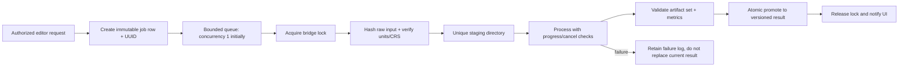

# BridgeGuard Point-Cloud Processing: Cleaning, Spatial Carving, Structural Segmentation, and Vertical-Clearance Measurement

**Technical research report and implementation audit**  
**Repository:** `bensidhom/remote`  
**Audited revision:** `8f4d00244c76a43c112380c1e26a65e01112462f`  
**Audit date:** 2026-08-11  
**Scope:** the code and locally persisted artifacts in this repository, supplemented by the standards, official software documentation, and research literature listed in Section 25.

> **Status statement.** BridgeGuard presently implements a promising bridge-point-cloud screening workflow: it can retain a raw scan, construct a reduced analysis sample, conservatively remove visually identified clutter, derive bridge-oriented geometric regions, fit simplified component solids, and estimate a roadway-to-soffit vertical gap. It is not yet a validated survey instrument, an autonomous NBIS inspection, or a generator of submission-ready SNBI B.H.13 or B.N.02 values. Every computed clearance should remain a candidate measurement for qualified human review until units, coordinate frame, feature identity, acquisition accuracy, uncertainty, and field-reference validation are controlled.

> **Implementation reconciliation (2026-08-14).** PR 0 now defaults protected deployments to an explicit blocked/screening-only contract. PR 1 adds signature-bound E57 ingestion; reviewed units, coordinate frame, CRS, gravity, scan selection, and registration evidence; float64 reversible transforms; bounded source inspection; and immutable source-profile receipts. PR 2 now binds bridge-scoped analysis/segmentation to one integrity-verified published canonical revision and supplies the VLM with a bounded, deterministic knowledge pack containing decoded, provenance-bearing SNBI component values plus only same-scope cited report evidence in a separately marked untrusted block. The exact pack bytes/hash and all source/publication/dictionary/report-set receipts are retained with the immutable processed generation and revalidated before publication; the former independent latest-year and raw report-cache context paths were removed. Formats that the browser can display but the server cannot parse metrically remain view-only. These controls establish provenance, coordinate correctness, and contextual isolation but do not make the current segmentation or clearance algorithms survey-grade; typed multimodal output, conservative fusion, component geometry, feature-bound measurement, durable review, and field validation remain phased work in [`point-cloud-processing-hardening-plan.md`](point-cloud-processing-hardening-plan.md).

---

## Abstract

This report reconstructs the complete BridgeGuard point-cloud workflow from file ingestion through cleaning, spatial carving, component segmentation, simplified geometry fitting, vertical-clearance estimation, visualization, and persistence. The study combines a static audit of the frontend, API, geometry algorithms, authentication rules, storage model, dependencies, and tests with a read-only examination of the locally saved point-cloud inventory. It then compares the implementation with Federal Highway Administration (FHWA) Specifications for the National Bridge Inventory (SNBI), National Bridge Inspection Standards (NBIS) requirements, transportation LiDAR guidance, point-cloud file specifications, and relevant bridge-clearance and semantic-segmentation literature.

The production user path is narrower than the source tree suggests. The visible **Process Bridge** action submits a browser-parsed or server-parsed point set to a combined `/analyze` endpoint with hosted visual reasoning enabled, local SAM disabled, and `model_mode=clearance`. The default cleaner is not conventional statistical denoising. It is a conservative coarse-to-fine cube classifier: raster views of colored spatial cubes are sent to the configured Cerebras vision-capable model, which classifies each cube as bridge, clutter, or mixed. Geometry then estimates a bridge-aligned frame, deck footprint, under-surface, supports, and fitted solids. A separate, older `/segment` pipeline exists, but it uses different class identifiers and a simpler Z-band algorithm and is not exposed by the current rendered interface.

For highway clearance, the implementation divides the cloud into a 64-by-64 XY grid, detects the largest vertical point gap within eligible cells, estimates road and soffit shells, groups cells into roadway candidates, fits two planes using least squares with median-absolute-deviation trimming, and evaluates their vertical separation. This is a reproducible engineering heuristic, but it is not RANSAC and it is not feature-complete for SNBI B.H.13. The code excludes the outer 15% of an inferred transverse footprint, selects the largest roadway rather than the lowest-clearance roadway as the primary result, can remove attached signs or utilities as clutter, does not bind a result to a specific SNBI feature record, and rounds to hundredths of a foot rather than down to a tenth. The waterway calculation is substantially weaker: it treats a global low-Z percentile as a water-level proxy and does not use a navigation channel or controlling permit/gage datum, so it cannot be considered B.N.02-compliant.

The audit also finds operational weaknesses: non-E57 units and coordinate reference systems are not read; all opened scan formats are treated as metric and Z-up; multi-scan E57 files are not merged; stored results have no input hash, processing timestamp, code version, parameter snapshot, uncertainty, or current-provider provenance; viewers may invoke a bridge analysis that overwrites shared processed files; and concurrent same-bridge jobs can collide. The repository has two point-cloud-specific tests but no accuracy, robustness, standards, malformed-input, or concurrency test suite. A research-grade validation program is therefore proposed, including structural-retention recall, clutter precision, class IoU/F1, dimensional error, clearance bias/MAE/RMSE, controlling-location error, uncertainty calibration, repeatability, and stratification by scanner, density, bridge form, roadway arrangement, units, occlusion, and environmental clutter.

**Keywords:** bridge inspection; point cloud; LiDAR; E57; LAS; spatial carving; semantic segmentation; vertical clearance; SNBI B.H.13; navigation clearance; VLM; Cerebras; quality assurance.

---

## 1. Research questions and scope

This report addresses six questions.

1. What does BridgeGuard actually do when a user opens a point cloud and selects **Process Bridge**?
2. How do file parsing, sampling, cleaning, VLM-assisted carving, geometric segmentation, fitted component models, and clearance estimation interact?
3. Which source-code paths are operational, which are optional, and which are currently unreachable from the user interface?
4. How closely does the calculated vertical gap correspond to FHWA SNBI highway and navigation-clearance definitions?
5. What can and cannot be inferred from the current local processed artifacts and test suite?
6. What changes and experiments are necessary to support research publication, multi-user production, and eventual agency decision support?

### 1.1 Included material

The audit covers:

- browser parsing and visualization in [`PointCloud.tsx`](../frontend/src/pages/PointCloud.tsx);
- point-cloud API transport, attachment storage, persistence, and bridge context in [`point_cloud_api.py`](../backend/app/routers/point_cloud_api.py);
- geometry, denoising, carving, segmentation, fitting, and clearance in [`point_cloud.py`](../backend/app/routers/services/point_cloud.py);
- hosted model dispatch in [`llm_providers.py`](../backend/app/routers/services/llm_providers.py);
- role enforcement in [`auth.py`](../backend/app/auth.py);
- database field loading in [`database.py`](../backend/app/routers/services/database.py) and [`constants.py`](../backend/app/routers/services/constants.py);
- NBI-to-SNBI clearance transition logic in [`mapper.py`](../backend/app/routers/services/mapper.py);
- production dependencies, container process configuration, deployment settings, README claims, and tests;
- aggregate, read-only characteristics of locally saved raw and processed point-cloud artifacts.

### 1.2 Excluded claims

This report does not claim that:

- the local collection is representative of the NJDOT bridge population;
- a stored SNBI or legacy NBI clearance is survey ground truth;
- a high application confidence label is a calibrated probability or uncertainty bound;
- a visually plausible fitted bridge model is metrically accurate;
- hosted-VLM classifications are deterministic across model revisions;
- the current workflow replaces a qualified bridge inspector, surveyor, or agency reporting procedure.

### 1.3 Method and evidence classes

The implementation was traced from the visible UI event through every server call and output-writing branch. Constants and equations were reconstructed directly from source. Local artifacts were inspected only in aggregate. External claims use the authoritative or original sources listed in Section 25.

Evidence is classified as follows:

| Label | Meaning |
|---|---|
| **Implemented fact** | Directly established by the audited revision. |
| **Local diagnostic** | Observed in this workspace on 2026-08-11; volatile and not a benchmark. |
| **Standard requirement** | Derived from FHWA, eCFR, ASTM, or ASPRS material. |
| **Research precedent** | Reported by an original study; not necessarily adopted by BridgeGuard. |
| **Recommendation** | Proposed future design or experiment, not current behavior. |

### 1.4 Threats to validity and audit environment

This is primarily a static implementation audit, not a prospective field experiment. The following limitations constrain its conclusions:

- the live OCI container, environment variables, exact Cerebras model/configuration, Cloudflare perimeter, and provider responses were not captured or replayed;
- the local processed artifacts are a convenience sample, are stale relative to the current processing path, and have no source hash, acquisition metadata, or survey ground truth;
- carve audit responses are truncated and the old processed results have no replayable model/prompt record;
- aggregate artifact inspection cannot determine whether the source scan was complete, registered, leveled, metric, contemporaneous, or associated with the matched feature;
- the repository worktree contained unrelated modified presentation files and untracked documentation, but the audited point-cloud/API/auth/database source files had no tracked diff from the stated commit;
- official web documentation can change; mutable web sources were accessed on 2026-08-11 and the validation-logic version is recorded in the bibliography.

The focused test interpreter was CPython 3.14.5 with NumPy 2.5.1; its local virtual environment did not have SciPy or pye57 installed, so passing unit tests did not exercise neighborhood geometry or E57 decoding. The declared deployment requirements specify NumPy 2.5.1, pye57 0.4.19 on supported non-ARM platforms, unpinned SciPy/Matplotlib, and Cerebras Cloud SDK 1.67.0. The frontend toolchain observed for this audit was Node 24.18.1 and npm 11.16.0. A reproducible experiment must capture the actual container lockfile/image digest rather than infer runtime behavior from declarations.

### 1.5 Post-report implementation reconciliation (2026-08-14)

This report is a point-in-time audit. Later hardening in the same working tree addressed several operational findings but did not validate the measurement algorithms:

- point-cloud attachment rows and storage are now workspace-scoped;
- uploads use opaque objects, bounded streaming, SHA-256 receipts, and confined paths;
- processed output uses immutable generations, unique staging, atomic pointer promotion, artifact hashes, and source/profile/snapshot binding;
- source and published-snapshot identity are rechecked before a result can become current;
- heavy point-cloud endpoints use bounded quotas and per-bridge in-process locks;
- deletion requires an authenticated actor and reason and uses the retention audit/outbox; and
- report RAG now has revision-scoped source receipts, hybrid retrieval, citations, and explicit untrusted-evidence boundaries.

PR 0 of the follow-on hardening plan also adds a versioned result contract. Legacy outputs are explicitly `screening_estimate`, use `client_asserted_unverified` units and `assumed_z_up_unverified` gravity, remain `unreviewed`, and set `submission_ready=false`. Protected deployments default to `POINT_CLOUD_PIPELINE_MODE=required` and cannot silently fall back to the legacy research engine while the replacement is incomplete.

The scientific findings remain open: format support is inconsistent, units/CRS/gravity/registration are not proven, bridge context is still assembled from legacy latest-year tables, attached report text is not yet passed through the hardened RAG adapter, VLM output is not schema-enforced, cleaning can be destructive, clearance can return numeric fallbacks, BH13 is not feature-bound, and the waterway calculation lacks a controlling datum. The implementation sequence is maintained in [`point-cloud-processing-hardening-plan.md`](point-cloud-processing-hardening-plan.md).

---

## 2. Terminology: four different operations that should not be conflated

BridgeGuard’s source and UI sometimes use overlapping terms. A research description should keep the following distinctions explicit.

| Term | Meaning in this report | BridgeGuard implementation |
|---|---|---|
| **Parsing** | Decoding a file into numeric XYZ points and optional color/intensity. | Server for E57 and NPZ; browser for PLY, LAS, and generic text. |
| **Sampling** | Selecting a subset for display or analysis without necessarily aggregating geometry. | Deterministic, approximately evenly spaced source indices. |
| **Denoising** | Removing sparse statistical outliers and locally volumetric scatter. | Separate SciPy k-nearest-neighbor filter; not the default destructive cleaner in the active path. |
| **Smoothing** | Moving retained points toward locally fitted surfaces. | Gaussian-weighted local plane projection in the standalone `/smooth` path. |
| **Carving** | Recursively dividing space into cubes and using visual classification to keep, remove, or subdivide regions. | Hosted-VLM-assisted cube deletion in the active `/analyze` path. |
| **Semantic segmentation** | Assigning each point a component category. | Deterministic geometry first; VLM review or renaming second. It is not a trained point-wise 3D network. |
| **Instance segmentation** | Separating multiple objects of the same semantic class. | Optional 2D SAM render/back-projection in a legacy path; disabled and unavailable in production. |
| **Component fitting** | Replacing point regions with simplified lofts, ribbons, cylinders, or prisms. | Active after geometric labeling. |
| **Vertical extent** | Maximum minus minimum Z of a cloud or fitted component. | Displayed as cloud height or component `H`; not clearance. |
| **Vertical clearance** | Plumb separation between a lower traveled surface and an overhead restriction at matched XY. | Plane-to-plane Z difference for highway candidates; low-return proxy for waterways. |

The application’s use of “carving” should also not be read as the classical multi-view silhouette space-carving algorithm. Here it means recursive region classification in an axis-aligned 3-D lattice.

---

## 3. System architecture and active data flow

```mermaid
flowchart LR
  U["Editor uploads raw cloud"] --> A["Bridge attachment storage"]
  A --> F{"File format"}
  L["User opens local cloud"] --> F
  F -->|"E57"| E["Server: pye57, scan 0"]
  F -->|"NPZ"| N["Server: NumPy"]
  F -->|"PLY / LAS / text / PCD"| B["Browser parser"]
  E --> V["Three.js preview"]
  N --> V
  B --> V
  V --> P["Process Bridge"]
  P --> X["POST bridge point-cloud/analyze"]
  X --> S["Analysis sample: at most 300k in clearance mode"]
  S --> C["Hosted-VLM cube carving"]
  C --> G["Bridge frame, footprint, geometric labels"]
  G --> M["Fitted component solids"]
  M --> J["Hosted VLM component review"]
  G -->|"pre-review labels"| Q["Road/soffit clearance estimation"]
  J --> O["Reviewed components and expanded viewer labels"]
  O --> R["Persist processed NPZ, PLY, analysis JSON"]
  Q --> R
  R --> UI["Viewer: components, layers, clearance, downloads"]

  D["Bridge DB, elements, reports"] -. "prompt context" .-> J
  D -. "feature kind only" .-> Q
  D -. "not passed by active path" .-> QX["BH13 cross-check"]
```



### 3.1 What the visible button sends

The frontend fixes `useHostedVlm=true` and `useAiCleaning=true` and sends `use_local_sam=false` and `model_mode=clearance` when **Process Bridge** is selected ([`PointCloud.tsx#L671`](../frontend/src/pages/PointCloud.tsx#L671), [`PointCloud.tsx#L1642`](../frontend/src/pages/PointCloud.tsx#L1642)). There is no visible user opt-out for sending rendered analysis views to the hosted provider.

### 3.2 What is not part of the visible production path

The component still defines callbacks for standalone smoothing, standalone segmentation, standalone clearance, manual two-click measurement, photogrammetric reconstruction, and Poisson meshing. The rendered interface does not call those callbacks. The frontend also references `/api/point-cloud/reconstruct` and `/api/point-cloud/mesh`, but corresponding backend routes are absent. These paths must not be described as active product capabilities merely because code fragments remain.

### 3.3 Relationship to Ask and document embeddings

The point-cloud pipeline is separate from the document RAG/Ask pipeline. Point coordinates and component meshes are not embedded with the text embedding model and are not retrieved as document chunks. Bridge database records and selected inspection-report excerpts can be supplied as text context to the VLM component judge, but geometric segmentation and clearance are computed in the point-cloud service. Thus “Ask knows the point cloud” is not an accurate description of the current architecture.

---

## 4. Input contract and actual format support

### 4.1 Accepted upload extensions

The API accepts `.las`, `.ply`, `.e57`, `.xyz`, `.pcd`, `.csv`, `.txt`, and `.npz` ([`point_cloud_api.py#L38`](../backend/app/routers/point_cloud_api.py#L38)). The default raw upload limit is 500 MiB, while a point-array analysis request defaults to 128 MiB ([`point_cloud_api.py#L39`](../backend/app/routers/point_cloud_api.py#L39)). Acceptance by extension does not mean complete semantic support.

| Format | Where decoded | What is retained | Important limitation |
|---|---|---|---|
| E57 | Server, `pye57` | XYZ; RGB when available; otherwise normalized intensity | One selected scan, normally index 0; no merge/registration of multiple scans; embedded images and broader metadata are not used. |
| NPZ | Server, NumPy with pickle disabled | Required `points`; optional colors | Entire compressed body is held in memory; expected key/schema is application-specific. |
| PLY | Browser | Vertex XYZ and selected color properties | Implements only a subset of ASCII/binary PLY; list-property byte widths are not fully skipped; units/CRS are not established. |
| LAS | Browser | Scaled and offset XYZ | No LAZ; ignores CRS/WKT/GeoTIFF VLRs, unit metadata, point classification, return numbers, intensity, and RGB. |
| XYZ/CSV/TXT | Browser generic text parser | First three numeric tokens per accepted row | Delimiters/headers/units/CRS are not formally profiled. |
| PCD | Browser generic text parser | Only text that happens to resemble XYZ rows | Binary PCD is not parsed; declaring `.pcd` accepted overstates support. |
| LAZ | None | None | Explicitly unsupported. |

E57 support is platform-conditional. The production requirements install `pye57==0.4.19` only when the machine architecture is neither `aarch64` nor `arm64`; on an ARM deployment the point-cloud health route reports degraded E57 support unless the dependency is supplied separately ([`requirements.txt#L34`](../backend/requirements.txt#L34), [`point_cloud_api.py#L788`](../backend/app/routers/point_cloud_api.py#L788)). The audit does not infer the live OCI architecture from repository configuration.

The backend can independently reopen a saved attachment for analysis only when it is E57. For every saved non-E57 attachment, the browser must download and parse the file and submit point coordinates in the request ([`point_cloud_api.py#L354`](../backend/app/routers/point_cloud_api.py#L354)).

Source color/intensity is preview data, not an input to the active bridge analysis. The frontend’s binary submission gathers coordinates without colors, the E57 analysis path ignores its decoded color array, and `analyze_bridge` accepts only XYZ ([`PointCloud.tsx#L1656`](../frontend/src/pages/PointCloud.tsx#L1656), [`point_cloud_api.py#L854`](../backend/app/routers/point_cloud_api.py#L854)). Hosted carving and component review therefore see synthetic geometry renders with cube/class colors—not scanner photography, reflectance, or original RGB—even when those attributes were available during preview.

The PLY reader is a partial implementation of the [Stanford PLY format](https://graphics.stanford.edu/data/3Dscanrep/). In binary PLY, list properties are not advanced by their variable byte widths, so uncommon vertex layouts can be misaligned ([`PointCloud.tsx#L243`](../frontend/src/pages/PointCloud.tsx#L243)). Its reported absolute bounds also add the centroid twice, although the recentered geometry and spans remain usable ([`PointCloud.tsx#L331`](../frontend/src/pages/PointCloud.tsx#L331)). PCD support similarly falls far short of the [PCL PCD specification](https://pcl.readthedocs.io/projects/tutorials/en/master/pcd_file_format.html): binary and binary-compressed PCD are not decoded.

The E57 standard can represent much more than raw coordinates, including color, intensity, imagery, transforms, and metadata. The app consumes only a narrow scan-point subset. The LAS specification similarly defines scale/offset, CRS representation, point formats, return/classification semantics, and VLR/EVLR metadata; the current minimal parser uses only the coordinate-related portion. See [ASTM E2807-11(2026)](https://store.astm.org/e2807-11r26.html), the [libE57 Foundation API](https://www.libe57.org/FoundationAPI/html/index.html), [pye57](https://github.com/davidcaron/pye57), the [ASPRS LAS 1.4 R15 specification](https://www.asprs.org/wp-content/uploads/2019/07/LAS_1_4_r15.pdf), and [PDAL’s LAS reader documentation](https://pdal.io/en/stable/stages/readers.las.html).

### 4.2 Raw attachment lifecycle

An editor upload is streamed into a `.uploading` temporary file and then renamed into:

```text
attachments/point_clouds/<state>_<bridge>/<sanitized-filename>
```

The bridge attachment row is replaced so there is effectively one current raw point cloud per bridge. A new upload deletes the bridge’s `processed/` directory. Basename and bridge-ID sanitization reduce path-traversal risk. However, validation is based on the extension alone; the service does not inspect a magic number, MIME/content consistency, decompression ratio, scanner metadata, CRS, or unit declaration before accepting the file ([`point_cloud_api.py#L238`](../backend/app/routers/point_cloud_api.py#L238), [`point_cloud_api.py#L632`](../backend/app/routers/point_cloud_api.py#L632)).

### 4.3 Browser and server memory behavior

For client-parsed PLY, LAS, and generic text formats, the 2,000,000-point browser display cap is applied only after the file has been read into an `ArrayBuffer`; it therefore does not limit peak ingestion memory. E57 and NPZ use the server preview paths. The normal UI’s `gatherPointsBinary()` posts the rendered point buffer to analysis, so the cap becomes the maximum UI-supplied analysis—and, for a bridge-scoped run, persistence—source. The binary server request is accumulated in a byte array, converted to immutable bytes, decoded as float32, converted to float64, and later expanded into KD-tree neighborhoods and label arrays. Concurrent requests can consume several times the nominal body limit.

E57 has a separate peak-memory problem in both preview and saved-file analysis. Normal preview first materializes the complete selected scan and only then downsamples it; the saved-file branch additionally calls `world_points_from_e57(..., max_points=0)` before the later analysis sample is taken ([`point_cloud.py#L235`](../backend/app/routers/services/point_cloud.py#L235), [`point_cloud.py#L308`](../backend/app/routers/services/point_cloud.py#L308), [`point_cloud_api.py#L369`](../backend/app/routers/point_cloud_api.py#L369)). A compressed or large E57 can therefore consume much more memory than either the preview or 300,000-point geometry cap suggests.

Non-finite coordinates expose a contract mismatch. `_as_xyz` silently drops NaN/Inf rows before analysis, but bridge persistence compares the returned label count with the original unfiltered request array. The calculation can succeed while saving the bridge result fails with only a warning because the lengths no longer match ([`point_cloud.py#L291`](../backend/app/routers/services/point_cloud.py#L291), [`point_cloud_api.py#L136`](../backend/app/routers/point_cloud_api.py#L136)). Input validation should reject or consistently filter such rows before both analysis and persistence.

### 4.4 Sampling

Both browser rendering and backend analysis use deterministic source-index sampling rather than voxel aggregation or randomized, density-aware sampling. At the backend, the sample indices are generated with evenly spaced positions, capped at 300,000 points for clearance mode and 600,000 by default for structural mode ([`point_cloud.py#L78`](../backend/app/routers/services/point_cloud.py#L78), [`point_cloud.py#L301`](../backend/app/routers/services/point_cloud.py#L301)).

This has two implications:

1. reproducibility is good for a fixed file ordering; and
2. representativeness can be poor when the scanner or converter groups points by scan line, return, tile, class, or acquisition time.

A research version should compare ordered-stride sampling with voxel-grid centroids, spatially stratified sampling, and importance sampling around candidate road/soffit surfaces.

---

## 5. Coordinate system, units, and the measurement contract

The geometry assumes that:

- XYZ is Cartesian;
- Z is aligned with gravity;
- a coordinate unit equals one meter when `scale_known=true`;
- individual scans are already registered;
- the road and soffit are sufficiently sampled;
- global extents are not dominated by unrelated distant geometry.

The newly opened raw-file path marks E57, NPZ, LAS, PLY, XYZ, CSV, TXT, and PCD as scale-known and displays extents in meters; a cached processed analysis can instead restore its saved `scale_known` metadata. ASTM E2807 standardizes E57 quantities in SI units, but the app does not parse LAS CRS/unit metadata and cannot infer units for NPZ, PLY, PCD, or text. Consequently, a non-E57 scan in US survey feet can be treated as meters, and every fixed metric threshold becomes wrong by a factor of approximately 3.28. Merely setting `scale_known=false` does not solve this: the algorithm still uses thresholds such as a 1.2-unit minimum vertical gap, 0.5-unit clearance floor, and 0.6-unit road-plane RMS gate. The computation is therefore not scale-invariant.

Coordinate precision also depends on format and path. E57 and NPZ coordinates, and binary PLY coordinates in the browser, are cast to float32 before centering; persisted processed XYZ is likewise stored as float32 world coordinates ([`point_cloud.py#L242`](../backend/app/routers/services/point_cloud.py#L242), [`point_cloud_api.py#L138`](../backend/app/routers/point_cloud_api.py#L138), [`PointCloud.tsx#L321`](../frontend/src/pages/PointCloud.tsx#L321)). Large georeferenced eastings/northings can therefore lose centimeter-scale relative detail through quantization before analysis or after reload. LAS and generic-text browser paths center in float64 first, so behavior is format-dependent, while plane fitting still solves against uncentered world X/Y. Translation-invariance and large-offset precision must be tested explicitly.

The required preprocessing contract should be made explicit:

```text
registered + leveled + gravity-aligned + declared linear unit + declared CRS/local frame
```

Recommended required metadata are:

- source format and scanner/export software;
- coordinate reference system or explicit local frame;
- horizontal and vertical units;
- gravity/up vector and any leveling transform;
- E57 scan indices and transforms included in the analysis;
- registration residual and control method;
- acquisition accuracy, density, date, and environmental conditions;
- known scale target when the source is photogrammetric or unitless.

FHWA’s mobile-LiDAR guidance stresses that accuracy, density, intended use, and post-processing requirements must be defined before collection; survey/engineering applications demand a different accuracy class than general asset inventory ([FHWA-HIF-16-010](https://www.fhwa.dot.gov/construction/3d/hif16010.pdf)). The published [NCHRP Report 748](https://onlinepubs.trb.org/onlinepubs/nchrp/nchrp_rpt_748.pdf) likewise emphasizes calibration, control, validation, reproducible metadata, deliverables, and application-specific acceptance criteria.

---

## 6. Standalone denoising and smoothing

These functions are implemented and callable through an API, but they are not the destructive cleaning stage used by the visible **Process Bridge** workflow.

### 6.1 Statistical outlier score

For each point (p_i), the service queries up to (k=12) neighbors through SciPy’s [`cKDTree.query`](https://docs.scipy.org/doc/scipy/reference/generated/scipy.spatial.cKDTree.query.html) and computes the mean non-self neighbor distance:

\[
\bar d_i=\frac{1}{k}\sum_{j=1}^{k}\lVert p_i-p_{ij}\rVert_2.
\]

A point is marked statistically isolated when:

\[
\bar d_i>\mu_{\bar d}+2\sigma_{\bar d}.
\]

This follows the general statistical-outlier pattern documented by [PDAL](https://pdal.io/en/stable/stages/filters.outlier.html) and [PCL](https://pointclouds.org/documentation/tutorials/statistical_outlier.html), although exact defaults and implementation details differ.

### 6.2 Local surface-variation score

For the covariance eigenvalues of a local neighborhood, ordered as (\lambda_1\leq\lambda_2\leq\lambda_3), BridgeGuard computes:

\[
S_i=\frac{\lambda_1}{\lambda_1+\lambda_2+\lambda_3+\epsilon}.
\]

The point is treated as volumetric scatter when (S_i>0.11). The statistical and surface-variation masks are ORed. The intent is to remove both isolated sensor returns and vegetation-like local scatter while retaining planar deck/road regions and linear structural edges ([`point_cloud.py#L332`](../backend/app/routers/services/point_cloud.py#L332)). If SciPy is unavailable or fewer than 200 points are present, the function returns an all-false noise mask.

### 6.3 Local plane-projection smoother

For each point and its (k=16) neighborhood, weights are assigned as:

\[
w_{ij}\propto \exp\left(-\frac{d_{ij}^{2}}{h_i^{2}}\right),
\]

where (h_i) is the mean non-self neighbor distance. The weighted centroid and covariance are computed, the eigenvector associated with the smallest eigenvalue is taken as the local plane normal (n_i), and the point is projected onto that plane:

\[
p_i'=p_i-\left[(p_i-c_i)\cdot n_i\right]n_i.
\]

The operation preserves point order and count after filtering ([`point_cloud.py#L374`](../backend/app/routers/services/point_cloud.py#L374)). This is best described as an **MLS-inspired local plane projection**. The [PCL Moving Least Squares tutorial](https://pointclouds.org/documentation/tutorials/resampling.html) describes a fuller polynomial surface reconstruction/resampling method; BridgeGuard does not implement that complete procedure.

### 6.4 Open3D path is not operational in this deployment

The source attempts to import an `open3d_bridge` helper for optional outlier removal and later Poisson meshing. That helper file is absent, and Open3D is deliberately omitted from production requirements. The endpoint therefore uses the NumPy/SciPy path. This differs from [Open3D’s documented statistical outlier removal](https://www.open3d.org/docs/latest/tutorial/Advanced/pointcloud_outlier_removal.html) and [Poisson surface reconstruction](https://www.open3d.org/docs/latest/tutorial/geometry/surface_reconstruction.html), which are useful design references but not current production dependencies.

---

## 7. Active cleaning method: conservative hosted-VLM cube carving

### 7.1 Why it exists

The active clearance workflow disables conventional statistical removal as its first destructive step and defaults to `clean_mode=carve` ([`point_cloud.py#L2884`](../backend/app/routers/services/point_cloud.py#L2884)). The design goal is high structural recall: a sparse pier edge, cable, flange, or attached member should not be erased merely because it is locally isolated. A visual model instead judges spatial regions in the context of the whole bridge.

### 7.2 Algorithm

Carving is conditional, not universal. `_qwen_octree_carve` returns immediately for fewer than 5,000 points, and `analyze_bridge` skips the carving stage when `scale_known=false` ([`point_cloud.py#L2396`](../backend/app/routers/services/point_cloud.py#L2396), [`point_cloud.py#L2964`](../backend/app/routers/services/point_cloud.py#L2964)). The following algorithm describes a scale-known clearance-mode run that clears those gates.

Let the analysis sample have axis-aligned bounds (b_{min},b_{max}), and let:

\[
L_0=\frac{\max(b_{max}-b_{min})}{3}.
\]

The cloud is partitioned into occupied cubes of edge (L_0). If the edge exceeds the default 4 m judge threshold, the lattice descends geometrically without model calls until cubes are small enough, subject to a hard pre-descent cap of six levels. A cloud whose maximum extent exceeds roughly 768 m can therefore still reach a judged level with cubes larger than 4 m. At each judged level:

1. cubes with fewer than 40 points are kept unjudged;
2. no more than 192 cubes are judged at that level;
3. cubes are batched eight at a time;
4. up to 5,000 points per cube plus gray contextual points are rendered;
5. oblique, side, and top views are produced;
6. the hosted model returns `bridge`, `clutter`, or `mixed` for each colored cube;
7. `bridge` becomes final keep, `clutter` is removed, and `mixed` is subdivided;
8. failed, missing, over-budget, too-small, or unresolved final-level decisions are kept.

Five levels are used by default and may be configured from one to eight. With 24 batches per level, a five-level upper bound is 120 sequential logical carve batches before later component review. Each logical call permits a 300-second timeout and the provider wrapper can make up to three HTTP attempts, so repeated rate limits can expand that bound to 360 provider attempts, plus up to two logical component-review calls with the same retry behavior ([`llm_providers.py#L406`](../backend/app/routers/services/llm_providers.py#L406)). These are worst-case code bounds, not typical measured request counts.

That bound creates a direct capacity risk against the [default provider-limit profile](../backend/app/routers/services/llm_providers.py#L33) recorded in the same repository: `gemma-4-31b` is described as allowing 5 requests per minute and 150 per hour. A 120-batch dense carve consumes 80% of the hourly allowance even without retries and can violate the minute limit whenever calls complete faster than the required pacing; retry attempts can increase both pressure and total traffic. The [call wrapper](../backend/app/routers/services/llm_providers.py#L406) does not pace against the displayed limits, reserve shared quota, or honor a `Retry-After` duration; it retries a rate limit after approximately 1.5 and 3 seconds. Rate-limited batches fail open and keep their cubes, while a single non-throwing call can still make `hosted_cleaning_used=true`. A provider-aware queue and request-budget reservation are prerequisites for predictable cleaning.

### 7.3 Protective guards

The implementation is deliberately fail-open:

- thin, concentrated Z slabs are pre-kept;
- a clutter decision is rescued when the cube contains a strong Z concentration and at least 1,500 points;
- render or provider failure keeps the cube;
- more than 90% proposed removal cancels the entire removal as a likely hallucination;
- more than 50% proposed removal is flagged for review inside the carve audit; and
- the combined analysis applies the proposed carve mask only when at least 5,000 points would remain. If fewer survive, the deletion is silently discarded even though the carve audit can still report removed points and `review_recommended` ([`point_cloud.py#L2984`](../backend/app/routers/services/point_cloud.py#L2984)).

This policy prioritizes not deleting bridge structure. It also means clutter may remain when the call budget, render quality, or provider availability is insufficient.

### 7.4 Audit artifacts

The algorithm writes rendered views, the first 4,000 characters of each raw response, parsed decisions, and a summary under:

```text
data/pointcloud_carve/YYYYMMDD_HHMMSS/
```

The folder name is only second-resolution and is not keyed by bridge, user, job UUID, source hash, or model revision. Concurrent jobs started within the same second may collide or intermix. These audit artifacts are outside the bridge attachment directory, so deleting a bridge cloud does not necessarily remove the images or model responses generated from it.

### 7.5 Model role and provider truth

Some helper names and comments still say “Qwen,” “local vision,” or “on-device.” In the audited code, `_hosted_vlm_generate` delegates to the configured Cerebras provider, whose default model setting is `gemma-4-31b` ([`llm_providers.py#L23`](../backend/app/routers/services/llm_providers.py#L23)). The exact deployed model can be changed by environment configuration. This report therefore uses **hosted VLM** except when naming a legacy function.

The production dependency set omits Torch, Ultralytics, SAM, Open3D, and local model runtimes. No backend GPU is required for the supported path. However, Three.js requests a high-performance WebGL context in the user’s browser, so “CPU-only server” does not mean “the laptop GPU is never used.” A low-power WebGL option is advisable for machines with unstable GPU drivers.

### 7.6 Safety conflict with clearance

The cube-carving prompt lists poles and sign gantries among clutter examples. The later component-review vocabulary also treats poles, signs, wires, cables, and lights as possible clutter. FHWA B.H.13, however, measures to the lowest bridge member, attached appurtenance, or other restriction. Deleting an attached sign, light, cable, or utility can increase the computed gap and create a safety-critical overestimate. Survival through cleaning is not sufficient: the active clearance mask contains only deck, girder, road, and substructure labels, so a retained restriction labeled parapet/edge or unknown is still unable to control the numeric result unless it is misclassified as deck or girder ([`point_cloud.py#L3411`](../backend/app/routers/services/point_cloud.py#L3411)). Both cleaning and clearance extraction must therefore distinguish:

- unrelated foreground/background clutter that may be removed; and
- attached or roadway-overhead restrictions that must be retained in a dedicated `restriction` class.

### 7.7 Status counters do not isolate “noise”

Two returned fields require careful interpretation. `hosted_cleaning_used` means that at least one carve-model call returned without an exception; even that response may be unparseable or contain no usable verdict. It does not prove that a point was removed, that every intended cube was reviewed, or that the final result passed an accuracy check. `cleaning.removed_noise` is calculated as total input points minus total retained points. It therefore combines hosted carve deletion, bridge-footprint exclusion, disconnected-panel pruning, fragment pruning, and any other point left outside the fitted model. It is not a statistical sensor-noise count.

The remaining cleaning counters use a different denominator. `sam_removed`, `fragment_removed`, and `detached_removed` are counts on the reduced analysis sample, while `input_points`, `kept_points`, and `removed_noise` refer to the full submitted cloud. `sam_removed` also combines hosted-carve sample removals with optional local-SAM removals. These subcounts are not a partition of `removed_noise` and must not be summed or compared directly without their sample denominators ([`point_cloud.py#L3428`](../backend/app/routers/services/point_cloud.py#L3428)).

### 7.8 Structural mode is intentionally different

The backend also supports `model_mode=structural`. That mode is recall-first and skips aggressive pre-geometry AI cleaning so that sparse girders, railings, and other bridge members are less likely to be destroyed. It can nevertheless retain `clean_mode=carve` in metadata even when the carve was not run, so `model_mode`, `stage_counts`, carve audit, and warnings must be read together. The visible UI currently requests clearance mode, while the local persisted snapshot in Section 20 contains older structural-mode artifacts.

---

## 8. Geometric isolation and component segmentation in the active pipeline

The active pipeline is a hybrid. Geometry generates point labels and fitted regions; the VLM reviews or names them. It is not a learned point-wise semantic network.

### 8.1 Bridge-aligned frame

PCA is applied in plan view. The dominant XY eigenvector becomes the along-span axis (u), the orthogonal minor eigenvector becomes the transverse axis (v), and points are transformed into this bridge-oriented frame. Z remains the original vertical coordinate; there is no gravity estimation or leveling transform.

### 8.2 Local horizontality

For each sampled point, the covariance of its local neighbors is eigendecomposed with NumPy’s [`linalg.eigh`](https://numpy.org/doc/stable/reference/generated/numpy.linalg.eigh.html). The smallest-eigenvalue eigenvector is interpreted as a normal. The score:

\[
H_i=|n_{i,z}|
\]

approaches 1 for horizontal road/deck surfaces and 0 for vertical faces. If SciPy is absent, all points receive 1 and orientation discrimination degrades ([`point_cloud.py#L543`](../backend/app/routers/services/point_cloud.py#L543)).

### 8.3 Deck band and footprint

The code builds a Z histogram, searches for a dominant elevated mode, defines an approximate deck top above that mode, estimates an initial soffit with a low percentile of the deck-band points, and rasterizes deck occupancy in the bridge frame. The largest connected deck blob becomes the footprint. In clearance mode, approach cells without a convincing under-deck air gap are removed so long approach pavement is less likely to become part of the bridge.

This is a shape prior: the method expects a visible, dominant elevated deck mass. Deck-only scans, arches, trusses, severe skew, variable-depth members, dense overhead utilities, or a large unrelated elevated slab can violate that assumption. The failure path does not abstain: when deck-band support is 50 points or fewer, or footprint extraction returns `None`, all cleaned points are treated as inside the footprint and downstream labeling/fitting continues ([`point_cloud.py#L3042`](../backend/app/routers/services/point_cloud.py#L3042)). A plausible result can therefore be produced after failed bridge isolation.

### 8.4 Under-surface and substructure

The algorithm searches below the approximate soffit for the lowest dense horizontal mass, using a histogram and horizontal-orientation filter, and labels it as the road/ground or under-bridge surface. Points inside the footprint, below the deck, outside the road band, and locally vertical may become substructure. Very low points more than approximately 2.5 m below the road band are excluded from support candidates.

Detached panels and small connected fragments are pruned. This can suppress clutter, but sparse real members remain at risk. The later full-cloud propagation tries to recover geometry around the retained model while also carving points near removed analysis-sample coordinates.

### 8.5 Active class schema

The packed one-pass result uses kind-level identifiers:

| ID | Meaning |
|---:|---|
| 0 | removed or off-structure |
| 1 | deck / superstructure slab |
| 2 | substructure / supports |
| 3 | under-surface: road, ground, or waterway/banks |
| 4 | girders / beams / soffit ribs |
| 5 | parapet / railing / barrier |
| 6 | unknown bridge structure |

Individual component IDs are used internally for fitting and VLM review, then collapsed into these kind IDs for the per-input-point `labels_b64u8`. The returned `classes` array is therefore the authoritative legend.

### 8.6 VLM component review

Artificially colored component renders are shown to the hosted model with a bridge-element vocabulary and optional context from:

- latest bridge inventory geometry;
- element records;
- span and substructure records;
- feature records; and
- selected inspection-report excerpts.

The vocabulary is application-specific, but it was assessed against the terminology and element context in the [NJDOT Bridge Element Inspection Manual](https://dot.nj.gov/transportation/eng/structeval/pdf/BridgeElInsManual.pdf). That manual is not a label ontology for point-cloud segmentation and does not validate the model’s component assignments.

The model can propose a component name, material, confidence, evidence, and keep/drop result. In clearance mode, a slab or road/ground surface is protected only when its point count is at least `max(5,000, 5% of the analysis sample)`; a smaller slab/surface can still be dropped when `keep=false` agrees with a clutter-like label. Other component removal likewise requires agreement between the keep decision and a clutter-like label. Structural mode unconditionally protects modeled slabs, surfaces, columns, beams, and edges from this review-stage deletion.

Materials are visual/textual hypotheses, not measurements. The renders primarily show class colors and geometry, not calibrated spectral/material information. Inspection-report text can also anchor the answer to an old or unrelated condition and is an indirect-prompt-injection surface unless untrusted text is clearly delimited.

Component-review visibility is not guaranteed. The renderer takes a uniform source-index sample of at most 40,000 points from the complete cloud rather than stratifying by component, so a small or unfavorably ordered component can be absent or barely visible while still appearing in the prompt legend ([`point_cloud.py#L3610`](../backend/app/routers/services/point_cloud.py#L3610)). The palette also repeats every eight component IDs; when more than eight fitted components exist, distinct IDs can have indistinguishable colors even though the model is asked to decide them separately ([`point_cloud.py#L3152`](../backend/app/routers/services/point_cloud.py#L3152)). Both cases make component-specific names, materials, and keep/drop decisions ambiguous.

Review-stage keep/drop is causal for the displayed and persisted segmentation: a dropped component is removed from the component set and its final component/kind labels are zeroed. The active numeric clearance mask, however, is derived from the earlier geometric `labels` array—deck, girder, road, and substructure—not from those reviewed component IDs. A later VLM decision that drops a fitted component does not remove the same geometric label from the clearance point set, so an “AI-reviewed” viewer result does not mean clearance was recomputed from reviewed components. Conversely, the heuristic clearance confidence is computed from plane fit and cell count and does not automatically fall when hosted cleaning or component review was unavailable. The UI must present cleaning/review warnings independently from clearance confidence.

---

## 9. The separate legacy segmentation endpoint

The `/segment` endpoint implements a different, simpler pipeline and a different class-ID schema:

| ID | Legacy `/segment` meaning |
|---:|---|
| 0 | ground / roadway |
| 1 | substructure |
| 2 | soffit |
| 3 | deck |
| 4 | unclassified |
| 5 | noise / vegetation |

### 9.1 Z-band method

The method uses the 1st and 99th Z percentiles, a 400-bin histogram, a Gaussian smoothing kernel, and local maxima exceeding one quarter of the average smoothed count. The lowest mode defines ground top, the highest mode defines deck bottom, and an eligible middle mode defines a soffit band. A 56-by-56 XY grid provides per-cell Z standard deviation; unlabeled middle-band points in high-spread cells become substructure ([`point_cloud.py#L3516`](../backend/app/routers/services/point_cloud.py#L3516)).

Labels are created on at most 300,000 points and propagated to the complete point set by nearest neighbor. Without SciPy, the fallback is chunked brute force.

### 9.2 VLM and SAM roles

The hosted VLM sees three segmented renders and may change display names or material estimates. It does not change the geometric point labels. Optional MobileSAM renders a single 512-by-512 side elevation, runs 2-D instance masks, and back-projects only visible pixels. It adds instance IDs and does not replace semantic labels. This is a custom adaptation of the promptable 2-D method introduced by [Kirillov et al.](https://openaccess.thecvf.com/content/ICCV2023/html/Kirillov_Segment_Anything_ICCV_2023_paper.html), not native 3-D segmentation. The production requirements omit the SAM dependency, and the current UI sends it as disabled.

Although `segment_structure` accepts inspection-report context, the current `/segment` API dispatcher does not pass that argument. Bridge-scoped standalone segmentation therefore receives the function default rather than the bridge/report context assembled for the active `/analyze` path.

### 9.3 Why the two schemas matter

In active analysis, ID 0 means removed; in the legacy endpoint, ID 0 means ground. In active analysis, ID 3 means under-surface; in the legacy endpoint, it means deck. Persisting or combining labels without their returned class schema can silently corrupt visualization and downstream measurements.

---

## 10. Simplified component geometry

After active geometric labeling, BridgeGuard produces a lightweight digital representation intended for visualization and measurement support.

| Region | Fitted representation | Typical metadata |
|---|---|---|
| Deck | station-wise loft with a rectangularized section | vertices, faces, fit RMS, coverage, dimensions |
| Road/ground | thin ribbon loft | vertices, faces, fit RMS, coverage |
| Pier/column | cylinder when circular evidence is strong; otherwise piecewise prism | robust bounds, height, radius/width, fit statistics |
| Abutment/wall | connected support mass or prism | dimensions, occupancy, mesh |
| Girder | clustered beam-like solids in structural mode | simplified beam templates |
| Parapet/edge | clustered edge solids in structural mode | simplified edge templates |
| Unknown | clustered generic structural solids in structural mode | conservative fallback |

These models are idealized. They are not as-built BIM objects, finite-element meshes, or certified fabrication geometry. Their value is interpretability: a user can see what the pipeline believes is deck, support, under-surface, or beam, and a researcher can compute fit and completeness metrics.

The optional Poisson surface branch is effectively unavailable because the required Open3D bridge module does not exist in this repository. The frontend’s separate surface-mesh callback also targets an absent backend route. A product description should not promise a Poisson mesh in the current deployment.

---

## 11. Three quantities called “height” in the interface

### 11.1 Whole-cloud Z span

The statistics card calculates:

\[
H_{cloud}=z_{max}-z_{min}.
\]

It is an axis-aligned extent of the displayed cloud. It is not a bridge height, structural depth, or clearance, and it is meaningful in meters only when units and leveling are known.

### 11.2 Component height

Each fitted component displays (L\times W\times H). The third dimension is a robust histogram-supported Z extent of the component’s fitted/occupied bounds. It describes the component bounding height, not the vertical space available to traffic.

### 11.3 Vertical clearance

Clearance is evaluated at matched plan coordinates:

\[
C(x,y)=z_{overhead}(x,y)-z_{road}(x,y).
\]

It is the only one of the three intended to represent a roadway vertical restriction. The three quantities should receive separate UI labels and tooltips.

---

## 12. Highway vertical-clearance algorithm

### 12.1 Preconditions

The function accepts at least 50 finite XYZ points, retains at most 300,000, optionally denoises, and assumes Z-up. In the active combined workflow it is called with `clean=false` and normally receives the selected deck/girder/road/substructure sample rather than running the standalone denoiser again ([`point_cloud.py#L3402`](../backend/app/routers/services/point_cloud.py#L3402)). There is an important fallback: when that label mask contains fewer than 200 points, the entire post-cleaning analysis sample is sent to `compute_clearance` ([`point_cloud.py#L3411`](../backend/app/routers/services/point_cloud.py#L3411)). Weak segmentation can therefore reintroduce off-structure scene points and still end in a numeric global fallback.

### 12.2 Analysis grid

The 1st-to-99th percentile X and Y ranges are divided into a fixed 64-by-64 grid. For each cell containing at least 10 points, Z values are sorted and the largest adjacent gap is found. The required gap is:

\[
g_{min}=\max(1.2\text{ m},0.18\,Z_{span}),
\]

where (Z_{span}=P_{99}(z)-P_{1}(z)).

At least four points must occur below and above the gap. The candidate surfaces are:

\[
z_{road,cell}=P_{95}(z_{below})
\]

and

\[
z_{soffit,cell}=P_{5}(z_{above}).
\]

Cells with a candidate gap below 0.5 m are rejected. Thin bands around these shells supply points for later plane fitting ([`point_cloud.py#L650`](../backend/app/routers/services/point_cloud.py#L650)).

### 12.3 Roadway components

The valid-cell mask is dilated twice in four-neighbor directions to bridge small holes caused by piers or scanner shadows. Eight-connected components are found with custom grid traversal; SciPy’s [`ndimage.label`](https://docs.scipy.org/doc/scipy/reference/generated/scipy.ndimage.label.html) is a comparison reference, not the invoked implementation. A component must include at least:

\[
n_{cells,min}=\max(12,0.04n_{valid}).
\]

Within each component, points with local normal score (|n_z|>0.5) are preferred for road and soffit fitting, with fallback to all shell points when fewer than 30 remain.

### 12.4 Plane fitting

The frontend contains a “RANSAC” comment, but the implementation does not use RANSAC. For each surface it solves:

\[
z=ax+by+c
\]

with NumPy [`linalg.lstsq`](https://numpy.org/doc/stable/reference/generated/numpy.linalg.lstsq.html), computes the median absolute deviation about the residual median, and performs two refits after retaining residuals whose absolute value about zero is less than 2.5 times that MAD ([`point_cloud.py#L519`](../backend/app/routers/services/point_cloud.py#L519)). This differs from [Open3D’s documented RANSAC plane segmentation](https://www.open3d.org/docs/release/tutorial/geometry/pointcloud.html). The RMS reported by the code is evaluated over the original fit-point set, not just the final retained subset.

A roadway is rejected when the road-plane RMS exceeds 0.6 m. Soffit RMS above 1.0 m lowers a later heuristic confidence flag but does not necessarily reject the roadway. Single planes are sensitive to arches, vertical curves, superelevation transitions, variable-depth girders, deep floor beams, and multiple discrete controlling members.

### 12.5 Traveled-way approximation and controlling point

PCA of cell centers gives an inferred transverse coordinate (v). Only cells satisfying:

\[
|v|\leq P_{85}(|v|)
\]

are normally considered for the controlling value. This removes the outer 15% of the inferred transverse footprint. It is not lane or shoulder detection and has no direct knowledge of pavement markings, stabilized shoulders, medians, ramps, or legal traveled-way boundaries.

For each retained cell center, clearance is the difference between fitted planes. The code then reports the literal minimum—not the “robust low percentile” claimed by its docstring—along with center, median, and maximum values.

### 12.6 Output semantics

For a roadway (r):

- `controlling_min_m` is the minimum fitted separation among selected cells;
- `center_m` is fitted separation at the component centroid;
- `median_m` is the median selected-cell separation;
- `max_m` is the maximum;
- `min_location` is the XY of the minimum;
- `controlling_point` includes road and soffit Z at that XY;
- `surface_fit` contains road and soffit RMS.

Roadways are sorted by descending cell count. The largest becomes the **primary** roadway. Top-level values then mean:

| Output | Actual meaning |
|---|---|
| `clearance_m` | center clearance of the largest roadway |
| `min_clearance_m` | minimum clearance of the largest roadway |
| `typical_clearance_m` | median clearance of the largest roadway |
| `ground_z`, `soffit_z` | fitted elevations at that roadway’s controlling-minimum XY |
| `road_center` | despite its name, the controlling-minimum XY |

The UI calls `typical_clearance_m` “Typical (centre),” although it is the median. With multiple roadways, the top-level value need not be the global lowest clearance. The complete `roadways` list is returned, but it is not matched to SNBI feature IDs.

### 12.7 Low-confidence fallback

If no roadway passes the tests, the function still returns success with low confidence:

\[
z_{ground}=P_2(z)
\]

and:

\[
z_{soffit}=P_5\{z:z>z_{ground}+0.40Z_{span}\}.
\]

When fewer than 10 points clear that threshold, the implementation uses the global (P_{95}(z)) as soffit instead ([`point_cloud.py#L843`](../backend/app/routers/services/point_cloud.py#L843)). The difference becomes the clearance. This global split can produce a plausible number for a cloud that does not contain a measurable traveled way. A deck-only scan receives warnings and lower confidence but can still persist a near-zero “clearance.” For safety-critical use, “not measurable” should be a first-class outcome rather than a successful numeric fallback.

### 12.8 Confidence is a rule label, not uncertainty

For fitted roadways, `high` requires a soffit RMS no greater than 1 m and at least 30 roadway cells; otherwise it is `medium`. Global fallback is `low`. This rule does not incorporate:

- coordinate units or CRS validation;
- leveling/gravity alignment;
- acquisition accuracy or registration residual;
- sample density and ordering;
- scanner incidence and occlusion;
- roadway-boundary certainty;
- VLM/carving failure or model revision;
- attached-restriction retention;
- disagreement with a field reference;
- repeated-run variability.

Reported precision of 0.001 m and 0.01 ft is therefore display precision, not demonstrated measurement accuracy.

---

## 13. Waterway and other under-feature behavior

### 13.1 Automatic waterway inference

Each grid cell is tagged as having overhead deck when its maximum Z is high in the cloud and as having ground when its minimum Z is low. A high-under-deck cell without a low return is considered a water candidate. Automatic water mode is selected when candidate voids exceed 35% of deck cells and the largest connected void exceeds both 40 cells and 5% of deck cells. A database-derived `under_feature=waterway` can also force water mode; `highway` prevents automatic water selection.

The bridge feature lookup scans distinct below-feature types across all years rather than choosing a coherent latest snapshot. Waterway/relief-waterway types take precedence over highway when both are found. Railroad and pedestrian cases have no dedicated measurement branch.

### 13.2 Navigation proxy

When water mode is selected, the implementation defines:

\[
z_{water\ proxy}=P_2(z_{all})
\]

and estimates soffit from the 10th percentile of available deck-soffit cells, or from (P_{90}(z)) as fallback. It returns:

\[
C_{proxy}=z_{soffit}-z_{water\ proxy}.
\]

The comment describes a surrounding bank median, but the code uses the global second percentile. Water often produces few or no returns, and the lowest site return is not a water-surface datum. The function appropriately tells users to confirm a controlling gage datum, but the method name `waterway_navigation` is stronger than the evidence warrants.

### 13.3 SNBI navigation-clearance gap

SNBI B.N.02 applies to a navigable waterway and the designated navigation channel. The controlling upper datum comes from approved permit plans or, when measured in the field, a prescribed water-surface elevation such as mean high water for tidal waterways, extreme high water for non-tidal lakes/ponds, or the Q50 surface for rivers/streams. The lowest restriction over the designated channel controls ([FHWA SNBI](https://www.fhwa.dot.gov/bridge/snbi/snbi_march_2022_publication.pdf)). BridgeGuard has no BN01 navigability gate, channel polygon, permit datum, gage integration, tidal/river classification, or datum transformation. Its result is an experimental scene-gap proxy, not B.N.02.

The normalized database schema is also not ready to supply those fields. The [SNBI-to-column mapping](../backend/app/routers/services/constants.py#L134) lists BRR01–BRR03 and BN01–BN06, but the current [`features` table](../backend/app/routers/services/database.py#L507) defines highway-oriented columns only; the [loader](../backend/app/routers/services/database.py#L1136) filters a feature object to columns that actually exist before insertion. Canonical railroad and navigation values are therefore dropped from normalized feature rows. Adding a BN01/BN02 or BRR02 lookup requires a schema migration and loader coverage first, not merely a new query.

---

## 14. Database integration and the BH13 cross-check defect

### 14.1 Feature-kind context

Bridge analysis obtains an `under_feature` hint from stored bridge features. It also builds a text prior from latest inventory, elements, span/substructure, features, and up to six report excerpts. Those records help the hosted component judge; they do not override the geometric point labels or supply a certified surface/datum.

### 14.2 Recorded-clearance lookup uses the wrong storage location

The separate `/clearance` route calls `_db_clearance_ft`, which queries `bridges.highway_min_vertical_clearance` ([`point_cloud_api.py#L403`](../backend/app/routers/point_cloud_api.py#L403)). Canonical SNBI JSON loading stores B.H.13 in year-scoped feature rows, not in the bridge row ([`database.py#L1136`](../backend/app/routers/services/database.py#L1136), [`constants.py#L128`](../backend/app/routers/services/constants.py#L128)). A local diagnostic found zero non-null values in the bridge column and 300,024 in the feature table. The cross-check therefore normally has no database value to show.

### 14.3 The active path bypasses the lookup anyway

The visible **Process Bridge** path calls `analyze_bridge`, which invokes `compute_clearance(..., db_clearance_ft=None, ...)` ([`point_cloud.py#L3414`](../backend/app/routers/services/point_cloud.py#L3414)). Only the standalone `/clearance` route passes a database value, and its frontend callback has no visible caller. Thus the current primary workflow cannot display a BH13 comparison even if the lookup were corrected.

### 14.4 Carried versus below highway

A clearance measured under a bridge generally corresponds to a below highway feature, often H02 in converted legacy data. The [legacy NBI record format](https://www.fhwa.dot.gov/bridge/nbi/format.cfm) distinguishes Item 53 from Item 54, and the NBI-to-SNBI mapper assigns Item 53 to the carried H01 feature and Item 54B to a below H02 feature when the reference-feature code indicates highway ([`mapper.py#L402`](../backend/app/routers/services/mapper.py#L402), [`mapper.py#L443`](../backend/app/routers/services/mapper.py#L443)). A bridge-level comparison that does not bind the detected roadway to `BF01`, `BF02`, `BH13`, and data year can compare unlike quantities.

### 14.5 Current heuristic comparison

When a database value is supplied, the code declares a match when:

\[
|C_{measured}-C_{DB}|\leq\max(1.0\text{ ft},0.08C_{DB}).
\]

This is an application heuristic, not an FHWA tolerance, survey standard, or statistically derived acceptance bound. It should be labeled as such or replaced by a validation-policy threshold justified from acquisition specifications and field-reference uncertainty.

---

## 15. Comparison with FHWA B.H.13 and NBIS expectations

FHWA B.H.13 requires a feature-specific minimum vertical clearance, measured plumb over the highway surface—including applicable paved or stabilized shoulders—to the lowest bridge member, attached appurtenance, or other restriction. Several measurements may be required; only the minimum is reported. Values are rounded **down** to the nearest tenth of a foot, with the SNBI sentinel rule for no restriction or very large clearance. See the [SNBI specification](https://www.fhwa.dot.gov/bridge/snbi/snbi_march_2022_publication.pdf), [transition crosswalk](https://www.fhwa.dot.gov/bridge/snbi/datacrosswalk.cfm), and [validation logic](https://www.fhwa.dot.gov/bridge/snbi/data_validation_logic.cfm).

FHWA’s [current SNBI landing page](https://www.fhwa.dot.gov/bridge/snbi.cfm) publishes the original March 2022 specification, [Errata Number 1](https://www.fhwa.dot.gov/bridge/snbi/errata1_to_snbi_march_2022_publication.pdf), transition material, schema, and the current validation module. This report uses the original publication to identify the baseline item definition and cites the current landing page and Version 1.1 validation logic for present operational context; implementers should resolve any difference against the submission-year materials in force rather than treating this audit as a substitute for FHWA instructions.

| Requirement or concern | Current implementation | Assessment |
|---|---|---|
| Plumb measurement | Difference in world Z at matched XY | Aligned only when the cloud is gravity-aligned and Z-up. |
| Minimum over each highway feature | Minimum over selected cells of the largest detected roadway; other roadway results returned separately | Not feature-bound; top-level result may not be global minimum. |
| Traveled way plus eligible shoulders | Inferred footprint with outer 15% removed | May exclude a controlling shoulder or include non-road surface. |
| Lowest member/appurtenance/restriction | Deck/girder point set after cleaning | Attached signs/utilities may be carved as clutter; discrete floor beams may not fit a plane. |
| Multiple measurements | Many fitted-cell evaluations | Conceptually aligned, but cells are algorithmic rather than survey locations/lane cross-sections. |
| Feature identity | Coarse highway/waterway hint | Missing BF01/BF02 linkage and roadway-to-feature matching. |
| Round down to 0.1 ft | Nearest rounding to 0.01 ft | Nonconforming output formatting. |
| 99.9 rule | Not implemented as an SNBI export rule | Nonconforming for direct submission. |
| Qualified inspection and documented QA | Automated analysis with heuristic confidence | Decision support only. |
| Measurement traceability | Last-write-wins JSON/NPZ/PLY | Missing input hash, transform, model/code/parameter version, and uncertainty. |

NBIS permits agencies to use advanced technologies, but personnel qualifications, inspection procedures, documentation, quality control, and quality assurance remain applicable. [23 CFR §650.309](https://www.ecfr.gov/current/title-23/chapter-I/subchapter-G/part-650/subpart-C/section-650.309) and [23 CFR §650.313](https://www.ecfr.gov/current/title-23/chapter-I/subchapter-G/part-650/subpart-C/section-650.313) support treating this result as inspector/surveyor decision support, not an autonomous replacement.

### 15.1 Proposed SNBI-ready transformation—after validation only

Once an accepted field measurement (C_{ft}\) is associated with a specific highway feature, the reporting transformation should be:

\[
C_{BH13}=\frac{\lfloor 10C_{ft}\rfloor}{10},
\]

subject to the SNBI upper/sentinel rule and agency policy. This flooring operation must occur only after unit validation, feature matching, QA review, and accepted uncertainty—not directly on the current screening estimate.

---

## 16. Frontend behavior and user interpretation

### 16.1 What a user can do now

The current visible workflow supports:

- open the bridge’s stored raw or previously processed cloud;
- upload/replace a raw cloud when authorized as editor;
- orbit, zoom, and inspect the point rendering;
- select **Process Bridge**;
- toggle returned fitted components/layers;
- view cleaned point counts, component dimensions, and clearance cards;
- restore the pre-analysis in-memory cloud only when those original buffers are still retained;
- download raw and processed artifacts where exposed.

### 16.2 Hidden or stale affordances

- Standalone `smoothCloud`, segmentation, and clearance functions exist without rendered buttons.
- The photogrammetry and mesh callbacks target absent server routes.
- Manual measurement code waits for `measureStep='ground'`, but no visible control enters that state.
- The method-name map recognizes `roadway_sections`, while the backend returns `fitted_surfaces`.
- A frontend comment calls plane fitting RANSAC, though it is MAD-trimmed least squares.
- If the standalone clearance callback is re-exposed, its waterway branch expects `ground_z` even though the backend returns `water_level_z`; the shared difference display can therefore become undefined/NaN.

### 16.3 Measurement presentation problems

- `typical_clearance_m`, a median, is labeled “Typical (centre).”
- the dormant standalone-clearance callback builds status text from center clearance, whereas the visible **Process Bridge** status and card use the controlling minimum;
- all ordinary file formats are labeled in meters even without unit evidence;
- a low-confidence fallback still has `status=success`;
- the confidence label does not explain which prerequisites were or were not verified.

Recommended UI output is a measurement evidence card:

```text
Candidate minimum: 14.23 ft
Feature: H02 / Route ... / below bridge
Method: fitted road and soffit surfaces
Coordinate units: verified meters
Gravity alignment: verified / not verified
Roadway boundary: inferred, no lane polygon
Attached restrictions: not verified
Model/source versions: ...
Uncertainty: pending validation
Disposition: screening only — survey review required
```

---

## 17. API and persistence contract

### 17.1 Relevant endpoints

| Endpoint | Purpose | Current required app role | Persistent effect |
|---|---|---|---|
| `POST /api/bridges/{state}/{bridge}/point-cloud` | Upload/replace raw file | Editor | Replaces attachment and removes processed result |
| `GET .../point-cloud/info` | Raw/processed availability | Viewer | None |
| `GET .../point-cloud` | Download raw file | Viewer | None |
| `GET .../point-cloud/preview` | E57 preview | Viewer | None |
| `POST .../point-cloud/analyze` | Combined bridge analysis | Viewer | Saves processed NPZ, PLY, JSON |
| `POST /api/point-cloud/analyze` | Ad hoc combined analysis | Viewer | Response only; consumes CPU/VLM quota |
| `POST /api/point-cloud/preview` | Uploaded E57 preview | Viewer | Response only; can parse/allocate a body up to the raw-upload limit |
| `POST /api/point-cloud/preview-npz` | Uploaded NPZ preview | Viewer | Response only; can decompress/allocate a body up to the raw-upload limit |
| `POST .../point-cloud/segment` | Legacy segmentation | Viewer | Response only; consumes CPU/VLM quota |
| `POST /api/point-cloud/smooth` | Denoise/smooth | Viewer | Response only; consumes CPU |
| `POST .../point-cloud/clearance` | Standalone clearance and optional DB comparison | Viewer | Response only; consumes CPU |
| `GET .../point-cloud/processed` | Load analysis JSON | Viewer | None |
| `GET .../processed/preview` | Load processed points | Viewer | None |
| `GET .../processed/download` | Download PLY or NPZ | Viewer | None |
| `DELETE .../point-cloud` | Remove current raw and processed bridge artifacts | Editor | Destructive |

### 17.2 Saved result

Successful bridge analysis writes:

```text
attachments/point_clouds/<state>_<bridge>/processed/
  processed_cloud.npz
  processed_cloud.ply
  analysis.json
```

The NPZ contains retained XYZ, class colors, and retained kind labels. The PLY contains retained XYZ and colors. The JSON stores the analysis output and a fixed `analysis_version=1` ([`point_cloud_api.py#L128`](../backend/app/routers/point_cloud_api.py#L128)). Label 0 is excluded, so the processed artifacts contain only retained points.

Each file is written through its own temporary path, but the three-file set is not atomically committed as a unit. A crash can therefore leave a mixed or partial version. Fixed temporary names also permit same-bridge races.

### 17.3 Missing provenance

The saved result lacks:

- SHA-256 of the raw source;
- raw file size and modification/upload identifier used for the run;
- processing start/end timestamp;
- requester identity;
- code commit and algorithm version;
- complete parameter and threshold snapshot;
- provider and immutable model revision;
- VLM call/audit IDs;
- CRS, unit, gravity transform, and E57 scan indices;
- acquisition accuracy/registration information;
- uncertainty and validation disposition.

`_load_processed` requires the NPZ and `analysis.json`; the PLY is optional. It does not compare input hashes or processing compatibility. Old output can therefore be loaded indefinitely after algorithms, models, settings, or code change. When a processed result exists, the current UI preferentially loads its processed preview, clears the in-memory original buffers, and returns without fetching raw. No raw-reload control is exposed in that path. Pressing **Process Bridge** again can therefore analyze the already-cleaned preview and overwrite the processed artifacts, compounding removal by default.

---

## 18. Hosted model, privacy, and reproducibility

The active pipeline sends rendered point-cloud images to Cerebras for cube classification and component review. The component-review prompt can also include bridge inventory, element, feature, and inspection-report excerpts. The configured API key remains server-side, consistent with the [Cerebras authentication guidance](https://inference-docs.cerebras.ai/api-reference/authentication), but server-side credential handling does not answer data-governance questions.

Before agency production, the system should document:

- which image renders and text excerpts leave the hosting boundary;
- provider retention/training terms applicable to the account;
- whether bridge geometry or reports are sensitive;
- approved users and purposes;
- logging/redaction rules;
- how a model revision changes reproducibility;
- how to disable hosted review for restricted assets;
- how failed/partial calls affect the result.

The [Cerebras model-selection documentation](https://inference-docs.cerebras.ai/models/choose-a-model) is an operational source for available model capabilities, but the exact model identifier alone is insufficient. A research record should include provider, model, immutable revision if offered, request parameters, prompt-template version, image hashes, responses, and usage.

There is also a concrete media-type defect to correct before relying on hosted vision. Both [point-cloud renderers](../backend/app/routers/services/point_cloud.py#L3610) encode their views as PNG, but the shared [provider message builder](../backend/app/routers/services/llm_providers.py#L361) prefixes every base64 image with `data:image/jpeg`. A tolerant provider may inspect the bytes and continue; a strict provider may reject or misdecode the image. The code should return the encoder’s true MIME type and add an integration test that verifies the provider receives and interprets all three views.

The NIST [Generative AI Profile](https://nvlpubs.nist.gov/nistpubs/ai/NIST.AI.600-1.pdf) provides a useful risk-management frame: empirically evaluate validity, document limits, retain human oversight, control third-party exposure, monitor changes, and test failure modes. It does not certify this implementation.

Inspection-report excerpts are untrusted model input and can influence component names and keep/drop decisions. They should be placed in a strongly delimited data block, excluded from system instructions, length- and character-normalized, and covered by indirect-prompt-injection tests. The persisted result should record which report/version supplied context and should never present a context-conditioned material or keep/drop judgment as a measured fact.

---

## 19. Authorization, multi-user behavior, and concurrency

### 19.1 Current role behavior

Uploading a bridge point cloud requires editor. However, the authorization matcher treats `POST /api/bridges/.../point-cloud/analyze` as viewer-level ([`auth.py#L219`](../backend/app/auth.py#L219), [`test_auth.py#L69`](../backend/tests/test_auth.py#L69)). That endpoint invokes hosted calls and persists shared bridge artifacts. Other point-cloud POST endpoints—including ad hoc analysis, E57/NPZ previews, legacy segmentation, smoothing, and clearance—also fall through to viewer. The two preview routes accept bodies up to the 500-MiB raw limit and perform the full parser/decompression allocations described in Section 4.3 ([`point_cloud_api.py#L802`](../backend/app/routers/point_cloud_api.py#L802), [`point_cloud_api.py#L829`](../backend/app/routers/point_cloud_api.py#L829)). Therefore, a viewer can initiate an expensive shared mutation or consume CPU, memory, and hosted quota even when an endpoint is response-only.

### 19.2 Shared rather than per-user state

Raw and processed paths are keyed only by state and bridge. There is no user, organization, tenant, data year, run ID, or scenario identity. One user’s successful bridge analysis becomes the shared current result; a later run overwrites it. Frontend React state is per browser, but persistent geometry is global.

### 19.3 Race conditions

Expensive functions run in `asyncio.to_thread`. A single Gunicorn process can therefore overlap requests. The audited code/configuration has no global semaphore, background-job queue, distributed per-bridge lock, unique staging directory, request/job rate limit, per-user quota, parser time budget, or processing cancellation token. Upload, analyze, and delete can interleave. Simultaneous requests can:

- write the same `.uploading`, `.tmp`, `.tmp.npz`, PLY, and JSON paths;
- overwrite another result;
- delete another request’s temporary file;
- intermix carve audits created in the same second;
- exceed memory through duplicate float64, KD-tree, render, and neighborhood arrays;
- consume hosted request quotas unpredictably.

The repository README already advises one point-cloud job at a time and recommends a bounded job queue before concurrent use.

### 19.4 Minimum safe job architecture



Each job should store requester, tenant/project, bridge and data year, input hash, configuration, code/model versions, progress, start/end times, memory/latency/cost, audit artifacts, result disposition, and reviewer approval. Read-only viewers may inspect approved results; editors may submit jobs; only designated reviewers should promote an output to an agency-accepted measurement.

### 19.5 Upload security

The [OWASP File Upload Cheat Sheet](https://cheatsheetseries.owasp.org/cheatsheets/File_Upload_Cheat_Sheet.html) recommends defense in depth: allowlisted formats, signature/content checks, renamed storage, size limits, authorization, storage isolation, parser safety, and malware/content controls. BridgeGuard already sanitizes paths, allowlists extensions, limits size, and disables NPZ pickle. It still needs content sniffing, format-specific parsers, decompression limits, isolated parsing, quotas, and clearer retention/deletion behavior.

### 19.6 Access-control audit boundary

This report audits the repository’s application middleware, not the complete live perimeter. The code can verify Cloudflare Access JWTs when Cloudflare mode is configured, but the live Access application policy, allowed-email rules, tunnel routes, origin firewall/reachability, service tokens, and DNS configuration were not inspected in this study. Viewer/editor conclusions describe authorization after a request reaches this app; they do not independently prove that the production origin is private or that only intended email identities can reach it.

---

## 20. Local artifact snapshot: evidence of provenance debt, not accuracy

The following is a read-only local diagnostic from 2026-08-11. It describes this workspace, not production generally and not the NJ bridge population.

| Quantity | Observed value |
|---|---:|
| Current point-cloud attachment rows | 15 |
| Bridges with attachment rows | 15 |
| Recorded raw bytes | 5,226,301,971 |
| Processed `analysis.json` directories | 16 |
| Saved analyses reporting success | 16 |
| Saved mode | 16 structural |
| Saved VLM model marker | 16 `local-gpu` |
| Saved source points | 9,620,940 |
| Saved retained points | 4,454,840 |
| Clearance methods | 8 fitted surfaces; 4 global fallback; 4 waterway proxy |
| Confidence labels | 7 high; 1 medium; 8 low |
| Source hash / processing timestamp / full config | absent in all 16 |

The extra processed directory suggests a processed result without a current raw attachment row, although exact cause should be confirmed before cleanup. All saved analyses appear to come from an older local-GPU structural-mode implementation, whereas the current code and default UI target hosted Cerebras plus CPU geometry in clearance mode. The live deployed environment was not inspected. Because saved artifacts have no compatibility check, the application will continue treating them as current.

### 20.1 Diagnostic clearance comparison

An exploratory comparison was possible for eight saved fitted-surface outputs with a candidate below-highway BH13 value. It produced approximately 3.56 ft MAE, +1.24 ft signed bias, 4.40 ft RMSE, and one of eight within the code’s own tolerance. Seven artifacts flagged `deck_only_scan`—a heuristic set solely when a scale-known cloud’s Z span is below 3 m—reported approximately 0.17–1.75 ft; four were classified as waterway, and a railroad-below example was auto-classified as water.

These numbers are **not an accuracy benchmark** because:

- the processed results are stale structural-mode artifacts;
- BH13 is rounded inventory data, not contemporaneous survey ground truth;
- feature matching may be ambiguous;
- acquisition dates, units, CRS, registration, and source accuracy are not recorded;
- the code path has changed.

They are nevertheless strong evidence that numeric outputs should not be accepted without provenance and a formal validation study.

### 20.2 Snapshot reproduction record

The snapshot was taken on 2026-08-11 at approximately 12:17 EDT from:

```text
C:\test\remote\backend\data\snbi_bridges.db
C:\test\remote\backend\data\attachments\point_clouds\*\processed\analysis.json
```

At extraction, the SQLite base-file SHA-256 was:

```text
B259D07DB94BCC49E12F257D7006F61A7E337F0332FEF083973B731B6D5D70EA
```

SQLite reported library version 3.50.4, `PRAGMA user_version=0`, and `PRAGMA schema_version=30`; the WAL file was empty when the hash was recorded. Attachment counts and the BH13 storage diagnostic use:

```sql
SELECT COUNT(*),
       COUNT(DISTINCT CAST(state_code AS TEXT) || ':' || bridge_number),
       SUM(size_bytes)
FROM bridge_attachments
WHERE attachment_type='point_cloud';

SELECT COUNT(*)
FROM bridges
WHERE highway_min_vertical_clearance IS NOT NULL;

SELECT COUNT(*)
FROM features
WHERE highway_min_vertical_clearance IS NOT NULL;
```

Those queries returned 15 rows, 15 bridge keys, 5,226,301,971 bytes, zero bridge-table BH13 values, and 300,024 feature-table BH13 values. Processed counts include every parseable `analysis.json` under the glob; all 16 had `status=success`. Source/retained totals sum `persistence.source_point_count` and `persistence.processed_point_count` respectively.

The eight-row consistency diagnostic was a filesystem loop plus this parameterized query per saved fitted-surface result:

```sql
SELECT highway_min_vertical_clearance,
       data_year,
       feature_type,
       feature_location
FROM features
WHERE state_code=?
  AND bridge_number=?
  AND feature_location='B'
  AND highway_min_vertical_clearance IS NOT NULL
ORDER BY data_year DESC
LIMIT 1;
```

The inclusion logic was exact: enumerate sorted processed JSON paths; retain only `clearance.method='fitted_surfaces'`; parse state/bridge from the parent directory; and retain the row when the query returns a candidate. It did **not** filter status, confidence, scale, `deck_only_scan`, model mode, attachment existence, acquisition year, or `feature_type LIKE 'H%'`, and it had no deterministic secondary order for ties within the latest data year. All eight returned candidates happened to be 2025 H02/B rows. The orphaned processed directory was included.

For each retained pair:

\[
C_{scan,ft}=C_{min,m}\times3.28084,
\qquad e=C_{scan,ft}-BH13_{ft}.
\]

Using unrounded errors produced (n=8), MAE (=3.559531335) ft, signed bias (=+1.243159985) ft, and RMSE (=4.395792509) ft. The application’s heuristic tolerance accepted one of eight. Because the matching is bridge-level, not confirmed scan-to-feature correspondence, and BH13 is not contemporaneous ground truth, these are consistency diagnostics only.

---

## 21. Test and validation status

The point-cloud-specific test module currently covers two behaviors:

1. the hosted point-cloud call delegates through the configured provider without a local model hint; and
2. retained points, colors, labels, and analysis metadata can be persisted and read.

The authorization suite also asserts that raw upload is editor-level while bridge analysis is viewer-level. There are no automated tests for:

- E57, LAS, PLY, XYZ, CSV, PCD, or malformed-file parsing;
- multi-scan registration or scan selection;
- units, CRS, gravity rotation, photogrammetric scale, or large-coordinate translation invariance;
- denoising precision or structural retention;
- VLM carve parsing, call budgets, repeatability, and catastrophic removal;
- segmentation class accuracy, footprint-failure abstention, component completeness, review-render visibility, or repeated-color identity;
- plane fitting under outliers, camber, arch, or variable-depth members;
- divided highways, ramps, shoulders, signs, utilities, or multiple below features;
- waterway false positives and datum correctness;
- BH13 feature lookup and carried/below distinction;
- uncertainty/confidence calibration;
- stale artifact invalidation;
- same-bridge concurrency and authorization of persistent processing.

A simple synthetic sanity case containing two parallel sloped planes 5 m apart returned `fitted_surfaces`, high confidence, and 5.0 m for center, minimum, and median. This verifies one controlled algebraic case, not field accuracy or generalization.

---

## 22. Failure modes and edge cases

| Case | Likely behavior | Risk | Required mitigation/test |
|---|---|---|---|
| Feet interpreted as meters | All fixed thresholds and outputs wrong | Catastrophic scale error | Require unit metadata or calibration target; refuse unknown scale for metric output |
| Large georeferenced float32 coordinates | Fine relative geometry is quantized before centering/reload | Centimeter-scale detail loss | Center in float64 before casting; test large-offset translation invariance |
| Non-Z-up or tilted scan | Road/soffit orientation and Z gap wrong | Biased clearance | Gravity/ground-plane alignment and transform record |
| Multi-scan E57 | Only scan 0 analyzed | Missing components/roadway | Scan inventory, transforms, merge/registration QA |
| NaN/Inf coordinate rows | Analysis filters rows but persistence retains original length | Successful calculation may not save | Validate/filter once before analysis and storage |
| Ordered scan-line sampling | Thin structures systematically skipped | Missed restriction/support | Voxel/spatial stratification comparison |
| Deck-only scan | Low-confidence numeric result persists | False clearance | `not_measurable` outcome when road and soffit evidence absent |
| Deck/footprint isolation fails | Whole cleaned scene is treated as bridge footprint | Plausible off-structure fit | Abstain on insufficient deck support; expose isolation diagnostics |
| Clearance label mask has fewer than 200 points | Entire post-cleaning sample replaces the mask | Scene clutter can drive fallback | Reject weak segmentation or require explicit measurement mask |
| Dense vegetation | VLM may retain clutter or remove adjacent bridge | Fit bias or loss | Labeled cleaning benchmark and human carve review |
| Attached sign/utility | May be carved, or survive as an excluded edge/unknown label | Clearance overestimate | Protected restriction class included in the clearance envelope |
| Vehicle under bridge | Can become lower/upper mass or clutter | Spurious gap | Temporal/multi-pass filtering and object class |
| Sparse cable/railing | Statistical or fragment pruning may remove it | Structural incompleteness | Class-specific retention tests |
| Small component in VLM review | Uniform 40k sample may not show it | Unsupported keep/drop or name | Per-component stratified renders and visibility checks |
| More than eight reviewed components | Render colors repeat | Ambiguous component identity | Unique ID overlays or one-component-at-a-time review |
| Arch or curved soffit | Single plane has large model error | Wrong minimum | Local surface model/spline/mesh envelope |
| Variable-depth girder/floor beam | Plane averages discrete restriction | Clearance overestimate | Lowest-envelope extraction and beam-aware sections |
| Divided highway plus ramp | Largest component becomes primary | Missed lower secondary roadway | Feature/lane association and global candidate minimum |
| Stabilized shoulder | Outer 15% trimmed | Missed official minimum | Road/shoulder polygon from imagery/map/manual input |
| Highway and waterway below one bridge | Water may win globally | Wrong semantic branch | Per-feature measurement, never global mode |
| Railroad below | Treated as highway/unknown or water | Wrong field/standard | Dedicated BRR02 workflow |
| Calm water with no returns | P2 ground used as water proxy | Invalid navigation datum | BN01/BN02 permit/gage datum integration |
| Two simultaneous users | Shared temp/result collision | Corrupt or overwritten artifact | Queue, unique staging, lock, versioned output |
| Provider timeout/change | Fail-open clutter plus variable review | Repeatability drift | Job state, retry policy, model pinning, abstention |
| Old processed artifact | Loaded without compatibility check | Obsolete result appears current | Hash/config/version invalidation and provenance badge |

---

## 23. Research-grade evaluation plan

### 23.1 Study objectives

The evaluation should test three separable hypotheses:

- **H1—Cleaning:** hosted spatial carving removes non-bridge clutter while preserving safety-relevant bridge and attached-restriction points.
- **H2—Segmentation and fitting:** geometric labels and fitted solids recover component identity and dimensions across bridge forms and acquisition conditions.
- **H3—Clearance:** the computed controlling plumb clearance and its location agree with independent field measurements within agency-defined tolerances.

The three stages must be evaluated independently. A correct final clearance can occur despite incorrect segmentation by coincidence, and an excellent segmentation can still produce a wrong clearance from units or datum error.

### 23.2 Reference dataset

For each bridge/site, retain:

- immutable raw E57/LAS and scanner metadata;
- control network, CRS, units, registration report, and accuracy statement;
- point density and incidence distributions;
- manual labels for bridge, clutter, roadway, stabilized shoulder, soffit, supports, girders, attached restrictions, water, and unknown;
- per-component instances where relevant;
- surveyed roadway/soffit cross-sections at traceable locations;
- total-station, rod, or other accepted reference clearances;
- lane/shoulder and feature polygons linked to BF01/BF02;
- waterway channel and controlling datum when applicable;
- weather, traffic, occlusion, and scan-position notes.

Field references and point-cloud processing should be blinded where practical. The measurement study should report both instrument/reference uncertainty and algorithm error. TLS/photogrammetry validation against geodetic measurement has precedent in [Riveiro et al.](https://doi.org/10.1016/j.measurement.2012.09.018), while [Zhang, Arditi, and Chen](https://doi.org/10.5194/isprsarchives-XL-2-W2-133-2013) demonstrate multi-location TLS bridge-clearance measurement and mapping; [Gargoum et al.](https://doi.org/10.1016/j.autcon.2018.08.015) provide a mobile-LiDAR highway-clearance comparator. Transportation-agency acquisition and repeat-measurement context is also documented by the [FHWA/WSDOT bridge-location and vertical-clearance webinar](https://www.gis.fhwa.dot.gov/webinars/webinar34_WSDOT_Bridge_Location_Vertical_Clearance.aspx) and the U.S. DOT report [*Infrastructure Investment Protection with LiDAR*](https://rosap.ntl.bts.gov/view/dot/25075/dot_25075_DS1.pdf); these are operational precedents, not accuracy evidence for BridgeGuard.

### 23.3 Sampling strata

The dataset should intentionally cover:

- slab, girder, box-girder, truss, arch, and variable-depth forms;
- concrete, steel, masonry, and mixed material appearance;
- straight, skewed, curved, cambered, and superelevated geometry;
- one road, divided highway, ramps, frontage roads, railroad, pedestrian path, water, and mixed features;
- attached signs, utilities, lighting, braces, and floor beams;
- clean, vegetated, trafficked, snowy/wet, reflective, and occluded scenes;
- terrestrial static, mobile, and photogrammetric sources;
- metric and foot-based coordinate systems;
- low, medium, and high densities;
- single- and multi-scan E57;
- multiple scanner models and export tools.

### 23.4 Cleaning metrics

Let `keep` be bridge or safety-relevant restriction and `remove` be unrelated clutter.

\[
\text{Structural retention recall}=\frac{TP_{keep}}{TP_{keep}+FN_{keep}}
\]

\[
\text{Clutter removal precision}=\frac{TP_{remove}}{TP_{remove}+FP_{remove}}
\]

Also report:

- clutter-removal recall;
- attached-appurtenance retention;
- per-component false-removal rate;
- catastrophic-removal rate, such as runs removing a safety-relevant member or more than a predeclared fraction;
- retained clutter mass/density near measurement surfaces;
- repeated-run agreement by provider/model version;
- abstention and failed-call rates;
- VLM calls, tokens, latency, and cost.

Structural recall should be prioritized over aggressive removal because a removed controlling restriction can produce an unsafe overestimate.

### 23.5 Segmentation metrics

For each class (c):

\[
IoU_c=\frac{TP_c}{TP_c+FP_c+FN_c}
\]

Report per-class precision, recall, F1, IoU, macro/micro mean IoU, confusion matrices, boundary IoU, support count/location error, and instance average precision or panoptic quality when instance labels exist. Compare:

1. standalone Z-band segmentation;
2. active geometric pipeline without VLM review;
3. active geometry plus VLM review;
4. an appropriate published/trained 3-D baseline.

Bridge-specific semantic-segmentation studies such as [Xia, Yang, and Chen](https://doi.org/10.1016/j.autcon.2021.103992), [Yang et al.](https://doi.org/10.1016/j.autcon.2022.104519), and [Lee, Park, and Ryu](https://doi.org/10.1016/j.autcon.2021.103847) provide comparator methods and evaluation conventions. They are related literature, not descriptions of BridgeGuard’s current algorithm.

### 23.6 Geometry metrics

For each fitted component, report:

- point-to-surface RMSE and robust percentile error;
- bidirectional Chamfer distance where appropriate;
- 95th-percentile surface distance rather than only maximum Hausdorff distance;
- length, width, height, radius, and orientation bias;
- coverage/completeness;
- topology or component-count error;
- fitted envelope’s ability to retain the true lowest restriction.

### 23.7 Clearance metrics

For bridge/feature (i), with computed (C_i) and independent reference (R_i):

\[
e_i=C_i-R_i,
\]

\[
\text{Bias}=\frac{1}{n}\sum_i e_i,
\]

\[
\text{MAE}=\frac{1}{n}\sum_i|e_i|,
\]

\[
\text{RMSE}=\sqrt{\frac{1}{n}\sum_i e_i^2}.
\]

Also report median absolute error, 95th-percentile absolute error, maximum absolute error, Bland–Altman agreement limits where assumptions are appropriate, controlling-point plan-distance error, correct controlling lane/feature rate, and agreement after the SNBI round-down transform. Do not invent an acceptance threshold from the current one-foot/eight-percent heuristic; select thresholds with the agency based on acquisition specification, operational risk, and reference uncertainty.

### 23.8 Confidence and abstention calibration

Define measurable preconditions and train/calibrate a quality score against observed error. Candidate inputs include:

- verified units/CRS/gravity;
- registration residual;
- road and soffit coverage/density;
- fit residual distribution;
- number and area of roadway cells;
- distance from sample points to controlling fitted location;
- sensitivity to grid size and sampling;
- repeated-run VLM agreement;
- presence of attached restrictions;
- feature-matching certainty;
- disagreement with inventory value.

Evaluate coverage versus risk: among results the system accepts at a given quality threshold, what fraction falls within the agency tolerance? A calibrated abstention policy is preferable to always returning a number.

### 23.9 Ablation and sensitivity studies

At minimum, vary:

- no cleaning vs statistical cleaning vs VLM carving;
- cube size, number of levels, call budget, and rescue thresholds;
- ordered-stride vs voxel/spatial sampling;
- grid sizes such as 32, 64, 96, and adaptive physical-cell size;
- percentile definitions for road and soffit shells;
- plane vs local quadratic/spline/mesh surfaces;
- with/without transverse trimming;
- largest-roadway vs global-lowest-feature logic;
- geometry alone vs VLM review;
- provider/model revisions and repeated runs.

Pre-register primary metrics and acceptance criteria before examining the final test set.

---

## 24. Prioritized engineering and research roadmap

### Priority 0 — prevent misleading or unsafe use

1. Label every result **screening estimate—not survey/SNBI value**.
2. Require explicit units and a gravity-aligned coordinate frame before reporting meters/feet.
3. Return `not_measurable` for deck-only, missing-road, missing-soffit, or unresolved-feature cases instead of a numeric global fallback.
4. Protect attached restrictions from carving and model them as a dedicated class.
5. Stop calling the water proxy navigation clearance; require BN01/channel/datum input for B.N.02.
6. Disable or clearly mark legacy cached artifacts whose source/config provenance is unknown.

### Priority 1 — correctness and feature identity

1. Join the latest coherent `features` rows and bind each detected roadway to BF01/BF02/BH13.
2. Fix BH13 lookup to use the feature table and distinguish carried Item 53 from below Item 54B transitions.
3. Pass the correct feature-specific reference into the active analysis path.
4. Compute the global controlling candidate across all applicable roadways while preserving per-feature results.
5. Replace the fixed outer-15% trim with explicit traveled-way and stabilized-shoulder polygons or reviewer input.
6. Add railroad, pedestrian, and mixed-feature outcomes rather than forcing highway/waterway.
7. Add SNBI export formatting only after human acceptance: floor to a tenth and apply sentinel rules.

### Priority 2 — provenance and multi-user safety

1. Require editor or a new processor role for persistent analysis.
2. Create immutable job/run records with UUIDs and requester identity.
3. Hash raw sources and store CRS, units, transforms, scan indices, parameters, commit, algorithm, provider/model revision, and timestamps.
4. Add global bounded concurrency—initially one job on the documented 2-vCPU/12-GB deployment target—and a per-bridge lock; verify the actual runtime shape before setting production limits.
5. Use unique staging directories and atomically promote a complete artifact manifest.
6. Version outputs instead of overwriting history; add approval and rollback.
7. Connect deletion/retention policy to carve audit images and hosted disclosure records.

### Priority 3 — algorithmic validation

1. Build a labeled, survey-controlled benchmark.
2. Add unit, rotation, multi-scan, malformed-format, road-layout, appurtenance, and water-datum fixtures.
3. Implement automated cleaning/segmentation/clearance metrics.
4. Replace fixed display precision with uncertainty-aware reporting.
5. Evaluate local surface/envelope models for arches and discrete girders.
6. Calibrate a quality/abstention model and monitor drift across model revisions.

### Priority 4 — performance and product polish

1. Use robust format libraries such as PDAL/laspy for LAS/LAZ, SRS, attributes, and metadata.
2. Add background progress, cancellation, retry, quotas, cost display, and failure recovery.
3. Add a low-power browser renderer and point budget controls.
4. Remove or implement dead reconstruction/mesh UI paths.
5. Harmonize class schemas or version every schema explicitly.
6. Correct UI labels for center, median, minimum, method, and units.

---

## 25. Sources used

All mutable web sources in this section were accessed on **2026-08-11**. Standards, regulations, and agency documents are primary sources; journal articles are cited as research precedents rather than as evidence that BridgeGuard satisfies their accuracy claims.

### 25.1 Federal standards, regulation, and transportation guidance

1. **Federal Highway Administration.** *Specifications for the National Bridge Inventory*. FHWA-HIF-22-017, March 2022. Baseline definitions and reporting instructions used here for feature data, B.H.13 highway minimum vertical clearance, and B.N.02 navigation minimum vertical clearance. [PDF](https://www.fhwa.dot.gov/bridge/snbi/snbi_march_2022_publication.pdf)

2. **Federal Highway Administration.** *National Bridge Inventory (NBI)—Based on the SNBI*. Current publication hub, updated January 6, 2026; it links the original specification, Errata Number 1, schema, crosswalks, transition tool, and validation module. [Landing page](https://www.fhwa.dot.gov/bridge/snbi.cfm)

3. **Federal Highway Administration.** *Errata Number 1—Specifications for the National Bridge Inventory*, March 2024. Used to track corrections after the 2022 publication; implementers must follow the materials applicable to the relevant submission year. [PDF](https://www.fhwa.dot.gov/bridge/snbi/errata1_to_snbi_march_2022_publication.pdf)

4. **Federal Highway Administration.** *SNBI Data Crosswalk*, updated December 5, 2023. Primary transition mapping for legacy NBI Items 53/54, feature assignment, units, and round-down behavior. [HTML](https://www.fhwa.dot.gov/bridge/snbi/datacrosswalk.cfm)

5. **Federal Highway Administration.** *SNBI Data Validation Logic*, Version 1.1, updated December 30, 2025. Current field-level presence, precision, feature-location, and range checks used as operational context. [HTML](https://www.fhwa.dot.gov/bridge/snbi/data_validation_logic.cfm)

6. **Federal Highway Administration.** *Recording and Coding Guide for the Structure Inventory and Appraisal of the Nation’s Bridges—Record Format*. Used to distinguish legacy Item 53 over-bridge-roadway clearance from Item 54 underclearance/reference-feature data. [HTML](https://www.fhwa.dot.gov/bridge/nbi/format.cfm)

7. **Electronic Code of Federal Regulations.** 23 CFR §650.309, *Qualifications of personnel*. Primary qualification requirements relevant to program managers and team leaders. [eCFR](https://www.ecfr.gov/current/title-23/chapter-I/subchapter-G/part-650/subpart-C/section-650.309)

8. **Electronic Code of Federal Regulations.** 23 CFR §650.313, *Inspection procedures*. Primary inspection, documentation, quality-control, and quality-assurance context for advanced technology. [eCFR](https://www.ecfr.gov/current/title-23/chapter-I/subchapter-G/part-650/subpart-C/section-650.313)

9. **Federal Highway Administration.** *Guide for Efficient Geospatial Data Acquisition Using LiDAR Surveying Technology*. FHWA-HIF-16-010, 2016. Application-driven accuracy, density, acquisition, control, and product requirements. [PDF](https://www.fhwa.dot.gov/construction/3d/hif16010.pdf)

10. **Transportation Research Board.** *Guidelines for the Use of Mobile LIDAR in Transportation Applications*. NCHRP Report 748, 2013, ISBN 978-0-309-25914-9. Performance-based acceptance, calibration/control, metadata, quality management, validation, and long-term data stewardship. [PDF](https://onlinepubs.trb.org/onlinepubs/nchrp/nchrp_rpt_748.pdf)

11. **Federal Highway Administration and Washington State Department of Transportation.** *Bridge Location and Vertical Clearance* webinar. Operational precedent for geospatial bridge-clearance collection and repeatable measurement locations; not an accuracy validation of BridgeGuard. [Webinar page](https://www.gis.fhwa.dot.gov/webinars/webinar34_WSDOT_Bridge_Location_Vertical_Clearance.aspx)

12. **U.S. Department of Transportation, National Transportation Library.** *Infrastructure Investment Protection with LiDAR*. Agency mobile-LiDAR application and clearance context. [ROSA P PDF](https://rosap.ntl.bts.gov/view/dot/25075/dot_25075_DS1.pdf)

13. **New Jersey Department of Transportation.** *Bridge Element Inspection Manual*. NJ bridge-element vocabulary and inspection context used to assess the application’s component taxonomy; it is not a point-cloud labeling specification. [PDF](https://dot.nj.gov/transportation/eng/structeval/pdf/BridgeElInsManual.pdf)

### 25.2 File formats, point-cloud software, and numerical methods

14. **ASTM International.** ASTM E2807-11(2026), *Standard Specification for 3D Imaging Data Exchange, Version 1.0*. Active standard as of June 5, 2026; defines the E57 exchange format and states that standardized quantities use SI units. DOI: 10.1520/E2807-11R26. [ASTM page](https://store.astm.org/e2807-11r26.html)

15. **libE57 project.** *Foundation API Documentation*. Implementation-oriented E57 hierarchy, scan, transform, image, and block-record reference. [Documentation](https://www.libe57.org/FoundationAPI/html/index.html)

16. **David Caron and contributors.** *pye57*. Official repository for the Python binding used by BridgeGuard; documents scan-indexed reads, invalid-point filtering, color/intensity, and raw scan access. [GitHub](https://github.com/davidcaron/pye57)

17. **American Society for Photogrammetry and Remote Sensing.** *LAS Specification 1.4—R15*, July 2019. Public header, scale/offset, point formats, classifications, spatial reference representation, VLRs, and EVLRs. [PDF](https://www.asprs.org/wp-content/uploads/2019/07/LAS_1_4_r15.pdf)

18. **Stanford Computer Graphics Laboratory.** *The Stanford 3D Scanning Repository*. Canonical repository and PLY-format context used to assess the partial browser parser. [Repository](https://graphics.stanford.edu/data/3Dscanrep/)

19. **Point Cloud Library.** *The PCD (Point Cloud Data) File Format*. Primary documentation for ASCII, binary, and binary-compressed PCD organization. [Documentation](https://pcl.readthedocs.io/projects/tutorials/en/master/pcd_file_format.html)

20. **PDAL.** *LAS Reader*. Production-grade LAS/LAZ, spatial-reference, scaling, dimensions, and metadata reference. [Documentation](https://pdal.io/en/stable/stages/readers.las.html)

21. **PDAL.** *Outlier Filter*. Statistical and radius-outlier definitions and parameters used as a comparison for the application’s custom filter. [Documentation](https://pdal.io/en/stable/stages/filters.outlier.html)

22. **Point Cloud Library.** *Removing outliers using a StatisticalOutlierRemoval filter*. Reference for global mean/standard-deviation filtering over mean neighbor distance. [Tutorial](https://pointclouds.org/documentation/tutorials/statistical_outlier.html)

23. **Point Cloud Library.** *Smoothing and normal estimation based on polynomial reconstruction*. Reference for moving-least-squares reconstruction; used to classify BridgeGuard as MLS-inspired rather than a complete PCL MLS implementation. [Tutorial](https://pointclouds.org/documentation/tutorials/resampling.html)

24. **SciPy developers.** `scipy.spatial.cKDTree.query`. Exact nearest-neighbor interface and worker behavior used by the implementation when SciPy is available. [API reference](https://docs.scipy.org/doc/scipy/reference/generated/scipy.spatial.cKDTree.query.html)

25. **SciPy developers.** `scipy.ndimage.label`. Connected-component labeling reference used for comparison with the repository’s custom grid-labeling logic. [API reference](https://docs.scipy.org/doc/scipy/reference/generated/scipy.ndimage.label.html)

26. **NumPy developers.** `numpy.linalg.lstsq`. Least-squares primitive used to fit road and soffit planes. [API reference](https://numpy.org/doc/stable/reference/generated/numpy.linalg.lstsq.html)

27. **NumPy developers.** `numpy.linalg.eigh`. Symmetric eigendecomposition used for local normals and principal axes. [API reference](https://numpy.org/doc/stable/reference/generated/numpy.linalg.eigh.html)

28. **Open3D project.** *Point cloud outlier removal*. Reference for the optional, currently unavailable Open3D statistical/radius-outlier branch. [Tutorial](https://www.open3d.org/docs/latest/tutorial/Advanced/pointcloud_outlier_removal.html)

29. **Open3D project.** *Point cloud geometry*. Reference for RANSAC plane segmentation, used to distinguish that method from BridgeGuard’s least-squares/MAD fit. [Tutorial](https://www.open3d.org/docs/release/tutorial/geometry/pointcloud.html)

30. **Open3D project.** *Surface reconstruction*. Reference for the optional, currently unavailable Poisson-reconstruction path. [Tutorial](https://www.open3d.org/docs/latest/tutorial/geometry/surface_reconstruction.html)

31. **Kirillov, A., Mintun, E., Ravi, N., et al.** “Segment Anything.” *Proceedings of the IEEE/CVF International Conference on Computer Vision*, 2023. Establishes SAM as promptable 2-D segmentation; BridgeGuard’s render/back-projection is a custom 3-D adaptation. [Paper](https://openaccess.thecvf.com/content/ICCV2023/html/Kirillov_Segment_Anything_ICCV_2023_paper.html)

### 25.3 Bridge clearance and point-cloud research

32. **Zhang, C., Arditi, D., and Chen, Z.** “Using Terrestrial Laser Scanners to Calculate and Map Vertical Bridge Clearance.” *ISPRS Archives*, XL-2/W2 (2013): 133–138. Multiple TLS measurements, minimum identification, traffic-noise treatment, georeferencing, and web delivery. [DOI](https://doi.org/10.5194/isprsarchives-XL-2-W2-133-2013)

33. **Riveiro, B., González-Jorge, H., Varela, M., and Jauregui, D. V.** “Validation of terrestrial laser scanning and photogrammetry techniques for the measurement of vertical underclearance and beam geometry in structural inspection of bridges.” *Measurement* 46, no. 1 (2013): 784–794. Field validation against conventional geodetic methods. [DOI](https://doi.org/10.1016/j.measurement.2012.09.018)

34. **Gargoum, S. A., Karsten, L., El-Basyouny, K., and Koch, J. C.** “Automated assessment of vertical clearance on highways scanned using mobile LiDAR technology.” *Automation in Construction* 95 (2018): 260–274. Network-scale mobile-LiDAR clearance and voxel/asset-processing precedent. [DOI](https://doi.org/10.1016/j.autcon.2018.08.015)

35. **Xia, T., Yang, J., and Chen, L.** “Automated semantic segmentation of bridge point cloud based on local descriptor and machine learning.” *Automation in Construction* 133 (2022): 103992. Bridge-specific labeled evaluation and mIoU precedent. [DOI](https://doi.org/10.1016/j.autcon.2021.103992)

36. **Yang et al.** “Automated semantic segmentation of bridge components from large-scale point clouds using a weighted superpoint graph.” *Automation in Construction* 142 (2022): 104519. Large-scale, class-imbalance-aware segmentation comparator. [DOI](https://doi.org/10.1016/j.autcon.2022.104519)

37. **Lee, J. S., Park, J., and Ryu, Y.-M.** “Semantic segmentation of bridge components based on hierarchical point cloud model.” *Automation in Construction* 130 (2021): 103847. Hierarchical bridge-component segmentation comparator. [DOI](https://doi.org/10.1016/j.autcon.2021.103847)

### 25.4 Hosted-model, AI-risk, and upload-security sources

38. **Cerebras Systems.** *Choosing a Model*. Provider capability and model-selection reference; the deployment must separately record its exact configured model and revision. [Documentation](https://inference-docs.cerebras.ai/models/choose-a-model)

39. **Cerebras Systems.** *Authentication*. Server-side API-key handling reference. [Documentation](https://inference-docs.cerebras.ai/api-reference/authentication)

40. **National Institute of Standards and Technology.** *Artificial Intelligence Risk Management Framework: Generative Artificial Intelligence Profile*. NIST AI 600-1, July 2024. Validation, monitoring, human oversight, third-party, and documentation risk framework. [PDF](https://nvlpubs.nist.gov/nistpubs/ai/NIST.AI.600-1.pdf)

41. **OWASP Foundation.** *File Upload Cheat Sheet*. Defense-in-depth controls for untrusted file ingestion. [Guidance](https://cheatsheetseries.owasp.org/cheatsheets/File_Upload_Cheat_Sheet.html)

---

## 26. Repository source index

| Topic | Primary implementation evidence |
|---|---|
| UI parsing and current action | [`PointCloud.tsx#L187`](../frontend/src/pages/PointCloud.tsx#L187), [`PointCloud.tsx#L523`](../frontend/src/pages/PointCloud.tsx#L523), [`PointCloud.tsx#L1211`](../frontend/src/pages/PointCloud.tsx#L1211), [`PointCloud.tsx#L1642`](../frontend/src/pages/PointCloud.tsx#L1642) |
| Input limits, attachment paths, payload parsing | [`point_cloud_api.py#L38`](../backend/app/routers/point_cloud_api.py#L38), [`point_cloud_api.py#L70`](../backend/app/routers/point_cloud_api.py#L70), [`point_cloud_api.py#L238`](../backend/app/routers/point_cloud_api.py#L238), [`point_cloud_api.py#L296`](../backend/app/routers/point_cloud_api.py#L296) |
| E57 parsing and sampling | [`point_cloud.py#L212`](../backend/app/routers/services/point_cloud.py#L212), [`point_cloud.py#L301`](../backend/app/routers/services/point_cloud.py#L301), [`point_cloud.py#L308`](../backend/app/routers/services/point_cloud.py#L308) |
| Denoising and smoothing | [`point_cloud.py#L332`](../backend/app/routers/services/point_cloud.py#L332), [`point_cloud.py#L374`](../backend/app/routers/services/point_cloud.py#L374), [`point_cloud.py#L421`](../backend/app/routers/services/point_cloud.py#L421) |
| Local normal and plane fits | [`point_cloud.py#L519`](../backend/app/routers/services/point_cloud.py#L519), [`point_cloud.py#L543`](../backend/app/routers/services/point_cloud.py#L543) |
| Clearance | [`point_cloud.py#L566`](../backend/app/routers/services/point_cloud.py#L566), [`point_cloud.py#L650`](../backend/app/routers/services/point_cloud.py#L650), [`point_cloud.py#L731`](../backend/app/routers/services/point_cloud.py#L731), [`point_cloud.py#L826`](../backend/app/routers/services/point_cloud.py#L826) |
| Active class schema and geometry | [`point_cloud.py#L904`](../backend/app/routers/services/point_cloud.py#L904), [`point_cloud.py#L2884`](../backend/app/routers/services/point_cloud.py#L2884), [`point_cloud.py#L3017`](../backend/app/routers/services/point_cloud.py#L3017) |
| VLM carving | [`point_cloud.py#L2292`](../backend/app/routers/services/point_cloud.py#L2292), [`point_cloud.py#L2388`](../backend/app/routers/services/point_cloud.py#L2388) |
| Full-cloud labels and clearance coupling | [`point_cloud.py#L3319`](../backend/app/routers/services/point_cloud.py#L3319), [`point_cloud.py#L3402`](../backend/app/routers/services/point_cloud.py#L3402) |
| Legacy segmentation | [`point_cloud.py#L3516`](../backend/app/routers/services/point_cloud.py#L3516), [`point_cloud.py#L3796`](../backend/app/routers/services/point_cloud.py#L3796) |
| Bridge context and clearance lookup | [`point_cloud_api.py#L373`](../backend/app/routers/point_cloud_api.py#L373), [`point_cloud_api.py#L403`](../backend/app/routers/point_cloud_api.py#L403), [`point_cloud_api.py#L421`](../backend/app/routers/point_cloud_api.py#L421) |
| API dispatch and persistence | [`point_cloud_api.py#L128`](../backend/app/routers/point_cloud_api.py#L128), [`point_cloud_api.py#L849`](../backend/app/routers/point_cloud_api.py#L849), [`point_cloud_api.py#L966`](../backend/app/routers/point_cloud_api.py#L966) |
| Cerebras configuration | [`llm_providers.py#L23`](../backend/app/routers/services/llm_providers.py#L23), [`llm_providers.py#L473`](../backend/app/routers/services/llm_providers.py#L473) |
| BH13 feature storage | [`constants.py#L128`](../backend/app/routers/services/constants.py#L128), [`database.py#L1136`](../backend/app/routers/services/database.py#L1136) |
| Legacy Item 53/54 transition | [`mapper.py#L402`](../backend/app/routers/services/mapper.py#L402), [`mapper.py#L443`](../backend/app/routers/services/mapper.py#L443) |
| Authorization | [`auth.py#L219`](../backend/app/auth.py#L219), [`test_auth.py#L69`](../backend/tests/test_auth.py#L69) |
| Focused tests | [`test_point_cloud.py#L14`](../backend/tests/test_point_cloud.py#L14) |
| Deployment dependencies and capacity warning | [`requirements.txt`](../backend/requirements.txt), [`Dockerfile`](../Dockerfile), [`README.md#L91`](../README.md#L91), [`compose.yaml`](../deploy/oci/compose.yaml) |

---

## 27. Reproducibility checklist for every future processed result

```yaml
job:
  job_id: uuid
  requester: authenticated-email
  tenant_or_project: identifier
  bridge: {state_code: 34, bridge_number: "...", data_year: 2025}
  created_at: ISO-8601
source:
  attachment_id: integer
  filename: string
  sha256: hex
  bytes: integer
  format: E57|LAS|PLY|NPZ|XYZ|CSV|TXT|PCD
  scan_indices: [0]
  crs: EPSG-or-WKT-or-local
  horizontal_unit: metre
  vertical_unit: metre
  up_vector: [0, 0, 1]
  registration_rms: value-and-unit
processing:
  git_commit: hash
  algorithm_version: semantic-version
  label_schema_version: integer
  parameters: complete-object
  random_seed_or_sampling_rule: value
  provider: cerebras
  model: exact-id
  model_revision: immutable-id-if-available
  prompt_template_hash: hex
outputs:
  artifact_manifest_sha256: hex
  cleaning_metrics: object
  segmentation_metrics_or_QA: object
  clearance_candidates: per-feature-array
  units_verified: true|false
  gravity_verified: true|false
  uncertainty: object-or-null
  disposition: screening|reviewed|accepted|rejected
review:
  reviewer: authenticated-email-or-null
  reviewed_at: ISO-8601-or-null
  notes: string
```

---

## 28. Conclusions

BridgeGuard already has the skeleton of a useful, interpretable point-cloud research platform. Its strongest design choice is the separation between conservative removal, deterministic geometry, fitted components, and a visible clearance result. The hosted cube-carve verdict is causally destructive: a parsed `clutter` decision changes the retained geometry and therefore can change clearance. Later hosted component review directly changes the displayed/persisted component set and segmentation, but the current numeric clearance remains based on pre-review geometric labels. Provider failure is fail-open for affected cubes, so the geometry can also retain more clutter when calls fail. A raw scan is retained on disk when it was uploaded as a bridge attachment; a user can also open a local cloud and persist bridge-scoped processed output without first storing that raw source. Processed points are exportable, and the component/clearance outputs expose enough intermediate structure to support a serious evaluation program.

The principal limitation is not the absence of another AI model. It is the absence of a verified measurement contract and validation chain. Units, CRS, gravity alignment, scan registration, feature identity, traveled-way boundaries, attached restrictions, controlling datum, uncertainty, versioned provenance, and qualified review determine whether a clearance number is meaningful. Those controls are currently incomplete. The local cache also demonstrates why provenance matters: successful, visually usable legacy outputs can remain present after the processing architecture changes.

For near-term use, the defensible description is:

> BridgeGuard performs CPU-based geometric bridge isolation and component fitting, assisted by hosted visual review, and produces candidate roadway-to-soffit clearance measurements for human QA. Its current highway results are screening estimates; its waterway result is a scene-gap proxy. Neither is automatically an SNBI-reportable value.

With the Priority 0–2 safeguards, a controlled benchmark, and field-survey validation, the system can become a reproducible decision-support tool and a credible research contribution. Until then, conservatism, abstention, and transparent provenance are more important than adding precision digits or expanding model complexity.

---

## 29. Post-report implementation reconciliation (2026-08-14)

This research report is the baseline investigation; it is not a statement of
the current implementation. The subsequent implementation is tracked in
[`point-cloud-processing-hardening-plan.md`](point-cloud-processing-hardening-plan.md).
PRs 0–10 have now implemented the software controls described there:

- immutable E57 source identity plus reviewed unit/frame/gravity and registration receipts;
- one exact published canonical bridge revision and a bounded, citation-bearing SNBI/report knowledge pack for the segmentation VLM;
- typed multimodal messages, strict JSON-schema/local parsing, exact image MIME/hash/camera receipts, bounded repair, and content-free usage receipts;
- deterministic proposals separated from semantic review, with conservative fusion that protects attached restrictions and unknown structural regions;
- feature-bound, plural clearance measurement candidates with explicit `measurable`, `review_required`, and `not_measurable` dispositions and no global-percentile fallback;
- a durable run/worker/evidence/review/publication workflow; accepted readers never treat an unpublished run or mutable legacy pointer as an accepted result;
- a human review UI that shows bounded trusted SNBI and cited report evidence, component corrections, and measurement-gate evidence;
- a sealed evaluation/receipt engine that is deliberately blocked from scientific release while survey truth, empirical bridge splits, approved error/classification thresholds, and domain approval are absent; and
- recoverable legacy-pointer quarantine, v5 backup/restore reconciliation, truthful readiness, retired synchronous bridge processing, and deletion protection for source/artifact evidence referenced by immutable runs.

The checked-in evaluation data is synthetic safety-contract data. It does not
establish geometric or segmentation accuracy. No code path may convert the
absence of an empirical observation into a passing metric. In
dedicated/commercial operation, acceptance requires a current blocker-free
scientific receipt; the repository cannot presently produce one because the
external empirical and approval inputs are intentionally absent.

Accordingly, the current defensible description is narrower and more precise:

> BridgeGuard can create immutable, bridge-revision-bound point-cloud component
> and clearance screening candidates for authenticated human review. Accepted
> software records are reproducible from retained hashes and evidence, but no
> result is a survey, engineering determination, official FHWA validation, or
> SNBI-reportable value until an external calibrated evaluation and qualified
> approval process passes.
